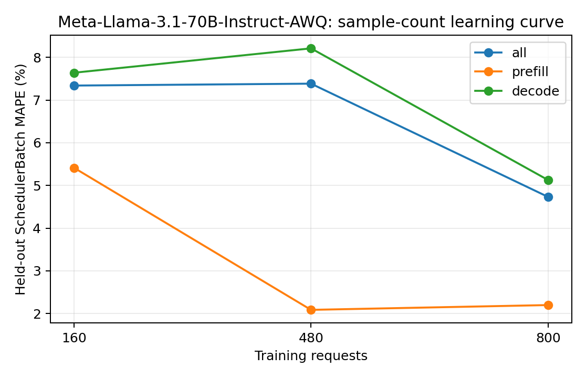

# Meta-Llama-3.1-70B-Instruct-AWQ：训练样本量与独立测试误差

训练集为前 N 组独立采集的真机 trace（每组可含多种负载），测试集固定为未参与训练的五组真实 trace。数值为 teacher-forced SchedulerBatch MAPE，不包含调度反馈。训练和测试的负载设置以采集 metadata 为准，不将所有测试用例统称为同分布。正式模型使用预先确定的全量训练集，不按测试集误差挑选训练量。

| 训练请求数 | 训练 trace 组数 | case | phase | 测试 batch 数 | MAPE | MAE (ms) | P95 APE |
| ---: | ---: | --- | --- | ---: | ---: | ---: | ---: |
| 160 | 1 | all | all | 12674 | 7.3412% | 7.4231 | 17.6908% |
| 160 | 1 | all | prefill | 1711 | 5.4153% | 9.7509 | 22.5798% |
| 160 | 1 | all | decode | 10963 | 7.6417% | 7.0598 | 17.6572% |
| 160 | 1 | latency_128x64_r1 | all | 1945 | 6.3364% | 6.3760 | 12.1299% |
| 160 | 1 | latency_256x128_r1 | all | 2284 | 4.7388% | 5.0050 | 11.3497% |
| 160 | 1 | saturation_1024x256_inf | all | 2415 | 7.8684% | 8.2192 | 17.7190% |
| 160 | 1 | saturation_1536x384_inf | all | 3600 | 9.4752% | 8.8076 | 18.1517% |
| 160 | 1 | service_1024x256_r4 | all | 2430 | 6.9059% | 7.6918 | 16.5173% |
| 480 | 3 | all | all | 12674 | 7.3858% | 7.1201 | 17.4784% |
| 480 | 3 | all | prefill | 1711 | 2.0854% | 4.9420 | 8.6691% |
| 480 | 3 | all | decode | 10963 | 8.2130% | 7.4600 | 17.6030% |
| 480 | 3 | latency_128x64_r1 | all | 1945 | 5.9609% | 5.9922 | 14.1700% |
| 480 | 3 | latency_256x128_r1 | all | 2284 | 5.6495% | 5.4595 | 16.4662% |
| 480 | 3 | saturation_1024x256_inf | all | 2415 | 7.3342% | 7.2115 | 17.7522% |
| 480 | 3 | saturation_1536x384_inf | all | 3600 | 9.8412% | 8.8866 | 17.8494% |
| 480 | 3 | service_1024x256_r4 | all | 2430 | 6.5716% | 6.8758 | 16.6470% |
| 800 | 5 | all | all | 12674 | 4.7316% | 5.2992 | 15.2987% |
| 800 | 5 | all | prefill | 1711 | 2.1976% | 5.8446 | 10.5654% |
| 800 | 5 | all | decode | 10963 | 5.1271% | 5.2141 | 15.6355% |
| 800 | 5 | latency_128x64_r1 | all | 1945 | 6.4891% | 6.4835 | 14.5233% |
| 800 | 5 | latency_256x128_r1 | all | 2284 | 6.1764% | 5.7754 | 16.2496% |
| 800 | 5 | saturation_1024x256_inf | all | 2415 | 5.3439% | 5.6533 | 17.3141% |
| 800 | 5 | saturation_1536x384_inf | all | 3600 | 2.1952% | 3.8169 | 11.4444% |
| 800 | 5 | service_1024x256_r4 | all | 2430 | 5.1161% | 5.7477 | 14.0525% |

