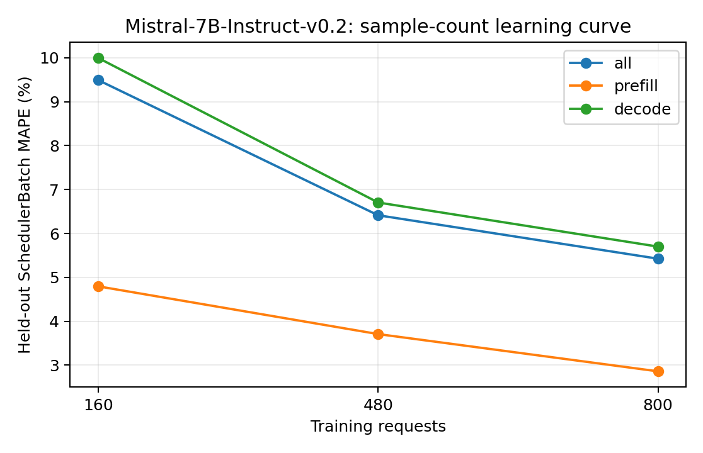

# Mistral-7B-Instruct-v0.2：训练样本量与独立测试误差

训练集为前 N 组独立采集的真机 trace（每组可含多种负载），测试集固定为未参与训练的五组真实 trace。数值为 teacher-forced SchedulerBatch MAPE，不包含调度反馈。训练和测试的负载设置以采集 metadata 为准，不将所有测试用例统称为同分布。正式模型使用预先确定的全量训练集，不按测试集误差挑选训练量。

| 训练请求数 | 训练 trace 组数 | case | phase | 测试 batch 数 | MAPE | MAE (ms) | P95 APE |
| ---: | ---: | --- | --- | ---: | ---: | ---: | ---: |
| 160 | 1 | all | all | 18306 | 9.4934% | 3.3247 | 16.5427% |
| 160 | 1 | all | prefill | 1774 | 4.7955% | 1.4906 | 16.0649% |
| 160 | 1 | all | decode | 16532 | 9.9975% | 3.5215 | 16.5556% |
| 160 | 1 | latency_128x64_r1 | all | 3491 | 8.2361% | 2.8506 | 16.9643% |
| 160 | 1 | latency_256x128_r1 | all | 5160 | 11.3858% | 3.4717 | 15.1870% |
| 160 | 1 | saturation_1024x256_inf | all | 2416 | 7.6642% | 3.4620 | 16.0416% |
| 160 | 1 | saturation_1536x384_inf | all | 3600 | 9.6577% | 3.5786 | 17.2475% |
| 160 | 1 | service_1024x256_r4 | all | 3639 | 9.0680% | 3.2288 | 16.5078% |
| 480 | 3 | all | all | 18306 | 6.4145% | 2.5358 | 15.4455% |
| 480 | 3 | all | prefill | 1774 | 3.7079% | 1.2352 | 13.0798% |
| 480 | 3 | all | decode | 16532 | 6.7049% | 2.6754 | 15.6184% |
| 480 | 3 | latency_128x64_r1 | all | 3491 | 7.5188% | 2.6768 | 16.5324% |
| 480 | 3 | latency_256x128_r1 | all | 5160 | 7.2727% | 2.3941 | 14.5748% |
| 480 | 3 | saturation_1024x256_inf | all | 2416 | 5.5551% | 2.9407 | 12.4367% |
| 480 | 3 | saturation_1536x384_inf | all | 3600 | 5.6561% | 2.5603 | 17.2447% |
| 480 | 3 | service_1024x256_r4 | all | 3639 | 5.4589% | 2.3086 | 13.5918% |
| 800 | 5 | all | all | 18306 | 5.4249% | 2.2839 | 13.2250% |
| 800 | 5 | all | prefill | 1774 | 2.8593% | 0.9591 | 10.0888% |
| 800 | 5 | all | decode | 16532 | 5.7002% | 2.4261 | 13.4195% |
| 800 | 5 | latency_128x64_r1 | all | 3491 | 6.5490% | 2.4981 | 14.9359% |
| 800 | 5 | latency_256x128_r1 | all | 5160 | 4.7777% | 1.7547 | 13.0520% |
| 800 | 5 | saturation_1024x256_inf | all | 2416 | 5.6780% | 2.9396 | 13.6540% |
| 800 | 5 | saturation_1536x384_inf | all | 3600 | 4.4128% | 2.2181 | 8.7445% |
| 800 | 5 | service_1024x256_r4 | all | 3639 | 6.0973% | 2.4587 | 12.5790% |

