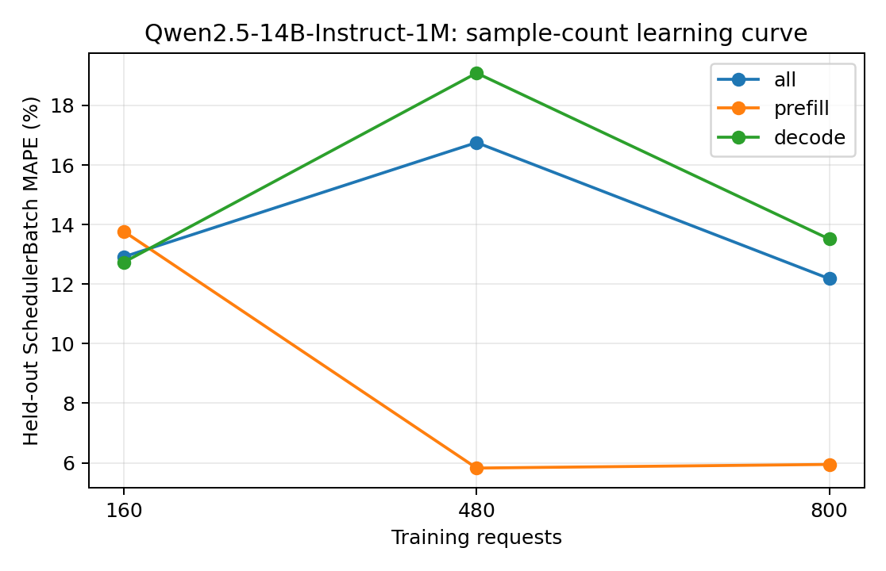

# Qwen2.5-14B-Instruct-1M：训练样本量与独立测试误差

训练集为前 N 组独立采集的真机 trace（每组可含多种负载），测试集固定为未参与训练的五组真实 trace。数值为 teacher-forced SchedulerBatch MAPE，不包含调度反馈。训练和测试的负载设置以采集 metadata 为准，不将所有测试用例统称为同分布。正式模型使用预先确定的全量训练集，不按测试集误差挑选训练量。

| 训练请求数 | 训练 trace 组数 | case | phase | 测试 batch 数 | MAPE | MAE (ms) | P95 APE |
| ---: | ---: | --- | --- | ---: | ---: | ---: | ---: |
| 160 | 1 | all | all | 9974 | 12.9184% | 40.7745 | 29.9100% |
| 160 | 1 | all | prefill | 1755 | 13.7687% | 160.8408 | 27.1402% |
| 160 | 1 | all | decode | 8219 | 12.7368% | 15.1368 | 30.1229% |
| 160 | 1 | latency_128x64_r1 | all | 557 | 3.4792% | 42.6533 | 19.4906% |
| 160 | 1 | latency_256x128_r1 | all | 850 | 14.9827% | 34.0840 | 38.0022% |
| 160 | 1 | saturation_1024x256_inf | all | 2463 | 13.3401% | 41.4314 | 30.1162% |
| 160 | 1 | saturation_1536x384_inf | all | 3641 | 11.3594% | 38.7768 | 25.7545% |
| 160 | 1 | service_1024x256_r4 | all | 2463 | 16.2236% | 44.9548 | 30.7281% |
| 480 | 3 | all | all | 9974 | 16.7550% | 32.3872 | 22.9355% |
| 480 | 3 | all | prefill | 1755 | 5.8244% | 80.2069 | 21.5103% |
| 480 | 3 | all | decode | 8219 | 19.0890% | 22.1763 | 23.6277% |
| 480 | 3 | latency_128x64_r1 | all | 557 | 67.3542% | 75.9704 | 767.5428% |
| 480 | 3 | latency_256x128_r1 | all | 850 | 48.3196% | 64.7010 | 741.1258% |
| 480 | 3 | saturation_1024x256_inf | all | 2463 | 10.8093% | 37.2780 | 21.9492% |
| 480 | 3 | saturation_1536x384_inf | all | 3641 | 12.6221% | 30.6762 | 23.5525% |
| 480 | 3 | service_1024x256_r4 | all | 2463 | 6.4741% | 9.0177 | 21.1286% |
| 800 | 5 | all | all | 9974 | 12.1825% | 27.9257 | 25.9254% |
| 800 | 5 | all | prefill | 1755 | 5.9467% | 81.8359 | 21.6416% |
| 800 | 5 | all | decode | 8219 | 13.5140% | 16.4142 | 26.7035% |
| 800 | 5 | latency_128x64_r1 | all | 557 | 30.3931% | 35.6044 | 342.4731% |
| 800 | 5 | latency_256x128_r1 | all | 850 | 24.3308% | 38.2182 | 331.3003% |
| 800 | 5 | saturation_1024x256_inf | all | 2463 | 10.7561% | 37.4529 | 21.6967% |
| 800 | 5 | saturation_1536x384_inf | all | 3641 | 12.2139% | 31.4561 | 28.3109% |
| 800 | 5 | service_1024x256_r4 | all | 2463 | 5.2517% | 7.8909 | 17.7779% |

