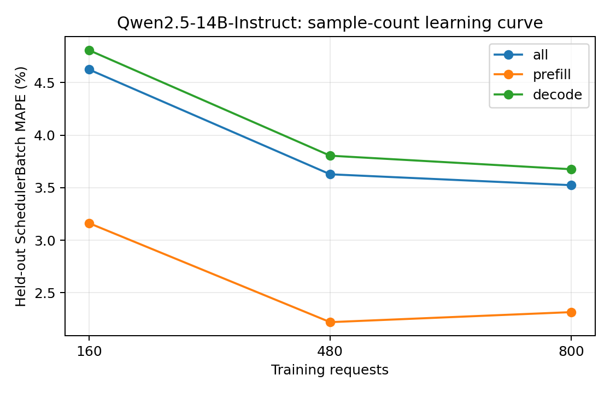

# Qwen2.5-14B-Instruct：训练样本量与独立测试误差

训练集为前 N 组独立采集的真机 trace（每组可含多种负载），测试集固定为未参与训练的五组真实 trace。数值为 teacher-forced SchedulerBatch MAPE，不包含调度反馈。训练和测试的负载设置以采集 metadata 为准，不将所有测试用例统称为同分布。正式模型使用预先确定的全量训练集，不按测试集误差挑选训练量。

| 训练请求数 | 训练 trace 组数 | case | phase | 测试 batch 数 | MAPE | MAE (ms) | P95 APE |
| ---: | ---: | --- | --- | ---: | ---: | ---: | ---: |
| 160 | 1 | all | all | 15701 | 4.6237% | 2.9079 | 14.4682% |
| 160 | 1 | all | prefill | 1753 | 3.1615% | 1.9263 | 11.8231% |
| 160 | 1 | all | decode | 13948 | 4.8074% | 3.0313 | 14.5311% |
| 160 | 1 | latency_128x64_r1 | all | 2957 | 1.2917% | 1.2830 | 2.5313% |
| 160 | 1 | latency_256x128_r1 | all | 3937 | 3.4863% | 2.0744 | 12.7175% |
| 160 | 1 | saturation_1024x256_inf | all | 2418 | 5.7093% | 3.9346 | 12.7535% |
| 160 | 1 | saturation_1536x384_inf | all | 3600 | 7.8994% | 4.2225 | 15.6942% |
| 160 | 1 | service_1024x256_r4 | all | 2789 | 4.5923% | 3.2204 | 12.6569% |
| 480 | 3 | all | all | 15701 | 3.6272% | 2.4651 | 11.4463% |
| 480 | 3 | all | prefill | 1753 | 2.2200% | 1.2293 | 9.6087% |
| 480 | 3 | all | decode | 13948 | 3.8041% | 2.6204 | 11.5154% |
| 480 | 3 | latency_128x64_r1 | all | 2957 | 2.8868% | 1.9051 | 7.0415% |
| 480 | 3 | latency_256x128_r1 | all | 3937 | 4.3431% | 2.3888 | 11.9201% |
| 480 | 3 | saturation_1024x256_inf | all | 2418 | 5.4199% | 3.7834 | 11.3815% |
| 480 | 3 | saturation_1536x384_inf | all | 3600 | 1.9277% | 1.7472 | 4.8242% |
| 480 | 3 | service_1024x256_r4 | all | 2789 | 4.0412% | 2.9500 | 12.5658% |
| 800 | 5 | all | all | 15701 | 3.5236% | 2.4221 | 11.4874% |
| 800 | 5 | all | prefill | 1753 | 2.3154% | 1.2864 | 11.2617% |
| 800 | 5 | all | decode | 13948 | 3.6754% | 2.5649 | 11.4955% |
| 800 | 5 | latency_128x64_r1 | all | 2957 | 2.1217% | 1.6039 | 6.8375% |
| 800 | 5 | latency_256x128_r1 | all | 3937 | 4.0514% | 2.2824 | 12.0520% |
| 800 | 5 | saturation_1024x256_inf | all | 2418 | 4.8205% | 3.5097 | 11.4863% |
| 800 | 5 | saturation_1536x384_inf | all | 3600 | 2.4258% | 1.9406 | 10.2039% |
| 800 | 5 | service_1024x256_r4 | all | 2789 | 4.5572% | 3.1654 | 12.5392% |

