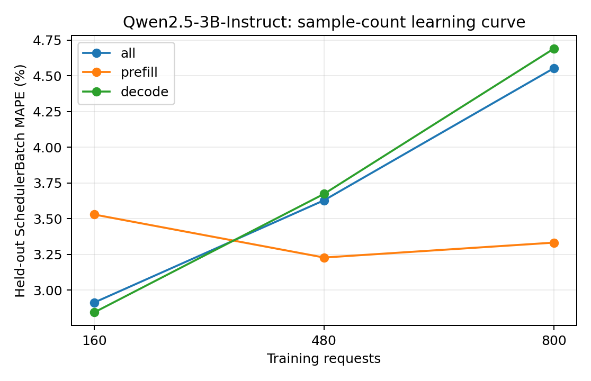

# Qwen2.5-3B-Instruct：训练样本量与独立测试误差

训练集为前 N 组独立采集的真机 trace（每组可含多种负载），测试集固定为未参与训练的五组真实 trace。数值为 teacher-forced SchedulerBatch MAPE，不包含调度反馈。训练和测试的负载设置以采集 metadata 为准，不将所有测试用例统称为同分布。正式模型使用预先确定的全量训练集，不按测试集误差挑选训练量。

| 训练请求数 | 训练 trace 组数 | case | phase | 测试 batch 数 | MAPE | MAE (ms) | P95 APE |
| ---: | ---: | --- | --- | ---: | ---: | ---: | ---: |
| 160 | 1 | all | all | 17628 | 2.9140% | 1.7883 | 10.1740% |
| 160 | 1 | all | prefill | 1776 | 3.5289% | 1.1533 | 11.2723% |
| 160 | 1 | all | decode | 15852 | 2.8451% | 1.8595 | 9.9560% |
| 160 | 1 | latency_128x64_r1 | all | 3329 | 1.5966% | 1.1948 | 3.6211% |
| 160 | 1 | latency_256x128_r1 | all | 4725 | 2.4209% | 1.3024 | 11.0886% |
| 160 | 1 | saturation_1024x256_inf | all | 2418 | 4.8058% | 3.0032 | 10.8503% |
| 160 | 1 | saturation_1536x384_inf | all | 3600 | 3.2300% | 2.0000 | 9.8103% |
| 160 | 1 | service_1024x256_r4 | all | 3556 | 3.1961% | 1.9492 | 7.3998% |
| 480 | 3 | all | all | 17628 | 3.6286% | 2.0149 | 12.6764% |
| 480 | 3 | all | prefill | 1776 | 3.2283% | 1.0763 | 12.6742% |
| 480 | 3 | all | decode | 15852 | 3.6735% | 2.1201 | 12.6757% |
| 480 | 3 | latency_128x64_r1 | all | 3329 | 1.8294% | 1.2683 | 3.8332% |
| 480 | 3 | latency_256x128_r1 | all | 4725 | 2.8606% | 1.4453 | 12.6530% |
| 480 | 3 | saturation_1024x256_inf | all | 2418 | 5.5007% | 3.2196 | 14.1951% |
| 480 | 3 | saturation_1536x384_inf | all | 3600 | 3.9893% | 2.2545 | 12.3950% |
| 480 | 3 | service_1024x256_r4 | all | 3556 | 4.6955% | 2.4091 | 14.4859% |
| 800 | 5 | all | all | 17628 | 4.5521% | 2.2861 | 12.6023% |
| 800 | 5 | all | prefill | 1776 | 3.3325% | 1.1068 | 12.7175% |
| 800 | 5 | all | decode | 15852 | 4.6887% | 2.4183 | 12.5938% |
| 800 | 5 | latency_128x64_r1 | all | 3329 | 2.9547% | 1.6078 | 11.3814% |
| 800 | 5 | latency_256x128_r1 | all | 4725 | 3.2660% | 1.5532 | 12.1551% |
| 800 | 5 | saturation_1024x256_inf | all | 2418 | 6.5148% | 3.5146 | 13.7293% |
| 800 | 5 | saturation_1536x384_inf | all | 3600 | 5.8572% | 2.8074 | 11.8437% |
| 800 | 5 | service_1024x256_r4 | all | 3556 | 5.1006% | 2.5321 | 14.8091% |

