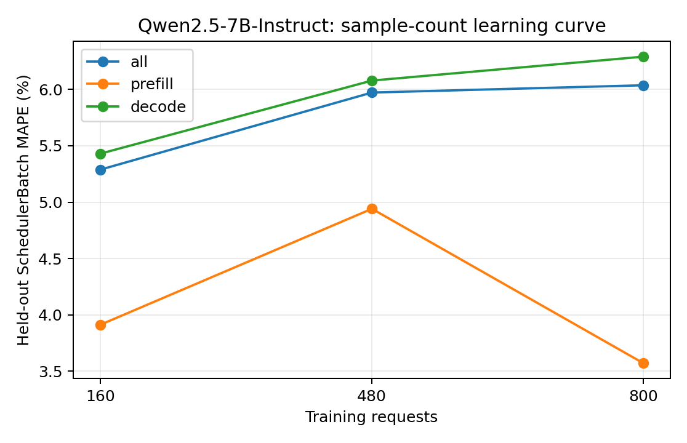

# Qwen2.5-7B-Instruct：训练样本量与独立测试误差

训练集为前 N 组独立采集的真机 trace（每组可含多种负载），测试集固定为未参与训练的五组真实 trace。数值为 teacher-forced SchedulerBatch MAPE，不包含调度反馈。训练和测试的负载设置以采集 metadata 为准，不将所有测试用例统称为同分布。正式模型使用预先确定的全量训练集，不按测试集误差挑选训练量。

| 训练请求数 | 训练 trace 组数 | case | phase | 测试 batch 数 | MAPE | MAE (ms) | P95 APE |
| ---: | ---: | --- | --- | ---: | ---: | ---: | ---: |
| 160 | 1 | all | all | 19018 | 5.2889% | 2.1677 | 13.8085% |
| 160 | 1 | all | prefill | 1776 | 3.9121% | 1.2716 | 14.8085% |
| 160 | 1 | all | decode | 17242 | 5.4308% | 2.2600 | 13.7715% |
| 160 | 1 | latency_128x64_r1 | all | 3550 | 7.7359% | 2.6944 | 13.7665% |
| 160 | 1 | latency_256x128_r1 | all | 5489 | 3.2695% | 1.2552 | 12.2753% |
| 160 | 1 | saturation_1024x256_inf | all | 2418 | 6.0886% | 2.9998 | 14.6237% |
| 160 | 1 | saturation_1536x384_inf | all | 3600 | 4.0257% | 2.0662 | 15.0152% |
| 160 | 1 | service_1024x256_r4 | all | 3961 | 6.5543% | 2.5446 | 14.0168% |
| 480 | 3 | all | all | 19018 | 5.9729% | 2.3093 | 14.4223% |
| 480 | 3 | all | prefill | 1776 | 4.9407% | 1.6841 | 19.4117% |
| 480 | 3 | all | decode | 17242 | 6.0792% | 2.3737 | 14.3689% |
| 480 | 3 | latency_128x64_r1 | all | 3550 | 6.3021% | 2.2016 | 14.6610% |
| 480 | 3 | latency_256x128_r1 | all | 5489 | 8.3288% | 2.4045 | 14.6246% |
| 480 | 3 | saturation_1024x256_inf | all | 2418 | 5.5692% | 2.9135 | 14.6122% |
| 480 | 3 | saturation_1536x384_inf | all | 3600 | 4.3673% | 2.2384 | 14.2296% |
| 480 | 3 | service_1024x256_r4 | all | 3961 | 4.1187% | 1.9695 | 13.0986% |
| 800 | 5 | all | all | 19018 | 6.0373% | 2.2958 | 14.1702% |
| 800 | 5 | all | prefill | 1776 | 3.5704% | 1.1499 | 12.7874% |
| 800 | 5 | all | decode | 17242 | 6.2914% | 2.4138 | 14.2120% |
| 800 | 5 | latency_128x64_r1 | all | 3550 | 6.8188% | 2.3342 | 14.6238% |
| 800 | 5 | latency_256x128_r1 | all | 5489 | 7.6362% | 2.2379 | 14.4535% |
| 800 | 5 | saturation_1024x256_inf | all | 2418 | 7.0021% | 3.2126 | 14.5388% |
| 800 | 5 | saturation_1536x384_inf | all | 3600 | 4.7342% | 2.2096 | 13.4153% |
| 800 | 5 | service_1024x256_r4 | all | 3961 | 3.7165% | 1.8601 | 12.3254% |

