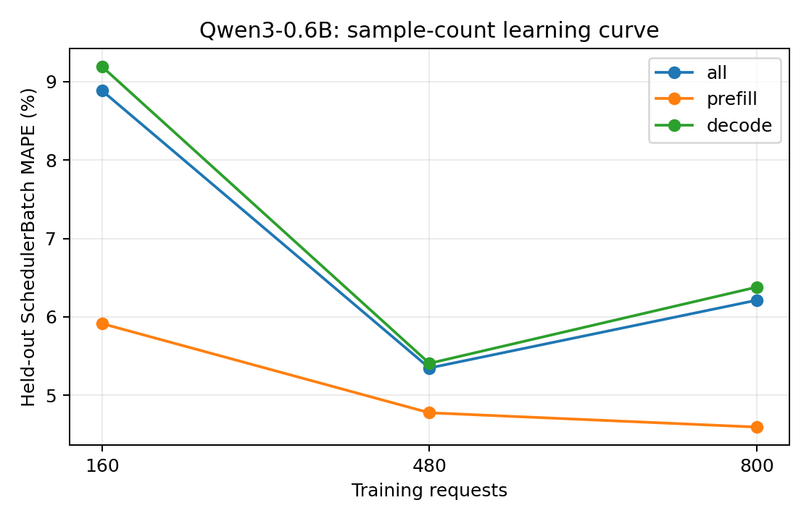

# Qwen3-0.6B：训练样本量与独立测试误差

训练集为前 N 组独立采集的真机 trace（每组可含多种负载），测试集固定为未参与训练的五组真实 trace。数值为 teacher-forced SchedulerBatch MAPE，不包含调度反馈。训练和测试的负载设置以采集 metadata 为准，不将所有测试用例统称为同分布。正式模型使用预先确定的全量训练集，不按测试集误差挑选训练量。

| 训练请求数 | 训练 trace 组数 | case | phase | 测试 batch 数 | MAPE | MAE (ms) | P95 APE |
| ---: | ---: | --- | --- | ---: | ---: | ---: | ---: |
| 160 | 1 | all | all | 19080 | 8.8852% | 3.0212 | 19.1170% |
| 160 | 1 | all | prefill | 1786 | 5.9141% | 1.6451 | 18.2576% |
| 160 | 1 | all | decode | 17294 | 9.1920% | 3.1633 | 19.1492% |
| 160 | 1 | latency_128x64_r1 | all | 3542 | 13.0145% | 3.9030 | 18.7649% |
| 160 | 1 | latency_256x128_r1 | all | 5451 | 16.1020% | 4.3743 | 20.1003% |
| 160 | 1 | saturation_1024x256_inf | all | 2420 | 3.8675% | 2.4981 | 13.2063% |
| 160 | 1 | saturation_1536x384_inf | all | 3600 | 4.1017% | 2.0735 | 12.5659% |
| 160 | 1 | service_1024x256_r4 | all | 4067 | 2.8360% | 1.5896 | 8.3815% |
| 480 | 3 | all | all | 19080 | 5.3479% | 2.1655 | 14.8593% |
| 480 | 3 | all | prefill | 1786 | 4.7767% | 1.3792 | 14.4706% |
| 480 | 3 | all | decode | 17294 | 5.4069% | 2.2467 | 14.8869% |
| 480 | 3 | latency_128x64_r1 | all | 3542 | 6.6619% | 2.3896 | 16.0321% |
| 480 | 3 | latency_256x128_r1 | all | 5451 | 5.5888% | 1.8247 | 16.7881% |
| 480 | 3 | saturation_1024x256_inf | all | 2420 | 4.1154% | 2.5300 | 11.7337% |
| 480 | 3 | saturation_1536x384_inf | all | 3600 | 4.6982% | 2.2190 | 12.6767% |
| 480 | 3 | service_1024x256_r4 | all | 4067 | 5.1891% | 2.1631 | 14.3050% |
| 800 | 5 | all | all | 19080 | 6.2124% | 2.3704 | 15.1770% |
| 800 | 5 | all | prefill | 1786 | 4.5943% | 1.3365 | 14.4840% |
| 800 | 5 | all | decode | 17294 | 6.3795% | 2.4771 | 15.2377% |
| 800 | 5 | latency_128x64_r1 | all | 3542 | 6.6583% | 2.3725 | 15.6249% |
| 800 | 5 | latency_256x128_r1 | all | 5451 | 7.2335% | 2.2192 | 16.2112% |
| 800 | 5 | saturation_1024x256_inf | all | 2420 | 5.2525% | 2.8170 | 13.0521% |
| 800 | 5 | saturation_1536x384_inf | all | 3600 | 4.8884% | 2.2471 | 12.8142% |
| 800 | 5 | service_1024x256_r4 | all | 4067 | 6.1988% | 2.4145 | 14.6189% |

