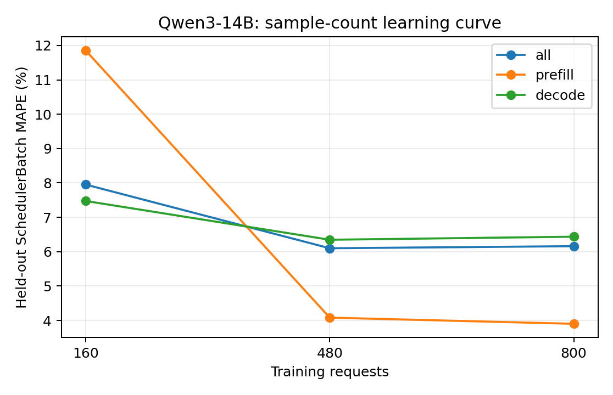

# Qwen3-14B：训练样本量与独立测试误差

训练集为前 N 组独立采集的真机 trace（每组可含多种负载），测试集固定为未参与训练的五组真实 trace。数值为 teacher-forced SchedulerBatch MAPE，不包含调度反馈。训练和测试的负载设置以采集 metadata 为准，不将所有测试用例统称为同分布。正式模型使用预先确定的全量训练集，不按测试集误差挑选训练量。

| 训练请求数 | 训练 trace 组数 | case | phase | 测试 batch 数 | MAPE | MAE (ms) | P95 APE |
| ---: | ---: | --- | --- | ---: | ---: | ---: | ---: |
| 160 | 1 | all | all | 16069 | 7.9525% | 4.3766 | 21.4923% |
| 160 | 1 | all | prefill | 1752 | 11.8527% | 8.3814 | 43.1782% |
| 160 | 1 | all | decode | 14317 | 7.4752% | 3.8865 | 21.0857% |
| 160 | 1 | latency_128x64_r1 | all | 3038 | 5.9532% | 3.1889 | 13.8119% |
| 160 | 1 | latency_256x128_r1 | all | 4169 | 5.9297% | 2.9241 | 13.9330% |
| 160 | 1 | saturation_1024x256_inf | all | 2418 | 7.2922% | 5.1965 | 19.7740% |
| 160 | 1 | saturation_1536x384_inf | all | 3600 | 11.7143% | 5.6957 | 22.5073% |
| 160 | 1 | service_1024x256_r4 | all | 2844 | 8.8530% | 5.4076 | 20.3457% |
| 480 | 3 | all | all | 16069 | 6.1000% | 3.4331 | 14.3444% |
| 480 | 3 | all | prefill | 1752 | 4.0810% | 3.1340 | 17.3837% |
| 480 | 3 | all | decode | 14317 | 6.3471% | 3.4697 | 14.3253% |
| 480 | 3 | latency_128x64_r1 | all | 3038 | 5.5570% | 3.0291 | 13.5065% |
| 480 | 3 | latency_256x128_r1 | all | 4169 | 5.6078% | 2.7683 | 12.8862% |
| 480 | 3 | saturation_1024x256_inf | all | 2418 | 5.9302% | 4.3091 | 17.9001% |
| 480 | 3 | saturation_1536x384_inf | all | 3600 | 6.5673% | 3.4034 | 14.6641% |
| 480 | 3 | service_1024x256_r4 | all | 2844 | 6.9546% | 4.1322 | 15.7669% |
| 800 | 5 | all | all | 16069 | 6.1600% | 3.4244 | 14.1536% |
| 800 | 5 | all | prefill | 1752 | 3.9022% | 3.0526 | 17.2031% |
| 800 | 5 | all | decode | 14317 | 6.4363% | 3.4699 | 14.1265% |
| 800 | 5 | latency_128x64_r1 | all | 3038 | 6.2515% | 3.2110 | 14.4428% |
| 800 | 5 | latency_256x128_r1 | all | 4169 | 6.8356% | 3.1409 | 14.4996% |
| 800 | 5 | saturation_1024x256_inf | all | 2418 | 5.0044% | 3.9800 | 13.3630% |
| 800 | 5 | saturation_1536x384_inf | all | 3600 | 6.3992% | 3.3451 | 12.8401% |
| 800 | 5 | service_1024x256_r4 | all | 2844 | 5.7516% | 3.6957 | 15.3300% |

