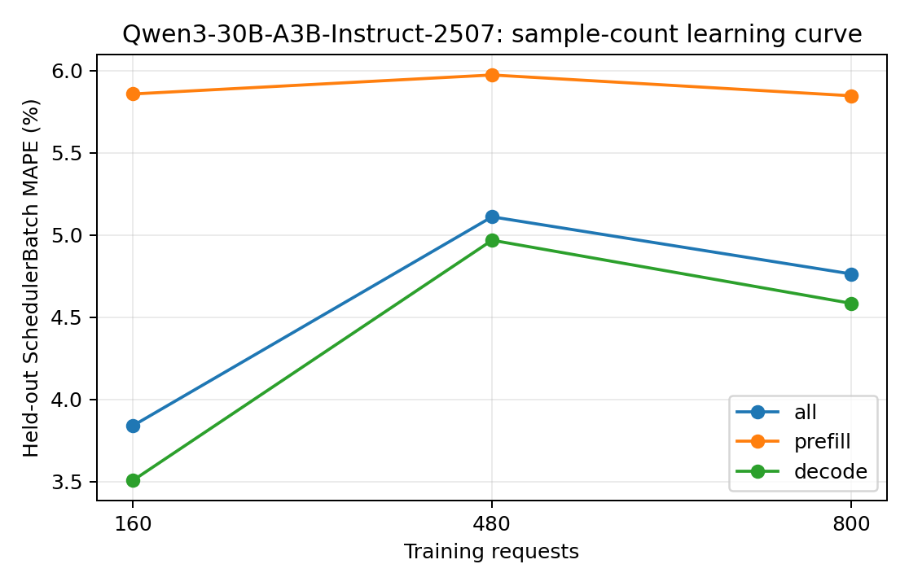

# Qwen3-30B-A3B-Instruct-2507：训练样本量与独立测试误差

训练集为前 N 组独立采集的真机 trace（每组可含多种负载），测试集固定为未参与训练的五组真实 trace。数值为 teacher-forced SchedulerBatch MAPE，不包含调度反馈。训练和测试的负载设置以采集 metadata 为准，不将所有测试用例统称为同分布。正式模型使用预先确定的全量训练集，不按测试集误差挑选训练量。

| 训练请求数 | 训练 trace 组数 | case | phase | 测试 batch 数 | MAPE | MAE (ms) | P95 APE |
| ---: | ---: | --- | --- | ---: | ---: | ---: | ---: |
| 160 | 1 | all | all | 12188 | 3.8398% | 11.9403 | 9.7863% |
| 160 | 1 | all | prefill | 1727 | 5.8584% | 23.6905 | 11.6770% |
| 160 | 1 | all | decode | 10461 | 3.5066% | 10.0005 | 9.5060% |
| 160 | 1 | latency_128x64_r1 | all | 1638 | 4.1896% | 16.4676 | 9.8643% |
| 160 | 1 | latency_256x128_r1 | all | 2055 | 3.1712% | 13.0508 | 8.9489% |
| 160 | 1 | saturation_1024x256_inf | all | 2418 | 3.6226% | 11.6416 | 9.7770% |
| 160 | 1 | saturation_1536x384_inf | all | 3600 | 3.4690% | 8.9369 | 9.4947% |
| 160 | 1 | service_1024x256_r4 | all | 2477 | 4.9143% | 12.6821 | 10.3049% |
| 480 | 3 | all | all | 12188 | 5.1107% | 12.9795 | 10.4207% |
| 480 | 3 | all | prefill | 1727 | 5.9740% | 23.7394 | 11.3988% |
| 480 | 3 | all | decode | 10461 | 4.9682% | 11.2032 | 10.3136% |
| 480 | 3 | latency_128x64_r1 | all | 1638 | 6.0835% | 18.0079 | 10.5472% |
| 480 | 3 | latency_256x128_r1 | all | 2055 | 5.3779% | 14.8999 | 10.8043% |
| 480 | 3 | saturation_1024x256_inf | all | 2418 | 3.8820% | 11.8587 | 10.3120% |
| 480 | 3 | saturation_1536x384_inf | all | 3600 | 5.3851% | 10.4799 | 10.3381% |
| 480 | 3 | service_1024x256_r4 | all | 2477 | 5.0463% | 12.7881 | 10.4139% |
| 800 | 5 | all | all | 12188 | 4.7631% | 12.6996 | 10.1929% |
| 800 | 5 | all | prefill | 1727 | 5.8474% | 23.6840 | 11.4955% |
| 800 | 5 | all | decode | 10461 | 4.5840% | 10.8862 | 9.9303% |
| 800 | 5 | latency_128x64_r1 | all | 1638 | 5.4475% | 17.5435 | 10.7801% |
| 800 | 5 | latency_256x128_r1 | all | 2055 | 3.8337% | 13.6250 | 10.3369% |
| 800 | 5 | saturation_1024x256_inf | all | 2418 | 3.6546% | 11.6673 | 10.0065% |
| 800 | 5 | saturation_1536x384_inf | all | 3600 | 5.5685% | 10.6246 | 9.4339% |
| 800 | 5 | service_1024x256_r4 | all | 2477 | 4.9930% | 12.7520 | 10.4203% |

