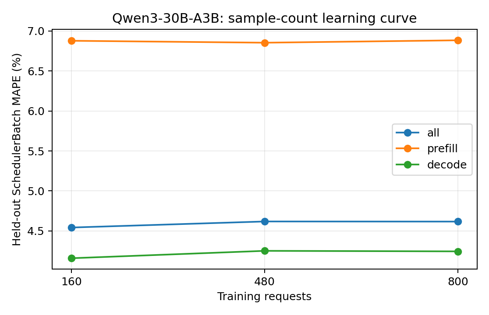

# Qwen3-30B-A3B：训练样本量与独立测试误差

训练集为前 N 组独立采集的真机 trace（每组可含多种负载），测试集固定为未参与训练的五组真实 trace。数值为 teacher-forced SchedulerBatch MAPE，不包含调度反馈。训练和测试的负载设置以采集 metadata 为准，不将所有测试用例统称为同分布。正式模型使用预先确定的全量训练集，不按测试集误差挑选训练量。

| 训练请求数 | 训练 trace 组数 | case | phase | 测试 batch 数 | MAPE | MAE (ms) | P95 APE |
| ---: | ---: | --- | --- | ---: | ---: | ---: | ---: |
| 160 | 1 | all | all | 12223 | 4.5418% | 12.5550 | 9.8199% |
| 160 | 1 | all | prefill | 1725 | 6.8784% | 24.1931 | 11.5181% |
| 160 | 1 | all | decode | 10498 | 4.1579% | 10.6426 | 9.4267% |
| 160 | 1 | latency_128x64_r1 | all | 1659 | 3.8991% | 16.0746 | 9.9196% |
| 160 | 1 | latency_256x128_r1 | all | 2069 | 5.3774% | 15.1264 | 9.9132% |
| 160 | 1 | saturation_1024x256_inf | all | 2418 | 3.7678% | 11.7266 | 9.1285% |
| 160 | 1 | saturation_1536x384_inf | all | 3600 | 4.9360% | 10.2548 | 9.8060% |
| 160 | 1 | service_1024x256_r4 | all | 2477 | 4.4570% | 12.2014 | 9.9424% |
| 480 | 3 | all | all | 12223 | 4.6175% | 12.6365 | 10.1860% |
| 480 | 3 | all | prefill | 1725 | 6.8542% | 24.1698 | 11.4230% |
| 480 | 3 | all | decode | 10498 | 4.2500% | 10.7414 | 9.8488% |
| 480 | 3 | latency_128x64_r1 | all | 1659 | 3.9304% | 16.0866 | 9.4818% |
| 480 | 3 | latency_256x128_r1 | all | 2069 | 5.4280% | 15.1656 | 9.7973% |
| 480 | 3 | saturation_1024x256_inf | all | 2418 | 3.7243% | 11.6996 | 9.7764% |
| 480 | 3 | saturation_1536x384_inf | all | 3600 | 5.2079% | 10.5390 | 11.0049% |
| 480 | 3 | service_1024x256_r4 | all | 2477 | 4.4145% | 12.1764 | 9.8133% |
| 800 | 5 | all | all | 12223 | 4.6161% | 12.6342 | 10.1843% |
| 800 | 5 | all | prefill | 1725 | 6.8843% | 24.1886 | 11.5254% |
| 800 | 5 | all | decode | 10498 | 4.2434% | 10.7356 | 9.8828% |
| 800 | 5 | latency_128x64_r1 | all | 1659 | 4.0483% | 16.1953 | 10.0269% |
| 800 | 5 | latency_256x128_r1 | all | 2069 | 5.4987% | 15.2324 | 10.3348% |
| 800 | 5 | saturation_1024x256_inf | all | 2418 | 3.7221% | 11.6983 | 9.6739% |
| 800 | 5 | saturation_1536x384_inf | all | 3600 | 5.0584% | 10.3989 | 10.6353% |
| 800 | 5 | service_1024x256_r4 | all | 2477 | 4.4892% | 12.2411 | 9.7882% |

