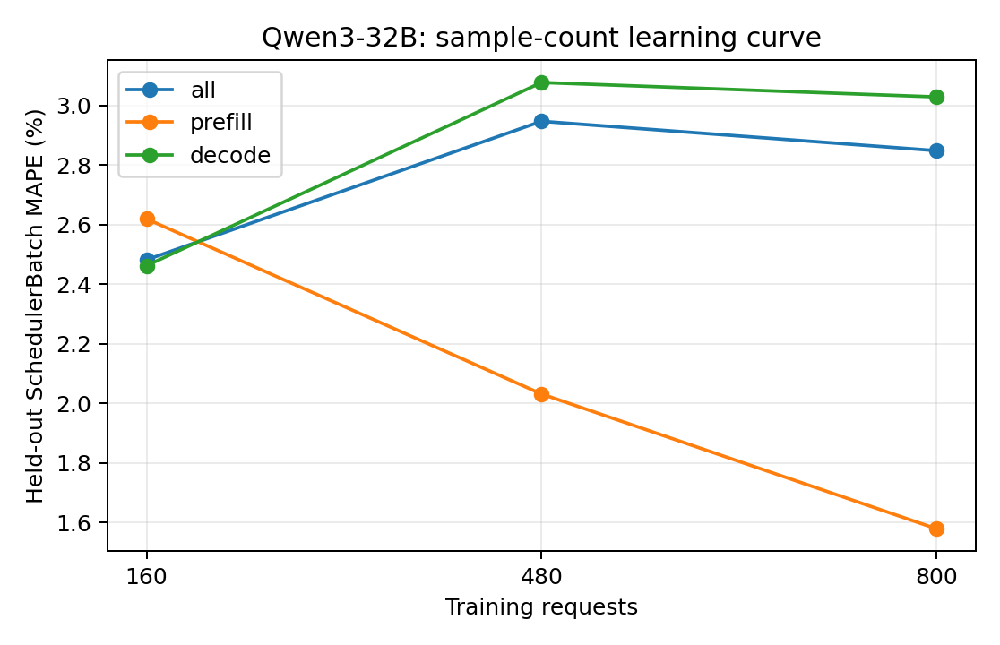

# Qwen3-32B：训练样本量与独立测试误差

训练集为前 N 组独立采集的真机 trace（每组可含多种负载），测试集固定为未参与训练的五组真实 trace。数值为 teacher-forced SchedulerBatch MAPE，不包含调度反馈。训练和测试的负载设置以采集 metadata 为准，不将所有测试用例统称为同分布。正式模型使用预先确定的全量训练集，不按测试集误差挑选训练量。

| 训练请求数 | 训练 trace 组数 | case | phase | 测试 batch 数 | MAPE | MAE (ms) | P95 APE |
| ---: | ---: | --- | --- | ---: | ---: | ---: | ---: |
| 160 | 1 | all | all | 13889 | 2.4820% | 2.7140 | 12.4244% |
| 160 | 1 | all | prefill | 1729 | 2.6193% | 3.2020 | 7.1658% |
| 160 | 1 | all | decode | 12160 | 2.4625% | 2.6446 | 12.4687% |
| 160 | 1 | latency_128x64_r1 | all | 2410 | 4.1737% | 3.5773 | 14.2522% |
| 160 | 1 | latency_256x128_r1 | all | 2957 | 3.2417% | 2.7990 | 12.4106% |
| 160 | 1 | saturation_1024x256_inf | all | 2418 | 1.7042% | 2.5704 | 3.3897% |
| 160 | 1 | saturation_1536x384_inf | all | 3600 | 1.9626% | 2.4181 | 3.8263% |
| 160 | 1 | service_1024x256_r4 | all | 2504 | 1.4544% | 2.3470 | 3.0738% |
| 480 | 3 | all | all | 13889 | 2.9470% | 2.9064 | 11.8907% |
| 480 | 3 | all | prefill | 1729 | 2.0317% | 2.3815 | 6.9041% |
| 480 | 3 | all | decode | 12160 | 3.0772% | 2.9810 | 12.0008% |
| 480 | 3 | latency_128x64_r1 | all | 2410 | 4.1914% | 3.5739 | 13.8985% |
| 480 | 3 | latency_256x128_r1 | all | 2957 | 3.2967% | 2.7966 | 12.3073% |
| 480 | 3 | saturation_1024x256_inf | all | 2418 | 2.1579% | 2.7144 | 6.3145% |
| 480 | 3 | saturation_1536x384_inf | all | 3600 | 2.9014% | 2.8483 | 7.9005% |
| 480 | 3 | service_1024x256_r4 | all | 2504 | 2.1642% | 2.6625 | 6.0351% |
| 800 | 5 | all | all | 13889 | 2.8484% | 2.8172 | 12.2523% |
| 800 | 5 | all | prefill | 1729 | 1.5793% | 1.8409 | 4.8824% |
| 800 | 5 | all | decode | 12160 | 3.0288% | 2.9561 | 12.3851% |
| 800 | 5 | latency_128x64_r1 | all | 2410 | 4.0750% | 3.5129 | 13.7524% |
| 800 | 5 | latency_256x128_r1 | all | 2957 | 3.2014% | 2.7399 | 12.3197% |
| 800 | 5 | saturation_1024x256_inf | all | 2418 | 2.2349% | 2.7213 | 7.3254% |
| 800 | 5 | saturation_1536x384_inf | all | 3600 | 2.5577% | 2.5749 | 10.3666% |
| 800 | 5 | service_1024x256_r4 | all | 2504 | 2.2612% | 2.6802 | 7.0263% |

