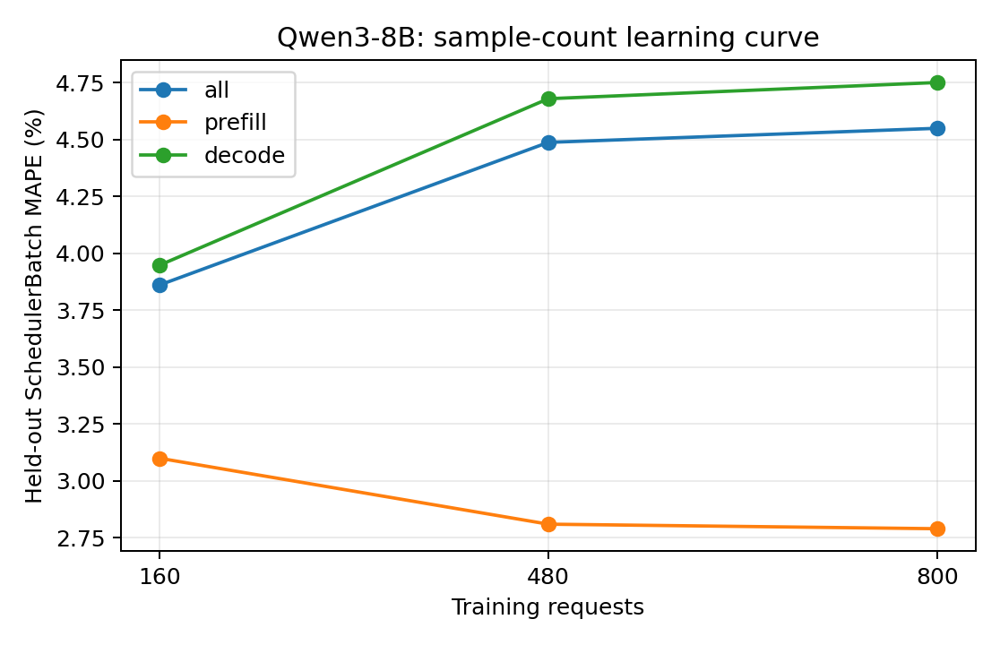

# Qwen3-8B：训练样本量与独立测试误差

训练集为前 N 组独立采集的真机 trace（每组可含多种负载），测试集固定为未参与训练的五组真实 trace。数值为 teacher-forced SchedulerBatch MAPE，不包含调度反馈。训练和测试的负载设置以采集 metadata 为准，不将所有测试用例统称为同分布。正式模型使用预先确定的全量训练集，不按测试集误差挑选训练量。

| 训练请求数 | 训练 trace 组数 | case | phase | 测试 batch 数 | MAPE | MAE (ms) | P95 APE |
| ---: | ---: | --- | --- | ---: | ---: | ---: | ---: |
| 160 | 1 | all | all | 17291 | 3.8602% | 2.1993 | 12.4206% |
| 160 | 1 | all | prefill | 1775 | 3.0988% | 1.2158 | 12.2860% |
| 160 | 1 | all | decode | 15516 | 3.9473% | 2.3118 | 12.4248% |
| 160 | 1 | latency_128x64_r1 | all | 3252 | 3.7783% | 2.0639 | 12.3672% |
| 160 | 1 | latency_256x128_r1 | all | 4628 | 2.8657% | 1.4829 | 11.4886% |
| 160 | 1 | saturation_1024x256_inf | all | 2418 | 1.6293% | 1.9038 | 3.0122% |
| 160 | 1 | saturation_1536x384_inf | all | 3600 | 7.2944% | 3.5322 | 13.2860% |
| 160 | 1 | service_1024x256_r4 | all | 3393 | 3.2415% | 2.1026 | 11.9609% |
| 480 | 3 | all | all | 17291 | 4.4868% | 2.3821 | 12.8912% |
| 480 | 3 | all | prefill | 1775 | 2.8092% | 1.0931 | 11.8775% |
| 480 | 3 | all | decode | 15516 | 4.6787% | 2.5295 | 12.9286% |
| 480 | 3 | latency_128x64_r1 | all | 3252 | 3.7167% | 2.0459 | 12.5136% |
| 480 | 3 | latency_256x128_r1 | all | 4628 | 2.8741% | 1.4850 | 11.4944% |
| 480 | 3 | saturation_1024x256_inf | all | 2418 | 4.0862% | 2.6634 | 11.6770% |
| 480 | 3 | saturation_1536x384_inf | all | 3600 | 7.2499% | 3.4875 | 13.5830% |
| 480 | 3 | service_1024x256_r4 | all | 3393 | 4.7782% | 2.5545 | 13.0879% |
| 800 | 5 | all | all | 17291 | 4.5486% | 2.3987 | 12.3886% |
| 800 | 5 | all | prefill | 1775 | 2.7892% | 1.0884 | 12.1746% |
| 800 | 5 | all | decode | 15516 | 4.7498% | 2.5486 | 12.4122% |
| 800 | 5 | latency_128x64_r1 | all | 3252 | 5.0197% | 2.4284 | 13.3866% |
| 800 | 5 | latency_256x128_r1 | all | 4628 | 3.5605% | 1.6880 | 11.8197% |
| 800 | 5 | saturation_1024x256_inf | all | 2418 | 2.6736% | 2.2227 | 7.8890% |
| 800 | 5 | saturation_1536x384_inf | all | 3600 | 7.0729% | 3.4413 | 12.8001% |
| 800 | 5 | service_1024x256_r4 | all | 3393 | 4.1026% | 2.3587 | 11.3702% |

