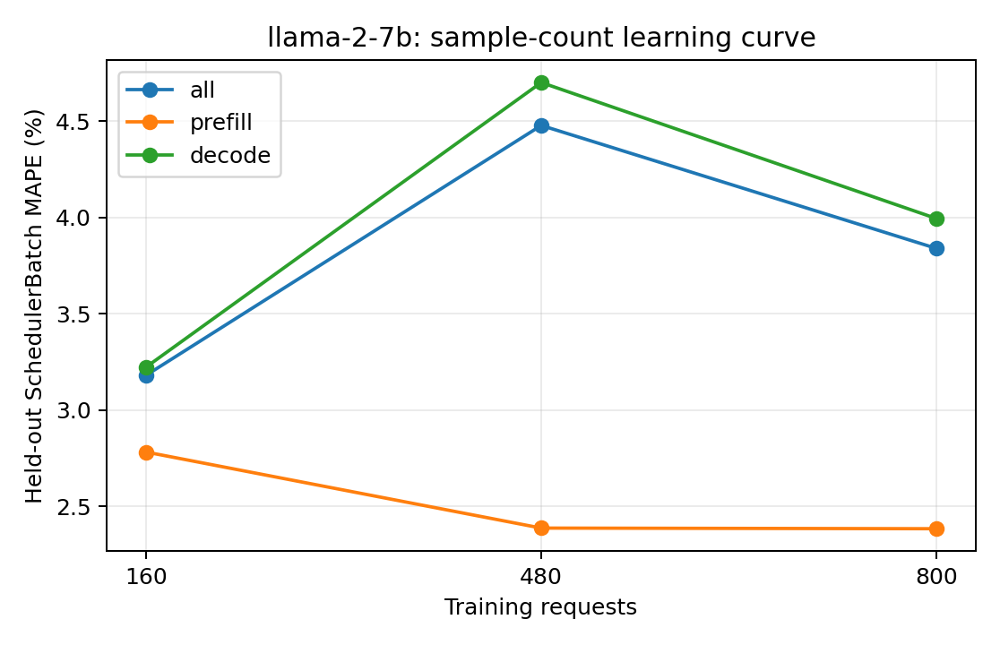

# llama-2-7b：训练样本量与独立测试误差

训练集为前 N 组独立采集的真机 trace（每组可含多种负载），测试集固定为未参与训练的五组真实 trace。数值为 teacher-forced SchedulerBatch MAPE，不包含调度反馈。训练和测试的负载设置以采集 metadata 为准，不将所有测试用例统称为同分布。正式模型使用预先确定的全量训练集，不按测试集误差挑选训练量。

| 训练请求数 | 训练 trace 组数 | case | phase | 测试 batch 数 | MAPE | MAE (ms) | P95 APE |
| ---: | ---: | --- | --- | ---: | ---: | ---: | ---: |
| 160 | 1 | all | all | 18500 | 3.1818% | 1.7104 | 11.1389% |
| 160 | 1 | all | prefill | 1782 | 2.7826% | 0.9839 | 9.9559% |
| 160 | 1 | all | decode | 16718 | 3.2243% | 1.7878 | 11.1836% |
| 160 | 1 | latency_128x64_r1 | all | 3607 | 1.5885% | 1.0329 | 3.1282% |
| 160 | 1 | latency_256x128_r1 | all | 5221 | 2.7844% | 1.2258 | 11.6194% |
| 160 | 1 | saturation_1024x256_inf | all | 2419 | 4.0648% | 2.5973 | 13.8313% |
| 160 | 1 | saturation_1536x384_inf | all | 3600 | 4.1072% | 2.2103 | 11.2075% |
| 160 | 1 | service_1024x256_r4 | all | 3653 | 3.8262% | 1.9919 | 9.2465% |
| 480 | 3 | all | all | 18500 | 4.4788% | 2.0280 | 11.6190% |
| 480 | 3 | all | prefill | 1782 | 2.3879% | 0.8208 | 9.4012% |
| 480 | 3 | all | decode | 16718 | 4.7017% | 2.1567 | 11.7249% |
| 480 | 3 | latency_128x64_r1 | all | 3607 | 2.3913% | 1.2408 | 8.7470% |
| 480 | 3 | latency_256x128_r1 | all | 5221 | 5.0603% | 1.7994 | 11.7063% |
| 480 | 3 | saturation_1024x256_inf | all | 2419 | 5.6447% | 2.9826 | 13.9857% |
| 480 | 3 | saturation_1536x384_inf | all | 3600 | 5.4963% | 2.5264 | 11.4217% |
| 480 | 3 | service_1024x256_r4 | all | 3653 | 3.9342% | 2.0087 | 9.7229% |
| 800 | 5 | all | all | 18500 | 3.8403% | 1.8670 | 11.8559% |
| 800 | 5 | all | prefill | 1782 | 2.3846% | 0.8082 | 9.8183% |
| 800 | 5 | all | decode | 16718 | 3.9955% | 1.9799 | 11.9390% |
| 800 | 5 | latency_128x64_r1 | all | 3607 | 2.0552% | 1.1542 | 8.0446% |
| 800 | 5 | latency_256x128_r1 | all | 5221 | 4.1966% | 1.5913 | 12.0633% |
| 800 | 5 | saturation_1024x256_inf | all | 2419 | 4.8931% | 2.7702 | 13.9633% |
| 800 | 5 | saturation_1536x384_inf | all | 3600 | 4.2230% | 2.2135 | 11.2745% |
| 800 | 5 | service_1024x256_r4 | all | 3653 | 4.0195% | 2.0254 | 10.1885% |

