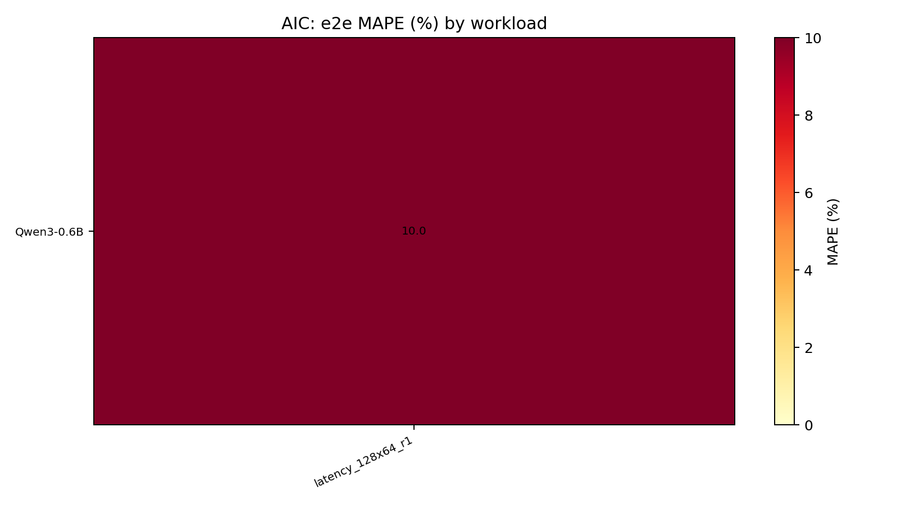
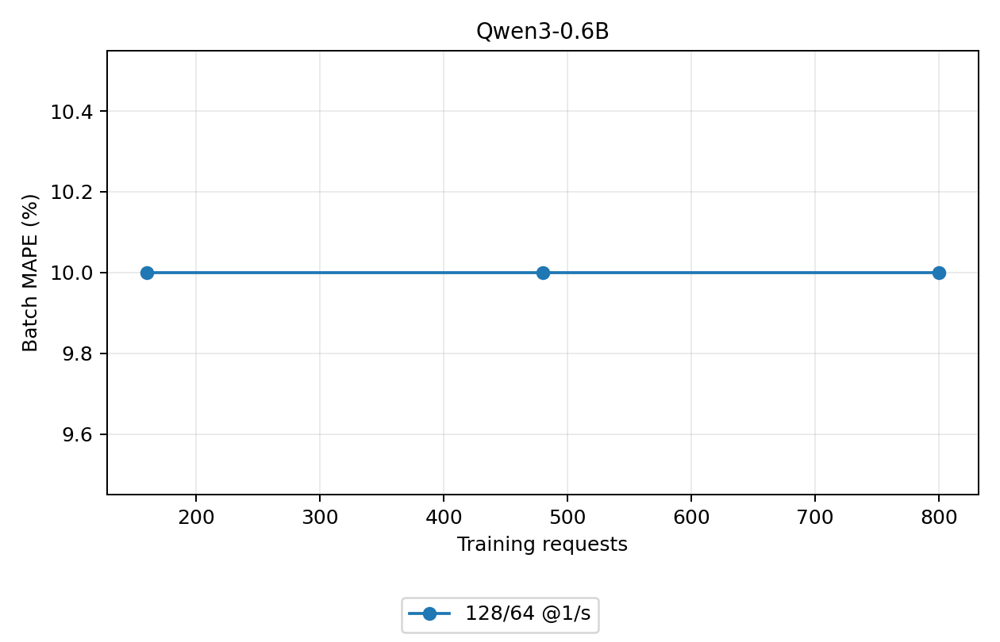

# Fixture, not experiment results
## ML 训练记录

正式 predictor 为每模型独立 HGB p50，18 维 batch/长度特征；不按独立测试误差选择 p50 或 L2。训练集合内先按每条 trace 用例随机划分 80%/20%作内部检查，再将全部训练行传给最终 fit；HGB 另取训练侧 15%作 early-stopping 验证，不使用正式测试请求。

上游 data-tools 的 trainer 读取已采集的 batch 文件，不负责生成独立测试请求。其默认内部检查按每个用例随机分行，比例 50%/50%、seed=42、forward_modes=1；检查后保存的模型重新使用全部输入行拟合。这个划分没有按完整请求隔离，同一请求的多个 batch 可能落在两侧，不能作为跨请求或跨负载泛化结果。本轮正式测试另行采集完整请求，内部检查只用于核查拟合过程。[上游训练脚本](https://github.com/littlefatfat/sglang/blob/9cfddcedc9d1e00885c28db75a45513eddbb6271/tools/sglang-simulator/tools/train_latency_model.py)，[上游验证说明](https://github.com/littlefatfat/sglang/blob/9cfddcedc9d1e00885c28db75a45513eddbb6271/tools/sglang-simulator/README.md#train-an-ml-latency-predictor)。

上游 serving 单测与上述训练验证是两件事：它使用 examples 中的 ML 配置，在 CPU 模拟器上发送 3 条 ShareGPT 请求，每条输出 4 token，断言完成数和指标有效性，没有真机误差对照。配套资产生成脚本仅以一行全零特征、0.001 秒标签构建固定 1 ms 的 DummyRegressor；它是功能示例，不是 GPU 校准结果。本轮不使用该示例预测器，而是每模型分别采集、训练并在独立请求上评价。[上游 serving 单测](https://github.com/littlefatfat/sglang/blob/9cfddcedc9d1e00885c28db75a45513eddbb6271/tools/sglang-simulator/test/test_simulation_sglang_serving.py)，[ML 示例配置](https://github.com/littlefatfat/sglang/blob/9cfddcedc9d1e00885c28db75a45513eddbb6271/tools/sglang-simulator/examples/sim_configs/ml.json)，[示例资产生成脚本](https://github.com/littlefatfat/sglang/blob/9cfddcedc9d1e00885c28db75a45513eddbb6271/tools/sglang-simulator/examples/build_example_assets.py)。

| 参数 | 设置 |
| --- | --- |
| loss / quantile | quantile / 0.5 |
| max_iter / max_leaf_nodes | 400 / 63 |
| learning_rate / l2_regularization | 0.04 / 0.1 |
| early_stopping / validation_fraction / n_iter_no_change | True / 0.15 / 20 |
| 标签与过滤 | iter_latency，秒；训练只保留有效 mode=1/2、非空 batch、0 < latency ≤ 30 秒；正式评分保留所有有限正时延 |

| 模型 | 最终 fit 输入行 | 训练 trace 用例 | 实际迭代数 |
| --- | --- | --- | --- |
| Qwen3-0.6B | 30 | 15 | 20 |

全部特征名称、单调约束、random_state 和实际参数另存 training_parameters.csv；原始 bundle 和训练命令同时保留。

## 同负载与跨负载测试

前三类负载出现在训练数据中，但测试请求和 seed 独立；后两类负载不用于训练。跨负载不代表所有特征都在训练范围之外。以下按模型与负载列出实测值和预测值，避免把五类负载混成一个精度结论。

总 token 吞吐采用 collector/trace 的实际输入+输出 token 数，除以原始 benchmark duration；原始输入计数和原报吞吐保留在 comparison.csv。随机 ID 解码成文本后再编码可能改变输入长度，此处统一 token 分子，不消除 client/模拟器时间窗差异。std 为五次重复的总体标准差（分母 n），不是置信区间。

| 用例名称 | 生成输入/输出长度上限 | 到达设置 | 每组请求 | 用于训练 |
| --- | --- | --- | --- | --- |
| latency_128x64_r1 | 128 / 64 token | 1 请求/秒 | 32 | 是 |

长度是随机生成上限，不是每个请求的固定长度；range_ratio=0 从 1 到上限采样。1536/384 长用例使用 --tokenize-prompt 直接发送随机 ID，避免文本再编码使输入+输出超出 2048 上下文；其他用例沿用随机 ID 解码成文本再发送，实际输入 ID 保存在 trace。长用例相对训练还改变了输入路径，不能将其差异只归因于长度。r1/r4 为平均到达率，有限速请求间隔为指数分布；inf 是突发提交，不是无限并发，服务最多同时运行 32 个请求。

### latency_128x64_r1（同负载独立测试）

| 模型 | 方法 | 单步实测/预测 ms | 单步 MAPE / MAE ms | E2E 实测 ± std / 预测 ms | E2E MAPE | TTFT 实测 ± std / 预测 ms（MAPE） | TPOT 实测 ± std / 预测 ms（MAPE） | 总 token 吞吐实测/预测 tok/s |
| --- | --- | --- | --- | --- | --- | --- | --- | --- |
| Qwen3-0.6B | ML | 2.00 / 1.80 | 10.00% / 0.20 | 2.00 ± 0.10 / 1.80 | 10.00% | 2.00 ± 0.10 / 1.80（10.00%） | 2.00 ± 0.10 / 1.80（10.00%） | 2.00 / 1.80 |
| Qwen3-0.6B | AIC | 2.00 / 1.80 | 10.00% / 0.20 | 2.00 ± 0.10 / 1.80 | 10.00% | 2.00 ± 0.10 / 1.80（10.00%） | 2.00 ± 0.10 / 1.80（10.00%） | 2.00 / 1.80 |

按阶段展开单步结果。n 为五次独立真机实验合并后的 batch 条数，P95 为逐 batch 绝对百分比误差的 95 分位。

| 模型 | 方法 | n（prefill/decode） | prefill 实测/预测 ms | prefill MAPE / MAE ms | decode 实测/预测 ms | decode MAPE / MAE ms | P95 APE（prefill/decode） |
| --- | --- | --- | --- | --- | --- | --- | --- |
| Qwen3-0.6B | ML | 15 / 15 | 2.00 / 1.80 | 10.00% / 0.20 | 2.00 / 1.80 | 10.00% / 0.20 | 12.00% / 12.00% |
| Qwen3-0.6B | AIC | 15 / 15 | 2.00 / 1.80 | 10.00% / 0.20 | 2.00 / 1.80 | 10.00% / 0.20 | 12.00% / 12.00% |

## 训练量递增对比

测试集保持不变，以前 1、3、5 组训练 trace 分别拟合，训练请求数为 160、480、800；下面曲线按负载展示。增加样本是否有效以实测误差变化为准，不预设单调改善。

完整 prefill/decode、P95 APE、偏差与样本数见同目录 workload_batch_metrics.csv；全部 E2E、TTFT、TPOT、吞吐及实机标准差见 workload_end_to_end_metrics.csv。

## 结果解释的边界

同步墙钟单步时延包含 run_batch 内 CPU 发射、采样/拷贝和同步等待，AIC 算子 GPU 时延求和不包含全部这些开销。因此增加 AIC 算子点与提高端到端准确性不是同一件事。AWQ BF16 代理、dual-chunk attention 代理与 MoE 路由覆盖限制沿用前文单列说明。当前 GPU 其他进程及显存状态已记录；本轮不是无干扰的硬件性能标定。

AIC 的 Silicon 模式也不是所有算子都查实测表：此版本将 RMSNorm、SwiGLU 等归为 ElementWise，并调用 query_mem_op 的带宽/固定延迟公式。当前配置为带宽 1.935 TB/s、经验缩放 0.8、固定延迟 3 μs；重新采集 attention/GEMM 不会更新这些项。这里保留标准 SDK 实现，解析项与本机实测表分别说明。源码：[ElementWise](https://github.com/ai-dynamo/aiconfigurator/blob/c5f139662be28b177ca9f62f83543bbf10f133a0/src/aiconfigurator/sdk/operations/elementwise.py)、[query_mem_op](https://github.com/ai-dynamo/aiconfigurator/blob/c5f139662be28b177ca9f62f83543bbf10f133a0/src/aiconfigurator/sdk/perf_database.py)。

attention harness 在计时前调用 init_forward_metadata，测量时仅重复执行 RadixAttention，并先 warmup 三次；真机 run_batch 的同步墙钟标签包含相关元数据准备。两条路径都构造 TritonAttnBackend，KV-split 上限 8 不代表每个请求固定使用 8 个 split。元数据准备、首次 shape 编译和稳态 GPU 算子测量的边界应区分；尚无同配置逐项 profile，不能为这些开销分配具体误差比例。

Qwen3 的 QK norm 还存在阶段差异：ContextAttention 用解析项附加其时延；GenerationAttention 虽保留 use_qk_norm 标志，query 中没有对应附加项。本机 attention harness 计时的是 RadixAttention 调用，不包含模型层前面的 QK norm/旋转位置编码调用，因此加密这张表不等于补采这些操作。CPU 调用核验在 B=1、S=128 和 B=8、S=1024 下，开关 QK norm 的 prefill 差值均为约 0.0264 ms/层，decode 差值为零；这是 SDK 公式/调用行为，不是 GPU 实测时延，也不用于修改预测值。没有当前逐项 profile 证据，不能据此量化它占总误差的比例。依据：[attention 查询](https://github.com/ai-dynamo/aiconfigurator/blob/c5f139662be28b177ca9f62f83543bbf10f133a0/src/aiconfigurator/sdk/operations/attention.py)、[attention harness](https://github.com/ai-dynamo/aiconfigurator/blob/c5f139662be28b177ca9f62f83543bbf10f133a0/collector/sglang/collect_attn.py)；调用记录见 preflight/aic_attention_query_scope_20260928.json。

AIC checkout 在本轮开始前已有三处 collector 修改：两份 attention YAML 增补 head=28，以及 collect_attn.py 的 runner 兼容字段和可选 Torch SDPA 路径。正式采集显式选择 Triton，不进入可选 SDPA 分支；这些原有修改未回滚，也未在本轮改写。provenance 同时保存 AIC dirty patch、collector/SDK 源文件及 SHA256，不能仅用 HEAD 表示实际采集代码。

## 按负载等权的同负载/跨负载结果

以下先分别计算每类负载的误差，再对负载等权平均，避免低到达率用例较多的单请求 decode 行主导总览。前三种是同负载独立请求，后两种是跨负载；这个划分不等同于严格的特征分布内/分布外。原始逐行加权结果仍在前文保留。

| 模型 | 方法 | 同负载单步 MAPE | 跨负载单步 MAPE | 同负载 E2E MAPE | 跨负载 E2E MAPE |
| --- | --- | --- | --- | --- | --- |

## GPU 状态记录

本轮没有连续 GPU 遥测文件；启动快照不足以排除运行期间干扰。
