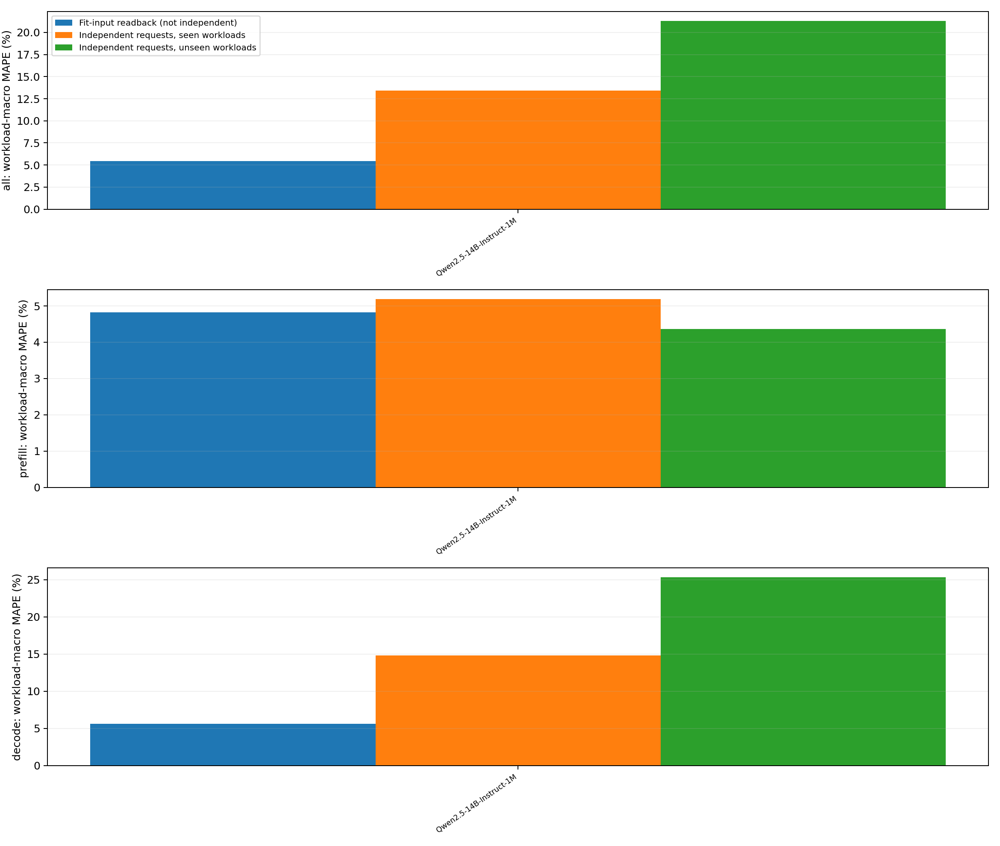

## 训练与测试请求核对

直接检查真机保存的 input_ids、实际输出长度和 request ID，不只依靠 seed 声明；逐条核验回放 trace 的输入 ID/输出长度未改变。下表的重叠比例以测试请求数为分母。相同 prompt、相同 18 维特征与同一条时延标签是不同概念；少量 prompt 重复不自动构成时延标签泄漏。正式拟合仍只读取训练目录。

| 模型 | 训练/测试请求 | 测试 prompt 与训练重叠 | 输入 ID+输出长度同时重叠 | 回放 ID 核验请求 |
| --- | --- | --- | --- | --- |
| Qwen2.5-14B-Instruct-1M | 800 / 1280 | 0.00% | 0.00% | 2080 |

## 同一 ML 预测器的训练样本回评分与独立测试

固定每模型最终 p50 bundle，回评分传入最终 fit 的训练样本，并与同一 bundle 的独立测试比较；不重新训练、不选择新的参数。训练侧沿用 bundle 的时延过滤，核对行数/用例数及数据来源；测试侧保留全部有效正时延，逐行复算并核验与正式评分完全一致。

训练样本回评分不是独立验证；最终 HGB fit 内仍有 early-stopping 保留部分，因此也不表示每行都用于构建树。它与前文 80%/20% 内部分行验证的模型不同。下表各格为负载等权的实测/预测均值 ms（MAPE）；差距同时包含请求组成、batch 分布与采集时段变化，不能归因于请求不同这一单一因素。此处仅比较单步，不补跑训练请求的端到端服务。

| 模型 | 训练样本回评分 ms（MAPE） | 同负载独立测试 ms（MAPE） | 跨负载独立测试 ms（MAPE） |
| --- | --- | --- | --- |
| Qwen2.5-14B-Instruct-1M | 314.460/302.783（5.46%） | 306.598/300.949（13.45%） | 329.721/337.025（21.30%） |

逐负载、prefill/decode、样本数和 bundle SHA256 见 ml_fit_input_vs_independent_by_workload.csv；等权汇总及相对训练回评分的百分点差见 ml_fit_input_vs_independent_macro.csv。训练逐行预测保存在 ml_fit_input_readback/，正式独立测试文件不修改。
