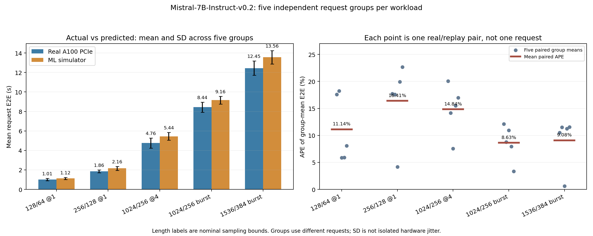

# Pipeline verification — 2026-09-28

These are implementation checks, not completion of the 13-model experiment.

## Focused checks

The initial focused selection covered protocol budgets, GPU capacity floors, real baseline hooks, HGB training/scoring, trace-targeted AIC plans, interpolation support/scoring database, replay validation, paired summaries and SimSun DOCX generation: **34 passed in 3.84 seconds**.

After adding phase-completeness checks and actual-token throughput normalization, `test/test_summarize_pr33824_data_tools_replay.py test/test_append_expanded_report.py`: **8 passed in 2.05 seconds**. These overlap the earlier selection and are not eight additional independent checks.

After adding page-size alignment, denser sequence grids and recorded runtime checks, a wider focused selection passed **44 tests in 4.22 seconds**. Complete output is in `focused_final_20260928.log`. The native-kernel SHA256 comparison was also executed successfully against the formal real-baseline snapshot. Tests of the page-size wrapper are CPU contracts; the new page=1 CUDA operator path still needs its actual sampling run before claiming GPU validation.

The page=1 CUDA check subsequently passed at approximately 20:43, in a GPU interval with the real collector stopped. Two A100 PCIe BF16/Triton points (batch=1, sequence=128, heads=16, KV heads=8, dimension=128; KV splits=8) completed: context 0.018944 ms and generation 0.009779 ms. Runtime Torch `2.9.1+cu126`, kernel `0.4.6.post1`, and native import stage match the formal real baseline. Evidence: `preflight/aic_page1_smoke_20260928_2042/`. These two points validate execution only; they are not added to the formal AIC table or treated as model-level accuracy.

Report checks after adding same-observation guards: **7 passed in 2.02 seconds**, output in `report_comparison_checks_20260928.log`. Tokenizer-only long-context bounds checks covered 4160 candidate requests; see `preflight/long_context_tokenizer_bounds.csv`. The first held-out attempt was stopped before its invalid long-text case finished and archived under `attempts/qwen06_holdout1_before_long_input_ids/`. The full group is excluded; a fresh canonical group uses direct IDs only for the long case. All 800 successful training requests and trained bundles were retained.

The final focused selection, including the long-input protocol and report consistency checks, passed **45 tests in 4.11 seconds**, exit 0. Output: `focused_protocol_final_20260928.log`. The final source snapshot is `provenance/matrix_protocol_final_20260928_2045/`; 154 source files were captured and the imported native kernel matched the formal baseline's SHA256 checksums. These checks do not supersede the full-suite failure below or demonstrate full-model prediction accuracy.

## Full simulator test directory

Executed from `tools/sglang-simulator` using hbf-cxl Python, `CUDA_VISIBLE_DEVICES=''`, `PYTHONNOUSERSITE=1`, `HF_HUB_OFFLINE=1`, `OMP_NUM_THREADS=1`, conda-first PATH and compatibility-stage/source/conda/user-fallback PYTHONPATH:

```bash
python -m pytest -q test
```

Result: **1 failed, 47 passed, 5 warnings, 395.20 seconds, exit 1**. The suite began before the three newest test additions, so it does not cover those additions. Output/cache paths were isolated under this result root. The CPU-only serving tests used fixture models and random ports; they are not real GPU accuracy benchmarks. They ran at 20:19–20:26 concurrently with the 3B first training group and are recorded as possible host interference rather than an isolated-performance interval.

Failure: `test/test_simulation_offline_blocking.py::test_request_rate_offline_matches_blocking`. Saved fixture outputs under `verification/full_suite/offline_blocking_failure/` reproduce:

| Metric | offline | blocking | Relative difference | Tolerance |
| --- | ---: | ---: | ---: | ---: |
| TTFT ms | 12.762786 | 11.341969 | 12.5271% | 10% |
| E2E ms | 39.090425 | 39.187272 | 0.2471% | 10% |
| Duration s | 1.565132 | 1.565379 | 0.0158% | 1% |

Arrival, request/token count and other compared metric checks passed on the saved outputs. The origin of the TTFT difference is not isolated by this run. No tolerance was relaxed or unrelated simulator implementation changed to hide the failure.

## Real collection evidence and recovery

0.6B first formal case completed 32 requests and 915 latency rows. Fourth training group completed all 160 requests and 2526 rows; a Bash read-offset error occurred only after the final case, while the script was being edited. Every case was independently checked before restoring its group marker; see its `RECOVERY_VALIDATION.md`. The queue was restarted after the active 3B group completed. Existing measured artifacts and failure logs were retained.

Formal inference data is produced by real CUDA SGLang, not these CPU tests. Whole-matrix accuracy, AIC collection, independent test coverage and final report remain pending.

## All-model configuration preflight

At 20:51–20:52, a CPU-only check using the current source and hbf-cxl parsed all 13 `ModelConfig` instances with context length 2048. Twelve select BF16; the 70B AWQ checkpoint selects FP16 and AWQ. A second check imported AIConfigurator from the declared v0.10.0 checkout and verified that all 13 models' layer counts, attention heads, KV heads and head dimensions match SGLang's parsed configuration. Qwen3-0.6B's explicit head dimension 128 is preserved, rather than inferred as hidden_size / heads. The existing Mistral-to-LLAMA architecture alias was used.

All indexed checkpoint weight shard paths are present under `/home/ms-admin/data/models`; the single-file 0.6B checkpoint is also present. This is a path-presence check, not a weight checksum or a GPU launch test. Logs: `preflight/model_config_cpu_check_20260928.log` and `preflight/aic_topology_and_weight_paths_20260928.log`. The short checks ran at low CPU priority alongside the 0.6B held-out group; no GPU workload was launched by them.

## First expanded held-out group

0.6B held-out repeat 1 completed at 20:53:52, then repeat 2 started. The new direct-ID long case retained all 64 requests and 747 finite, positive latency rows; actual input IDs match recorded input lengths, and the maximum actual input-plus-output length is 1858 tokens (below the declared 1920 bound). Its saved benchmark command contains `--tokenize-prompt`. The group completion marker and all five case statuses were checked; this proves only one held-out group completed, not five-repeat accuracy or all-model completion.

The immutable upstream trainer and README at commit `9cfddcedc9d1e00885c28db75a45513eddbb6271` were rechecked online. The final report now distinguishes its default within-case row split (50%/50%, seed 42, mode 1) and refit on all input rows from this experiment's separately collected test requests. Report tests including the source attribution passed **7 tests in 2.06 seconds**, exit 0; output in `report_upstream_context_20260928.log`.

## Per-workload support and historical baseline reporting

Added phase-specific marginal training-feature coverage for every model/workload cell, using the shared 18-feature ABI, the actual training latency filter, and held-out row counts checked against both predictors' official scoring CSVs. The final report will include three coverage heatmaps and a descriptive coverage/error scatter plot. Unit checks confirmed inside/outside bounds, phase grouping, exclusion of training rows above 30 seconds, and rejection of scoring-count mismatches. Coverage is not a test of equal distributions or causal error attribution.

The historical AIC section was also executed against actual September 8/10 CSVs: 18 workload rows and 12 model/metric scope rows were read and a real/predicted saturation figure generated under `preflight/historical_report_pipeline_check_20260928/`. This reuses historical observations only; it is not a new accuracy experiment. For 3B saturation, the September 8 real/predicted means are 2258.37/2093.47 ms (7.30% MAPE); September 10 gives 1581.05/2229.65 ms (42.73%). Both had graph/overlap enabled and context 8192, but kernel/table paths and static memory fraction (0.80/0.96) changed. New experiments use different budgets and graph/sync settings, so this section does not describe a single-factor calibration benefit.

The expanded report tests passed **10 tests in 4.10 seconds**, exit 0, including the historical-value/metric-scope check; output is `report_historical_baselines_20260928.log`. Both files are currently untracked, so the earlier `git diff --check` exit 0 did not check their added contents. Subsequent no-index comparisons against `/dev/null` returned exit 1 for new content with no whitespace diagnostics; a direct `awk` trailing-whitespace check returned exit 0. Earlier overlapping report checks passed 9 tests in 4.00 seconds (`report_workload_coverage_20260928.log`). These checks do not supersede the full-suite failure above. The revised report sources were archived in `provenance/report_coverage_history_20260928_2103/`, with native kernel checksums still matching the formal real baseline.

The wider focused selection subsequently passed **48 tests in 5.47 seconds**, exit 0 (`focused_with_coverage_history_20260928.log`). This is an overlapping selection, not 48 additional independent checks.

## AIC collector source identity and analytic operations

The AIC checkout already contained three modified collector files: the context/generation attention YAMLs add query head 28, and `collector/sglang/collect_attn.py` has runner compatibility fields plus an optional Torch SDPA branch. This experiment did not modify or roll back that checkout. Formal collection selects Triton; the optional SDPA branch is not used. The previous 133-file check covered the SDK, not the collector's dirty files, so source provenance was expanded to archive the actual collector/SDK/configuration sources, dirty patch, status and SHA256 manifest before formal operator sampling.

An actual source-only capture under `provenance/aic_collector_source_20260928_2110/` retained **385 AIC source files** and **155 experiment Python/shell files**. Every archived AIC file was read back and matched against the SHA256 manifest; the imported SDK's 133 Python files match the declared checkout, and the native kernel still matches the formal real-baseline reference. Output: `aic_source_archive_validation_20260928.log`. This capture performs no GPU sampling. The formal AIC collector will make its own fresh pre-sweep archive; final report generation requires that archive and checks its file contents, counts, source revision and SDK import identity.

The SDK's ElementWise operation (used for normalization and activation/gating terms) delegates to `query_mem_op`, which uses an empirical bandwidth/fixed-latency formula even in Silicon mode. The current local system YAML sets 1.935 TB/s, bandwidth scaling 0.8, and fixed latency 3 microseconds. Expanded attention/GEMM tables do not calibrate these analytic terms. The protocol and report template now state this limitation with immutable primary-source links; the SDK and system configuration were not changed.

Provenance/report checks passed **13 tests in 4.36 seconds**, exit 0 (`provenance_report_final_checks_20260928.log`). The subsequent explicit-source, CPU-only focused selection passed **52 tests in 5.25 seconds**, exit 0 (`focused_aic_source_archive_20260928.log`), using hbf-cxl, the new source tree, compatibility stage and conda-first dependency paths. Tests include retaining dirty/untracked source bytes, rejecting forged archive hashes, report phase/repeat guards, and SimSun DOCX output. A direct trailing-whitespace check on the modified untracked source/document files returned exit 0. These results do not supersede the earlier full-suite TTFT failure or establish prediction accuracy.

At 21:13:15 the 0.6B third independent test group completed and the fourth started. Its training set remains 800 requests / 11533 latency rows; the complete 13-model pipeline and new AIC accuracy remain pending.

## Attention query coverage check

Inspected the unchanged local AIC SDK, immutable upstream attention source, collector harness, and current SGLang Qwen3 model preparation path. Qwen3 applies QK normalization and rotary position encoding before RadixAttention. The collector times RadixAttention directly. `ContextAttention.query` adds analytic QK-normalization/memory-operation terms; `GenerationAttention.query` retains the `use_qk_norm` attribute but does not add a corresponding QK-normalization term. This is a source-level coverage limitation, not a measurement of how much overall error it causes.

Executed `tools/probe_pr33824_aic_attention_scope.py` with CUDA hidden, the declared AIC source, and the current system YAML. Its attention table results are deliberately synthetic (0.01 ms), while memory-operation arithmetic delegates to the unchanged SDK formula. The retained artifact is explicitly tagged **CPU_SOURCE_CONTRACT_PROBE_NOT_BENCHMARK** at `preflight/aic_attention_query_scope_20260928.json`. For B=1/S=128 and B=8/S=1024, toggling QK norm adds 0.026417464 analytic ms/layer in prefill and zero in decode. Neither number is a GPU measurement, training label, or correction applied to predictions. The probe does not change AIC, the native kernel, or the running Bash scripts.

The query-scope unit check passed **1 test in 0.30 seconds** (`aic_attention_scope_probe_test_20260928.log`). The subsequent combined scope/report/SimSun DOCX check passed **2 tests in 2.56 seconds**, exit 0 (`aic_attention_scope_docx_20260928.log`). Updated protocol/report text distinguishes analytic query coverage from measured operator tables and does not assign a causal error percentage without a current operator profile. A direct trailing-whitespace check returned exit 0.

The 0.6B fourth independent test group completed at **21:23:05**, giving **1024 held-out requests / 15139 latency rows** in four groups; the fifth started immediately. GPU telemetry recorded a separate vLLM process during part of group 4 (approximately 22–23 GiB); it was no longer resident by 21:19. No external process was stopped by this experiment. Per-case real KV capacities and profiling windows are retained, and replay reads each case's actual capacity. All-model accuracy and formal AIC collection remain pending.

Checked the fifth held-out group's slow-compilation messages against actual profile boundaries. In `service_1024x256_r4.server.log`, compilation messages at 21:25:47, 21:26:17 and 21:26:30 precede `start_profile` at 21:26:43. In `saturation_1024x256_inf.server.log`, messages at 21:27:42, 21:28:12 and 21:28:25 precede its 21:28:37–21:28:51 profile window. These startup/warm-up events are not evidence of JIT time contaminating those two formal timing sets. The report's quality check counts only profile-window messages; no labels were removed or changed, and no restart was triggered by warm-up logs.

## Completed 0.6B real collection and independent ML scoring

All five held-out groups completed at **21:32:59**. The training set contains **800 requests / 11533 batch-latency rows**; the independently collected test set contains **1280 requests / 19080 rows**. Official scoring finished at 21:33:02. Values below come directly from `models/Qwen3-0.6B/holdout/ml_teacher_forced/summary.csv` and are not new AIC measurements.

| Held-out workload | Rows | Actual mean ms | ML predicted mean ms | MAPE % | MAE ms | P95 APE % |
| --- | ---: | ---: | ---: | ---: | ---: | ---: |
| latency_256x128_r1 | 5451 | 24.9126 | 25.9353 | 7.2335 | 2.2192 | 16.2112 |
| service_1024x256_r4 | 4067 | 26.0288 | 25.9718 | 6.1988 | 2.4145 | 14.6189 |
| saturation_1024x256_inf | 2420 | 27.1669 | 25.7755 | 5.2525 | 2.8170 | 13.0521 |
| latency_128x64_r1 | 3542 | 25.9870 | 25.9810 | 6.6583 | 2.3725 | 15.6249 |
| saturation_1536x384_inf | 3600 | 26.6936 | 25.6644 | 4.8884 | 2.2471 | 12.8142 |

Across all 19080 held-out batches: actual/predicted means **25.9719 / 25.8802 ms**, MAPE **6.2124%**, MAE **2.3704 ms**, RMSE **19.4829 ms**, and P95 APE **15.1770%**. Prefill MAPE is **4.5943%** (1786 rows), decode MAPE **6.3795%** (17294 rows). These labels time synchronized `Scheduler.run_batch`, not pure GPU operators. A mean-value match does not replace row-level error statistics.

Equal-workload macro MAPE is **6.2283%** for the three training workload families and **5.7734%** for the two added test families. This one-model observation does not establish generalization for all 13 models, or end-to-end accuracy. The longer test case also changes the input path to direct token IDs; it is not a length-only controlled comparison. No historical score is treated as a single-factor calibration baseline.

The request-identity audit checked actual raw `input_ids`, actual output lengths and request IDs against saved replay traces for **all 2080 requests**. Test prompt overlap with training is **0.00%**; overlap of input IDs plus output length is **0.00%**; no train/test request ID is reused. There are 480 unique training prompts and 888 unique test prompts, so request counts do not imply every prompt within each set is unique. Evidence: `preflight/qwen06_request_identity_quality_20260928/train_test_request_identity.csv` and `verification/qwen06_request_identity_quality_20260928.log`.

The quality audit covers 40 completed real cases; 25 have a 30-second telemetry sample inside their profile window, and two observed another resident GPU process. No slow-compilation message was logged inside a formal profile window. Uncovered windows and short unobserved interference remain possible; no latency labels were automatically discarded. The final report helper now rejects changed replay input IDs/output lengths, reused train/test request IDs, wrong request budgets and malformed raw records. Its **13 tests passed in 4.20 seconds**, exit 0 (`report_request_identity_20260928.log`), overlapping previous report checks.

CPU ML end-to-end replay groups 1 and 2 completed at **21:37:06** and **21:41:02**; group 3 then started. All five replays and their paired summary are required before marking this model's real/ML stage complete. Formal new AIC collection has not started, and the full 13-model comparison/report remains pending.

The updated request-audit/report sources were archived at 21:43 under `provenance/request_identity_report_20260928_2143/`: **157 experiment source files**, **385 AIC source/configuration files**, and the imported native kernel still matches the formal real-baseline SHA256 reference. The capture exited 0 and used hbf-cxl, explicit source/compatibility-stage imports and conda-first dependencies; it did not launch a GPU worker. The final archive made before formal AIC sampling is still required.

## Executed 0.6B nested-training learning curve

At approximately **21:45–21:46**, while the matrix was in CPU-only ML replay, executed the already-planned learning-curve tool early for the completed 0.6B data. It used CUDA hidden, hbf-cxl, one-thread limits and low CPU priority. The exact command was:

```bash
python tools/run_pr33824_ml_learning_curve.py \
  --sim-root /home/ms-admin/workspace1/yiheng/ali/sglang-pr33824-merged/tools/sglang-simulator \
  --model-root test-results/pr33824_expanded_all13_predictors_20260928_1933/models/Qwen3-0.6B \
  --python /home/ms-admin/workspace1/.miniforge3/envs/hbf-cxl/bin/python \
  --out-dir test-results/pr33824_expanded_all13_predictors_20260928_1933/models/Qwen3-0.6B/learning_curve \
  --train-counts 1,3,5
```

The three fits use nested prefixes of the real training groups, the same HGB p50 settings and seed 202609280, and the same fixed **1280 held-out requests / 19080 timing rows**. No test request or timing label was added to training. The run exited 0 and produced 24 curve rows, per-fit bundles and scoring CSVs, a Markdown table and a Matplotlib PNG. The queued matrix will reuse this completed curve CSV instead of refitting it. Log: `qwen06_learning_curve_early_20260928.log`.

| Training requests | Training timing rows | All MAPE % | Prefill MAPE % | Decode MAPE % | All MAE ms | All P95 APE % |
| ---: | ---: | ---: | ---: | ---: | ---: | ---: |
| 160 | 2157 | 8.8852 | 5.9141 | 9.1920 | 3.0212 | 19.1170 |
| 480 | 6818 | 5.3479 | 4.7767 | 5.4069 | 2.1655 | 14.8593 |
| 800 | 11533 | 6.2124 | 4.5943 | 6.3795 | 2.3704 | 15.1770 |

The error is not monotonically decreasing on this fixed test set. These are nested, time-ordered training groups, not randomized replicated sample-size trials; they do not isolate sample count as the sole cause. The preselected formal **800-request model is unchanged**: the test set is not used to select the apparently best 480-request fit. A direct comparison verified that the five-group refit's complete scoring CSV is exactly equal to the existing official held-out scoring CSV, including actual values and counts.

Corrected presentation-only labels in `tools/run_pr33824_ml_learning_curve.py`: generated tables now identify each workload and actual training request count, and do not label all expanded test workloads as same-distribution. Rerendered the existing 0.6B README/PNG without training again. Curve/scoring CSV bytes were not changed; the curve CSV SHA256 is `2ef8f4f25524a3a59e14192a31fc09bb9f65b1f6c05efb29d667d1ff73522889`. Evidence: `qwen06_learning_curve_presentation_20260928.log`.

Presentation and report checks passed **15 tests in 5.08 seconds**, exit 0 (`learning_curve_report_checks_20260928.log`), including preserving input score records, identifying per-workload rows and refusing to invent an unrecorded request budget. This overlaps earlier report checks and does not supersede the full-suite TTFT failure. Direct trailing-whitespace checks passed. No running Bash script, native kernel, model, predictor setting or AIC source was modified.

## Completed 0.6B real/ML stage and end-to-end results

The fifth replay, paired summary and `REAL_ML_COMPLETE` marker completed at **21:53:09**. The same live matrix then skipped the previously validated 3B training group 1 and started group 2. The 3B CUDA server became ready at 21:53:41; its capacity record passed the 12 GiB floor with 81050 MiB free. No independent competing GPU workload was launched by this audit.

The following values are from the completed official `models/Qwen3-0.6B/holdout/ml_e2e_comparison/summary.csv`. Each row has **five real/ML pairs**, not five copies of a single seed. Standard deviations describe the five real repeats within that workload.

| Workload | Real E2E mean ± std ms | ML E2E mean ms | E2E MAPE % | Real / ML TTFT mean ms | TTFT MAPE % | Real / ML TPOT mean ms | TPOT MAPE % |
| --- | ---: | ---: | ---: | ---: | ---: | ---: | ---: |
| latency_256x128_r1 | 1694.90 ± 121.11 | 1958.77 | 15.3894 | 81.31 / 44.17 | 35.2010 | 26.75 / 30.92 | 15.6196 |
| service_1024x256_r4 | 4200.17 ± 310.26 | 4694.00 | 11.8013 | 94.64 / 64.25 | 31.5279 | 31.83 / 35.59 | 11.9347 |
| saturation_1024x256_inf | 7460.88 ± 403.39 | 7714.14 | 6.4324 | 2691.61 / 2673.23 | 3.1997 | 41.69 / 42.34 | 7.0081 |
| latency_128x64_r1 | 936.12 ± 120.59 | 1007.90 | 9.2984 | 59.67 / 39.85 | 29.7031 | 27.89 / 30.52 | 9.6145 |
| saturation_1536x384_inf | 10747.97 ± 733.51 | 11576.70 | 7.7168 | 3726.92 / 4179.71 | 12.4103 | 41.41 / 43.18 | 4.5285 |

Equal-workload aggregate MAPE across the **25 distinct pairs** is **10.1277% E2E**, **22.4084% TTFT**, **9.7410% TPOT** and **3.1896% actual-token throughput**. These aggregate means are descriptive averages across workloads, not one request-weighted serving measurement. Single-batch MAPE remains 6.2124%; it is not substituted for end-to-end accuracy.

Executed a fresh audit of all **25** completed replays using the existing validator: completed requests, actual input/output token totals, finite metrics and predictor iterations pass. Saved server commands match model path, context/request/chunk limits and graph/overlap flags. The replay's KV capacity exactly matches the real case's logged capacity; the observed capacities are **333643, 371366 and 467426 tokens**. The paired CSV contains **100 unique finite rows = five repeats × five workloads × four metrics**. Evidence: `qwen06_replay_integrity_and_wall_time_20260928.log`.

## Simulator predictor execution time in the logical clock

Inspected the current OFFLINE scheduler path and `StateManager` clock functions. `wrapped_run_batch` times and sums the execution of `predict_infer_time`; `wrapped_process_batch_result` advances CPU time by the wall-clock interval since the preceding processing point. The predictor call is inside this interval. Its separately reported `predictor_time_cost` is not deducted from that CPU advancement. The 5 ms prefetch branch is a different path, not the ordinary per-iteration cause of this observation.

Read the actual completed replay `metrics.json` and `iteration.jsonl`, checking their iteration counts and finite, nonnegative components. Across **18446 simulated iterations** in all 25 0.6B cases, average predictor wall time is **3.034 ms/iteration**, total accounted CPU time **4.062 ms/iteration**, and predicted forward **25.872 ms/iteration**. This CPU/predictor time is measured in the simulator process, not an independent measurement of the real CUDA service CPU cost.

| Workload | Simulated iterations | Predictor wall ms/iter | Accounted CPU ms/iter | Predicted forward ms/iter |
| --- | ---: | ---: | ---: | ---: |
| latency_256x128_r1 | 5072 | 3.0428 | 3.8342 | 25.9131 |
| service_1024x256_r4 | 3884 | 2.9841 | 4.0756 | 25.7331 |
| saturation_1024x256_inf | 2418 | 3.0914 | 4.4495 | 26.0001 |
| latency_128x64_r1 | 3472 | 2.9428 | 3.7410 | 25.7163 |
| saturation_1536x384_inf | 3600 | 3.1272 | 4.4180 | 26.0265 |

The final report now includes an audit of these recorded timing components for both predictors, with per-case/per-repeat CSVs. This is an additional documented timing limitation, not a measured causal percentage of overall error. Different timing would alter later batching and queueing, so no average predictor duration was subtracted from recorded request metrics, and no corrected accuracy is claimed without a separate replay. Scheduler code, training labels, bundles, AIC tables and the running matrix were not changed.

The report/presentation checks passed **17 tests in 5.20 seconds**, exit 0 (`replay_wall_time_report_checks_20260928.log`). New checks cover exact recorded iteration counts, preservation of predicted-forward values and distinguishing simulator CPU time from real-service CPU time. Existing test selections overlap; the earlier full-suite TTFT failure remains recorded. Actual component data is under `preflight/qwen06_replay_accounting_20260928/replay_wall_time_components.csv`. Only the 0.6B real/ML stage has completed; new AIC and the full 13-model report remain pending.

The short CPU-only audit/test commands ran at low priority concurrently with the 3B second training group; this is not an isolated-host interval. At **21:58:36**, the group's completion marker was recorded and group 3 started. By **22:00:17**, 3B has **320 validated training requests / 4101 timing rows** in two completed groups. Main PID 1379749 and the status/telemetry/old-calibration helpers were all revalidated live; no observed timeout was treated as a stopped experiment.

The revised analysis/presentation sources were captured under `provenance/replay_accounting_report_20260928_2200/`: **158 experiment files** and **385 AIC files**, with the imported native kernel still matching the formal baseline's SHA256 reference. Capture exited 0. Its identity file records the actual capture timestamp (21:59), independently of the directory's rounded label. Formal AIC sampling will still create its own fresh pre-sweep archive.

## Completed 3B training collection and fitting

3B training group 5 completed at **22:15:18**, and HGB fitting completed at **22:15:30**. The first independent held-out group started at **22:15:31**; its CUDA service became ready at 22:16:02. The full test/ML stage is not yet complete.

The five successful training groups contain exactly **800 requests / 10557 positive, finite timing rows / 15 real cases**. None of the rows exceed the existing 30-second training filter. Saved command arguments and the p50 bundle's `source_data_roots` both identify only the five `calibration/real/repeat-*/cases` directories, not a held-out directory. The fit seed is **202609280**, forward modes **1,2**, and the bundle uses the shared **18-feature ABI**. The p50 estimator stopped at **286 iterations**, with the preselected maximum of 400. Evidence: `models/Qwen2.5-3B-Instruct/calibration/train.command.txt`, `calibration/train.log`, the saved p50 bundle and `qwen3b_training_integrity_20260928.log` (exit 0).

The internal case-stratified check uses **8445 training / 2112 checking rows** and reports p50 MAPE **1.8889%**, MAE **1.5212 ms**, P95 APE **10.2476%** and R2 **0.001882**. It shares collected request trajectories within the training set and is **not independent-test accuracy**. The final bundle uses all 10557 training rows with its own 15% early-stopping validation, as specified in the training code; early stopping is explicitly enabled rather than changing at a sample-count threshold.

The legacy status message says “independent saturation traces”; this is not the actual expanded workload selection. Each of the five groups contains latency, service and saturation cases, and the fitted log records **15 cases**. The actual command and manifest take precedence over that legacy wording. No active Bash script was edited to change its label.

An initial ad-hoc metadata inspection assumed `train_cases` was a list and raised a `TypeError` when calling `len`; the field is an integer count. The corrected integrity check reads that recorded schema and passes. This was a diagnostic-script error, not a failed fit, missing cases or changed data. The five groups' stored manifests/markers and bundle metadata were checked directly. Predictor settings, labels, source implementation and AIC tables were not changed.

## Completed first 3B independent test group

The first held-out group completed at **22:24:55**, and group 2 started immediately afterward. A read-only audit verifies **256 test requests / 3554 positive, finite timing rows**, all five successful cases and the group completion marker. Across the 800 training requests and this test group, request IDs do not overlap, and **none of the 256 test prompts matches a training prompt**. All **1056** real request records preserve their actual input IDs and output lengths in the corresponding replay traces. The long-input case obeys the 1536-input/384-output bounds and the unchanged 2048-token context limit. All five training groups and the first test group have byte-identical stored package versions and imported native/Torch origins. Evidence: `qwen3b_holdout_repeat1_integrity_20260928.log`, exit 0.

The remaining four groups are still required before the official 3B held-out scoring. No held-out accuracy is inferred from the first group's collection-integrity checks or from the internal 1.8889% training check. Main PID 1379749 and the three existing monitoring/comparison helper PIDs remain live; the AIC stage has not started.

Clarified presentation-only labels in the base report: its signed bias is the average of per-batch `(prediction-actual)/actual`, not the relative difference of the two latency means. These statistics can have opposite signs. The regression example uses actual `[1,100]` and predicted `[10,90]`: mean prediction is lower, but mean signed relative error is +445%. No score, predictor, data, live Bash script or recorded metric was changed. Report/presentation checks passed **18 tests in 4.93 seconds**, exit 0 (`report_relative_bias_checks_20260928.log`); they overlap earlier checks and do not replace the recorded full-suite failure. The short CPU-only checks ran at low priority while the real 3B queue was active, not on an isolated host.

## Historical/current comparison checked after the user's questions

3B test group 2 completed at **22:34:06**; group 3 then started. Two completed groups contain **512 requests / 6845 timing rows**. PID 1379749 and the existing helpers remain live. Official 3B held-out scores and fresh AIC results are still pending.

Directly compared the September 18 and September 28 run metadata, package records, model settings and saved **0.6B/3B p50 estimator parameters**, rather than assuming the current trainer describes an older fit. The recorded loss, quantile, maximum iterations/leaves, learning rate, L2 regularization, early stopping, validation fraction and patience are identical: p50, 400 iterations, 63 leaves, 0.04 learning rate, 0.1 regularization, explicit early stopping, 15% validation and patience 20. The fit seeds differ as recorded. Both runs already have separate training and held-out request seeds; September 28 additionally expands training from one workload/320 requests to three workloads/800 requests, and testing from one workload/320 requests to five workloads/1280 requests. Core recorded SGLang revision, Torch and compatible kernel are retained. The actual small-model memory fractions changed from **0.20 to 0.65 (0.6B)** and **0.30 to 0.80 (3B)**.

For **0.6B / saturation_1024x256_inf**, both runs have five real/replay pairs; these are historical descriptive comparisons, not the same request trace or a single-factor ablation:

| Metric | September 18 real / prediction | September 28 real / prediction | September 18 / 28 MAPE |
| --- | ---: | ---: | ---: |
| Batch latency, ms | 25.0372 / 23.8294 | 27.1669 / 25.7755 | 2.1571% / 5.2525% |
| Mean request E2E, ms | 6638.7082 / 6822.7055 | 7460.8814 / 7714.1416 | 3.0868% / 6.4324% |

Historical/current test batch counts are 2269/2420, respectively. Changes in request seeds, training coverage, memory fractions and collection time prevent attributing these differences solely to adding training samples or using independent requests. The fixed current 19080-row test-set learning curve remains **8.8852%, 5.3479%, 6.2124%** at 160/480/800 training requests; the formal model remains the preselected 800-request fit. Evidence: `qwen06_previous_vs_expanded_same_case_20260928.log`, exit 0. This CPU-only readback neither trained nor scored a new predictor, changed measurements, or occupied the GPU. The deferred historical-calibration comparison will separately score old/new predictors on the same new held-out batches; it does not borrow historical real E2E measurements.

## Third 3B test group and warmup compilation check

Held-out group 3 completed at **22:43:20**, and group 4 started. A read-only integrity audit of all five training groups and the first three test groups passes: **800/768 requests**, **10557/10312 timing rows**, **30 successful real cases**, **1568 raw-to-replay request payloads** verified, no reused training/test request IDs, and no held-out prompt matches to the training set. Stored package-version files and native/Torch origins are byte-identical across these eight groups. All recorded timing rows are positive and finite, and none are dropped by the existing 30-second filter. Evidence: `qwen3b_first_three_test_groups_20260928.log`, exit 0.

The third group's `latency_128x64_r1` log contains slow Triton compilation warnings at **22:40:02, 22:40:24 and 22:40:37** (1.38, 2.12 and 2.20 seconds). Its formal profile window is **22:40:50–22:41:21**, so these logged events belong to warmup, not formal collection. The audit finds **zero logged slow compilations inside the 30 completed profile windows**. This is only the recorded warning count, not proof that all JIT work is absent. No samples were excluded, timings corrected, or running settings changed. Two test groups, official ML scores/replays, fresh AIC and the full report remain pending.

## Full-suite failure disclosure in the final report

3B held-out group 4 completed at **22:52:42**, and the fifth group started. Main PID 1379749 remains live; the 13-model queue and 800-request training budget have not been shortened or replaced by old training data.

The expanded report now includes the recorded full-suite result (**47 passed / 1 failed, exit 1**) separately from GPU prediction accuracy. `verification/full_suite_record.json` transcribes the previously recorded run, not a new pytest execution. The report helper re-reads the preserved offline/blocking fixture metrics: TTFT differs by **12.5271%** against the unchanged **10%** tolerance; E2E and duration differ by **0.2471% / 0.0158%**. The readback passed with exit 0 and saved `preflight/regression_fixture_readback_20260928_2257/full_suite_fixture_comparison.csv`. It does not establish the failure's cause or imply that assertions after the failed TTFT check executed.

Report/presentation checks passed **21 tests in 4.73 seconds**, exit 0 (`report_full_suite_disclosure_checks_20260928.log`). New checks reject a failed suite marked as successful and require saved metrics to reproduce its failure. These overlap earlier focused checks and do not supersede the full-suite failure. No GPU test, full-suite rerun, native-code change, active Bash edit or prediction correction was performed.

Archived the report sources in `provenance/report_regression_disclosure_20260928_2259/`: **158 experiment source files / 385 AIC source files**. The capture command passed with exit 0; the required resolved native import path and SHA256 still match the formal baseline, and the conda AIC SDK's **133 files** still match its checkout. Evidence: `report_regression_disclosure_provenance_20260928.log`. Existing dirty edits are retained. The source archive does not replace the later formal AIC pre-collection identity check.

## Completed 3B independent collection and formal single-batch score

All five held-out groups finished at **23:02:12**. The official ML single-batch score completed at **23:02:15**, and CPU-only replay of the 25 distinct held-out traces started at **23:02:16**. End-to-end scores, fresh AIC and the other 11 models remain pending; this is not completion of the 3B REAL_ML stage or of the whole matrix.

The read-only audit verifies **800 training requests / 10557 timing rows** and **1280 independent test requests / 17628 timing rows**, with all 40 real cases successful and all ten group completion markers present. All timing rows are finite, positive and below the training filter's 30-second bound. Stored package versions/native/Torch origins are byte-identical across all ten groups. There is **zero reused training/test request ID and zero test prompt overlap with training**; all **2080** real-to-replay input IDs and actual output lengths are preserved. The direct-ID long cases satisfy the unchanged context bound. Evidence: `qwen3b_complete_request_identity_quality_20260928.log`, exit 0; CSVs under `preflight/qwen3b_request_identity_quality_20260928/`.

| Workload | Test batch rows | Real mean ms | ML mean ms | MAPE % |
| --- | ---: | ---: | ---: | ---: |
| latency_256x128_r1 | 4725 | 31.6592 | 30.8351 | 3.2660 |
| service_1024x256_r4 | 3556 | 31.6945 | 31.6348 | 5.1006 |
| saturation_1024x256_inf | 2418 | 33.2590 | 31.8189 | 6.5148 |
| latency_128x64_r1 | 3329 | 31.2567 | 30.5992 | 2.9547 |
| saturation_1536x384_inf | 3600 | 32.3734 | 31.6360 | 5.8572 |

Across all **17628** held-out batches, real/predicted mean latency is **31.9556 / 31.2504 ms**, MAPE **4.5521%**, MAE **2.2861 ms**, and P95 APE **12.6023%**. Prefill (1776 rows) MAPE is **3.3325%**; decode (15852 rows) is **4.6887%**. Equal-case mean MAPE is **4.9605%** for the three seen workloads and **4.4059%** for the two unseen workloads; these are not request-weighted metrics or the all-row MAPE. Source: `models/Qwen2.5-3B-Instruct/holdout/ml_teacher_forced/summary.csv`. The unchanged formal model uses all 800 training requests; no test-based p50/L2 or training-budget selection was made.

The existing distribution audit records **8.46%** exact 18-feature matches and **19.29%** test rows outside at least one training feature range. Independent request identity therefore does not imply every batch feature is new, and the unseen workloads are not pure out-of-range tests. The long workload also uses a different input path as documented. These 3B results do not show a large error increase merely because requests differ, but they do not establish the behavior of the remaining models or isolate the effect of request independence from workload coverage.

GPU telemetry covers **32/40** formal real profile windows; those samples show **zero other resident processes**, and the logs show **zero slow compilation warnings inside all 40 profile windows**. Unsampled windows and brief interference are not ruled out. Host activity was not isolated, and the earlier concurrent full-suite run remains recorded. No samples were discarded, timings corrected, predictors refitted, or GPU experiments added during this audit. Main PID 1379749 and the existing monitoring/comparison helpers remain live.

## 3B replay progress and source-timing boundaries

CPU replay groups 1 and 2 completed at **23:06:16 / 23:10:15**; group 3 then started. A command-level readback of the first five completed cases verifies **256 requests**, the exact recorded real trace paths and arrivals, equal context/max-running/chunked-prefill settings, graphs/overlap disabled, and the per-case real KV capacity (**1661131 tokens** in all five first-group cases). Evidence: `qwen3b_ml_replay_first_group_settings_corrected_20260928.log`, exit 0. Five complete replay groups are still required for official paired end-to-end metrics.

The first diagnostic erroneously required `--attention-backend triton` on the CPU replay command and exited 1 (`qwen3b_ml_replay_first_group_settings_20260928.log`, retained). The replay intentionally uses CPU/mock forward and omits that CUDA backend flag; `triton` is saved as the **real-source** backend in replay metadata. The corrected audit distinguishes this from native GPU attention execution rather than changing launch commands. This was a diagnostic assumption error, not a failed experiment, different true GPU backend or changed predictor.

Source readback confirms the baseline label wraps `original_run_batch` and the following device synchronization; it stops its timer **before** constructing `request_infos` or appending the batch record (`baseline/collector.py::wrapped_run_batch`). JSON export occurs at stop-profile. Those recorder operations are therefore not directly in `iter_latency`, although instrumentation can affect surrounding scheduling and E2E. The native function includes its own framework/dispatch/result work; synchronized wall time is not a pure GPU-kernel sum. The simulator's separate predictor-wall/CPU accounting limitation remains unchanged as described above. No new profile, subtraction, label adjustment or core edit was made.

The pinned upstream trainer and README were re-read at commit `9cfddcedc9d1e00885c28db75a45513eddbb6271`: default seed 42, test fraction 0.5, mode 1, per-case row permutation, and final fit on all input rows. The README explicitly treats the split as interpolation and recommends complete cases excluded from training for validation. This confirms the report's distinction between its internal row split and this run's independent request collection. Sources: [trainer](https://github.com/littlefatfat/sglang/blob/9cfddcedc9d1e00885c28db75a45513eddbb6271/tools/sglang-simulator/tools/train_latency_model.py), [README](https://github.com/littlefatfat/sglang/blob/9cfddcedc9d1e00885c28db75a45513eddbb6271/tools/sglang-simulator/README.md#train-an-ml-latency-predictor).

## Completed 3B five-repeat ML end-to-end comparison

All five replay groups completed at **23:22:14**, and official paired summaries plus `REAL_ML_COMPLETE` were written at **23:22:15**. Llama-2-7B training group 1 started immediately afterward; its real CUDA server PID **1501619** was observed live with PPID **1501547**. The main queue is still PID **1379749**. These are **2/13 REAL_ML-complete models**, not ML/AIC-complete models; formal fresh AIC has not started.

A read-only audit passes for all **25 replay cases / 1280 independent requests**: five completion markers, successful case statuses, actual source trace paths and arrivals, real per-case KV capacity, and matching context/running/chunked-prefill settings. The paired CSV has **100 distinct finite rows** (25 trace pairs × 4 metrics); each case uses five different real traces. Recomputed each case's real/predicted means, population standard deviations and MAPE directly from those pairs. E2E, TTFT and TPOT real values remain identical to their originally reported values; only throughput uses the documented actual-token numerator. Evidence: `qwen3b_five_repeat_ml_e2e_integrity_20260928.log`, exit 0. This short, low-priority CPU audit ran concurrently with Llama startup/collection, not on an isolated host; it launched no GPU job and changed no timings, fit or scripts.

| Workload | Real E2E mean ± std ms | ML E2E mean ms | E2E MAPE % | Real / ML TTFT ms | TTFT MAPE % | Real / ML TPOT ms | TPOT MAPE % |
| --- | ---: | ---: | ---: | ---: | ---: | ---: | ---: |
| latency_256x128_r1 | 2152.77 ± 155.42 | 2292.63 | 6.4604 | 75.84 / 52.30 | 30.0317 | 33.75 / 36.22 | 7.3856 |
| service_1024x256_r4 | 5137.12 ± 377.07 | 5623.72 | 9.4432 | 116.03 / 81.63 | 28.6428 | 39.00 / 42.67 | 9.5739 |
| saturation_1024x256_inf | 8969.10 ± 844.32 | 9109.91 | 4.1018 | 3223.91 / 3207.87 | 4.9336 | 48.75 / 49.88 | 4.7875 |
| latency_128x64_r1 | 1115.19 ± 95.01 | 1188.06 | 6.4231 | 67.87 / 48.11 | 28.4410 | 33.16 / 35.94 | 8.3892 |
| saturation_1536x384_inf | 12814.73 ± 532.11 | 13259.75 | 5.2330 | 4532.65 / 4833.34 | 6.4068 | 49.73 / 49.60 | 5.2429 |

Across the **25 paired case means**, MAPE is **6.3323% E2E**, **19.6912% TTFT**, **7.0758% TPOT** and **2.3009% actual-token throughput**. The cross-workload real/predicted E2E mean is **6037.78 / 6294.81 ms**; its across-workload dispersion is not the five-repeat fluctuation reported in the table. Equal-case E2E MAPE is **6.6685%** for the three seen workloads and **5.8281%** for the two unseen workloads. The earlier all-row single-batch MAPE remains **4.5521%**. E2E accuracy therefore does not imply equally accurate TTFT: the three non-saturation cases have **28.44–30.03%** TTFT error. No individual cause is inferred from that pattern without a matching timing breakdown.

Audited all **17268** ML replay iterations. Per-iteration weighted means are **3.081 ms predictor execution wall time**, **4.147 ms accounted simulator CPU time**, and **30.925 ms predicted forward**. These are simulator accounting components, not a measured decomposition of the native GPU service. The existing predictor-wall inclusion remains disclosed, and no post-hoc subtraction or accounting change was applied. Detailed CSV: `preflight/qwen3b_replay_accounting_20260928/replay_wall_time_components.csv`. Source metrics: `models/Qwen2.5-3B-Instruct/holdout/ml_e2e_comparison/`. Fresh AIC, learning curves beyond 0.6B, remaining 11 models and the final unified MD/DOCX remain pending.

## First Llama-2-7B training group

The first real group finished at **23:28:47**, and group 2 started with the next training seed. Its three cases contain **160 requests / 2321 timing rows**: latency **32/1112**, service **64/749**, saturation **64/460**. A read-only audit verifies the group marker, successful case statuses, actual JSONL row counts against both manifests and benchmarks, positive finite timings below 30 seconds, unique request IDs, and preservation of every actual input ID and generated output length in the replay traces. Output length was checked against `len(raw.output_ids)`, not just a planned maximum. Evidence: `llama7b_first_training_group_integrity_20260928.log`, exit 0. No test requests or Llama ML fit/accuracy exist yet.

The stored package/Torch/native identity file is byte-identical to the 3B first training group's record. The actual first GPU startup log records `LlamaForCausalLM`, **12.57 GiB** weight-memory use, **BF16 KV cache**, and **90206** KV-capacity tokens. Weight loading took **29.65 seconds**. Its first formal profile interval is **23:24:03–23:24:37**. These startup measurements are not inference accuracy or pure GPU operator timing. Source: `models/llama-2-7b/calibration/real/repeat-1/cases/latency_256x128_r1.server.log`. Native collection keeps context 2048, running limit 32, prefill chunk 512, Triton and graphs/overlap disabled; memory fraction is the previously specified **0.72**.

Main PID 1379749 remains live; the first group's parent PID 1501547 exited after successful completion and the next group is owned by PID **1505622**. This normal group transition does not require restarting the matrix. No sampling, training, version, native-library or live-script setting was changed by this audit. Completed REAL_ML models remain **2/13**; fresh AIC and the unified report are still pending.

## Second Llama training group and reusable training artifacts

Training group 2 completed at **23:35:11**, and group 3 started with seed **202609282**. At **23:37:47**, main PID **1379749**, group-3 parent **1508586** and its native CUDA service-case server **1510045** were observed live. The old group-2 parent exited normally; no restart was needed.

A read-only CPU integrity check passes for the first **two completed groups / six real cases / 320 requests / 4628 timing rows**. Group 2 adds **160 requests / 2307 rows**: latency **32/1146**, service **64/696**, saturation **64/465**. Verified actual JSONL counts against manifests and completed benchmarks; all timings are positive, finite and at most 30 seconds; request IDs are unique across both groups; input token IDs and actual generated output lengths are preserved for replay. Both package-version/native-origin records are byte-identical to the 3B first training group. The saved native server settings agree on CUDA, Triton, page size 1, TP 1, context 2048, running limit 32, prefill chunk 512, memory fraction 0.72 and disabled graphs/overlap. Evidence: `llama7b_two_training_groups_integrity_20260928.log`, exit 0. This is collection integrity, not Llama test accuracy or a GPU operator profile.

In response to the training-reuse question, checked `time_predictor/ml_features.py`, `tools/train_latency_model.py` and `scripts/run_pr33824_data_tools_same_distribution_matrix.sh`. The current 18-feature contract describes batch/token composition, **not model architecture, quantization or hardware**. Each model's bundle is trained separately and saved under `models/<model>/calibration/training/`; source data, feature order, target unit, fit parameters and training-row count are recorded. The resume path already skips an existing pair of complete model bundles. Feature compatibility alone is not evidence that a different model or execution environment has the same latency.

Within a model's recorded execution environment, later test workloads can use the fixed existing bundle without training again; differences in workload support must still be reported. Changing the ML algorithm can reuse the saved training timings and retrain on CPU without new GPU collection. Reusing one model's complete-forward labels as another model's calibration is not justified by this feature contract. AIC operator measurements can instead be shared where the actual hardware, kernel/backend, dtype and operator shape agree; unmatched points require collection or an explicit proxy designation. Independent real test baselines remain necessary for accuracy evaluation. These are reuse boundaries, **not a change to the running 13-model collection budget or queue**. Fresh AIC and the unified final MD/DOCX remain pending.

## Third Llama training group completed

Group 3 completed at **23:41:41**, and group 4 started with seed **202609283**. At **23:42:48**, main PID **1379749** and group-4 parent **1512821** were observed live. The main session **77941** was also polled while live; it remained running rather than returning a terminal result. No job was restarted.

The third group's read-only integrity check passes, exit 0 (`llama7b_third_training_group_integrity_20260928.log`): **160 additional requests / 2365 timing rows** across latency **32/1031**, service **64/835**, and saturation **64/499**. Cumulative completed training is **480 requests / 6993 rows / 3 of 5 groups**. Its case statuses, actual request/batch counts, manifest counts and completed benchmark counts agree. All recorded timings are positive, finite and within the unchanged 30-second filter. Actual input IDs and generated output lengths are preserved in replay, with no reused request ID across the three training groups. The stored environment identity and native settings match the preceding groups. No held-out Llama data or formal accuracy result exists yet.

The saturation log records successful profile endpoints at **23:41:16 / 23:41:34** (HTTP 200). Its optional OpenAI Responses API initialization reports a missing `openai_harmony` module; that route is disabled. The actual benchmark command uses `--backend sglang`, its 64 requests completed, and collection validation passed. This optional-route warning is not evidence that the measured benchmark failed or that the current native kernel changed. No environment installation, additional GPU profile, prediction correction, training-budget change or active Bash edit was made. Completed REAL_ML models remain **2/13**, with fresh AIC and final reporting pending.

## Completed small-model residual concentration and cache timestamps

Read back the completed ML `per_batch.csv` files without loading or fitting a predictor. The largest 100 squared residuals account for **99.0087% / 99.1364%** of total squared error for **0.6B / 3B**, despite being only **0.5241% / 0.5673%** of their 19080/17628 held-out rows. Real latency medians are **24.8158 / 30.6847 ms**, and maxima are **568.7096 / 563.0189 ms**. This explains the concentration of **squared error**, not MAPE, every individual error or the AIC/native gap. The official scores retain every recorded row. Evidence: `completed_small_models_residual_concentration_20260928.log`, exit 0.

The ten largest residuals examined directly reproduce their original `TP0.schedule_batch.jsonl` latencies and line numbers (`completed_small_models_residual_source_readback_20260928.log`, exit 0). Examples include 0.6B repeat-2 short-load **line 2: 568.710 ms**, followed by **24.992 / 24.313 ms**; and 3B repeat-5 saturation **line 475 of 480: 563.019 ms**, a transition from batch size 2 to 1, followed by **30.524 / 30.703 ms**. These examples establish first-decode/tail spikes, not a cause. Of each model's top 100 residuals, 35 are prefill and 65 decode; 60/57 have batch size 1, respectively. No rows were discarded, relabeled or post-hoc corrected.

Filesystem readback finds Triton kernel metadata written inside the logged formal profile windows. For 0.6B repeat-2 `latency_128x64_r1` (**21:01:03–21:01:30**), `get_num_kv_splits_triton` metadata is dated **21:01:03.600**, and `write_req_to_token_pool_triton` **21:01:04.420**. For 3B repeat-5 saturation (**22:57:57–22:58:14**), the same names appear at **22:57:58.843 / 22:57:59.551**, with another KV-split metadata record at **22:58:14.362** (within the stop endpoint's one-second log-resolution boundary). Evidence: `completed_small_models_triton_cache_timestamps_20260928.log`, exit 0. File mtimes corroborate artifact generation; they do **not** isolate compilation duration, associate a file with a specific timed step or prove the cause of the 500-ms residuals. The earlier statement of zero logged slow-compilation warnings remains true but must not be interpreted as zero compilation in the formal windows.

Source readback also distinguishes setup from measured attention. `collector/sglang/collect_attn.py` in AIC calls `attn_backend.init_forward_metadata(forward_batch)` **before** defining/timing `run_iter`, which calls `layer(q, k, v, forward_batch)` and is warmed three times. Native `Scheduler.run_batch` includes its metadata preparation. Both paths construct the current `TritonAttnBackend`; the runtime-context shim supplies the same maximum KV-split setting of 8. The native backend defaults to **dynamic** KV-split selection, so a maximum of 8 must not be described as proof that every request uses eight splits. This readback does not demonstrate a static-vs-dynamic AIC mismatch, and it does not quantify the extra setup's contribution. No GPU profiler or AIC calibration was launched during these checks.

Llama training group 4 completed at **23:48:10**, and group 5 started. Main PID **1379749** and group-5 parent **1517282** were observed live at **23:48:54**. This collection milestone is not completion of Llama's independent testing or REAL_ML stage. The 13-model scope, training budget and active scripts remain unchanged.

## Tail-report validation and completed Llama training collection

The final report helper now emits `residual_concentration.csv` and `largest_batch_residuals.csv`, keeps every scored row, and verifies original step identities **between ML/AIC** (source path/line, phase, batch/token fields and real timing), not merely equal row counts or means. It also recomputes count, real/predicted means, RMSE and MAPE against each method's recorded summary. Tests cover reordered rows, equal means but different individual observations, duplicates, nonfinite predictions, missing formal files, dropped summary rows and zero-error shares. A single-method readback explicitly does not claim an ML/AIC comparison.

CPU-only presentation/report checks passed **28 tests in 5.33 s**, then **29 tests in 4.46 s** after the single-method wording check was added (both exit 0). Final evidence: `report_residual_concentration_checks_final_20260928.log`. These are overlapping focused checks, not a new full-suite run; the previously recorded full-suite failure remains disclosed. They ran at low CPU priority on the same host as Llama collection, with CUDA hidden, so they do not establish an isolated measurement environment. No GPU experiment or active Bash edit was made.

The new helper successfully re-read the **19080 / 17628** completed 0.6B/3B ML rows, exit 0 (`report_residual_readback_20260928.log`), reproducing the documented RMSE and top-100 concentration. Outputs are under `preflight/residual_concentration_readback_20260928_2353/`. This is **ML-only** readback while formal AIC is pending; it is not a completed final report or fresh AIC score. The normal final-report entry point includes both methods once all required files exist.

An additional readback finds large latency variation at identical single-request decode shapes. For **0.6B, B=1, extend=1, past=85**, 67 test rows have real min/median/max **23.7958 / 24.9920 / 568.7096 ms**, while the fixed prediction is **26.3585 ms**. For **3B, B=1, extend=1, past=418**, six rows have **30.2039 / 30.6013 / 563.0189 ms**, with prediction **30.6392 ms**. In a one-request batch those lengths determine the complete same 18-feature vector. This establishes timing variability not distinguished by the current inputs; it does not identify a compilation/CPU/GPU cause. One examined 0.6B past=324 shape has only a single sample and is not evidence of within-shape spread. Evidence: `completed_small_models_identical_shape_variance_20260928.log`, exit 0. No refit or exclusion was performed.

Archived the revised report sources at **23:53:58** in `provenance/report_residual_analysis_20260928_2354/`: **158 experiment files / 385 AIC files**, with **133** conda SDK source files matching the checkout. The declared compatibility-stage import **resolution** and the one native `.so` checksum match the formal reference. `--require-stage-import` checks `find_spec` origins; this archive check is not a new live-server binary-load test or GPU measurement. Evidence: `report_residual_analysis_provenance_20260928.log`, exit 0. Native libraries, AIC sources, original dirty edits and training settings were not changed.

All five Llama training groups completed at **23:54:31**. The p50/L2 CPU training stage completed at **23:54:54**, and independent held-out group 1 then started with seed **202609380**. A read-only audit of all **15 CUDA cases / 800 requests / 11532 timing rows** passes, exit 0 (`llama7b_complete_training_integrity_20260928.log`): all markers/statuses/counts agree; timings are finite, positive and below 30 s; actual input IDs/output lengths and unique training request IDs are preserved; recorded versions and native settings remain consistent. Per-group timing counts are **2321, 2307, 2365, 2417, 2122**. The Bash training status message still says "saturation traces", but actual manifests/trainer inputs contain the prescribed three workload types in each of five groups; this stale log label is not a different collection protocol, and the active Bash was not edited. Main PID **1379749** remains live. Llama independent testing/replay, fresh AIC and final MD/DOCX are not yet complete.

The saved Llama p50 bundle readback also passes, exit 0 (`llama7b_fitted_bundle_integrity_20260928.log`): **11532 input rows / 15 cases**, the prescribed 18-feature seconds contract, modes 1/2, seed **202609280**, quantile **0.5** and unchanged early-stopping policy. Its actual fitted iteration count is **400**, the existing cap; that count alone is not evidence of accuracy or overfitting. No model was refitted by this check. At **23:57:45**, main PID **1379749**, first test-group parent **1522227** and native service-case server **1523456** remained live; session **77941** also remained running when polled. The normal queue is progressing into testing without a restart.

## September 29: distinguish squared-error concentration from MAPE

Extended the descriptive tail table with each squared-residual-ranked group's contribution to **all-row MAPE**, calculated as the selected rows' APE sum divided by the unchanged full row count. This contribution is measured in percentage points; it is **not** the reduction from deleting those rows. The selected group is ranked by squared residual, not by APE. Official predictions, scored rows and summaries are unchanged.

The completed 0.6B/3B ML readback reproduces **0.3068 / 0.2785 percentage points** of overall MAPE from the largest 100 squared-residual rows. Their all-row MAPE remains **6.2124% / 4.5521%**. Thus the earlier **99.01% / 99.14% squared-error concentration** must not be described as the same percentage of MAPE or as evidence that a handful of long timings explain the overall AIC/native gap. Formal current AIC data is still pending. Evidence: `report_mape_contribution_readback_20260929.log`, exit 0; CSVs under `preflight/residual_mape_contribution_20260929_0000/`. The readback is ML-only, with no refit, GPU launch or sample exclusion.

Focused report/presentation checks passed **30 tests in 4.43 seconds**, exit 0 (`report_mape_contribution_checks_20260929.log`); execution finished just before midnight on September 28. A new synthetic check gives squared errors 81/100 but APE 900%/10%, verifying that the rankings and MAPE contributions are not confused. Zero-error contribution/share remains explicitly defined as zero. These overlapping CPU checks do not supersede the recorded full-suite failure or establish an isolated hardware environment.

Saved the latest code at **2026-09-29 00:00:38 +08:00** in `provenance/report_mape_contribution_20260929_0001/`: **158 experiment files / 385 AIC files**, with **133** imported SDK source files matching the checkout and the resolved kernel-stage path/native checksum matching the formal reference. The provenance command returned 0 (`report_mape_contribution_provenance_20260929.log`). This resolution/checksum check is not a new live-server binary-load measurement. Llama held-out group 1 remains active; the 13-model budget, active Bash, native kernels, AIC sources and formal measurements were not changed. New AIC and final unified MD/DOCX are still pending.

## First complete Llama independent test group

Held-out group 1 completed at **2026-09-29 00:05:25**, and group 2 started with seed **202609381**. At **00:07:03**, main PID **1379749** and the second group's parent **1528942** were observed live. The completed group has **256 actual requests / 3532 timing rows**: latency **32/951**, service **64/694**, saturation **64/478**, short-input latency **32/662**, and long-input saturation **64/747**. All five statuses and the group marker are complete; actual JSONL counts, manifests and completed benchmark counts agree.

Read-only integrity evidence (`llama7b_first_holdout_group_integrity_20260929.log`, exit 0) verifies finite positive timings below the unchanged 30-second filter, the first held-out seed **202609380**, saved package/native-origin identity matching training, and unchanged native CUDA/Triton/page-1/context/scheduling/memory settings. Every actual input ID and generated output length is preserved in its replay trace. Long direct-ID requests remain within input 1536 / output 384 / context 2048 bounds.

The audit compares this complete group against **all 800 training requests**: **zero reused request IDs**, **zero held-out prompt matches** and **zero prompt/output-length pair matches**. The training data contains **480 unique prompts**, and this 256-request test group contains **178 unique prompts**; request count is not the unique-prompt count. These figures establish train/test payload separation for this group, not for future groups, and are not a prediction-accuracy result. No predictor was fit/scored, GPU profile launched, sample removed or active setting changed by this audit. Five complete held-out groups and their official replays remain required; fresh AIC and final unified MD/DOCX remain pending.

## Upstream ML tests: row validation versus serving examples

Rechecked the user-provided `simulator-data-tools-0914` branch and the pinned source at **9cfddcedc9d1e00885c28db75a45513eddbb6271**. The generic [trainer](https://github.com/littlefatfat/sglang/blob/9cfddcedc9d1e00885c28db75a45513eddbb6271/tools/sglang-simulator/tools/train_latency_model.py) reads collected synchronized batch timings. Its defaults remain **forward mode 1, seed 42, 50%/50% random rows within each case**; the saved final model is refitted on all input rows. It neither generates independent test requests nor isolates whole requests during that internal split. This does not make the generic trainer synthetic; it can train on real collected data.

The separate [serving unit test](https://github.com/littlefatfat/sglang/blob/9cfddcedc9d1e00885c28db75a45513eddbb6271/tools/sglang-simulator/test/test_simulation_sglang_serving.py) hides CUDA and uses the CPU simulator, a Qwen3-8B configuration fixture and the small example tokenizer. It sends **3 ShareGPT requests / 4 output tokens each**, then asserts completion count, output count and valid nonnegative/positive metrics. It contains no real-GPU accuracy baseline or train/test request-separation experiment. Its [ML example configuration](https://github.com/littlefatfat/sglang/blob/9cfddcedc9d1e00885c28db75a45513eddbb6271/tools/sglang-simulator/examples/sim_configs/ml.json) points to `../assets/model.pkl`. The companion [asset builder](https://github.com/littlefatfat/sglang/blob/9cfddcedc9d1e00885c28db75a45513eddbb6271/tools/sglang-simulator/examples/build_example_assets.py) constructs a **DummyRegressor fixed at 0.001 seconds**, using one synthetic all-zero feature row. This is a source-level check of how the example asset is built, not a deserialization or hardware measurement of that remote binary. The current experiment uses per-model real CUDA timings and HGB p50 bundles, not this dummy example.

The upstream [trainer unit test](https://github.com/littlefatfat/sglang/blob/9cfddcedc9d1e00885c28db75a45513eddbb6271/tools/sglang-simulator/test/test_train_latency_model.py) separately constructs two synthetic eight-row cases, verifies **8 training / 8 test rows**, confirms matching case-ID sets, and checks saved bundle/feature/CLI artifacts. These synthetic fixtures validate code behavior; they are not reported GPU prediction accuracy. The distinction is now included in the final report helper with pinned primary-source links.

Focused CPU-only report and curve-presentation checks passed **30 tests in 4.42 seconds**, exit 0 (`report_upstream_ml_example_checks_20260929.log`). The rendering fixture checks the new explanation and still verifies SimSun DOCX fonts. These overlapping focused tests do not replace the recorded full-suite result. They ran at low CPU priority with CUDA hidden on the collection host; no claim of hardware isolation is made.

Updated-source provenance was captured at **2026-09-29 00:13:48 +08:00** in `provenance/report_upstream_ml_example_20260929_0014/`: **158 experiment files / 385 AIC source files**, **133** conda SDK files byte-matching the checkout, and one native `.so` matching the formal baseline reference. Resolved module origins still point to the declared source/kernel stage; this resolution check is not a new native binary-load test. Evidence: `report_upstream_ml_example_provenance_20260929.log`, exit 0.

At **00:13:53**, main PID **1379749** and Llama second-test-group parent **1528942** were confirmed live, with the short-input case's native CUDA server **1533226** and benchmark **1533761**. The training/test budgets, active Bash scripts, native kernels and AIC sources remain unchanged. Fresh AIC and the final unified MD/DOCX are not yet complete.

A **45-second poll of session 77941** returned the same running session, not a terminal result. At **00:15:43**, main PID **1379749**, stage child **1379762** and Llama test-group parent **1528942** remained live. The long-input case's native server **1534809** and benchmark **1535342** were running with the prescribed direct-token input setting and seed **202609381**. Status was refreshed from validated artifacts: Llama **800 training requests / 11532 rows**, and **448 completed test requests / 6652 rows**, including completed cases in the ongoing second group. Only **one complete test-group marker** existed at that observation; the second group must not be reported complete from partial counts. Result storage remained at **374 GB free**. The wait is verified runtime progress, not evidence that all models or AIC have finished.

## Frozen-bundle fit-input comparison added to final reporting

The current small-model internal row-split p50 checks read **2.2355% / 1.8889% MAPE** for 0.6B/3B (`calibration/training/eval/split_summary.csv`), versus **6.2124% / 4.5521%** on all independent test rows. The internal evaluation models use only the internal training partition, whereas the final bundles use all eligible fit inputs with their own early-stopping partition. The independent score also includes two additional workloads and different collection times; these numbers are not a request-identity-only ablation.

To separate predictor changes from sample changes, the final report helper now has `ml_fit_input_comparison_details`. It will use each unchanged **final frozen p50 bundle** to rescore eligible training inputs and the independent real test batches, with no fit or GPU invocation. It verifies training source roots, feature/target/mode ABI, the bundle's original timing filter, input row/case counts, and exact per-step agreement with official held-out predictions. The comparison reports **fit-input readback / independent seen-workload requests / independent unseen-workload requests**, using equal workload weights, separately for all/prefill/decode. Outputs are `ml_fit_input_vs_independent_by_workload.csv`, `ml_fit_input_vs_independent_macro.csv`, `ml_fit_input_vs_independent_mape.png`, and per-model `ml_fit_input_readback/` rows. Training readback is not independent validation and is not the earlier 80%/20% evaluation; early-stopping rows are included in fit inputs but not necessarily tree construction. No training-request E2E service is added.

The new function is attached to the existing final appender, **after the main experiment's real/ML/AIC stages**, not a separate scorer running during GPU collection. `SGLANG_COMPREHENSIVE_LEARNING_CURVES=1` and `OMP_NUM_THREADS=1` were confirmed in main PID 1379749's environment at **00:20:56**. Only report/test Python was edited; no active Bash, native code or collection protocol was changed. The runtime-version paragraph now calls KV-split 8 an **upper bound**, not a fixed split count.

Focused report, curve and ML-scorer checks passed **42 tests in 5.12 seconds**, exit 0 (`report_frozen_fit_input_checks_20260929.log`). New synthetic tests prohibit calls to `fit`, verify unchanged bundle/held-out bytes, the original 30-second training filter, equal-case rather than equal-row averaging, model SHA256, and rejection of changed ABI/counts/source roots or changed/duplicate independent scores. These checks validate the new report path, **not measured fit-input accuracy**: no real dataset was newly scored by this helper during the current GPU collection. They do not supersede the recorded full-suite failure or establish measurement isolation.

Archived the revised sources in `provenance/report_frozen_fit_input_20260929_0021/`; provenance returned 0 (`report_frozen_fit_input_provenance_20260929.log`), retaining **158 experiment source files / 385 AIC source files**, **133** SDK file matches and the unchanged native `.so` reference checksum. This remains source/import-resolution evidence, not a new binary-load measurement.

Llama independent test group 2 completed at **00:16:09** and group 3 started with seed **202609382**. A low-priority read-only JSON audit of the first **two complete groups** passes (`llama7b_first_two_holdout_groups_integrity_20260929.log`, exit 0). They contain **512 actual requests / 7324 timing rows** (group 1: 3532; group 2: 3792). Across these requests and all **800 training requests**, there are zero reused request IDs or held-out full-prompt matches. All actual input IDs/output lengths are preserved in replay traces; manifests, status files, benchmark completed counts, seeds and saved package identity agree; observed timings are finite, positive and no larger than 30 seconds. This is only the first two groups, not the full five-group independent evaluation, and no prediction was scored or refit by the audit.

At **00:20:56**, main PID **1379749**, group-3 parent **1536237** and its saturation-case native CUDA server **1539020** were live. The 13-model scope and per-model **800/1280** request budgets remain unchanged. Fresh AIC, real frozen-bundle readback values and final complete MD/DOCX remain pending.

## Historical single-step scope correction and raw-data verification

Re-read both completed historical fixed-shape experiments:

- `pr33824_aic_vs_real_single_step_dense3_20260908_155211` (Torch fallback).
- `pr33824_aic_vs_real_single_step_dense3_sm80compat_20260910_181204` (SM80 compatibility stage v4).

Each uses **B=1, input 1024, output 2**, one prefill and first decode, five same-shape repetitions in a model process, **prefill piecewise/decode full graph enabled** and context **8192**. The compatible experiment records default memory fraction 0.80 and a **32B override 0.96**. Its saved package identity includes Torch **2.9.1+cu126**, CUDA **12.6**, kernel distribution **0.4.6.post1+cu129**, and the stage-v4 native origin. These metadata observations do not prove that all other dirty source or performance-table contents are identical to the current experiment.

The original `scripts/summarize_pr33824_aic_single_step.py` computes `absolute_error_pct` as **absolute error relative to the five-real-sample mean**, not the average of five individual APE values. An earlier comparison README/plot labelled those AIC values MAPE while its ML values were actual dynamic Scheduler-batch MAPE. The new unified report corrects the definition **without rewriting historical files**. Sample standard deviation (n−1) from the historical single-step report also remains distinct from the current E2E population standard deviation.

The new `historical_aic_one_batch_details` independently reads all five raw measurements and each AIC prediction JSON; validates completion/status/shape/count/phase coverage; recomputes real means, sample standard deviations and errors against the original CSV; and emits **historical_aic_fixed_shape_steps.csv** plus **historical_aic_one_batch_actual_vs_predicted.png**. The CSV separately includes `individual_repeat_mape_pct`, source/config/kernel/actual-command references and the timing-source SHA256. The helper is wired into final reporting, separately from the current 13-model independent workload tables.

Actual historical readback passed, exit 0 (`report_historical_fixed_shape_readback_20260929.log`): **12 model/phase records**, with outputs under `preflight/historical_fixed_shape_readback_20260929_0027/`. Fallback real/predicted prefill/decode pairs (ms) are 3B **47.424/34.936 and 10.174/6.169**, 7B **87.211/73.340 and 13.967/10.135**, and 32B **371.144/314.467 and 49.679/43.624**. Compatible pairs are 3B **36.924/41.517 and 6.893/6.198**, 7B **74.558/91.897 and 11.136/12.097**, and 32B **322.922/411.448 and 43.152/57.393**. Compatible mean-relative errors therefore include **23.2568% for 7B prefill**, and **27.4144% / 33.0012% for 32B prefill/decode**. Historical single-step accuracy was not universally below 20%.

For these actual historical repetitions, the **maximum difference** between mean-relative absolute error and the mean of individual APE values is only **0.009978 percentage points**. Correcting the metric name is necessary, but does not explain a current difference of tens of percentage points. The changed graph configuration, batch/token distributions, measured call scope and calibrated operator paths must still be separated; no current matched-configuration operator profile has been run during GPU collection, and no quantitative causal share is assigned.

The current `python/sglang/benchmark/one_batch.py` is clean relative to the recorded revision: working-tree bytes equal `git show` bytes, SHA256 **76cdb1c3eddf1871d126859312228702ffe41f9f54a7496347fe94d8101899c2**. Its timers synchronize the device and use `perf_counter` around `extend`/`decode`; those calls include batch preparation, forward and sampling. It is not solely CUDA-event kernel timing. The current baseline collector instead times `Scheduler.run_batch`, with graph/overlap disabled and context 2048. The final helper rechecks timer-source identity for formal runs; this entry-point check does not establish historical/current identity of every other runtime module.

Focused report, curve and scorer checks passed **47 tests in 5.61 seconds**, then **47 in 5.54 seconds** after the dynamic metric-difference text was added, both exit 0. Latest evidence: `report_historical_scope_delta_checks_20260929.log`. The new synthetic fixture has zero error relative to its real mean but **26.6667% individual-repeat MAPE**, ensuring those definitions are not substituted. Tests also reject inconsistent summary values, duplicate/missing model phases, incomplete samples and failed completion status. These are overlapping focused checks; the prior full-suite failure is still disclosed. They ran low-priority with CUDA hidden on the collection host and are not isolated hardware accuracy tests.

Latest source provenance was captured at **2026-09-29 00:27:38 +08:00** in `provenance/report_historical_scope_20260929_0028/`: **158 experiment files / 385 AIC source files**, **133** SDK source matches, declared module-origin resolution and the unchanged one-native-binary checksum. The command exited 0 (`report_historical_scope_provenance_20260929.log`). No active Bash, original repository, native kernel, AIC source or collection budget was edited.

Llama held-out group 3 completed at **00:26:34** and group 4 started with seed **202609383**. At **00:27:44**, main PID **1379749**, stage child **1379762** and fourth-group parent **1543528** were live. Llama still requires the remaining real groups and official scoring/replays. Fresh current AIC, all-13 comparison and final unified MD/DOCX are not complete.

## Llama third independent group integrity

The read-only third-group audit passes, exit 0 (`llama7b_third_holdout_group_integrity_20260929.log`); its full command/inline audit source is preserved in the adjacent `.command.json`. Group 3 contains **256 requests / 3343 timing rows**: latency **32/798**, service **64/643**, saturation **64/489**, short-input latency **32/680**, long-input saturation **64/733**. All five completion statuses, manifests, raw JSONL counts and benchmark completed counts agree. Seed is **202609382** and package identity byte-matches training.

Every saved replay input ID/output length is checked against the actual request. There are no reused request IDs against **all 800 training requests**, the **512 previously completed test requests**, or within the new group, and no full-prompt matches with training. Timings are finite, positive and no larger than 30 seconds. With the separately audited first two groups, the completed independent-test evidence now covers **768 requests / 10667 timing rows**. This is still three of five real groups, not the final Llama prediction score.

At **00:31:59**, main PID **1379749** and fourth-group parent **1543528** were live, along with the fourth group's saturation native server **1546605** and real benchmark **1547080**. The historical-calibration comparison helper **1356872** was also confirmed live at **00:31:02**, but still has only `owner.json` and `reference.json`; it is correctly waiting for all real/ML collection, not silently scoring early. No new model fitting, predictor scoring or GPU job was launched by this audit, and no source/protocol/kernel changed in this continuation.

A subsequent **45-second poll of session 77941** returned the same running handle. At **00:34:21**, main PID **1379749** and fourth-group parent **1543528** remained live; the short-input native server **1547918** and benchmark **1548421** were running with seed **202609383**. Refreshed status counts **928 completed test requests / 13062 timing rows**, including completed cases in group 4. There are still **three complete test-group markers**; the partial count is not four complete groups or a finished Llama score. No restart or environment change was needed.

## Fourth independent group completed; fifth is live

Three further **45-second polls of session 77941** returned its same running handle. Process checks confirmed the fourth-group parent **1543528** live at **00:35:05**, **00:36:08** and **00:37:02**. The pipeline advanced from short-input to long-input testing, and the long-input server logged ongoing prefill with **cuda graph False**, as prescribed. The normal owned-process teardown messages are not used as evidence of failed collection; completed status files and the group marker determine acceptance.

Held-out group 4 completed at **00:37:32**, and group 5 started with seed **202609384**. Fourth-group integrity passes, exit 0 (`llama7b_fourth_holdout_group_integrity_20260929.log`); the full command and audit source are saved in its `.command.json`. It contains **256 requests / 3784 timing rows**: latency **32/1110**, service **64/760**, saturation **64/525**, short-input **32/672**, long-input **64/717**. Statuses, manifests, JSONL counts, benchmark completions, actual/replay input IDs and output lengths, seed and package bytes agree. Observed timings are finite, positive and at most 30 seconds. No training prompt matches or request-ID reuse against training, the preceding 768 test requests or within this group were found.

The independently audited cumulative test collection is now **1024 requests / 14451 timing rows**, **four complete groups**, versus the unchanged **800 training requests / 11532 training rows**. These are collection/integrity results, not official Llama prediction-accuracy values. At **00:38:29**, main PID **1379749**, fifth-group parent **1550893**, native latency-case server **1550980** and benchmark **1551459** were live. Refreshed `status.md` records four complete groups; the fifth is still required, followed by official scoring/replay. No extra GPU job, fit, predictor score, source edit or restart was made in this continuation. The fresh AIC stage and final all-13 MD/DOCX remain incomplete.

## Saved-model reuse association verified for completed small models

The read-only audit `frozen_ml_replay_association_20260929.log` passes, exit 0; its exact command and inline source are preserved in the adjacent `.command.json`. For each completed model, **0.6B and 3B**, the five replay configurations, all **25 saved CPU-server commands**, and the teacher-forced scoring README reference the same per-model final p50 bundle. Training commands contain only the five calibration source roots, no held-out roots. All replay markers/statuses are complete, the actual real-collection/model paths agree, graph/overlap remain disabled, and ML latency scale is 1.0. This verifies saved configuration/command association, not a historical per-process loaded-binary checksum or proof that filesystem timestamps capture every prior action.

The bundles were unchanged during the audit: 0.6B SHA256 **d5250353d9d4cfc1aa8602a1a8f647d67d0dd7bd2d23fbfd4ab3cfc38160773c**, 3B **408b8fb5c40e5edec3c69e7510cdbc506a9fe71fe6690f73371cd342f6d261ab**. No model was loaded, fitted or scored by this audit, and no GPU workload was added. The current 18-feature input contract contains workload/token-length features but no model-architecture or hardware identity, so these bundles must not be treated as cross-checkpoint predictors. Saved labels can be reused for a CPU algorithm refit; unchanged bundles can be reused for new tests under matching runtime conditions, with unseen coverage evaluated rather than assumed.

A **45-second poll of session 77941** returned the same running handle. At **00:43:49**, main PID **1379749**, fifth-group parent **1550893**, saturation server **1553188** and benchmark **1553617** were live. At **00:44:26**, main/parent remained live and the short-input server **1554277** was starting. The fifth group is not yet complete; no restart, active-script edit, kernel/AIC change, new predictor score or budget reduction was performed. The full 13-model request remains in scope, and the fresh AIC stage and final MD/DOCX remain pending.

## Llama five independent groups and saved single-step scores verified

Four subsequent **45-second polls of the same session 77941** confirmed continued execution. The pipeline advanced from short-input testing to the last long-input test. In the final long-input server log, `write_req_to_token_pool_triton` compiled for **1.77 s at 00:47:07**, and `_fwd_kernel` compiled for **2.15 s at 00:47:29** and **00:47:42**. All three warnings precede the formal **start_profile ACK at 00:47:55**; stop_profile ACK is **00:48:20**. These are pre-profile warmup/server-start observations, **not evidence of compilation inside these measured test labels**. The absence of warnings in the profile interval still does not prove that no shorter compilation occurred. No labels are removed or adjusted on this basis.

Held-out group 5 completed at **00:48:28**, official single-step scoring at **00:48:32**, and the distribution audit at **00:48:33**. The low-priority read-only audit `llama7b_full_holdout_and_saved_score_integrity_20260929.log` passes, exit 0; the exact command and inline source are in its `.command.json`. It checks all five completion markers, per-case statuses/manifests/benchmark counts, seeds, package byte identity, actual/replay payloads, timing positivity/finiteness and the saved start/end latency difference. All **18500 official saved ML score rows** are then matched to the exact raw source path/line, phase and actual latency; mean actual/prediction and MAPE are independently recomputed. No new fit, prediction invocation or GPU workload was performed by this audit.

Group 5 contains **256 requests / 4049 timing rows**: latency **32/1192**, service **64/899**, saturation **64/482**, short-input **32/745**, and long-input **64/731**. Full collection is **800 training requests / 11532 training rows** and **1280 independent test requests / 18500 test rows**. There are **480 unique training prompts / 888 unique test prompts**, zero full-prompt overlap, zero reused request IDs, and all 1280 actual/replay payloads agree. Unique prompt counts are lower than request counts because the same-seed service/saturation cases intentionally reuse payloads within a group, not across training and test.

| Llama-2-7B test workload | Rows | Mean actual ms | Mean ML prediction ms | MAPE % |
| --- | --- | --- | --- | --- |
| latency 256/128 | 5221 | 27.0846 | 26.5173 | 4.1966 |
| service 1024/256 | 3653 | 28.9122 | 27.9192 | 4.0195 |
| saturation 1024/256 | 2419 | 30.3871 | 28.8988 | 4.8931 |
| short latency 128/64 | 3607 | 26.6055 | 26.2794 | 2.0552 |
| long saturation 1536/384 | 3600 | 30.0914 | 28.7386 | 4.2230 |
| all steps, row weighted | 18500 | 28.3690 | 27.4914 | 3.8403 |

Prefill/decode MAPE is **2.3846% / 3.9955%**, on **1782 / 16718** rows. All-row MAE is **1.8670 ms**, RMSE **19.2825 ms**, and P95 APE **11.8559%**. Equal-case MAPE is **4.3697%** for the three seen workload types and **3.1391%** for the two unseen workload types. This is a workload-domain comparison, not a matched request-identity-only intervention. The internal per-case row-split p50 check reads **1.4090%**, using a different internal evaluation model/partition than the final frozen bundle; it must not be interpreted as a controlled same-request baseline.

At **00:50:04**, main PID **1379749**, stage child **1379762** and first CPU-replay parent **1556322** were live. The owned replay server uses `--device cpu`, the same final p50 bundle, native real trace KV capacity **90206 tokens**, graph/overlap disabled and context 2048. It is performing normal per-case process cleanup; this is not an unowned service shutdown or a pipeline failure. Llama **real collection/single-step scoring** is complete, but its **25 E2E replays/comparison** are not yet complete. Real/ML fully complete models remain **2/13**; fresh AIC and the unified final MD/DOCX remain pending. No active scripts, kernel, AIC source, request budget or 13-model scope were changed in this continuation.

## Per-step identity gate added to old/new calibration reporting

The preceding goal turn was **progress**: all five Llama groups and all 18500 official saved step scores were verified against raw sources. The resumed run confirmed main PID 1379749 and CPU-replay parent live; it did not restart the pipeline.

`previous_calibration_rows` previously compared only group counts and actual means. It now requires `per_batch.csv` from both old/new predictors and checks canonical source path + line, case, phase, batch size, token sums and actual latency for every step. Both calibration generations and both methods must share the same real observations, all under the **new** holdout directory. CSV order and equivalent symlink paths may differ; predicted values may differ. Duplicate/invalid rows and missing/duplicate summary groups fail explicitly. The active historical scorer was not edited or invoked early; this strengthens the final report gate, not evidence that the historical comparison has already run.

The first focused pytest command named a nonexistent `test/test_pr33824_learning_curve_presentation.py`: **exit 4, no tests ran** (`report_previous_row_identity_checks_20260929.log`). After discovering the actual filename with `rg --files`, the corrected command passed **69 tests in 6.94 s**, exit 0 (`report_previous_row_identity_corrected_checks_20260929.log`). The failed invocation remains preserved; it is not a model experiment failure. The new tests reject same-count/same-mean datasets with changed individual steps, duplicate rows, wrong source roots, invalid timings and changed summary coverage. They accept different predictor values on the same observations.

## Confirmed offline/runtime KV input discrepancy

Source inspection and AST checks identify a real semantic mismatch. `tools/train_latency_model.py`, `tools/score_pr33824_latency_model.py` and `tools/score_pr33824_aic_latency_model.py` construct past lengths from **prefix_indices_len only**. The unchanged runtime `simulation/sglang/scheduler.py` constructs both extend/decode `ScheduleRequest.past_kv_length` as **len(req.prefix_indices) + len(req.output_ids)**. The baseline JSON already saves `output_ids_len`, so this is a consumer-input interpretation issue, not missing GPU measurements. The ordered 18-feature ABI alone does not establish identical input values.

The new read-only tool `tools/audit_pr33824_kv_feature_contract.py` checks those actual source expressions, records source/data SHA256 and audits completed groups/cases. The first actual audit passes, exit 0 (`kv_feature_contract_audit_dense3_20260929.log`), covering **3 models / 120 measured files / 88830 training + test rows**, under `verification/kv_feature_contract_audit_dense3_20260929_0058/`. For all three models, every decode row's complete 18-feature vector changes under the runtime expression, while prefill rows do not change in these datasets. Decode rows are 0.6B **10430 train / 17294 test**, 3B **9462 / 15852**, Llama **10445 / 16718**. Mean added length is **80.1765 tokens in training / 97.5270 in testing**, maximum **254 / 383**, weighted by request appearances in decode batches—not the mean final output length of distinct requests. This is an input-ABI audit, **not independent physical GPU seq_lens verification**.

This finding qualifies the earlier teacher-forced accuracy and coverage numbers: they use the prefix-only scoring convention. End-to-end replay calls the predictor with the runtime convention. Do not silently describe them as exactly equal inputs, correct original records in place, or assign this issue a causal percentage of AIC error without further measurement.

## Frozen-model input-only sensitivity measured without recollection/refitting

The same tool's optional `--compare-frozen-inputs` path passes, exit 0 (`frozen_kv_input_comparison_dense3_20260929.log`). It reuses each final p50 bundle on all **55208 independent held-out rows**, first reproduces every official prefix-only prediction, then changes only past-length input to prefix-plus-output. Models, targets, source step identities, seeds and fit parameters are unchanged; no `fit()` or GPU job is called. Model, original score and source-trace SHA256 agree before/after. Outputs are under `verification/frozen_kv_input_comparison_dense3_20260929_0101/`.

| Model | Independent steps | Actual mean ms | Frozen prefix-only / runtime-input prediction ms | Prefix-only / runtime-input MAPE % | Improvement pp |
| --- | --- | --- | --- | --- | --- |
| Qwen3-0.6B | 19080 | 25.9719 | 25.8802 / 25.8424 | 6.2124 / 6.2859 | -0.0734 |
| Qwen2.5-3B-Instruct | 17628 | 31.9556 | 31.2504 / 30.9056 | 4.5521 / 3.8665 | +0.6856 |
| llama-2-7b | 18500 | 28.3690 | 27.4914 / 27.3793 | 3.8403 / 3.7215 | +0.1189 |

Decode MAPE changes are **6.3795→6.4606%**, **4.6887→3.9263%**, **3.9955→3.8640%**; prefill predictions/errors are unchanged. Changes in this frozen ML experiment are less than one percentage point. These are **not retrained-corrected-model accuracy**, an E2E rerun, an AIC sensitivity measurement, or proof that input correction explains historical large AIC errors. The CPU inference ran low-priority with CUDA hidden during fourth CPU replay, after Llama real GPU collection finished. CPU replay wall-clock overhead is not an isolated host measurement.

Generated and visually checked **ml_frozen_input_mape_dense3.png** and **ml_frozen_input_actual_vs_predicted_dense3.png** in the same directory, from the saved comparison CSV only. Exact plotting command/source is preserved in `frozen_kv_input_figures_20260929.command.json`; plotting performs no further prediction or training. Both figures use zero-based axes and identify the unchanged-model/input-only scope.

Final report integration now includes `kv_input_contract_details`, which will audit all selected models after collection, reproduce frozen predictions, report full-model input sensitivity, preserve detailed CSV/manifests and add the corresponding figure. It appears before workload tables and explicitly discloses the original single-step/E2E input difference, the absence of refitting and physical seq_lens validation, and that ML changes cannot stand in for AIC changes. Presentation-only fixtures may skip missing measured data; a formal run fails if data are missing. The running native collector, trainer, scoring scripts, scheduler, AIC source and active Bash were **not edited**; their existing experiments remain a preserved original-protocol baseline. Corrected training and AIC runtime-input sensitivity still require separate work before claiming the discrepancy fully resolved.

Focused checks progressed through **75 tests in 6.27 s**, **77 in 6.45 s**, then **79 in 7.21 s**, all exit 0 and overlapping scopes. Latest evidence is `report_kv_contract_integration_checks_20260929.log`. Tests prove source-expression checks, rejection of missing/invalid generated lengths, no `fit()` in frozen comparison, artifact byte preservation, original prediction reproduction and scope-qualified report/figure output. These are not full-suite success or all-model hardware validation; the earlier full-suite failure remains disclosed.

Latest source provenance was captured at **2026-09-29 01:05** in `provenance/report_kv_contract_20260929_0105/`, exit 0 (`report_kv_contract_provenance_20260929.log`): **160 experiment source files** (two added audit/test files), **385 AIC source files**, **133** SDK byte matches, and the unchanged **one-native-binary** reference checksum. Import origins are resolved, not a new native binary-load test. Native Llama training log and checkpoint config both explicitly confirm **torch.bfloat16** KV/config dtype; no dtype/environment change was made.

Main PID **1379749** remains live. Llama CPU groups complete at **00:52:20**, **00:56:10**, **01:00:00**, **01:03:45**; fifth-group parent **1565346** started **01:03:45**. At **01:06:19**, that parent and its owned CPU server **1566707** were live. No marker yet proves Llama E2E completion. Real/ML fully complete models remain **2/13** at this observation; all-13 fresh AIC, corrected training/AIC-input work, matched-configuration operator profiling and final unified MD/DOCX remain unfinished. No scope reduction, GPU job addition, native rebuild, environment upgrade or unowned process shutdown occurred.

## Llama E2E complete; Mistral native collection started

A further **45-second poll of session 77941** returned the same running handle. Llama replay group 5, E2E comparison and `REAL_ML_COMPLETE` finished at **01:07:38**. Mistral-7B-Instruct-v0.2 training group 1 then started with seed **202609280**, preserving the three prescribed training workloads and request multiplier 2. At **01:08:49**, main PID **1379749**, Mistral parent **1567551**, native CUDA server **1567595** and benchmark **1567998** were live. The server command uses context 2048, TP1, fraction **0.35**, max-running 32, chunk 512, Triton and graph/overlap disabled. At **01:10:56**, main and Mistral parent remained live; earlier case children had exited as the group advanced, which is not a terminal pipeline signal.

Completed Llama E2E readback passes, exit 0 (`llama7b_e2e_full_coverage_integrity_20260929.log` plus exact `.command.json`). It verifies **five replay markers / 25 successful cases / 100 unique paired metric cells / 20 complete grouped summaries**. Bundle/config associations, CPU/graph/overlap settings, real/replay roots and KV capacity **90206 tokens** agree. Every paired APE is recomputed; group real/predicted means, population standard deviations and MAPE agree with all five pairs. This is a saved-result audit, not a new prediction or simulation.

| Workload | E2E actual mean ± population std ms | ML E2E prediction mean ms | E2E MAPE % |
| --- | --- | --- | --- |
| latency 256/128 | 1826.29 ± 143.86 | 2052.58 | 12.5117 |
| service 1024/256 | 4697.12 ± 292.04 | 5240.29 | 11.6898 |
| saturation 1024/256 | 8430.28 ± 334.59 | 9180.03 | 8.9368 |
| short latency 128/64 | 932.39 ± 78.17 | 1066.40 | 14.3829 |
| long saturation 1536/384 | 12377.66 ± 803.18 | 13426.00 | 8.5351 |

Across the **25 real/replay pairs**, equal-workload/paired MAPE is E2E **11.2113%**, TTFT **12.1099%**, TPOT **12.0803%**, and normalized token throughput **3.9416%**. E2E seen/unseen-workload macro errors are **11.0461% / 11.4590%**. They are not request-identity-only causal estimates or the frozen input-only step ablation. The E2E predictions use the original training bundle and the runtime KV expression; the **3.7215%** frozen runtime-input single-step error remains a distinct metric, not a substitute for 11.2113% E2E error.

The refreshed status now marks **3/13 real/ML pipelines complete**, **0/13 both ML+AIC complete**, with Mistral in real training collection. Fresh AIC has not started; full corrected-input training/AIC sensitivity and matched operator profiling remain open. Original protocol artifacts are preserved, no native/software version changed, and no new DOCX or all-13 final report is claimed complete.

## Separate AIC input-contract diagnostic implemented and tested

At **2026-09-29 01:26:28**, session **77941** returned the same running handle after a 45-second poll; main PID **1379749** is live. Mistral training groups 2 and 3 completed at **01:19:51 / 01:25:44**; group 4 started at **01:25:44**, owned baseline parent **1576486** live. Completed real/ML models remain **3/13**, with **0/13** complete for both methods. The last goal-work turn made progress through the frozen ML input audit/report integration; this turn adds a separate AIC diagnostic and evidence about phase interpretation. There is no terminal pipeline state or new blocker.

Added `tools/audit_pr33824_aic_kv_inputs.py` and `test/test_aic_kv_input_audit.py`; final-only `append_pr33824_expanded_report.py` now invokes this diagnostic after the formal AIC completion marker. The diagnostic keeps the fresh Silicon DB, checkpoint config and exact native row targets fixed. It first reproduces every original prefix-only AIC prediction, then queries prefix-plus-output lengths, then changes phase only on rows where the current runtime phase inference differs. It checks exact file/line/case/phase/batch/token/target associations, row coverage, finite predictions, source immutability, performance-table/config checksums, checkpoint config, declared kernel import stage and its binary checksum against the real-baseline archive. No tuning, GPU recollection, fitting, or new E2E replay is performed. A failed original-score reproduction fails the diagnostic rather than silently presenting different predictors as an input-only comparison.

The final report will include actual/predicted latency and MAPE for all three input interpretations, native-phase-separated prefill/decode plots, detailed per-step CSV, exact subprocess command/environment and source manifest. The original experiment result tables remain untouched. The report subprocess explicitly uses the declared v4 kernel stage, Python and AIC source, CUDA hidden and one OpenMP thread. **Actual fresh-AIC sensitivity values have not been calculated yet**: fresh collection/scoring is still pending. Synthetic test outputs are not hardware results. Corrected-input ML refitting and matched native operator profiling remain open.

### Native phase versus runtime-inferred phase: measured row counts

Source inspection confirms that offline AIC's `ObservedScheduleBatch` keeps native `forward_mode`, whereas runtime `ScheduleBatch.is_decode()` returns true when every extend length is at most one. A one-token native prefill can therefore enter a decode query in runtime. A separate saved-data probe, exit 0, counts **4 mismatching rows per completed model**, all native-prefill rows and none with zero extend length:

| Model | Native test steps | Runtime phase disagreement rows | Disagreement workloads |
| --- | --- | --- | --- |
| Qwen3-0.6B | 19080 | 4 | short latency: 2; ordinary latency: 1; long saturation: 1 |
| Qwen2.5-3B-Instruct | 17628 | 4 | short latency: 2; ordinary latency: 1; long saturation: 1 |
| llama-2-7b | 18500 | 4 | short latency: 2; ordinary latency: 1; long saturation: 1 |

Evidence is `aic_native_vs_runtime_phase_probe_20260929_0124.log` plus its exact `.command.json`. Counts alone do not establish the latency/MAPE contribution or explain large historical error. The new diagnostic measures length-only and length-plus-phase effects separately, retains native stage grouping/targets and calls the actual current `ScheduleBatch.is_decode()` method, not an independently guessed phase rule. Neither length nor phase comparison independently verifies physical GPU seq_lens.

### Verification and preserved execution environment

Focused checks: **20 passed in 1.20 s**, then **91 in 7.33 s**, then **91 in 6.96 s**, exit 0, overlapping scopes. Latest log and exact command are `aic_kv_phase_report_checks_20260929_0126.log` / `.command.json`. Tests cover same measured targets, original prediction reproduction, phase preservation/inference, coverage/duplicate guards, strict generated lengths, immutable sources, rejected invalid predictions, Silicon-only DB checks, final-stage gating and report subprocess settings. They do not prove real AIC predictions for all models or full-suite success; the previously recorded full-suite failure remains unresolved.

Source provenance `provenance/aic_kv_phase_report_20260929_0125/` archives **162 experiment files / 385 AIC source files**, checks **133 SDK files** with no mismatch and the unchanged **one native binary** against the baseline reference. A separate SHA audit against the 01:05 provenance verifies **63 runtime/trainer/scorer/active-script source files unchanged**, exit 0 (`aic_input_active_source_identity_20260929_0127.log` and exact command). No running Bash, collector, original trainer/scorer, scheduler, AIC source or kernel was modified.

CPU-only scorer import smoke passed exit 0 (`aic_input_scorer_cpu_import_20260929_0126.log` plus exact command): actual `sgl_kernel` imports from minimal-stage-v4, the scoring module loads, and `torch.cuda.is_initialized()` is false. CUDA-hidden AWQ/GGUF platform warnings are present; they are not failures of a real quantized model run. This is an import/native-load compatibility check, **not** a performance DB query, GPU kernel execution or all-model scoring validation.

Short low-priority CPU tests, source archiving and module import occurred during Mistral group 3; no extra GPU process was started. The host is not isolated, so native wall labels/replay CPU overhead should not be described as free of all concurrent CPU activity. No rows were dropped, edited or recollected to hide that condition. Artifact filename suffixes are labels; authoritative completion timestamps above come from status/clock, not the filenames.

## Independent runtime-KV ML refit implemented; original protocol preserved

The previous goal turn made concrete progress through the AIC length/phase diagnostic, actual phase-count evidence and final-only report integration. This turn adds `tools/refit_pr33824_runtime_kv_ml.py`, its tests and final report integration; it does not change the active native collector, trainer, scoring scripts, scheduler, Bash or AIC collection. Main session **77941** returned the same running handle after a further 45-second poll at **2026-09-29 01:36:02**; main PID **1379749** and Mistral parent **1579231** are live. Mistral training group 4 completed at **01:31:32**, group 5 started at the same timestamp and remains in progress. Fully completed real/ML models remain **3/13**, both-method completion **0/13**.

### Reuse of calibration data without new GPU requests

The new CPU tool reuses each model's original calibration row identities/order/labels and every frozen HGB constructor parameter, including objective, seed and early stopping. It changes only past-derived features to `prefix_indices_len + output_ids_len`. Bundle feature/target/input contracts, original hyperparameter metadata, exact calibration roots and row/case counts are checked before fitting. The original p50 model is not overwritten, retuned or selected by new holdout error. Raw data are not rewritten; strict integer generated lengths are required. The original <=30 s training filter is retained; scoring keeps all finite positive held-out targets, as before.

The independent test reader is called **only after fit() and serialization**. Original prefix-only predictions must be reproduced on exact held-out file/line/case/phase/batch/token/target identities; then the same steps receive frozen-model runtime-input predictions and refitted-model runtime-input predictions. Sources, original bundle and scores are checksum-checked for mutation. New bundles explicitly record the runtime length interpretation and original bundle SHA. Manifests retain constructor parameters, actual old/new iterations, CPU fit duration, fit-array/target SHA256 and original raw file checksums. There is no AIC tuning or fresh GPU collection.

The final-only report helper runs this as an isolated CUDA-hidden, single-OpenMP-thread subprocess, adds real/predicted latency and all three MAPE values, and preserves per-workload/phase/per-step outputs. This is a **single-step refit comparison**, not an E2E rerun or independent physical GPU seq_lens measurement. The original experiment remains the baseline, and correction is applied to every selected model rather than only models that improve. **Actual runtime-input refitting has not been launched yet**; the helper runs in final analysis after native/AIC stages, so it does not compete with ongoing collection. Accuracy improvements or declines are not yet known.

### Checks and actual saved-bundle compatibility

Focused CPU checks: **16 passed in 1.50 s**, then **101 in 7.50 s**, then **103 in 7.47 s**, all exit 0 and overlapping scopes. Latest evidence is `runtime_refit_report_checks_20260929_0136.log` plus exact `.command.json`. Synthetic tests assert calibration-only fit features and exact targets/parameters, test reading after fit, unchanged original artifacts, rejected incompatible roots/counts/ABI/objective/hyperparameters, generated-length validation, original prediction reproduction, output overwrite refusal, mutation detection and qualified report/chart output. They are not all-model hardware accuracy or full-suite success. The older full-suite failure remains disclosed.

A read-only actual-bundle constructor/JSON check passes exit 0, without fit() or predict(), for **Qwen3-0.6B, Qwen2.5-3B and Llama-7B** (`runtime_refit_saved_bundle_constructor_20260929_0135.log` plus exact command). All have the expected 18-feature/seconds/prefix-only ABI, [1,2] modes, compatible p50 constructor metadata and seed **202609280**, with **11533 / 10557 / 11532** fit-input rows and 15 cases each. Their actual original iteration counts are **285 / 286 / 400**, not a claim that max_iter=400 means every model trained for 400 iterations. Final training tables already read actual `n_iter_` separately from the upper bound. Original bundle bytes are unchanged.

Latest provenance `provenance/runtime_kv_refit_report_20260929_0134/` captures **164 experiment source files / 385 AIC source files**, **133** SDK byte matches and the same **one kernel binary** baseline checksum, exit 0. It captures the two new refit/test files and report-only changes; it is not a new GPU kernel execution. Low-priority synthetic tests, metadata reads and source archiving ran during Mistral groups 4/5; this shared host is not described as isolated. No new GPU server, model download, native rebuild, environment upgrade, unowned process shutdown or final DOCX occurred.

Remaining requirements include complete native/ML coverage for all 13 models, fresh AIC collection/scoring/replay, historical predictors on identical new holdout rows, actual input-only AIC results and corrected-input ML fitting, matched native operator/CPU-GPU profiling for causal error analysis, then an audited unified Markdown/SimSun DOCX report with measured/predicted values and figures. There is no evidence permitting completion or scope reduction yet.

### Mistral training complete; independent holdout begins

At **01:37:17**, Mistral training group 5 completed and the original trainer started; training completed **01:37:35**, then independent holdout group 1 began with seed **202609380** and the five prescribed workloads. Main PID **1379749** and owned holdout parent **1582139** are live at **01:37:47**. A read-only completed-data audit passes exit 0 (`mistral7b_complete_training_counts_20260929_0138.log` plus exact command): **five complete groups / 15 successful cases / 800 requests / 11319 finite positive mode=1/2 timing rows <=30 s**, matching trainer retained counts. No new fitting/prediction was invoked by the audit.

Original training log reports internal case-row split p50 MAPE **1.84%** and L2 **4.91%**. Those are internal training-side checks, not independent holdout accuracy or runtime-KV correction results. Mistral has not completed held-out scoring/E2E; real/ML fully completed models remain **3/13**, and final all-model/AIC/MD/DOCX requirements remain open. No claim that all native experiments have finished is supported.

## Bounded native CUDA profiling implemented and scheduled in final analysis

The preceding user-question turn confirmed the saved 18-feature contract and explained same-checkpoint reuse; it did not complete new experiments. This continuation makes concrete implementation and verification progress. Main session **77941** returned the same running handle after a further 45-second poll at **2026-09-29 02:02:58**. Main PID **1379749** remains live at **02:08:18**. Mistral independent holdout groups 1/2/3 completed at **01:47:03 / 01:56:40 / 02:06:03**, then group 4 started with seed **202609383**; owned parent **1596531** is live. The actual completion inventory remains **Qwen3-0.6B / Qwen2.5-3B / llama-2-7b: 3/13 real+ML complete**, with no formal all-model AIC completion marker.

### Implementation and execution boundary

New opt-in files are `baseline/scheduler_profile.py`, `baseline/profiled_launcher.py`, `tools/analyze_pr33824_native_profile_sample.py`, `tools/run_pr33824_matched_native_profiles.py`, `tools/score_pr33824_native_profile_aic.py` and four focused test files. The report-only appender now invokes the matched diagnostic in final analysis. Ordinary baseline launcher, collector, existing trainers/scorers, running Bash, scheduler, AIC sources and kernel binaries were not edited. **No extra GPU server or actual CUDA profiler has been launched.** Synthetic passing checks do not prove current real CUDA tracing works.

The runner requires completed native/ML and AIC stages and, when configured, completion of the historical CPU comparison. It is called after those report gates and CPU input/refit diagnostics, so it does not run during ongoing GPU collection. It profiles **Qwen2.5-3B, Qwen2.5-7B and Qwen3-32B**, all five declared workloads, once each. It skips two active steps per native phase and records the next three: **90 bounded samples**, not five-repeat replacement baselines or additional ML training. The formal all-13-model scope remains unchanged.

Server/client arguments are parsed from each model's actual holdout group-1 recorded commands without shell evaluation. The same checkpoint, kernel/import paths, attention backend, memory fraction, graph/overlap-off settings, context, parallelism, client seed, workload counts/rate/random lengths and long-case direct-ID flag are preserved. Only the explicit opt-in launcher, diagnostic output/cache paths and port change. SGLang CPU-engine/simulator and forced Torch-fused-backend environment settings are removed. The GPU UUID must match archived native identity; model-specific capacity waiting checks every 600 s and does not stop other users' jobs.

Parent/descendant cleanup uses only owned psutil handles with create-time checks; readiness also checks ownership of the listener. It preserves the parent's actual signal exit status when psutil reaps it before Popen. Benchmark exit zero alone is insufficient: completed counts, unique finished raw requests, manifest timing units/counts and batch/request membership must match before collection completion. Original source/command hashes are verified rather than overwritten. A diagnostic failure remains a failure, not a silent CPU or alternate-backend fallback.

### Timing and AIC comparison semantics

Profiler setup, drain, metadata capture, stop and trace export are outside the unchanged baseline iteration timer. The native CPU record range surrounds the original `Scheduler.run_batch` inside that timer; record_function/CUPTI overhead still perturbs the diagnostic. Worker metadata records actual prepared CPU seq_lens, dtype/KV dtype, request IDs and lengths, executable and module origins. Async GPU work is assigned by CPU CUDA-launch correlation, not timestamp overlap alone. GPU duration sum and interval union are reported separately, with unattributed event counts/durations and known-device checks; ambiguous correlations and duplicate events are rejected.

The installed PyTorch parser/source and a saved older Chrome trace were inspected to verify actual `cuda_runtime`/`cuda_driver` correlation and GPU categories. That older trace is **schema evidence only**, not a current matched profiling run. Current native attention kernel definitions were inspected for standard/grouped decode, unified prefill and optional lean-decode names. Family classification is name-based; unknown kernels are retained.

After the diagnostic server exits, CPU-only AIC scoring uses the frozen fresh Silicon database on each exact exported profiled row. It preserves the actual native forward phase and queries prefix-only, runtime prefix-plus-output and actual prepared-sequence-minus-extension inputs. The local SDK's generation query uses `s=isl+1`; the physical-before input therefore removes this step's new token, while context uses s plus prefix. Actual prepared lengths are never silently forced to agree with inferred lengths. BF16 model/KV, worker executable/source/kernel identities, exact row/request pairing and database/source immutability are checked. All three predictions and full AIC operator dictionaries remain visible; the diagnostic does not select the best test interpretation or tune a predictor.

Final report additions keep instrumented wall time, attributed GPU busy time, all three AIC estimates, their separate error denominators and rough GEMM/attention-family timings in distinct tables/one plot. Wall-minus-GPU-union is **not pure CPU execution**, and name-based GPU families are not one-to-one AIC operators. First bounded samples are not representative all-batch coverage. Instrumentation/export may change scheduling, so no profiled wall/request/E2E values replace the original formal real/ML/AIC results. The actual profiling and CPU analysis results remain unknown until executed.

### Verification and provenance

Focused checks passed **44 in 2.50 s**, then **150 in 10.04 s**, then **156 in 10.00 s**, then **156 in 10.11 s**, exit 0, overlapping scopes rather than cumulative test counts. Latest exact command/result is `native_profile_verified_checks_20260929_0207.command.json` and its log. This covers bounded phase capture, fake-profiler timing/cleanup, launcher settings, launch correlation/union, family names, formal-stage gates, immutable command plans, owned process handles/exit codes, request completion, physical input/query contracts, AIC scale/sum checks and qualified report output, plus prior refit/input/report tests. The earlier full-suite failure remains disclosed and is not fixed by these focused passes.

A read-only actual five-workload **3B** command-plan check passes without creating any diagnostic output or starting any subprocess/GPU server (`native_profile_runtime_and_plan_readback_20260929_0207.log` and exact command). It preserves 0.8 memory fraction, seed **202609380**, case counts **32/64/64/32/64**, rates **1/4/inf/1/inf** and only the long-case direct-ID flag. **60 original native/simulator runtime source files** match baseline SHA256, and the currently incomplete-matrix gate correctly refuses GPU profiling. Other selected models' current formal group-1 command readback awaits their native collection; their future runner plans are not claimed already verified.

Latest complete source archive is `provenance/native_profile_verified_20260929_0207/`: **173 experiment sources / 385 AIC sources**, **133 SDK byte matches**, the same **one native kernel binary** and the original tracked native/simulator patch. Identity check evidence is `native_profile_provenance_identity_20260929_0208.log` plus exact command/result. Source revision remains **59799a368793b9f795baf59b067233a65ad8e38e**, AIC revision **c5f139662be28b177ca9f62f83543bbf10f133a0**, native stage **minimal-stage-v4**. The synthetic plot was visually checked for readable labels; it is a test artifact, not hardware evidence or a delivered experiment result. Earlier log filename suffixes are artifact labels; status/clock entries above establish actual timestamps.

Low-priority CUDA-hidden CPU tests, command/source readback and archives ran during Mistral holdout; the shared host is not claimed isolated. No environment upgrade, native rebuild, model change, unowned shutdown or final DOCX was performed. Remaining work still includes all-13 native/ML coverage, learning curves, fresh AIC collection/scoring/E2E, old predictors on identical new test rows, actual corrected-input refits/input diagnostics, actual matched CUDA profiling, and the audited unified Markdown/SimSun DOCX report. The active goal is not complete or blocked.

## Actual frozen ML fit-input versus independent-request readback

The preceding continuation made implementation/test/provenance progress on the final-only native profiler. This continuation produces **new actual-data evidence** for the ML request-independence question without another GPU run or fit. At **2026-09-29 02:15:53**, main session **77941** returns the same live handle after another 45-second poll; main PID **1379749** and owned Mistral holdout parent **1601118** are live. Mistral group 4 completed **02:15:43**, then group 5 began with seed **202609384**. Real/ML fully completed models remain **3/13**; fresh AIC and actual native profiling remain pending, not blocked.

### Frozen-model/data identity

The existing `ml_fit_input_comparison_details` and `request_identity_details` helpers were run on only the three fully completed models, with **CUDA hidden / OMP=1 / nice=15**. All five training and test groups and each case must already be marked successful. `HistGradientBoostingRegressor.fit` was temporarily replaced with an exception in this diagnostic process, so the readback cannot refit. Each model uses the same final p50 bundle for training-side predictions and both independent test subsets. The held-out predictions are reproduced on exact original file/line/case/phase/batch/token/target/prediction identities, rather than trusting aggregate means or filenames. Raw, normalized trace, original score/bundle and involved source bytes match **369 before/after SHA256** entries. Original data and models were not overwritten.

Evidence: `frozen_fit_input_dense3_20260929_0213.log` and its exact `.command.json`, plus directory `frozen_fit_input_dense3_20260929_0213/`. The latter preserves fit-input per-batch predictions, per-case/phase metrics, **27** model/stage/phase macro rows, request-identity CSV, source SHA CSV and the actual figure. Log filename suffixes are artifact labels; execution was observed complete by **02:12:07**. No fresh fitting, test-based parameter selection, server launch, environment mutation or AIC query was performed.

### Measured/predicted values and error changes

Values below are **workload-macro** means: cases have equal weight within each stage. They are not the previous all-step pooled figures. The training side covers the three declared training workloads; independent-seen uses new requests for those same three workloads; independent-unseen uses the two additional workloads. Every cell is **actual / predicted mean ms (MAPE)**.

| Model | Training-side fit-input readback | Same-workload independent requests | Cross-workload independent requests | Same-workload MAPE increase |
| --- | --- | --- | --- | --- |
| Qwen3-0.6B | 26.808 / 25.756 (2.3231%) | 26.036 / 25.894 (6.2283%) | 26.340 / 25.823 (5.7734%) | +3.9051 pp |
| Qwen2.5-3B-Instruct | 32.107 / 30.920 (1.8798%) | 32.204 / 31.430 (4.9605%) | 31.815 / 31.118 (4.4059%) | +3.0807 pp |
| llama-2-7b | 28.875 / 27.924 (1.3544%) | 28.795 / 27.778 (4.3697%) | 28.348 / 27.509 (3.1391%) | +3.0153 pp |

The observed same-workload independent errors remain single-digit for these three models, but are higher than training-side readback. The training-side figure is **not independent validation**: the final HGB fit includes an early-stopping holdout, and its data/model differs from the earlier 80%/20% internal case-row check. This comparison fixes the saved predictor, but request composition, dynamic batches, actual latency labels and collection time still change; it is not a pure causal ablation of request ID. The two cross-workload cases are not worse than seen cases in these measurements, which does not establish that arbitrary unseen lengths/loads generalize better or that all 13 models will behave alike.

### Phase-specific changes

The separation is mainly observed in decode, not a uniform worsening of every phase. These are again workload-macro single-step MAPE percentages, not E2E/TTFT metrics.

| Model | Prefill fit / independent-seen / independent-unseen | Decode fit / independent-seen / independent-unseen |
| --- | --- | --- |
| Qwen3-0.6B | 5.6824 / 4.3276 / 5.5343 | 2.0606 / 6.4093 / 5.7910 |
| Qwen2.5-3B-Instruct | 3.3613 / 3.5942 / 3.0793 | 1.7681 / 5.2273 / 4.6647 |
| llama-2-7b | 2.4693 / 2.7189 / 2.1761 | 1.2777 / 4.6416 / 3.3276 |

The numeric pattern motivates checking decode batch/KV/timing semantics in the already scheduled operator diagnostics; it does not itself identify CPU, a kernel or KV-length interpretation as the cause. This readback preserves the official prefix-only feature convention. Previously frozen runtime-input sensitivity and the planned corrected-input refit are separate controls and remain separately labelled. No E2E values were recomputed here.

### Request and sample counts

Each model has **800 training / 1280 held-out requests**, **480 / 888 unique input prompts**, zero reused request IDs, zero input-prompt overlap and zero input-ID-plus-output-length overlap across training/test. All **2080** real-to-replay request payloads per model retain their original IDs/input tokens/output lengths. Equal request counts do not imply equal timing-row counts: fit/independent-seen/independent-unseen rows are **11533/11938/7142**, **10557/10699/6929**, and **11532/11293/7207** respectively. Altogether the frozen readback covers **33622** training-side and **55208** held-out timing rows. Within-training service/saturation payload reuse still exists; it is not cross-training/test overlap.

The figure `ml_fit_input_vs_independent_mape.png` was visually checked and displays all/prefill/decode separately with an explicit non-independent training-side legend. The same existing helper is already part of final report generation for all models, so the authoritative all-13 report will incorporate the full comparison rather than relying only on this preliminary verification directory. No report source needed modification in this turn; latest 173-file source provenance remains applicable. The full model/method/report objective is still incomplete, with the live matrix making progress.

## AIC cache-argument audit and fourth-model independent-request evidence

This continuation is **progress**, not completion: it executes a negative-control audit on real saved data, adds that audit to the all-model final report, and verifies the newly completed Mistral native test traces. The preceding user question concerned reusing collected data/bundles; its answer does not authorize shrinking or cancelling the all-13 matrix. Current native collection, training, scorer and replay code remain unchanged.

### Live process and stage boundaries

At **2026-09-29 02:31:20**, session **77941** again returns the same live handle. Main PID **1379749** and child **1379762** remain live; the owned Mistral replay-repeat-2 parent **1607825** was inspected live at **02:30:34**. Mistral native holdout group 5 completed **02:25:31**, original single-step scoring completed **02:25:34**, and the first five-workload CPU replay group completed **02:29:30**. Four models now have completed native train/test and original ML single-step scores, but only **3/13** have completed their whole native/ML scoring/E2E workflow. Fresh AIC is still pending. Unfinished original replays are not replaced by diagnostic results.

### Actual cache-key difference, but no aliases in the checked data

The formal scorer's `cache_key()` uses integer-floored mean lengths to construct the prefill correction, whereas `AIConfiguratorTimePredictor.predict_infer_latency_dict()` computes that correction from floating means. This can alias two different actual queries. For the synthetic batch B=4, prefix=[0,0,0,0], extend=[1,1,1,5] versus [1,3,3,3], the legacy key is identical, but the actual prefill correction is **1.75 versus 1.12**. This is a synthetic counterexample, not an observed source of latency error.

New `tools/audit_pr33824_aic_cache_contract.py` executes the actual current scorer/read-order and predictor methods extracted from their trusted source AST. A backend/config spy captures the actual RuntimeConfig arguments without importing or querying AIC, loading a model, using the GPU or fitting. SDK prefix/correction defaults are checked against the actual config source. Cache scope/order matches one formal scoring call per model and role. Each repeated legacy key is checked against its **first** actual query, rather than merely looking for different request IDs or lengths. Exact floating differences and 1e-12-tolerance differences are recorded separately.

Actual run: `verification/aic_cache_contract_dense3_20260929_0228/`, with its `.log` and exact `.command.json`; **exit 0**. There are **120** closed ScheduleBatch files and **88,830** steps, with **zero exact or material aliases**:

| Model | Training / independent-test steps | Unique legacy queries, training / test | Reused steps, training / test | Parameter-different reuse |
| --- | --- | --- | --- | --- |
| Qwen3-0.6B | 11533 / 19080 | 1685 / 2412 | 9848 / 16668 | 0 / 0 |
| Qwen2.5-3B-Instruct | 10557 / 17628 | 1659 / 2440 | 8898 / 15188 | 0 / 0 |
| llama-2-7b | 11532 / 18500 | 1668 / 2455 | 9864 / 16045 | 0 / 0 |

Thus this cache-key discrepancy does **not** explain errors in these checked traces. The training-side count is a hypothetical application of the scorer's cache semantics; it is not an AIC training-score experiment. No latency-error contribution was measured here, and remaining models are not yet covered. `append_pr33824_expanded_report.py` now runs the same CPU-only check over **all declared models** at final report time, retaining counts/source hashes/examples and explicitly distinguishing alias counts from latency error. The original formal scorer, both predictors and any performance tables were not modified.

### Verification and provenance

The new eight synthetic audit tests pass **8 in 0.27 s**. The audit plus report/input/refit/native-profile focused selection passes **152 in 9.48 s**, **exit 0**, not a whole-suite result; the old offline-blocking full-suite failure remains open. Exact command/log: `aic_cache_contract_focused_checks_20260929_0230.command.json` and `.log`. Tests cover the real-method synthetic collision, identical queries, native phase preservation, fractional mean addition, decode aggregation, tiny rounding separation, overwrite refusal and qualified report output.

Latest source archive: `provenance/aic_cache_contract_20260929_0230/`, containing **175 experiment source files**, **385 AIC source files**, **133 SDK byte matches**, and the same **one native kernel binary**. Its SHA manifest has **176 entries including that binary**, not 176 source files. `aic_cache_contract_provenance_20260929_0230.log/.command.json` records capture exit 0. The separately executed `aic_cache_contract_runtime_identity_20260929_0233.log/.command.json` verifies **60 original runtime files** and the tracked native/simulator patch still match the formal baseline; scorer/predictor hashes also match. All **276** input/status/source files used by the cache audit match before/after hashes. Artifact filename suffixes label directories; execution times are in command records and clocks above.

No native rebuild, environment install, sampler change, training change, timing-table mutation, extra GPU server or unowned process shutdown occurred. Only the new isolated audit/tests and final-report presentation were added.

### Mistral frozen fit-input versus independent requests

Existing `ml_fit_input_comparison_details` and `request_identity_details` were executed on the closed Mistral calibration/test groups, with CUDA hidden, one OMP thread and nice=15. All five groups, **15 training / 25 held-out cases**, completion markers and status files were checked before reading. The process replaced `HistGradientBoostingRegressor.fit` with an exception: no retraining could occur. The same p50 bundle SHA256 **d52416cc1fc258d9745b74914a033b257b5d6d9e97a602db3556f1effe5f12e1** reproduces every original held-out prediction and actual step identity; **177** original source/data/status/bundle/score files are unchanged.

Evidence: `verification/frozen_fit_input_mistral7b_20260929_0231/` plus its process `.log/.command.json`. The process ran as an inline Python diagnostic calling those named existing helpers; the JSON preserves the interpreter/environment/time/result rather than pretending `argv=['-']` is a standalone saved reproduction script. The report helper source and data hashes are preserved. This is diagnostic readback, not a new formal baseline or native E2E run. The actual plot was visually checked.

The original **all-step pooled** independent ML score is **18,306** steps, **29.0308 / 28.6044 ms** actual/predicted, **5.4249% MAPE**. Prefill: **1774**, **36.4509 / 36.1935 ms**, **2.8593%**; decode: **16532**, **28.2345 / 27.7900 ms**, **5.7002%**. The following uses **equal-workload macro** averaging instead and must not be mixed with that pooled figure:

| Phase | Training fit-input actual / predicted ms (MAPE) | Same-workload independent actual / predicted ms (MAPE) | Cross-workload independent actual / predicted ms (MAPE) |
| --- | --- | --- | --- |
| All | 29.6646 / 28.8134 (1.9069%) | 29.0963 / 28.8560 (5.5177%) | 29.5101 / 28.6444 (5.4809%) |
| Prefill | 34.5956 / 34.2074 (2.9995%) | 34.0281 / 33.9506 (2.8870%) | 34.6040 / 33.8418 (4.6402%) |
| Decode | 28.7491 / 27.7980 (1.9017%) | 28.2395 / 27.9603 (5.9604%) | 28.5749 / 27.6652 (5.6689%) |

The same-workload all-phase increase is **3.6107 percentage points**, and cross-workload increase **3.5740**. Rows per stage are **11319 / 11215 / 7091**. As in the first three models, training-side readback is not independent validation; batching, measured labels and collection time also differ, so the gap cannot be attributed solely to new request contents. Decode increases more than seen-workload prefill in these observations, not proof of a particular CPU/kernel cause.

Mistral has **800 training / 1280 test requests**, **480 / 888 unique prompts**, no reused IDs, no input-prompt overlap and no input-ID-plus-output-length overlap across roles; all **2080** real-to-replay payload identities are checked. Within-role service/saturation prompt reuse is still disclosed. These four models now provide **44,941 training / 73,514 held-out timing rows** for frozen-model request-independence readback; this is not evidence for unrun models.

Remaining deliverables are unchanged: all-13 real/ML completion, learning curves, fresh local Silicon collection/scoring/E2E, prior predictors on identical new tests, corrected-input controls, actual matched native CUDA profiling and the unified audited Markdown/SimSun DOCX report. No final complete report or goal-complete marker has been generated.

## Pinned upstream request-split demonstration on actual closed traces

The previous goal continuation made progress on the actual cache-contract audit and Mistral independent-request readback. This continuation adds **new actual request-identity evidence** for the specifically referenced upstream trainer, without changing formal collection/training/testing. At **2026-09-29 02:41:53**, session **77941** returns the same live handle after a **45-second** poll; main PID **1379749**, child **1379762**, and owned Mistral replay-repeat-5 parent **1614247** are inspected live. Replay groups 3 and 4 completed **02:37:19 / 02:41:14**; group 5 began **02:41:14**. The whole native/ML-complete count is still **3/13**, with four models' native train/test/single-step results available. Fresh AIC/native profiling and final reporting remain pending.

### Primary source and exact executed method

`git ls-remote https://github.com/littlefatfat/sglang.git refs/heads/simulator-data-tools-0914` confirms that the referenced branch still points to **9cfddcedc9d1e00885c28db75a45513eddbb6271**. The immutable trainer, serving unit test and example asset builder were re-read from that GitHub revision. Trainer defaults are **seed=42, test_fraction=0.5, forward_modes=1**; rows are randomized separately inside each `case_id`, not grouped by request. The final predictor is fitted again on all input rows. Serving's 3 ShareGPT requests × 4 output tokens and constant-1-ms example asset remain separate functional tests, not native-GPU accuracy experiments. Primary links are already in the formal report generator.

The pinned trainer bytes are archived as `verification/upstream_row_split_identity_20260929_0236/upstream_train_latency_model.py`, actual SHA256 **2e64cfe2900b4bbe8c5932a39135b5d1b19c304c45bdfa66b8742ba3d3bb9721**. Only its original `build_case_stratified_split` AST was executed with numpy/defaultdict. No remote main, ML fit, GPU load or AIC query was executed. CLI defaults were parsed from that same source AST. Each of the four models has five closed calibration groups, three successful cases per group, and exactly 800 observed native request IDs.

The function is applied to **our current training traces**, not the upstream author's dataset or published results. Two settings are distinguished: the actual upstream default mode=1, and an explicit optional mode=1,2 comparison. Both use the same seed=42 and 50%/50% row split. Request-ID sets and exact source-file/line identity sets are counted after splitting.

### Actual request overlap, without repeated raw rows

| Model | Default prefill: split rows train / test | Default shared request IDs / union | Explicit prefill+decode: split rows train / test | Shared request IDs / union |
| --- | --- | --- | --- | --- |
| Qwen3-0.6B | 551 / 552 | 222 / 800 (27.750%) | 5766 / 5767 | 794 / 800 (99.250%) |
| Qwen2.5-3B-Instruct | 548 / 547 | 217 / 800 (27.125%) | 5279 / 5278 | 793 / 800 (99.125%) |
| llama-2-7b | 542 / 545 | 224 / 800 (28.000%) | 5766 / 5766 | 795 / 800 (99.375%) |
| Mistral-7B-Instruct-v0.2 | 537 / 542 | 216 / 800 (27.000%) | 5660 / 5659 | 792 / 800 (99.000%) |

Every pair has **zero identical source rows** in both sets. Different rows from one request can nevertheless cross the split. Percentages above use the **union of both request-ID sets (800)**, not the test-only ID count; the CSV preserves both denominators. This confirms the method does not enforce request isolation on these traces, but does not measure how much it lowers a model's error. It is not evidence of a duplicated latency label, any particular author's published leakage, or that all training-validation correlations are harmful. Our formal independent native holdout is unchanged and the separately verified cross-role request-ID/prompt overlap remains zero for these four models.

Evidence: the diagnostic directory above and `upstream_row_split_identity_20260929_0236.log/.command.json`, **exit 0**. The command JSON contains the full executed `python -c` source and environment. All **140** source ScheduleBatch/status/completion files match before/after SHA256. The initial generator shadowed its `content` variable with a schedule file, so its initial manifest's upstream hash field was wrong; that metadata field alone was repaired from the preserved upstream file, with the original wrong value and reason retained in `source_hash_repair`. CSV counts, executed function and original traces did not change. Summary SHA256 **94432f305780b76ad6c7cdc7f4410b3ad6b02249c8d288b3e7b1b170593585ab** is recorded and checked. The successful subsequent artifact-reader/source-identity checks validate the repaired metadata rather than trusting the initial hash.

### Reporting and verification

`upstream_split_request_details()` is now called from `training_details()` during final reporting. It checks pinned revision/defaults, archive and summary hashes, unchanged input files, complete model/mode pairing, counts/ratios, disjoint-row claim and request-ID union arithmetic before copying the eight-row CSV into report analysis and presenting a four-model table. It explicitly labels this as a demonstration on our data, distinguishes default prefill from optional decode, and makes no accuracy-correction claim. Missing demonstrations in presentation-only fixtures are not fabricated; inconsistent supplied evidence fails. No formal scorer, trainer, predictor or active Bash runner changed.

Actual report fragment/source readback passes, **exit 0**: `upstream_split_report_readback_20260929_0240.log/.command.json` and its output directory. This is a verified fragment, not the complete all-13 report. New artifact-reader tests exercise qualified denominators and rejection of changed defaults/source/summary/native inputs/counts/mode coverage. Report/cache selection passes **93 in 7.14 s**; broader focused report/input/refit/native-profile selection passes **160 in 8.78 s**, **exit 0**, with exact command/log `upstream_split_focused_checks_20260929_0240.*`. These are overlapping focused checks; the earlier full-suite failure remains disclosed and unresolved.

Latest provenance is `provenance/upstream_split_request_verified_20260929_0240/`: **175 experiment source files / 385 AIC source files / 133 SDK byte matches / the same one native kernel binary**. Its capture command/log are `upstream_split_source_provenance_20260929_0240.*`. Executed identity verification `upstream_split_source_identity_20260929_0242.*`, **exit 0**, confirms all **60** original runtime files and the tracked native/simulator patch remain byte-identical to baseline, and verifies the preserved primary source and repaired metadata. The SHA manifest's 176 entries include the kernel binary. Low-priority CUDA-hidden CPU diagnostics ran while original CPU replays continued; host isolation is not claimed.

No new environment installation, kernel build, GPU experiment, sampler adjustment, training run, independent-test change, final DOCX or all-model completion claim occurred. The all-13 objective and remaining deliverables above remain intact and active.

## Fourth model: complete paired E2E verification and live continuation

The preceding goal continuation was **progress**: the pinned upstream split was executed on actual closed traces and incorporated into final reporting. The intervening user question about data portability only clarified reuse boundaries; it did not reduce the 13-model experiment. This continuation verifies and records the now-complete Mistral native/ML E2E workflow, including actual/predicted values and the saved plot. No formal predictions or native labels were changed.

### Current process and completion evidence

Mistral replay group 5, its paired E2E summary and `REAL_ML_COMPLETE` all completed at **2026-09-29 02:45:12**. There are now **4/13** complete native/ML workflows, but **0/13** models with both ML and fresh AIC complete. These are different completion counts. Qwen2.5-7B-Instruct training groups 1 and 2 completed **02:51:11 / 02:56:42**; group 3 started **02:56:42**, seed **202609282**. Normal owned server cleanup between cases/groups is not a failed collection.

At **02:58:08**, a 45-second poll of session **77941** returns the same live handle. Main PID **1379749** and child **1379762** retain their original start times **2026-09-28 20:43:59 / 20:44:00**. Telemetry **1351638**, status writer **1356843**, and prior-calibration comparison waiter **1356872** are also inspected live. At **02:56:27**, owned Qwen7B server **1621424**, PPID **1619255**, and benchmark client **1621695** were running the second training group's saturation case. The live server command uses CUDA, the correct checkpoint, TP=1, context=2048, static fraction=0.35, max-running=32, chunked-prefill=512, Triton attention, CUDA graph disabled and overlap disabled. Fresh full AIC collection, actual matched native profiling and the final unified report remain pending.

### Exact saved-result audit

Evidence directory: `mistral7b_full_e2e_score_integrity_20260929_0249/`; actual command and exit-0 output are retained in its sibling `.command.json` and `.log`. The command record contains the full executed diagnostic `python -c` source, environment and execution times, not merely a plan. The audit covers **25 real/replay case pairs**, **100 metric rows**, **24 summary groups**, **1280 native test requests**, and all **18,306** original single-step score rows.

All five native collection markers, five replay markers and exact five-case sets were checked. Native benchmark completion counts, collector request counts, replay counts and per-request input/output lengths agree. Original comparison and summary numbers are reproduced from unchanged native benchmarks, trace manifests and replay metrics, including five observations per case and 25 overall. Every original step is matched by resolved file, line, phase, batch size, lengths and actual latency; the saved single-step summary is recomputed from the original saved predictions. This audit does **not** invoke `fit`, GPU inference, a new `predict` call, an E2E replay or a latency correction.

All **275** recorded source/data/status/bundle/metric files match their original SHA256. A separate executed read-only check at **02:58:08** revalidates those hashes, the model completion marker, the figure's two source CSV hashes and its PNG hash. The valid JSON figure manifest was parsed successfully; neither the figure metadata nor its source CSV needed repair.

The five native groups' selected version tuples agree: Python **3.10.21**, Torch **2.9.1+cu126**, Torch CUDA **12.6**, Triton **3.5.1**, kernel runtime **0.4.6.post1**, kernel distribution **0.4.6.post1+cu129**, and the same isolated **minimal-stage-v4** kernel import path. Editable SGLang distribution metadata is **0.0.0**; source identity remains the recorded commit **59799a368793b9f795baf59b067233a65ad8e38e** plus the archived dirty sources, not a release-version inference from that metadata.

### Actual and predicted values

The original **pooled single-step** result is **29.0308 / 28.6044 ms** actual/predicted with **5.4249% MAPE**. Prefill is **36.4509 / 36.1935 ms**, **2.8593%**, n=1774; decode is **28.2345 / 27.7900 ms**, **5.7002%**, n=16532. These pooled figures are not the equal-workload fit/independent-request macro figures in the preceding section.

Below, each E2E observation is one case/group's mean request latency paired with its corresponding replay. MAPE averages the five paired group-mean errors, not all individual request errors. Both standard deviations use denominator n and include the five different request groups; they do not isolate hardware jitter. Length labels are nominal sampling bounds, not fixed lengths.

| Nominal input / output, arrivals | Native mean ± std ms | ML replay mean ± std ms | Paired E2E MAPE |
| --- | --- | --- | --- |
| 128 / 64, 1 request/s | 1014.407 ± 113.153 | 1123.314 ± 98.601 | 11.1389% |
| 256 / 128, 1 request/s | 1857.047 ± 148.679 | 2160.039 ± 198.643 | 16.4113% |
| 1024 / 256, 4 requests/s | 4755.725 ± 510.827 | 5442.594 ± 397.600 | 14.8369% |
| 1024 / 256, burst | 8444.035 ± 516.937 | 9160.526 ± 401.858 | 8.6255% |
| 1536 / 384, burst | 12445.160 ± 734.898 | 13558.437 ± 691.160 | 9.0847% |

Across all 25 pairs, mean E2E is **5703.275 / 6288.982 ms**, MAPE **12.0195%**. Mean TPOT is **37.3896 / 42.2144 ms**, MAPE **13.4493%**; mean TTFT is **1708.595 / 1779.479 ms**, MAPE **13.5416%**. Actual-token throughput is **1548.217 / 1450.986 token/s**, MAPE **4.4087%**. Overall mean latencies mix all five workloads; their global standard deviation is not a repeatability estimate for one workload. Mean signed error and the percentage difference between these grand means need not equal the paired MAPE.

The actual chart was generated only from the verified CSVs, then visually checked. Its sibling command/log `mistral7b_e2e_verified_plot_20260929_0250.*` records exit 0. PNG SHA256 is **fe5477560ac479c93ad3b3bf46325535a7e365207efe1c1c18e9610eb76a2e98**; source summaries/pairs retain SHA256 **2ced8375363f972ed716bc9b25f20ef311eee1ddf84082c9af03919ddf82e6a4 / 7144d6a1b63ecf98821056988c91a71491b6def2675cf73319f7955b32027141**. This is a fourth-model verification plot, not the final all-model report.



### Simulator overhead and units: checked, not corrected

`replay_overhead_sections.md` and `replay_wall_time_components.csv` cover all **25** replays and **17,434** simulator iterations. Iteration-weighted means are **4.2248 ms** predictor execution, **5.3076 ms** CPU time advanced by the simulator, and **28.5245 ms** predicted forward. The current scheduler source explicitly accumulates `predictor_time_cost` as the **total seconds** measured by `perf_counter`, while iteration `cpu_overhead` and `forward_latency` are also seconds. Thus the report helper's conversion to ms/iteration is correct; there is no established units bug to fix here.

The predictor call lies inside the wall-clock interval charged as simulator CPU time. This accounts for simulator execution overhead, not a separately measured native CPU bubble. It warrants the planned matched native timing checks, but does not prove that subtracting 4.22 or 5.31 ms would fix the observed E2E error: changing the clock would also change scheduling. Original results are preserved without post-hoc subtraction, and no AIC error contribution is inferred from this ML-only audit.

No source implementation changed in this continuation; `provenance/upstream_split_request_verified_20260929_0240/` remains the latest source archive (**175** experiment sources, **385** AIC sources, **133** SDK byte matches and the same kernel binary). The previously reported focused tests are not rerun or promoted to whole-suite success; the earlier offline-blocking full-suite failure remains disclosed. The 13-model matrix, fresh Silicon method comparison, old/new predictors on identical new tests, corrected-input controls, actual native profiles and final Markdown/SimSun DOCX remain required before completion.

## Historical ML request identity: all 13 models checked directly

The preceding goal continuation was **progress**: it verified and documented the fourth model's completed E2E results. This continuation adds authoritative evidence about the user question's historical premise, then integrates the distinction into the final report. It does not use an upstream internal row split as a substitute for the existing independent-trace experiments.

### Observed historical request separation

The **2026-09-18** matrix metadata already specifies separately collected training and test traces. Rather than relying on the declared seeds or report wording, the existing `request_identity_details()` was executed on **all 13 historical models** after checking the completed historical experiment, each model marker, all five groups per role, group seed identities, exact case sets, successful case status and collector request counts. All **130** closed cases contain **64** native requests, giving **320 training / 320 test requests per model** and **8320** total real-to-replay payloads.

Actual evidence: `historical_request_identity_all13_20260929_0303/` and its sibling `.log/.command.json`, **exit 0**. The command JSON preserves the full executed diagnostic source, interpreter/environment/time/result. No fit, prediction, GPU server, native recollection or historical mutation was invoked. All **795** historical metadata/markers/raw-request/trace/status/manifest files match before/after SHA256. The helper used at execution time is preserved as `executed_report_helper.py`, SHA256 **d89107bfe9d180eeb619ffcb216ae045ae65ebbea6a568a982895e2cf6045eea**; the generated identity CSV is **8bb8f59f09724005c4a71d23cef5164fc15481747954ecf8190d912383c829d5**.

For **every one of the 13 models**:

- Training and test each have **320 unique complete input prompts**.
- Cross-role request-ID reuse is **0**.
- Test prompt overlap with training is **0.00%**.
- Test input-ID-plus-output-length overlap with training is **0.00%**.
- All **640** native request payloads agree with their respective replay's source ID, input tokens and actual output length.

Historical training seeds are **20260918–20260922**, test seeds **20261018–20261022**; the actual group metadata matches them. Both roles use only `saturation_1024x256_inf`. This is direct request/trace identity evidence, **not** an audit of every historical training label's membership, a new accuracy measurement, or proof of why an error changed.

### Distinct experiment boundaries

The pinned upstream trainer's case-row split permits different steps of one request on both sides, as demonstrated earlier. That internal check, training-side frozen-model readback, the September 18 independent native traces and this expanded independent native matrix are **four different evaluation scopes**. It would be incorrect to label the entire September 18 matrix “same-request testing.” This does not retroactively establish that all older static-grid or single-point evaluations were independent.

The current matrix increases the per-model budget from **320/320** to **800/1280** and expands training from one workload to three, testing from one to five. Thus a direct old-report/new-report difference cannot be attributed only to switching request identities, nor treated as a request-count-only learning curve. The already scheduled old predictors on the identical new true steps remain the paired control; that scoring still waits until all new native collection finishes to avoid competing with its CPU scheduler measurements.

### Final report integration and executed checks

New report-only `historical_request_identity_details()` is called from `training_details()`. It validates the actual reference path and completion/protocol, model/case coverage, disjoint recorded seeds, preserved helper and CSV hashes, all recorded native input hashes, request arithmetic and overlap ranges before copying the 13-row table into final analysis. It distinguishes these historical traces from upstream row-validation and avoids claiming that request identity alone proves training isolation or accuracy. Missing formal evidence fails; small presentation fixtures do not invent an audit. Nonzero prompt overlap, if valid, is reported rather than silently changed to zero.

The actual **13-model** report fragment was generated and read back successfully, **exit 0**: `historical_identity_report_readback_20260929_0306/` and `.log/.command.json`. It is a checked fragment, not a completed all-model report or DOCX. Ten new focused tests pass **10 in 0.70 s**; the broader report/cache/KV/refit/native-profile selection passes **170 in 8.93 s**, **exit 0**, with exact command/log `historical_identity_focused_checks_20260929_0306.*`. Tests cover qualified historical scope, nonzero prompt overlap and rejection of changed summary/helper/native inputs/seeds/counts/case coverage/reference/nonfinite percentages. These focused results do not resolve the previously disclosed offline-blocking full-suite failure.

Latest source archive is now `provenance/historical_request_identity_verified_20260929_0306/`: **175** experiment sources, **385** AIC sources, **133** SDK byte matches and the same one native kernel. Capture command/log: `historical_identity_source_provenance_20260929_0306.*`, **exit 0**. Executed verification `historical_identity_runtime_source_check_20260929_0306.*`, **exit 0**, confirms **60 original runtime files** and the tracked patch remain unchanged; kernel/import matches hold; the archived historical helper's `request_identity_details` AST still matches the current function; all **795** historical inputs still match. The earlier pinned-source/140-input identity check also remains valid. Only the report generator and its tests changed; subsequent source hashes for those two files intentionally differ from earlier report-source snapshots, including the dated Mistral diagnostic's source snapshot. Native measurements, bundles, scorers, predictors and active Bash runners were not changed.

### Current live matrix

Qwen2.5-7B training group 3 completed **2026-09-29 03:02:16**, then group 4 started with seed **202609283**. At **03:07:05**, session **77941** returns the same live handle after a 45-second poll; main PID **1379749**, child **1379762**, and historical-comparison waiter **1356872** are inspected live with unchanged start identities. The native/ML-complete count is still **4/13**, joint ML/fresh-AIC complete **0/13**. No observation timeout was treated as a stopped job, and no process was restarted or stopped.

Group 4 subsequently completed **03:07:50**, and group 5 began with seed **202609284**. A second 45-second session poll at **03:08:47** again confirms the same live handle and parents; owned server **1628056**, PPID **1628017**, and client **1628323** are inspected running the fifth group's latency case with the same CUDA/configuration contract. Four completed training groups do not imply a completed fifth model or an available fifth-model independent-test score.

Remaining scope is unchanged: all 13 native/ML workflows and learning curves, fresh local Silicon collection and paired scoring/E2E, old predictors on identical new tests, corrected-input controls, actual matched native CUDA profiles, and the unified audited Markdown/SimSun DOCX report. This is new evidence and report integration, not a completion claim or a reduction of that scope.

## Fifth-model calibration complete; independent test collecting

The preceding goal continuation was **progress** on actual all-13 historical request identity and final-report integration. This continuation first performs verified waits on the original main session, then checks newly closed Qwen2.5-7B calibration data and the saved predictor. It does not infer an independent-test accuracy from a training-side check.

### Executed stage transition

Qwen2.5-7B-Instruct training group 5 completed at **2026-09-29 03:13:22**, and original HGB training finished **03:13:36**. The original pipeline immediately started independent native holdout group 1 with seed **202609380** and all five planned workloads. At **03:14:17**, a 45-second poll of session **77941** returns the same live handle; main **1379749** and child **1379762** retain their original starts. Owned first-holdout server **1630848**, PPID **1630799**, is inspected live with CUDA, the correct Qwen7B checkpoint, fraction=0.35, TP=1, context=2048, max-running=32, chunked-prefill=512, Triton, graph disabled and overlap disabled. At **03:15:49**, the same native group parent **1630799** is still live; the first case server has been cleaned up as that group progresses.

No timeout caused a restart. The repeated “Killed” messages for already finished case servers were checked against `cleanup_server()` and successful case/group markers: owned cleanup sends termination and may escalate to SIGKILL after its grace period. Those observed cleanup messages are not evidence of an OOM or failed native collection. No unowned process was stopped. Recent 30-second GPU samples identify only the owned scheduler in the sampled intervals; this cannot exclude between-sample activity or establish host isolation.

### Closed calibration and bundle identity audit

Actual command/log: `qwen7b_completed_calibration_20260929_0315.command.json/.log`, **exit 0**; outputs in the same-name directory. The complete executed `python -c` source, environment and execution times are recorded. The CUDA-hidden, one-OMP-thread, nice=15 diagnostic replaces HGB `fit` and `predict` with exceptions, so neither fitting nor model prediction could run. It only loads the trusted saved bundle, inspects its parameters and reads completed native calibration files.

All five group seeds and completion markers, exact three-case sets, case success status, CUDA collector metadata and version tuples are checked. Every raw request agrees with its replay's source ID, input tokens and actual output length. Every recorded batch has valid native phase/request membership and finite positive seconds latency, with `end_timestamp - start_timestamp == iter_latency`; manifests explicitly record device-synchronized timing and seconds. All **100** source/configuration/command/group/data/bundle/summary files match before/after SHA256.

| Calibration item | Actual value |
| --- | --- |
| Native training groups / cases | 5 / 15 |
| Native requests / unique complete prompts | 800 / 480 |
| Recorded training steps | 11,598 |
| Internal case-row split train / validation | 9,277 / 2,321 |
| Internal p50 check MAPE / MAE | 1.4978% / 1.0738 ms |
| Formal p50 fit-input rows / cases | 11,598 / 15 |
| Actual p50 tree iterations / configured cap | 393 / 400 |

The **480 unique prompts** are not 800 unique prompts: the service/saturation cases reuse payloads within each training role, as already disclosed for the other models. The **1.4978%** figure is the original internal 80%/20% case-row validation, not the final frozen model's fit-input readback, an independent-request result or an E2E error. The independent native test is still collecting and no fifth-model held-out score is yet available.

The p50 bundle is `models/Qwen2.5-7B-Instruct/calibration/training/Qwen2.5-7B-Instruct_hgbmono_p50.pkl`, SHA256 **09b75806a25dd7de5337b87883368a6ef64ef811218d5b2877025a8ef4eb19dd**. Its source-data roots resolve exactly to the five calibration case directories, its ordered **18** features match the current ABI, and its retained input contract is `[[extend_input_len, prefix_indices_len], ...]`. Actual saved parameters remain quantile=0.5, seed=202609280, max-iter=400, max-leaves=63, learning-rate=0.04, L2=0.1, early-stopping=True, validation-fraction=0.15, patience=20. The actual original command is preserved in `calibration/train.command.txt`; it requests both L2/p50, modes=1,2, seed=202609280 and test-fraction=0.2. No held-out metric was used to select a new predictor here.

All five native version tuples agree: Python **3.10.21**, Torch **2.9.1+cu126**, CUDA **12.6**, Triton **3.5.1**, kernel runtime **0.4.6.post1**, distribution **0.4.6.post1+cu129**, and the same isolated **minimal-stage-v4** import. SGLang editable distribution metadata remains **0.0.0**; its source identity remains the recorded **59799a368793b9f795baf59b067233a65ad8e38e** and archived dirty source, not a different inferred release.

No source code, environment, native measurement, sampler, predictor implementation or AIC table changed this continuation. Latest source provenance remains `historical_request_identity_verified_20260929_0306/`; the last **170 focused passes** are not new tests of this actual dataset and are not whole-suite success. The previous full-suite failure remains disclosed. Five models now have closed calibration and saved ML bundles, but still only **4/13** complete native/ML test-and-E2E workflows and **0/13** joint ML/fresh-AIC complete. The complete 13-model method comparison and final Markdown/SimSun DOCX are still pending.

## Qwen7 first holdout closed; logged compilation boundary checked

The preceding continuation was a **verified wait** on the unchanged live main session. This continuation revalidates PID **1379749** and child **1379762**, polls session **77941** for **45 seconds**, and receives the same live handle. Qwen2.5-7B holdout group 1 completed at **2026-09-29 03:23:06**; group 2 then started with seed **202609381**. At **03:30:28**, its parent **1635300**, start **03:23:05**, has progressed to the final long/burst case. Owned server **1638870**, PPID **1635300**, uses the unchanged native CUDA configuration and the correct checkpoint. No independent five-group Qwen7 score exists yet.

The current short-case log shows slow Triton compilation after serving starts. A read-only, CUDA-hidden Python query therefore checks **all five closed group-1 server logs**, under `models/Qwen2.5-7B-Instruct/holdout/real/repeat-1/cases/`. Each has exactly one successful `/start_profile` and `/stop_profile` window:

| Closed case | Profile window, local time | Logged slow compilations before / inside / after |
| --- | --- | --- |
| latency_256x128_r1 | 03:14:59–03:15:36 | 3 / 0 / 0 |
| service_1024x256_r4 | 03:17:03–03:17:25 | 3 / 0 / 0 |
| saturation_1024x256_inf | 03:18:52–03:19:08 | 3 / 0 / 0 |
| latency_128x64_r1 | 03:20:35–03:21:10 | 3 / 0 / 0 |
| saturation_1536x384_inf | 03:22:36–03:22:57 | 3 / 0 / 0 |

Thus these **15 logged slow compilation events precede collection**, not occur inside its logged window. “After serving started” must not be read as “inside the measured benchmark.” Log timestamps have one-second resolution, and slow-warning logs are not exhaustive compilation detection. This check neither excludes unlogged compilation nor proves a cause of prediction error. The existing final-report `telemetry_details()` already counts logged compilation events only within the actual profile window; no code or filtering change is required.

No training, prediction, GPU experiment, latency subtraction, sample deletion, process restart or source edit was performed for this check. Only this diagnostic journal was appended. Native/ML workflows remain **4/13** complete, joint ML/fresh-AIC **0/13**, and the original complete scope remains active.

## Qwen7 independent single-step result verified

The preceding continuation was a **verified wait** through the fourth native test group. This continuation polls the original live session **77941**, with each wait at most 55 seconds, until the fifth group closes. Main PID **1379749** and child **1379762** retain their original identities. Qwen2.5-7B holdout group 5 completed **2026-09-29 04:00:14**; the original scorer completed **04:00:18** and distribution audit **04:00:19**. Native collection is complete, but this model's full E2E workflow is not.

### Actual request and saved-score checks

The read-only diagnostic is `verification/qwen7b_full_holdout_saved_score_20260929_0404/audit.py`. It adapts the previously executed llama7B audit, adds batch-count/extend/prefix-input checks and verifies all **18** saved summary groups. Exact command, start/end times and **exit 0** are in `execution.command.json`; output is `audit.log`, with `results/manifest.json` and `source_sha256.csv`. The first diagnostic launch failed before Python ran because the shell log-redirection directory was relative to the wrong working directory. That launch is preserved in `command_attempt_1.json`; the corrected invocation uses absolute script/log paths. This was not a native experiment failure.

All five actual holdout seeds **202609380–202609384**, completion markers, exact five-case coverage, success statuses, benchmark/request/trace/manifest counts, synchronized-seconds timing, and raw-request-to-replay token/output-length identities are checked. Test request IDs and complete input prompts do not overlap training. Every saved score maps uniquely to a real source path and line, with matching native phase, duration, batch size, sum-extend and retained prefix-only sum-past. Signed/absolute percentage errors and all counts, means, MAE, RMSE, median and P95 are independently recalculated from the saved values. No model `fit` or `predict`, GPU operation, new replay, latency correction or sample deletion is invoked by this diagnostic.

| Verified item | Actual value |
| --- | --- |
| Closed independent native groups / cases | 5 / 25 |
| Training requests / unique complete input prompts | 800 / 480 |
| Independent test requests / unique complete input prompts | 1,280 / 888 |
| Test timing rows / uniquely matched saved scores | 19,018 / 19,018 |
| Reused training request IDs / complete-prompt overlap | 0 / 0 |
| Actual request payloads matched to replay traces | 1,280 |

The **4,776** before/after SHA256 matches include completed native records, commands, hardware records and per-case compiler caches, plus the executed audit, original scorer and frozen bundle; they are not 4,776 timing samples or Python source files. The bundle retains SHA256 **09b75806a25dd7de5337b87883368a6ef64ef811218d5b2877025a8ef4eb19dd**, matching the completed-calibration audit. All five held-out package-version records byte-match completed calibration group 1: Torch **2.9.1+cu126**, CUDA **12.6**, Triton **3.5.1**, kernel runtime **0.4.6.post1**, distribution **0.4.6.post1+cu129**, same **minimal-stage-v4** import. SGLang metadata **0.0.0** is not a release identification; the recorded source commit remains **59799a368793b9f795baf59b067233a65ad8e38e** and archived dirty source.

### Independent single-step measurements

| Scope | Steps | Actual mean (ms) | Predicted mean (ms) | MAPE |
| --- | --- | --- | --- | --- |
| All native phases, row weighted | 19,018 | 26.5071 | 25.9343 | 6.0373% |
| Prefill | 1,776 | 34.2352 | 33.9454 | 3.5704% |
| Decode | 17,242 | 25.7110 | 25.1091 | 6.2914% |

| Independent test workload | Steps | Actual mean (ms) | Predicted mean (ms) | MAPE |
| --- | --- | --- | --- | --- |
| Short, 128/64 at rate 1 | 3,550 | 26.0309 | 25.3852 | 6.8188% |
| Latency, 256/128 at rate 1 | 5,489 | 24.6552 | 25.4882 | 7.6362% |
| Service, 1024/256 at rate 4 | 3,961 | 26.8501 | 25.5141 | 3.7165% |
| Saturation, 1024/256 burst | 2,418 | 28.6957 | 26.9566 | 7.0021% |
| Long, 1536/384 burst | 3,600 | 27.9528 | 26.9318 | 4.7342% |

Workload-equal MAPE is **6.1183%** for the three training-workload families with independent requests, and **5.7765%** for the two added short/long families. These are descriptive macros over different workload sets, not the pooled 6.0373% or proof that arbitrary out-of-distribution input is easier. The long case also uses direct IDs instead of the other cases' decoded-text input path. Nominal case labels describe generation bounds, not fixed measured token counts. The internal **1.4978%** training case-row check uses a different fitted evaluation model and is not the final frozen bundle's fit-input readback; subtracting it from 6.0373% would not isolate a request-identity effect.

### Remaining execution

At **04:04:40**, ML replay group 1 has completed **04:04:18**, and group 2 began **04:04:19**. The unchanged CPU simulator command uses the same test trace/KV capacity and graph/overlap-off configuration. Native/ML full workflows remain **4/13** complete, although **5/13** now have complete native collection and independent single-step scores. Joint ML/fresh-AIC remains **0/13**. No runtime, trainer, scorer, environment or AIC source/table was modified; only this standalone diagnostic/records, generated status and journal were added or updated. Fresh AIC comparison, remaining models, learning curves, old-predictor paired controls, input controls, native CUDA profiles and the unified Markdown/SimSun DOCX remain pending. No goal completion or scope reduction is claimed.

## Fifth complete native/ML workflow: Qwen7 E2E verified

The preceding continuation was a **verified wait** through ML replay group 3. The unchanged main session **77941** was polled while group 4 completed **2026-09-29 04:16:11**, then group 5 completed **04:20:12**. The original comparison command and `REAL_ML_COMPLETE` marker completed at **04:20:12**. The matrix immediately started Qwen3-8B training group 1; it was not restarted or reduced to completed models.

### Executed full comparison audit

`verification/qwen7b_full_e2e_score_integrity_20260929_0420/audit.py` adapts the executed Mistral7B diagnostic and adds client/settings/frozen-bundle/native-KV-capacity checks. Exact successful command, environment, execution times and **exit 0** are in `execution.command.json`; log is `audit_attempt_2.log`. Outputs are in `results/`: the manifest, original-input SHA256 list, verified 100-row E2E comparison, 24-group E2E summary, 18-group single-step summary, 25 native/replay KV capacities, and recorded replay wall-time components. The initial diagnostic incorrectly looked for CPU command records outside the case directory; actual CPU records are inside it. Its failed log, command and exact source snapshot remain `audit.log`, `command_attempt_1.json` and `attempt_1_source.json`. The path was corrected only in this standalone audit; no experiment was rerun.

All **five groups / 25 cases / 1,280 requests** have successful native and CPU replay markers/status, matching request/input/output counts and actual trace tokens. Native CUDA checkpoint identity and graph/overlap-off settings are verified. Every native/CPU server command agrees on the model, context=2048, max-running=32 and chunked-prefill=512; native uses TP=1 and Triton. Each CPU command's `--max-total-tokens` exactly matches the capacity captured in that native case's server log. All replay clients use that case's actual trace and arrival timestamps, with matching request counts. Native client seeds, range-ratio=0 and the long case's direct-ID flag are checked. Each saved CPU configuration uses the unchanged p50 bundle, scale=1 and TP/EP/DP=1; recorded source commit, native collection root and v4 compatibility path agree.

The original comparator is re-executed on recorded files only: all **100** saved metric rows and **24** summary groups match its arithmetic, including actual-trace throughput rather than nominal input counters. Every **19,018** saved single-step row matches the source batch's phase, duration and retained input fields; all **18** step summaries are recalculated. **387** original data/command/configuration/code files match before/after hashes at audit completion **04:21:39**. This is a dated check, not a promise that report-source files can never change later. The same bundle retains SHA256 **09b75806a25dd7de5337b87883368a6ef64ef811218d5b2877025a8ef4eb19dd**. No fitting, prediction invocation, GPU experiment/profile, AIC query, new replay, latency subtraction or sample deletion occurs in this audit.

### Verified end-to-end values

Each aggregate below has **25 native/predicted pairs**. MAPE is the mean of paired percentage errors, not the percentage difference between grand means. E2E single-step and endpoint errors also use different aggregation units and batch sequences.

| Endpoint metric | Actual mean | ML replay mean | Paired MAPE |
| --- | --- | --- | --- |
| Mean E2E latency (ms) | 5,365.6944 | 5,823.2586 | 11.4553% |
| Mean TPOT (ms) | 34.8964 | 38.9349 | 12.8645% |
| Mean TTFT (ms) | 1,641.5125 | 1,669.8930 | 18.7957% |
| Actual-trace throughput (tokens/s) | 1,616.3331 | 1,544.3274 | 3.2984% |

| Independent workload | Actual E2E mean ± population SD (ms) | Predicted E2E mean ± population SD (ms) | Paired MAPE, 5 groups |
| --- | --- | --- | --- |
| Short, 128/64 at rate 1 | 932.907 ± 118.697 | 1,041.848 ± 104.336 | 12.2228% |
| Latency, 256/128 at rate 1 | 1,676.053 ± 156.273 | 1,966.406 ± 191.244 | 17.4087% |
| Service, 1024/256 at rate 4 | 4,355.336 ± 474.345 | 4,938.265 ± 459.306 | 13.5894% |
| Saturation, 1024/256 burst | 8,121.525 ± 380.373 | 8,503.716 ± 434.911 | 5.9687% |
| Long, 1536/384 burst | 11,742.652 ± 1,060.116 | 12,666.058 ± 869.607 | 8.0867% |

These standard deviations span **five different independent request groups**, not five repetitions of identical requests or isolated hardware noise. Grand endpoint means mix workloads; they do not alone determine the sign of mean paired relative error. For example TTFT's grand predicted mean is larger, while mean paired signed error is **−16.1452%**. No causal attribution is inferred from these aggregates.

Independent teacher-forced MAPE remains **6.0373%**, actual/predicted batch means **26.5071 / 25.9343 ms**. The complete CPU replays contain **18,199** iterations, rather than the native **19,018**: they use their own prediction-driven scheduling, not a copy of the native batch sequence. Recorded replay predictor wall time is **4.3077 ms/iteration**, total accounted simulator CPU time **5.3765 ms/iteration**, predicted forward **25.7132 ms/iteration**. Predictor time is included in the broader CPU accounting; it must not be added again. These are **simulator wall-time components**, not separately profiled native CPU time or proof of the cause of the 11.4553% E2E error. No corrected endpoint was created by subtracting them.

### Matrix still active

At **04:22:33**, main **1379749**, child **1379762** and old-predictor waiter **1356872** retain their original live identities. Qwen3-8B group parent **1663839**, start **04:20:12**, owns native CUDA server **1663886**, start **04:20:16**, and benchmark client **1664395**, start **04:21:14**. The inspected first training case uses the correct Qwen3-8B checkpoint, fraction=0.42, TP=1, context=2048, max-running=32, chunked-prefill=512, Triton, graph/overlap disabled and seed=202609280. Version identity remains the recorded source/archived patch, Torch 2.9.1+cu126 and the same v4 kernel; database schema label 0.5.10 is not a native SGLang release.

Full native/ML workflows are now **5/13** complete; joint ML/fresh-AIC remains **0/13**. The remaining eight models, fresh AIC collection/scoring/replay, learning curves, historical predictors on identical new tests, corrected-input controls, actual native profiles and the unified Markdown/SimSun DOCX remain required. No active runner, runtime, trainer, scorer, environment or AIC table was changed. Only the standalone diagnostic, its records and this journal were added/updated; this is partial measured progress, not final completion.

## Qwen7 frozen fit-input versus independent-request comparison

The original main **1379749**, native/ML child **1379762**, telemetry **1351638**, status writer **1356843** and old-predictor waiter **1356872** are revalidated live at **2026-09-29 04:34:41**. Qwen3-8B training group 2 completed **04:33:01**; group 3 started immediately with seed **202609282**. The existing status writer was run once to refresh its generated view. The matrix, model scope, runtime settings and active scripts were not changed or restarted.

This continuation makes measured progress with `verification/frozen_fit_input_qwen7b_20260929_0437/readback.py`. The directory suffix is a label; authoritative execution timestamps are **04:36:13–04:36:21**, stored in `execution.command.json`, **exit 0**. The Python process is CUDA-hidden, single-threaded and nice=15. It calls the existing report helper's actual request-identity audit and frozen fit-input comparison for the now-completed Qwen2.5-7B checkpoint. `HistGradientBoostingRegressor.fit` is replaced with a raising guard; no model is fitted, no GPU collection or AIC query occurs, and no end-to-end replay is launched.

The same final p50 bundle, SHA256 **09b75806a25dd7de5337b87883368a6ef64ef811218d5b2877025a8ef4eb19dd**, is used on both sides. All **11,598** recorded fit-input rows and **19,018** independent native test rows are read. Every recomputed held-out prediction and observation identity exactly matches the original saved single-step scores. The request audit checks **800** training and **1,280** test requests against their actual replay payloads: **0** reused request IDs, complete-prompt overlap or input-plus-output-length overlap. All ten native group markers and forty case statuses are complete/successful. **179** closed data, bundle, metadata and executed-source files match before/after SHA256 at execution completion; these are files, not timing samples.

### Same frozen predictor, three sample scopes

Each mean and MAPE below is a **workload-equal macro**. Training and seen-independent columns use the same three workload families; the added short/long column averages two different families. They are not the pooled all-test MAPE of 6.0373%.

| Sample scope | Steps | Actual / predicted mean (ms) | Workload-macro MAPE | Difference from fit-input MAPE |
| --- | --- | --- | --- | --- |
| Final predictor's fit-input readback | 11,598 | 26.7786 / 25.8403 | 1.4886% | — |
| Independent requests, three seen workload families | 11,868 | 26.7337 / 25.9863 | 6.1183% | +4.6297 percentage points |
| Independent requests, two added short/long families | 7,150 | 26.9918 / 26.1585 | 5.7765% | +4.2879 percentage points |

| Native phase | Fit-input MAPE | Independent seen-workload MAPE | Independent added-workload MAPE |
| --- | --- | --- | --- |
| Prefill | 3.6334% | 3.5030% | 5.5345% |
| Decode | 1.3600% | 6.4937% | 5.8879% |

Fit-input readback is **not independent validation**; the final estimator also reserves early-stopping rows internally. Its 1.4886% workload macro is not the earlier 1.4978% case-row internal evaluation from a different fitted evaluation model. The observed difference includes request composition, batch distributions and collection times, and does not isolate request identity alone. The added long case changes the direct-ID versus decoded-text input route as well as generation bounds. These results do not establish that arbitrary new workloads are easier, or that a checkpoint-specific model can be transplanted to other checkpoints.

The actual request CSV, 24 workload/phase rows, nine macro rows, training per-row predictions and training summary, rendered report fragment, manifest and source hashes are saved under `verification/frozen_fit_input_qwen7b_20260929_0437/results/`. The generated Matplotlib plot was opened and visually checked: all three scopes and prefill/decode are readable and labeled as workload macros, with fit-input explicitly marked non-independent.

At **04:36:29**, the original matrix remains live. Qwen3-8B group parent **1669755**, start **04:33:01**, owns server **1670808**, start **04:35:14**, and request client **1671109**, start **04:35:45**, on the third group's service case. The inspected commands preserve checkpoint, fraction=0.42, TP=1, context=2048, max-running=32, chunked-prefill=512, Triton, graph/overlap off and seed=202609282. Full native/ML workflows remain **5/13**, joint ML/fresh-AIC **0/13**. Fresh AIC, the remaining models, gated controls/profiles and the unified Markdown/SimSun DOCX are still pending; this diagnostic does not replace any of them.

## Qwen3-8B completed training collection and bundle identity

The preceding continuations were **verified waits** on the original live session **77941**, not experiment restarts. Qwen3-8B groups 3, 4 and 5 completed **2026-09-29 04:39:12**, **04:45:26** and **04:51:32** respectively. The original training stage completed **04:51:45**, immediately starting independent native test group 1 with seed **202609380**. All five training seeds remain **202609280–202609284**. Stale status text calling them five saturation traces does not describe their actual fifteen cases across three workload families.

### Read-only executed calibration check

`verification/qwen8b_completed_calibration_20260929_0453/audit.py` is a checkpoint-specific adaptation of the preserved, actually executed Qwen7 audit in `qwen7b_completed_calibration_20260929_0315.command.json`. It checks completed training only. Its actual Python argv, environment, start/end timestamps **04:53:17–04:53:19** and **exit 0** are saved in `execution.command.json`; output is `audit.log`. Both HGB `fit` and `predict` raise if called. This diagnostic performs no fitting, prediction, AIC query, GPU experiment, new replay or measurement change.

| Verified training item | Actual value |
| --- | --- |
| Complete native training groups / cases | 5 / 15 |
| Requests / unique complete input prompts | 800 / 480 |
| Device-synchronized timing rows | 10,328 |
| Actual final p50 HGB iterations / configured cap | 400 / 400 |
| Closed data/source files unchanged before/after | 101 |

All fifteen case statuses, group markers and actual seeds/settings match. Per-case manifest request/step counts match raw requests and schedule rows; every saved raw input ID and output length matches its replay trace. Request IDs are unique across training groups/cases. Every timing row has a positive finite duration in seconds, matching end-minus-start and referring to a request in that case. Bundle row/case counts, training-only source roots, ordered 18-feature ABI, native-phase coverage and frozen hyperparameters are verified. The actual final p50 file is `models/Qwen3-8B/calibration/training/Qwen3-8B_hgbmono_p50.pkl`, SHA256 **c31e3669617441d1e4c9b5b985fcd87d07ad46653069369c42aa2eb7fc8df338**. It uses quantile=0.5, seed=202609280, max_iter=400, max_leaf_nodes=63, learning_rate=0.04 and L2=0.1, with early stopping and validation_fraction=0.15. No parameter is changed because the cap was reached.

All five training package records agree: Python **3.10.21**, Torch **2.9.1+cu126**, CUDA **12.6**, Triton **3.5.1**, kernel runtime **0.4.6.post1**, distribution **0.4.6.post1+cu129**, same **minimal-stage-v4** import. The recorded source revision remains **59799a368793b9f795baf59b067233a65ad8e38e** with archived dirty source. SGLang's **0.0.0** package metadata is not a release version. Results include `case_counts.csv`, source hashes and `manifest.json`, all under the audit's `results/` directory.

The recorded 80%/20% case-row internal p50 check has **8,262 / 2,066** rows, MAPE **1.8334%**, MAE **1.6731 ms**. This is a separate internally evaluated fit, not the final frozen bundle's training readback or an independent-request result. No held-out accuracy or train/test prompt-overlap claim is inferred while the independent tests are still collecting.

### Independent testing remains live

At **04:53:23**, main **1379749** and native/ML child **1379762** retain their original identities. Group parent **1678489**, start **04:51:45**, owns CUDA server **1678528**, start **04:51:49**, and native benchmark client **1678862**, start **04:52:20**. Their actual commands use Qwen3-8B, fraction=0.42, TP=1, context=2048, max-running=32, chunked-prefill=512, Triton, graph/overlap disabled and first held-out seed=202609380. Full native/ML workflows remain **5/13** complete, although **6/13** now have complete training collection/bundles. Joint ML/fresh-AIC remains **0/13**. The new diagnostic, generated status and journal are the only additions/updates; the active runners, collector, trainer, scorer, runtime, kernel, environment and AIC sources/tables were not changed. The complete matrix and unified Markdown/SimSun DOCX remain required.

## Qwen3-8B independent single-step result verified

The preceding goal turn was a **verified wait** on the unchanged live matrix session **77941**. This continuation polls that same handle in waits no longer than 55 seconds and revalidates main **1379749** and child **1379762**. Qwen3-8B holdout group 4 completed **2026-09-29 05:33:00** and group 5 **05:43:29**. The original single-step scorer completed **05:43:32**, followed by the distribution audit **05:43:33** and the first CPU end-to-end replay. The native test groups contain **3,484 / 3,175 / 3,385 / 3,640 / 3,607** timing rows respectively, totaling **17,291**.

### Executed saved-score and request audit

`verification/qwen8b_full_holdout_saved_score_20260929_0535/audit.py` adapts the previously executed Qwen7 diagnostic. It removes the other checkpoint's fixed timing-row count and checks this checkpoint's actual manifests and source rows instead. It also verifies all **25 native server/client command pairs**, actual metadata and frozen-bundle identity. The script was syntax-checked before execution; the substantive audit ran **05:44:37–05:44:44**, **exit 0**, CUDA-hidden, single-threaded and nice=15. Exact command, timestamps and exit code are in `execution.command.json`; output is `audit.log`. The folder suffix is a preparation label, not the execution time.

All five completion markers, success statuses, actual test seeds **202609380–202609384**, exact case/request counts, raw-to-replay input IDs and output lengths, synchronized timing in seconds, batch request identities and native phases are checked. Each of the **17,291** saved scores uniquely matches its original schedule path/line, observed duration, batch size, sum-extend and retained prefix-only sum-past. Every signed/absolute percentage error and all **18** saved summary groups are independently recalculated, including means, MAE, RMSE, median and P95. The diagnostic does **not** invoke fitting or prediction, launch a GPU workload/replay/profile, query AIC, subtract latency or delete samples.

| Verified item | Actual value |
| --- | --- |
| Closed independent native groups / cases | 5 / 25 |
| Training requests / unique complete input prompts | 800 / 480 |
| Independent test requests / unique complete input prompts | 1,280 / 888 |
| Test timing rows / uniquely matched saved scores | 17,291 / 17,291 |
| Cross-role request-ID / complete-prompt overlap | 0 / 0 |
| Raw requests matched to replay payloads | 1,280 |

All native commands agree on Qwen3-8B, CUDA, TP=1, context=2048, fraction=0.42, max-running=32, chunked-prefill=512, Triton and disabled graph/overlap. Client commands agree on the actual seeds, prompt counts, generation bounds, arrival rates, range-ratio=0, warmup=4 and profiling. Only the long case uses direct IDs via `--tokenize-prompt`; the others use decoded-text input. Five held-out package records byte-match completed calibration group 1: Torch **2.9.1+cu126**, CUDA **12.6**, Triton **3.5.1**, kernel runtime **0.4.6.post1**, distribution **0.4.6.post1+cu129**, same **minimal-stage-v4** import. The recorded source revision remains **59799a368793b9f795baf59b067233a65ad8e38e** with archived dirty source; SGLang metadata **0.0.0** is not a release identity.

The frozen p50 bundle retains SHA256 **c31e3669617441d1e4c9b5b985fcd87d07ad46653069369c42aa2eb7fc8df338**, matching the earlier completed-training audit. The **4,776** before/after file hashes match at audit completion; they include native records, command/hardware files, per-case compiler caches, stored scores, bundle and executed sources, not 4,776 timing samples. Outputs are `results/manifest.json` and `source_sha256.csv`.

### Independent native batch measurements

| Native phase | Steps | Actual mean (ms) | Predicted mean (ms) | Row-weighted MAPE |
| --- | --- | --- | --- | --- |
| All phases | 17,291 | 33.9904 | 32.6026 | 4.5486% |
| Prefill | 1,775 | 38.5413 | 37.8999 | 2.7892% |
| Decode | 15,516 | 33.4698 | 31.9966 | 4.7498% |

| Independent workload | Steps | Actual mean (ms) | Predicted mean (ms) | MAPE |
| --- | --- | --- | --- | --- |
| Short, 128/64 at rate 1 | 3,252 | 32.9061 | 32.1192 | 5.0197% |
| Latency, 256/128 at rate 1 | 4,628 | 32.7325 | 31.9041 | 3.5605% |
| Service, 1024/256 at rate 4 | 3,393 | 34.0470 | 32.8610 | 4.1026% |
| Saturation, 1024/256 burst | 2,418 | 34.2732 | 33.3005 | 2.6736% |
| Long, 1536/384 burst | 3,600 | 36.3437 | 33.2250 | 7.0729% |

Workload-equal MAPE is **3.4456%** for independent requests in the three training-workload families and **6.0463%** for the added short/long families. These use different sample scopes from pooled all-test MAPE. The long case's decode-only MAPE is **7.8932%**, but that observation alone does not identify a cause: workload shapes, phase proportions, direct-ID input and collection time differ. No corrected-input refit, physical-KV profile or new AIC comparison has yet been executed for this checkpoint. The prior **1.8334%** internal row-split result uses a different evaluation fit; the final frozen bundle's fit-input readback remains pending, so it is not subtracted from the independent score as a request-only effect.

### Remaining work and live execution

At **05:45:19**, the main and child retain their original identities. Replay parent **1702668**, started **05:43:32**, owns CPU simulator server **1703555**, started **05:45:13**, using the Qwen3-8B checkpoint, held-out configuration, native-derived KV capacity and unchanged graph/overlap-off settings. The old-predictor waiter **1356872** is still live and awaiting the all-native gate. The matrix was not restarted, narrowed or modified.

**6/13** checkpoints now have complete native training/test collection and independent single-step scores; full native/ML workflows remain **5/13**, joint ML/fresh-AIC **0/13**. Qwen3-8B's five full endpoint replays, the remaining seven checkpoints, learning curves, fresh AIC, paired historical predictors, input/cache controls, actual selected native CUDA profiles and the unified Markdown/SimSun DOCX are still required. Only this standalone diagnostic and its generated records, the generated status view and this journal were added/updated. No active collector, trainer, scorer, runner, runtime, kernel, environment or AIC table/source was edited.

## Qwen3-8B frozen fit-input versus independent-request comparison

The preceding goal turn made **measured progress** by executing the completed native/saved-score audit. The original main **1379749**, child **1379762** and CPU replay parent **1702668** are revalidated live at **2026-09-29 05:46:26**. This continuation reads the complete report-helper functions before using them; neither requires unfinished E2E files. The independent collection and original single-step scores are already closed, so a single-step-only frozen comparison can be executed without waiting for the endpoint replays.

`verification/frozen_fit_input_qwen8b_20260929_0547/readback.py` adapts the previously executed Qwen7 readback. Its completion guard checks the successful recorded calibration and single-step audits, all **ten** native collection markers and **forty** case statuses. It does not require or claim `REAL_ML_COMPLETE`. The actual command, environment, start/end Unix timestamps **05:47:36.794–05:47:44.320** and **exit 0** are in `execution.command.json`; output is `readback.log`. Execution is CUDA-hidden, single-threaded and nice=15, while the original CPU replay is live. That auxiliary execution context is recorded, not asserted to be an isolated timing experiment or to have zero resource impact.

The same final p50 bundle, SHA256 **c31e3669617441d1e4c9b5b985fcd87d07ad46653069369c42aa2eb7fc8df338**, scores all **10,328** recorded fit-input rows and **17,291** independent native test rows. HGB `fit` is replaced with a raising guard; no model is fitted. Every recomputed held-out prediction, actual duration and observation identity exactly matches the original saved score. The request audit verifies all **2,080** actual raw-to-replay payloads, **800 / 1,280** training/test requests, **480 / 888** unique complete inputs, and zero cross-role request-ID, complete-prompt or input-plus-output-length overlap. **182** closed source/data/bundle/guard files have matching before/after hashes. No GPU collection, new E2E replay, AIC query, latency adjustment or sample deletion occurs.

### Same frozen predictor and separate sample scopes

Each value below is a **workload-equal macro**. Fit-input and seen-independent columns cover three workload families; added-independent covers two different short/long families. They are not the pooled all-test MAPE of **4.5486%**.

| Sample scope | Steps | Actual / predicted mean (ms) | Workload-macro MAPE | Difference from fit-input MAPE |
| --- | --- | --- | --- | --- |
| Final predictor's fit-input readback | 10,328 | 33.7602 / 32.7032 | 1.6086% | — |
| Independent requests, three seen workload families | 10,439 | 33.6842 / 32.6885 | 3.4456% | +1.8369 percentage points |
| Independent requests, two added short/long families | 6,852 | 34.6249 / 32.6721 | 6.0463% | +4.4377 percentage points |

| Native phase | Fit-input MAPE | Independent seen-workload MAPE | Independent added-workload MAPE |
| --- | --- | --- | --- |
| Prefill | 2.7344% | 2.9638% | 3.9200% |
| Decode | 1.5748% | 3.5986% | 6.4549% |

Fit-input readback is not independent validation; the final estimator still internally reserves early-stopping rows. It is also not the earlier **1.8334%** case-row internal evaluation from a separately fitted model. The observed differences include actual request composition, batch/length distributions and collection time, and do not isolate request identity alone. The added long workload changes the direct-ID input route as well. These results neither establish cross-checkpoint transfer nor explain fresh AIC error without its pending measurements and profiles.

The request-identity CSV, **24** workload/phase rows, **nine** macro rows, training per-row predictions and summary, manifest, source hashes and rendered Markdown fragment are saved under the readback's `results/`. Its generated Matplotlib plot `ml_fit_input_vs_independent_mape.png` was opened and visually checked: all three scopes and phases are readable; the fit-input legend explicitly states that it is not independent validation. Actual/predicted values are retained in the companion CSVs and table, not replaced by error percentages alone.

At **05:47:55**, main **1379749** and child **1379762** remain live. CPU replay group 1 completed **05:47:38** and group 2 began immediately; new owned parent **1704799**, started **05:47:38**, is live. Full native/ML workflows remain **5/13**, complete independent native scores **6/13**, joint ML/fresh-AIC **0/13**. The active runner, collector, trainer, scorer, runtime, kernel, environment and AIC sources/tables were not edited. Only this standalone readback, generated outputs/plot and the journal were added; the full thirteen-model scope and unified Markdown/SimSun DOCX remain pending.

## Sixth completed native/ML workflow: Qwen3-8B E2E verified

The preceding goal turn made **measured progress** with the same frozen predictor's fit-input/independent comparison. This continuation is a **verified wait followed by an executed result audit**. It polls the unchanged original session **77941** in waits of at most 55 seconds and revalidates main **1379749** and child **1379762**. CPU replay groups 2–5 completed **2026-09-29 05:51:41**, **05:55:47**, **05:59:54** and **06:04:01**. The original endpoint comparison and `REAL_ML_COMPLETE` marker completed **06:04:01**, immediately starting Qwen2.5-14B training group 1.

### Full native/replay comparison audit

`verification/qwen8b_full_e2e_score_integrity_20260929_0550/audit.py` adapts the actually executed Qwen7 audit with the new checkpoint, previously verified **17,291** native steps, frozen SHA and actual fraction/exact model directory checks. The directory suffix is a preparation label. The substantive command ran **06:04:26–06:04:32**, **exit 0**, CUDA-hidden, single-threaded and nice=15. Exact command, timestamps and exit code are in `execution.command.json`; output is `audit.log`. Its completion guard requires the full model marker and all five native and replay markers, not merely existing CSVs or live processes.

All **25** closed native/ML case pairs and **1,280** requests are successful. Recorded commands, replay metadata/configuration, native server information, actual input/output token totals and source roots agree. CUDA baseline and CPU simulator use the same checkpoint, context=2048, max-running=32, chunked-prefill=512 and graph/overlap-off settings; native uses TP=1, Triton and fraction=0.42. Every CPU case uses exactly its captured native KV capacity, the corresponding trace, original request count and trace arrival timestamps. The p50 bundle, scale=1 and TP/EP/DP=1 are unchanged. Test seeds, range-ratio=0 and direct-ID input for the long case are checked.

The original comparator is re-executed on saved data only: all **100** recorded endpoint metric rows and **24** summary groups match, including actual-trace token throughput. Every saved native single-step observation and all **18** step summary groups are also recalculated. **387** original data, command, configuration, bundle and executed-source files have matching hashes at audit completion. The same frozen bundle retains SHA256 **c31e3669617441d1e4c9b5b985fcd87d07ad46653069369c42aa2eb7fc8df338**. No fitting, prediction invocation, new GPU/profile/AIC query/replay, latency subtraction or sample deletion occurs in this audit.

Outputs in the audit's `results/` include `manifest.json`, `source_sha256.csv`, the verified full endpoint/step summaries, all **25** native/replay KV-capacity pairs, and recorded replay wall-time components. Native versions remain Python **3.10.21**, Torch **2.9.1+cu126**, CUDA **12.6**, Triton **3.5.1**, kernel runtime **0.4.6.post1**, distribution **0.4.6.post1+cu129**, same **minimal-stage-v4** import. Source revision is **59799a368793b9f795baf59b067233a65ad8e38e** with archived dirty source; metadata **0.0.0** is not the native SGLang release identity.

### Verified endpoint measurements

Each overall metric uses **25 native/predicted pairs**. MAPE is the mean paired percentage error, not the percentage difference between grand means. The timing tables are in milliseconds unless otherwise labeled.

| Endpoint metric | Actual mean | ML replay mean | Paired MAPE |
| --- | --- | --- | --- |
| Mean E2E latency (ms) | 6,623.5354 | 7,022.0749 | 8.4146% |
| Mean TPOT (ms) | 43.4123 | 47.1511 | 10.1187% |
| Mean TTFT (ms) | 1,926.5644 | 1,938.1435 | 17.2473% |
| Actual-trace throughput (tokens/s) | 1,371.7504 | 1,315.1637 | 3.0025% |

| Independent workload | Actual E2E mean ± population SD (ms) | Predicted E2E mean ± population SD (ms) | Paired MAPE, 5 groups |
| --- | --- | --- | --- |
| Short, 128/64 at rate 1 | 1,162.926 ± 95.139 | 1,270.799 ± 118.780 | 10.9334% |
| Latency, 256/128 at rate 1 | 2,217.292 ± 203.594 | 2,405.401 ± 208.659 | 8.7459% |
| Service, 1024/256 at rate 4 | 5,615.136 ± 652.060 | 6,188.400 ± 366.544 | 11.6567% |
| Saturation, 1024/256 burst | 9,470.770 ± 415.083 | 10,079.723 ± 472.853 | 6.4318% |
| Long, 1536/384 burst | 14,651.552 ± 1,016.217 | 15,166.052 ± 1,040.013 | 4.3053% |

The standard deviations span five different independent request groups, not isolated repeated-request hardware jitter. TTFT's mean paired signed error is **−15.8324%**, although the grand predicted mean is larger; different workload sizes prevent interpreting grand-mean direction as the mean paired sign. Single-step and endpoint errors use different aggregation units and scheduling sequences, so the long case's endpoint MAPE need not equal its single-step MAPE.

Independent teacher-forced MAPE remains **4.5486%**, batch means **33.9904 / 32.6026 ms**. Complete CPU replays contain **16,821** iterations rather than the native **17,291**. Recorded weighted replay predictor wall time is **4.2864 ms/iteration**, total accounted simulator CPU time **5.3924 ms/iteration** and predicted forward **32.5717 ms/iteration**. Predictor time is included in the broader CPU accounting and is not added again. These are simulator wall-time components, not a native CPU profile or a causal decomposition of the endpoint error. No adjusted endpoint is produced by subtracting them.

### Full matrix remains active

At **06:05:22**, main **1379749**, child **1379762**, telemetry **1351638**, status writer **1356843** and old-predictor waiter **1356872** retain their original live identities. New native group parent **1713532**, start **06:04:01**, owns CUDA server **1713578**, start **06:04:06**, loading Qwen2.5-14B-Instruct. Its actual command uses the correct model directory, fraction=0.60, TP=1, context=2048, max-running=32, chunked-prefill=512, Triton and disabled graph/overlap. A readiness-wait process is live; no successful measured 14B case is inferred from server startup. The generated status was refreshed after the sixth full model completion.

Full native/ML workflows are now **6/13** complete, joint ML/fresh-AIC **0/13**. The remaining seven models, learning curves, fresh AIC, old predictors on the same new steps, corrected-input/cache controls, actual selected native CUDA profiles and unified Markdown/SimSun DOCX remain required. The active runners, collector, trainer, scorer, runtime, kernel, environment and AIC sources/tables were not modified or restarted. Only the standalone endpoint audit/records, generated status and this journal were added or updated; no all-model or final-report completion is claimed.

## Qwen2.5-14B completed calibration; independent testing live

The original matrix was revalidated at **2026-09-29 06:40:30**: main **1379749**, child **1379762**, telemetry **1351638**, status writer **1356843** and old-predictor waiter **1356872** retain their original live identities. The intervening user question about data reuse did not authorize or cause a matrix restart, cross-checkpoint predictor substitution, or removal of independent tests.

Qwen2.5-14B-Instruct's five native training groups completed **06:11:41**, **06:17:43**, **06:23:48**, **06:29:59** and **06:35:55**. The original fitting stage completed **06:36:08**, immediately starting independent native group 1. Training consists of fifteen cases across latency, service and saturation workload families; the runner's historical message about five saturation traces is not the actual case scope.

### Executed completed-calibration audit

`verification/qwen25_14b_completed_calibration_20260929_0621/audit.py` adapts the executed Qwen3-8B training audit, removes its checkpoint-specific fixed row count and adds actual native command-pair and pinned-version checks. Preparation-label `0621` is not its execution time. The recorded substantive execution ran **06:36:37.337–06:36:38.925**, **exit 0**, with `PYTHONNOUSERSITE=1`, `CUDA_VISIBLE_DEVICES=''`, `OMP_NUM_THREADS=1` and `nice -n 15`. Exact argv, environment, timestamps and exit code are saved in `execution.command.json`; output is `audit.log`.

| Verified training item | Actual value |
| --- | --- |
| Completed native groups / cases | 5 / 15 |
| Requests / unique complete input prompts | 800 / 480 |
| Positive finite, device-synchronized timing rows | 9,073 |
| Final p50 HGB iterations / configured cap | 313 / 400 |
| Closed source/data/command/bundle files unchanged during audit | 146 |

All group markers, fifteen success statuses, raw input/output IDs and lengths, replay payloads, unique request IDs and schedule identities agree. Saved durations in seconds equal their end-minus-start timestamps and refer to requests from the correct case. All **15 native server/client command pairs** and measured benchmark metadata agree on this checkpoint, CUDA, TP=1, context=2048, fraction=0.60, max-running=32, chunked-prefill=512, Triton and disabled graph/overlap. The clients use the expected **202609280–202609284** training seeds, counts 32/64/64 per group, random-ids, range-ratio=0 and native profiling.

The final training-only p50 bundle is `models/Qwen2.5-14B-Instruct/calibration/training/Qwen2.5-14B-Instruct_hgbmono_p50.pkl`, SHA256 **e018e42500f000028fa1e1af75969fcb0c15c2a9e824c8e8b2648147d163b12b**. Its 9,073 rows, fifteen source cases, training-only roots, ordered eighteen-feature ABI and retained prefix-only input contract are verified. Parameters remain quantile=0.5, seed=202609280, max_iter=400, max_leaf_nodes=63, learning_rate=0.04 and L2=0.1, with early stopping, validation_fraction=0.15 and n_iter_no_change=20. No fit or prediction is invoked by the audit: both HGB methods are guarded to raise. It performs no GPU collection, AIC query, new replay, timing subtraction or sample deletion.

All five native training records use Python **3.10.21**, Torch **2.9.1+cu126**, CUDA **12.6**, Triton **3.5.1**, kernel runtime **0.4.6.post1**, distribution **0.4.6.post1+cu129** and the same **minimal-stage-v4** import. Source revision remains **59799a368793b9f795baf59b067233a65ad8e38e**, with archived dirty source; SGLang metadata **0.0.0** is not its release identity. The audit outputs `results/manifest.json`, `case_counts.csv` and `source_sha256.csv`.

The saved, separate 80%/20% case-row internal p50 evaluation uses **7,257 / 1,816** rows, MAPE **1.2991%**, MAE **0.6794 ms** and P95 APE **4.3728%**. This is not the final frozen bundle's fit-input readback or an independent-request result. It does not prove low independent-test error or cross-checkpoint transfer.

### Remaining work

At **06:40:30**, independent group parent **1728064**, started **06:36:08**, owns CUDA server **1729949**, started **06:40:20**, on the saturation case. The inspected actual command retains the checkpoint directory, fraction=0.60 and unchanged native settings. Server startup is not a completed test or an accuracy measurement. No 14B independent score or zero train/test prompt overlap is inferred before those cases and the original score stage close.

**7/13** checkpoints now have completed training data/bundles; **6/13** have completed full native/ML workflows; **0/13** have completed joint ML/fresh-AIC workflows. The full matrix, remaining learning curves/AIC/comparison/input/cache/profile stages and unified Markdown/SimSun DOCX remain required. This continuation changes only the journal and generated status view; the active runners, collector, trainer, scorer, runtime, kernel, environment and AIC sources/tables remain unchanged.

## Qwen2.5-14B independent group 1 closed; full-result audits prepared

The preceding goal turn made progress by recording the executed completed-calibration audit. This continuation prepares checkpoint-specific result audits, then performs a **verified wait** on the original live session **77941**, checking the same main **1379749** and child **1379762** identities after each wait of at most 55 seconds. Group 1 closed **2026-09-29 06:46:33**; group 2 began immediately with independent seed **202609381**. No process was restarted or killed by this verification work.

The first native group's `BASELINE_COLLECTION_COMPLETE` contains `complete`; all **five** actual case statuses contain `ok`. Its five manifests total **256 requests / 3,178 synchronized timing rows**. Metadata records seed **202609380**, fraction=0.60, Triton, graph/overlap disabled and unchanged source revision **59799a368793b9f795baf59b067233a65ad8e38e**. These are closed collection counts, not a scored independent accuracy result or five-group completion.

Three standalone scripts were prepared with `apply_patch` from the previously executed Qwen3-8B diagnostics:

- `verification/qwen25_14b_full_holdout_saved_score_20260929_0643/audit.py`: requires all five closed native groups and original saved scores, verifies request/replay identity, all native command pairs, statistical summaries and the calibration-verified frozen SHA. Both HGB fit and predict are guarded to raise.
- `verification/frozen_fit_input_qwen25_14b_20260929_0643/readback.py`: requires successful recorded calibration and completed-native-score audits, scores saved training rows with the unchanged final estimator and exactly checks recomputed held-out predictions against original scores. Fit is forbidden. Actual test row/unique-prompt counts are taken from the completed test audit, not guessed from another checkpoint.
- `verification/qwen25_14b_full_e2e_score_integrity_20260929_0643/audit.py`: requires the full model marker, all five native/replay markers and successful native-score audit; checks endpoint arithmetic, all native-derived KV capacities and recorded replay accounting without fitting, prediction invocation or a new replay.

Checkpoint, fraction and expected bundle SHA use the already executed 14B calibration evidence. Independent timing-row counts are derived from the future closed original records; no fixed 8B test count is retained. Each substantive script records its exact argv/environment, start/end times and exit code when actually run. The standalone command `env PYTHONNOUSERSITE=1 CUDA_VISIBLE_DEVICES='' /home/ms-admin/workspace1/.miniforge3/envs/hbf-cxl/bin/python -m py_compile <the three absolute or repository-relative script paths above>` passed **06:44:08**, **exit 0**. This proves syntax only: **none of these three substantive audits has yet executed**, and no 14B comparison plot/result is claimed.

At **06:47:16**, group parent **1732786**, started **06:46:32**, owns CUDA server **1732826**, started **06:46:37**, and native client **1733128**, started **06:47:11**, on group 2's latency case. Actual commands retain Qwen2.5-14B, TP=1, context=2048, fraction=0.60, max-running=32, chunked-prefill=512, Triton, graph/overlap off, 32 requests and seed=202609381. Main/child remain unchanged. Full native/ML workflows remain **6/13**, completed training data/bundles **7/13**, joint ML/fresh-AIC **0/13**. The only additions are these standalone verification sources/compiled syntax artifacts and this journal/generated status. Runtime, active runners, collector/trainer/scorer, kernel, environment and AIC tables/sources were not changed. All thirteen checkpoints and remaining report gates remain in scope.

## Verified wait: Qwen2.5-14B independent group 2 completed

This continuation is a **verified wait**, not a restart or new experiment. The original session **77941** and main/child **1379749 / 1379762** were revalidated at **2026-09-29 06:47:56**, then polled in individual waits no longer than 55 seconds. The owned native service/client commands were inspected as group 2 advanced through service, saturation, short and long cases. Its original completion record is **06:56:34**; group 3 started immediately with seed **202609382**. The observation loop stopped after reading the actual group-2 completion marker, not by stopping a runner.

The second group's five manifest counts total **256 requests / 2,830 synchronized timing rows**, and all five closed case statuses contain `ok`. The first two completed groups therefore total **512 requests / 6,008 timing rows**. These are completed collection counts only. The original five-group score stage and the three prepared substantive audits have not yet run; no complete 14B independent accuracy, fit-input comparison, endpoint result or fresh AIC result is claimed.

At **06:57:34**, main/child retain their original identities. New group parent **1737792**, started **06:56:33**, owns CUDA server **1737833**, started **06:56:38**, and native client **1738127**, started **06:57:12**, on the third group's latency case. Their actual commands preserve the same checkpoint, TP=1, context=2048, fraction=0.60, max-running=32, chunked-prefill=512, Triton, graph/overlap disabled and independent seed=202609382. Telemetry **1351638**, status writer **1356843** and old-predictor waiter **1356872** are also revalidated live. The generated status was refreshed **06:57:35**.

Full native/ML workflows remain **6/13**, completed training data/bundles **7/13**, joint ML/fresh-AIC **0/13**. Only generated status and this journal were updated. No collector, trainer, scorer, runner, runtime, environment, kernel or AIC source/table was changed. Remaining native groups, endpoint replays, all other checkpoints, learning curves, AIC, paired historical/input/cache/profile controls and the unified Markdown/SimSun DOCX remain required.

## Verified wait: Qwen2.5-14B independent group 3 completed

The preceding continuation was a verified wait. This continuation revalidates the original main/child **1379749 / 1379762** and owned native group before polling the same session **77941**, at most 55 seconds per wait. Group 3 completed **2026-09-29 07:06:44**, immediately starting group 4 with independent seed **202609383**. All five closed group-3 cases report `ok`; their manifests total **256 requests / 3,143 synchronized timing rows**. The three completed groups total **768 requests / 9,151 timing rows**. These are collection counts, not final independent accuracy or E2E completion.

`tools/run_pr33824_previous_calibration_comparison.py` was read completely. It deliberately waits for `REAL_ML_ALL_MODELS_COMPLETE` before CPU scoring, to avoid competing with real scheduler measurement; its live waiter **1356872** is revalidated **07:07:11**. Its historical comparison reuses frozen per-checkpoint ML bundles and the earlier AIC database, with no fitting or recollection. The gate was not bypassed and no concurrent historical scoring was launched.

At **07:07:11**, new group parent **1742420**, started **07:06:44**, owns CUDA server **1742464**, started **07:06:49**, on group 4's latency case. The command retains the same checkpoint, fraction=0.60, TP=1, context=2048, max-running=32, chunked-prefill=512, Triton and graph/overlap-off settings. Server startup is not a completed measured case. Generated status was refreshed **07:07:12**. Training/bundles remain **7/13**, full native/ML workflows **6/13**, joint ML/fresh-AIC **0/13**. Only journal/status changed; all runtime, collector, trainer, scorer, runner, environment, kernel and AIC sources/tables and all-thirteen-model/report requirements remain unchanged. The prepared three 14B result audits remain unexecuted until their completion guards are satisfied.

## Qwen2.5-14B independent single-step result and frozen fit-input comparison

The preceding goal turn was a verified wait. This continuation polls the unchanged session **77941** in waits no longer than 55 seconds, revalidating main/child **1379749 / 1379762** and actual owned native commands. Groups 4 and 5 completed **2026-09-29 07:17:01 / 07:27:22**. The original teacher-forced scoring completed **07:27:25**, distribution audit **07:27:26**, immediately followed by the first CPU endpoint replay. Five native test groups contain **3,178 / 2,830 / 3,143 / 3,289 / 3,261** timing rows, totaling **15,701**.

### Executed request and saved-score audit

The prepared `verification/qwen25_14b_full_holdout_saved_score_20260929_0643/audit.py` now ran **07:27:59.482–07:28:06.493**, **exit 0**. Its exact command, environment and timestamps are in `execution.command.json`; output is `audit.log`. It is CUDA-hidden, single-threaded and nice=15, with HGB fit and predict guarded to raise. It checks all five completion markers, twenty-five success statuses and actual native server/client command pairs, independent seeds **202609380–202609384**, request counts, raw-to-replay payloads, native phases and synchronized seconds. Every stored score's source path/line, actual duration, batch size, retained prefix-only feature counts and percentage error matches; all **18** summary groups are independently recalculated.

There are **800 / 1,280** training/test requests, **480 / 888** unique complete input prompts, and **zero** cross-role request-ID or complete-input overlap. All **1,280** held-out replay payloads match their original native inputs/output lengths. All five held-out package records byte-match completed calibration group 1: Python **3.10.21**, Torch **2.9.1+cu126**, CUDA **12.6**, Triton **3.5.1**, kernel runtime **0.4.6.post1**, distribution **0.4.6.post1+cu129**, same **minimal-stage-v4** import. Source revision remains **59799a368793b9f795baf59b067233a65ad8e38e** with archived dirty source; SGLang metadata **0.0.0** is not a release identity. Actual native commands preserve Qwen2.5-14B, CUDA, TP=1, context=2048, fraction=0.60, max-running=32, chunked-prefill=512, Triton and graph/overlap disabled. No new GPU run, replay, AIC query, fitting, prediction invocation, latency subtraction or sample deletion occurs in this audit.

| Native phase | Steps | Actual mean (ms) | Predicted mean (ms) | Row-weighted MAPE |
| --- | --- | --- | --- | --- |
| All phases | 15,701 | 44.4090 | 43.3880 | 3.5236% |
| Prefill | 1,753 | 63.6638 | 63.1980 | 2.3154% |
| Decode | 13,948 | 41.9890 | 40.8983 | 3.6754% |

| Independent workload | Steps | Actual mean (ms) | Predicted mean (ms) | MAPE |
| --- | --- | --- | --- | --- |
| Short, 128/64 at rate 1 | 2,957 | 40.5160 | 40.2442 | 2.1217% |
| Latency, 256/128 at rate 1 | 3,937 | 41.2936 | 40.5069 | 4.0514% |
| Service, 1024/256 at rate 4 | 2,789 | 46.3536 | 45.0256 | 4.5572% |
| Saturation, 1024/256 burst | 2,418 | 49.0761 | 46.3834 | 4.8205% |
| Long, 1536/384 burst | 3,600 | 46.3724 | 45.8407 | 2.4258% |

The frozen bundle retains SHA256 **e018e42500f000028fa1e1af75969fcb0c15c2a9e824c8e8b2648147d163b12b**, matching completed calibration. **4,776** closed before/after file hashes agree; these include command/metadata/compiler-cache files, not 4,776 timing samples. `results/manifest.json` and `source_sha256.csv` retain the evidence.

### Same final predictor on fit inputs and independent requests

The prepared `verification/frozen_fit_input_qwen25_14b_20260929_0643/readback.py` ran **07:28:23.757–07:28:30.621**, **exit 0**, CUDA-hidden, single-threaded and nice=15. The exact command is recorded in its `execution.command.json`. HGB fit is forbidden. It uses the same final estimator for all **9,073** recorded fit-input rows and **15,701** independent rows; every recomputed held-out prediction exactly matches the original saved score. Its request audit verifies all **2,080** native-to-replay payloads, and confirms zero cross-role input-plus-output-length overlap as well. **182** closed original source/data/bundle/guard files have matching before/after hashes. This is a low-priority CPU readback while the original CPU endpoint replay is live, not an isolated timing experiment or a zero-resource-impact claim.

Each following value is a **workload-equal macro**, not the pooled all-test MAPE of 3.5236%.

| Sample scope | Steps | Actual / predicted mean (ms) | Workload-macro MAPE | Change from fit inputs |
| --- | --- | --- | --- | --- |
| Final predictor's fit-input readback, 3 workload families | 9,073 | 44.8812 / 43.7435 | 1.4594% | — |
| Independent requests, same 3 workload families | 9,144 | 45.5744 / 43.9720 | 4.4764% | +3.0170 percentage points |
| Independent requests, 2 added short/long families | 6,557 | 43.4442 / 43.0424 | 2.2737% | +0.8143 percentage points |

| Native phase | Fit-input MAPE | Independent seen-workload MAPE | Independent added-workload MAPE |
| --- | --- | --- | --- |
| Prefill | 2.2272% | 3.2436% | 2.1582% |
| Decode | 1.4458% | 4.7812% | 2.3472% |

Fit-input readback is not independent validation and is not the separate internal 80%/20% evaluation's 1.2991%. Differences include request/batch composition and collection times; they do not isolate request identity alone. Added long requests also change the direct-ID input route. The lower added-workload macro does not establish that unseen workloads are generally easier, cross-checkpoint transfer works, or fresh AIC error has been explained. No refit, time adjustment or sample removal was used.

The identity CSV, nine macro rows, twenty-four workload/phase rows, training-row predictions/summary, source hashes, manifest, Markdown fragment and Matplotlib figure are saved under the readback's `results/`. `ml_fit_input_vs_independent_mape.png` was opened and visually checked: all/prefill/decode scopes and legends are readable, and fit input is explicitly labeled non-independent. Actual and predicted means remain in companion CSVs/tables.

### Remaining execution and scope

At **07:29:46**, original main/child, telemetry **1351638**, status writer **1356843** and old-predictor waiter **1356872** remain live. CPU replay parent **1751786**, start **07:27:25**, owns simulator server **1752658**, start **07:29:00**, and the runner's owned teardown helper. The observed server command uses the correct checkpoint, device=CPU, context=2048, max-running=32, chunked-prefill=512, captured native KV capacity **107,057**, unchanged graph/overlap-off flags and held-out ML config. Normal owned case teardown is not a model completion claim. Generated status was refreshed **07:28:57**.

Completed native collections/single-step scores and training bundles are **7/13**; full native/ML workflows remain **6/13**, joint ML/fresh-AIC **0/13**. The prepared full-endpoint audit remains unexecuted until all replays and the full model marker close. All remaining checkpoints, learning curves, fresh AIC, old predictors on the same new tests, input/cache controls, actual selected native CUDA profiles and unified Markdown/SimSun DOCX remain required. Only private diagnostic outputs/plot, generated status and journal changed; the active runners, collector, trainer, scorer, runtime, kernel, environment and AIC sources/tables were not edited or restarted.

## Seventh completed native/ML workflow: Qwen2.5-14B endpoints verified

The preceding goal turn made progress by executing the native-score audit and frozen fit-input comparison. This continuation is a verified wait followed by an executed endpoint audit. Original session **77941** and main/child **1379749 / 1379762** were revalidated before polling; each wait is at most 55 seconds. The five CPU replay groups completed **2026-09-29 07:31:19**, **07:35:07**, **07:39:01**, **07:42:55** and **07:46:45**. The original endpoint comparison and full model marker closed **07:46:45**, immediately starting Qwen2.5-14B-Instruct-1M training group 1.

### Executed full endpoint audit

The prepared `verification/qwen25_14b_full_e2e_score_integrity_20260929_0643/audit.py` ran **07:47:19.173–07:47:24.775**, **exit 0**. Exact command, CUDA-hidden/single-threaded/nice=15 environment, timestamps and exit code are in `execution.command.json`; output is `audit.log`. Its guards require the full 14B model marker, all five native/replay completion markers and the previously successful closed-native-score audit. Both HGB fit and predict raise if invoked. The diagnostic recalculates saved data only; no fitting, prediction invocation, new replay, GPU/profile/AIC query, timing subtraction or sample deletion occurs.

All **25** closed native/ML case pairs and **1,280** requests succeed. Actual recorded commands, request counts, seeds, input/output token totals, exact model paths, trace arrival timestamps and source roots agree. Every replay uses its corresponding native-derived KV capacity; all **25** pairs are checked. Native uses CUDA/TP=1/Triton/fraction=0.60; replay uses CPU, frozen p50 bundle, scale=1 and TP/EP/DP=1. Both retain context=2048, max-running=32, chunked-prefill=512 and graph/overlap disabled. All **100** saved endpoint metric rows and **24** summaries exactly match recalculation, including actual-trace token throughput. The **15,701** saved native step identities and **18** step summaries also match.

**389** original data, command, configuration, bundle, successful-score-guard and executed-source files retain their before/after hashes. The bundle SHA256 remains **e018e42500f000028fa1e1af75969fcb0c15c2a9e824c8e8b2648147d163b12b**. Native versions remain Python **3.10.21**, Torch **2.9.1+cu126**, CUDA **12.6**, Triton **3.5.1**, kernel runtime **0.4.6.post1**, distribution **0.4.6.post1+cu129**, same **minimal-stage-v4** import. Source revision remains **59799a368793b9f795baf59b067233a65ad8e38e** with archived dirty source; package metadata **0.0.0** is not a release identity. Outputs include `manifest.json`, `source_sha256.csv`, verified endpoint/step summaries, twenty-five capacity pairs and recorded replay wall components, under the audit's `results/` directory.

### Verified endpoint values

Each overall metric uses **25 actual/predicted pairs**. Paired MAPE is not the percentage difference between grand means.

| Endpoint metric | Actual mean | Predicted mean | Paired MAPE |
| --- | --- | --- | --- |
| Mean E2E latency (ms) | 9,080.8284 | 9,340.9755 | 5.8435% |
| Mean TPOT (ms) | 60.4255 | 61.4748 | 6.6000% |
| Mean TTFT (ms) | 2,657.0514 | 2,789.0783 | 18.9782% |
| Actual-trace throughput (tokens/s) | 1,094.4084 | 1,077.5414 | 2.8007% |

| Independent workload | Actual E2E mean ± population SD (ms) | Predicted E2E mean ± population SD (ms) | Paired MAPE, 5 groups |
| --- | --- | --- | --- |
| Short, 128/64 at rate 1 | 1,434.270 ± 125.685 | 1,525.841 ± 129.863 | 6.4143% |
| Latency, 256/128 at rate 1 | 2,799.794 ± 267.437 | 2,961.889 ± 238.637 | 7.4495% |
| Service, 1024/256 at rate 4 | 8,065.933 ± 756.728 | 8,454.109 ± 625.188 | 7.1861% |
| Saturation, 1024/256 burst | 13,752.233 ± 286.470 | 13,563.129 ± 535.258 | 3.8019% |
| Long, 1536/384 burst | 19,351.912 ± 968.310 | 20,199.909 ± 1,076.865 | 4.3658% |

Standard deviations span five different request groups, not isolated repeated-request hardware jitter. TTFT's mean paired signed error is **−9.0933%** despite a larger grand predicted mean. Its short/latency/service case MAPEs are **25.6625 / 30.0580 / 26.8863%**, while saturation/long are **2.9347 / 9.3497%**. Thus low overall E2E or native-forward MAPE is not interchangeable with low TTFT MAPE across all cases. This does not identify the cause of those TTFT errors without further timing evidence.

Independent native single-step MAPE remains **3.5236%**, actual/predicted batch means **44.4090 / 43.3880 ms**. CPU replays contain **15,522** iterations rather than the native **15,701**. Recorded weighted predictor wall time is **3.4456 ms/iteration**, broader accounted simulator CPU **4.5665 ms/iteration** and predicted forward **43.0773 ms/iteration**. Predictor time is included in the broader CPU figure and is not added twice. These are simulator wall components, not native CPU profiling or a causal decomposition of endpoint error; no adjusted result is produced by subtracting them.

### Next checkpoint and remaining scope

At **07:47:49**, original main/child, telemetry **1351638**, status writer **1356843** and historical-predictor waiter **1356872** remain live. New native group parent **1762008**, start **07:46:44**, owns CUDA server **1762077**, start **07:47:00**, loading **Qwen2.5-14B-Instruct-1M**. A readiness-wait child is live; no completed measured 1M-model case is inferred from startup. Its actual command uses fraction=0.60, TP=1, context=2048, max-running=32, chunked-prefill=512, page-size=256, **dual_chunk_flash_attn**, graph/overlap disabled. The checkpoint suffix does not mean a million-token context was tested: experiment context remains **2,048**.

The actual new package record still imports **sgl_kernel from minimal-stage-v4**, runtime **0.4.6.post1**, distribution **0.4.6.post1+cu129**. Separately, FlashAttention is imported from **pr33824_sm80_fa2_compat_v6_20260918_1305/stage** with `SGLANG_SIMULATOR_FORCE_FA2_FLASH_ATTN=1`. The v6 label belongs to this additional FlashAttention compatibility build, not a different sgl_kernel version. This backend/page-size exception must remain explicit when comparing against Triton/page-size=1 AIC tables; matching sgl_kernel versions alone does not establish backend equivalence.

Generated status was refreshed **07:47:50**. Full native/ML workflows are now **7/13** complete; joint ML/fresh-AIC remains **0/13**. All other checkpoints, learning curves, fresh AIC, paired historical/input/cache controls, actual selected native profiles and unified Markdown/SimSun DOCX remain required. Only the standalone audit/generated records, status and this journal changed; active runners, collector, trainer, scorer, runtime, kernel, environment and AIC sources/tables were not edited or restarted. No all-model or final-report completion is claimed.

## Collector timing scope clarified; first 14B-1M training group closed

The preceding user-question turn made progress through actual source inspection: `ML_FEATURE_NAMES` contains eighteen batch/length/phase features, without checkpoint architecture inputs. An existing same-checkpoint bundle can be reused under matching environment/settings and supported workload coverage; a new estimator can reuse saved training observations for CPU refitting. This is not evidence for untested cross-checkpoint transfer. Matching AIC hardware/kernel/dtype/backend/shape records can be shared, whereas independent native validation remains required. The running all-thirteen-model workflow was not canceled or changed by that explanation.

### Read-only inspection of actual operator sampling

Inspected local `collector/helper.py`, `collector/sglang/collect_gemm.py`, `collector/sglang/collect_attn.py`, the native collector timer and the targeted-AIC caller. `benchmark_with_power` defaults to graph capture, performs warmup before and after capture, and measures graph replay using CUDA events. BF16 GEMM creates **1–6 independent matrix closures**, constrained by its device-memory budget, and divides measured op-list latency by the actual number of closures. Attention's captured function reuses one layer's input/KV-pool references; `init_forward_metadata` precedes its timer. No explicit cache-eviction step appears inside these timed loops. These source facts do **not** measure actual cache-hit rates or assign a numerical part of the prediction error to cache behavior. In particular, all GEMM records must not be described as repeated use of one matrix.

The current native label instead surrounds `Scheduler.run_batch` with device synchronization and `perf_counter`; graph and overlap are disabled in the recorded native commands. This explains a **measurement-boundary difference**, not the magnitude or cause of error. No cache experiment, new profile, latency subtraction, fixed correction, sampling-runtime change or extra GPU job was performed.

The final-report appender now includes this qualified explanation and primary-source links. Only `tools/append_pr33824_expanded_report.py` and `test/test_append_expanded_report.py` changed. A narrowly targeted rendered-report/SimSun fixture test passed **1 test in 2.74 seconds**, followed by the entire report-test module: **95 passed in 6.53 seconds, exit 0**. The latter execution was observed **2026-09-29 07:58:37–07:58:46**, CUDA-hidden, single-threaded and nice=15. These fixtures are not experiment results, final report generation, a native GPU profile or a claim that the previously failed full suite now passes.

`verification/aic_collector_timing_scope_20260929_0758.json` records the inspection ranges, source SHA256, command, observed execution window, output and scope. New source/environment snapshots are under `provenance/aic_collector_timing_scope_verified_20260929_0758/`. All **176** checksum keys agree with the preceding 03:06 snapshot except the two explicitly changed report files; the key sets match. All **385** AIC sources remain unchanged, **133** imported SDK Python files match their declared checkout, and the native kernel binary matches formal-start provenance. Report-helper SHA256 is **c6e20b358b55f245e4da5f62fc757c236019f30405072c2a153ae4e2acea49e0**; test SHA256 is **8b809470ff338e9780dcc41659bcd1e9d70f7134ddb91043b1b39eff0ee0ec27**.

### First completed dual-chunk training group

Original session **77941**, main/child **1379749 / 1379762** and owned native processes were revalidated before a **55-second** poll. Qwen2.5-14B-Instruct-1M training group 1 closed **07:59:51**, and group 2 started immediately. A CUDA-hidden, nice=15 readback checked the actual completion marker, all three `ok` statuses, native benchmark completed counts, raw-request/replay/manifest counts, synchronized finite positive labels and prefill/decode phases. It found:

| Training case, seed 202609280 | Completed requests | Timing rows | Prefill / decode rows | Actual pooled step mean (ms) |
| --- | --- | --- | --- | --- |
| Latency, 256/128 at rate 1 | 32 | 166 | 24 / 142 | 277.4140 |
| Service, 1024/256 at rate 4 | 64 | 470 | 92 / 378 | 319.5151 |
| Saturation, 1024/256 burst | 64 | 470 | 92 / 378 | 408.3572 |
| Total | 160 | 1,106 | 208 / 898 | — |

These are completed-group native observations, **not** ML accuracy or a controlled comparison against the regular 14B checkpoint. Actual commands preserve fraction=0.60, CUDA/TP=1, context=2048, max-running=32, chunked-prefill=512, **dual_chunk_flash_attn/page256** and graph/overlap disabled. The already inspected package record still uses **sgl_kernel minimal-stage-v4**, runtime **0.4.6.post1**, distribution **0.4.6.post1+cu129**, with a separate **FlashAttention compat-v6** import and forced FA2 flag. The checkpoint suffix does not change the experiment context to one million tokens. Triton/page1 AIC remains an explicitly documented backend/page-size proxy for this checkpoint.

The prepared `verification/qwen25_14b_1m_completed_calibration_20260929_0750/audit.py` additionally checks all fifteen native command pairs, five training markers, request/timing contracts, checkpoint-specific backend/page policy, unchanged kernel and separate FlashAttention source, training-only bundle roots and actual derived row/iteration counts. Its **syntax check passed at 07:51:10**; its substantive audit is **not yet executed**, because all five training groups and the frozen bundle do not yet exist. No partial-group result is presented as full calibration.

At **08:00:46**, group-2 parent **1766625**, start **07:59:51**, owns CUDA server **1766701**, start **08:00:07**, and real native benchmark client **1767035**, start **08:00:40**, using seed **202609281**. Status was refreshed after group 1 closed. Full native/ML workflows remain **7/13**, joint ML/fresh-AIC **0/13**. Remaining native groups/models, learning curves, fresh AIC and same-new-test historical controls, feature/cache/phase controls, actual selected GPU profiles and unified Markdown/SimSun DOCX are still required. Expected running collection is not a blocker; no owned or unowned service was stopped or restarted in this continuation.

## Verified wait on 14B-1M group 2; checkpoint-specific audits prepared

The previous goal turn made progress by updating the report's actual collector-timing boundaries and running **95 report tests**, then verifying the first completed 1M training group. This continuation is a **verified wait** on the unchanged experiment, not a new numerical result or a repeated interpretation of earlier scores. Main/child **1379749 / 1379762**, telemetry **1351638**, status writer **1356843** and old-predictor waiter **1356872** were revalidated **2026-09-29 08:01:47**. Original session **77941** was then polled for **55 seconds** and remained live; no observation timeout was treated as termination.

By **08:04:25**, group 2's latency case was closed with `status.txt=ok`, **32 requests / 179 timing rows** in its native manifest. Its parent **1766625** owns the subsequent service CUDA server **1768347**, started **08:02:43**, and actual native benchmark client **1768687**, started **08:03:17**. The command retains the correct 1M checkpoint, fraction=0.60, TP=1, context=2048, max-running=32, chunked-prefill=512, dual-chunk attention/page256 and graph/overlap disabled; the measured service client uses **64 requests, rate 4, seed 202609281**. At the poll's completion **08:05:34**, both owned processes and the original main/child were live. Native prefill/queue logs advanced through **08:05:33**; outstanding requests are expected running collection, not an external blocker or a complete training group.

Three private diagnostics were adapted from the **actually executed** regular-14B audits and saved under:

- `verification/qwen25_14b_1m_full_holdout_saved_score_20260929_0802/audit.py`
- `verification/frozen_fit_input_qwen25_14b_1m_20260929_0802/readback.py`
- `verification/qwen25_14b_1m_full_e2e_score_integrity_20260929_0802/audit.py`

They use the exact checkpoint and native **dual_chunk_flash_attn/page256** policy, separately check unchanged kernel-v4 and FlashAttention-v6/forced-FA2 provenance, and derive the frozen bundle SHA and training/held-out timing counts from successful checkpoint-specific audits. No regular-14B SHA or its **9,073-row** count is transplanted. Native-score and endpoint diagnostics forbid both fit and predict; the fit-input readback forbids fitting, recomputes only from the frozen checkpoint bundle and requires exact agreement with original held-out predictions. Endpoint checks additionally retain paired native/replay page sizes and captured native KV capacities. All require appropriate complete-group/model markers; these guards have not been bypassed to analyze partial collections.

The three sources passed **`python -m py_compile`, exit 0, at 08:03:58**. Exact command and scope are saved in `verification/qwen25_14b_1m_full_audit_preparation_20260929_0802.json`. A source search also found no stale regular-14B bundle hash, timing count or result-root reference. This is **syntax/preparation only**: none of the three substantive audits has executed, and no independent 1M ML score, CPU replay, AIC query or plot was produced here. The earlier completed-calibration audit likewise remains pending all five groups and the original fit.

Only these private diagnostic sources, syntax record, generated status and this journal are in scope for this continuation. Active collector/trainer/scorer/runner/runtime, environment, kernel and AIC sources were not edited or restarted; completed checkpoints were not refit or recollected. Full native/ML remains **7/13**, joint ML/fresh-AIC **0/13**, with the entire remaining all-model comparison, controls, actual GPU profiling and final Markdown/SimSun DOCX still pending. No completion, shrinking of scope or numerical error attribution is claimed.

## Second completed 14B-1M training group verified

The preceding turn was a verified wait with private audit preparation, not a completed statistical result. This continuation revalidated unchanged main/child **1379749 / 1379762**, monitor/status/old-predictor processes and owned native commands **2026-09-29 08:06:48**, then polled the same original session **77941**, one **55-second** interval at a time. The group-2 service benchmark had completed its profile by **08:06:44**; this client exit was not taken as proof that the whole group succeeded. The subsequent saturation CUDA server **1769711** started **08:07:16**, benchmark client **1770013** started **08:07:50**, still using fraction=0.60, context=2048, dual-chunk/page256, graph/overlap disabled and seed **202609281**. Both remained live through **08:11:18**. The owned count-check helper appeared **08:12:12**, again without a premature group-completion claim.

The original runner's group-2 marker and status closed **08:12:32**, immediately starting group 3. At **08:13:32**, a CUDA-hidden, single-threaded, nice=15 readback verified both complete-group markers, all six `ok` statuses, each native benchmark/raw-request/replay/manifest request count, manifest/schedule count agreement and finite positive prefill/decode timing rows. Its result was **exit 0**:

| Group | Case | Measured requests | Timing rows | Prefill / decode rows |
| --- | --- | --- | --- | --- |
| 1 | Latency, 256/128 at rate 1 | 32 | 166 | 24 / 142 |
| 1 | Service, 1024/256 at rate 4 | 64 | 470 | 92 / 378 |
| 1 | Saturation, 1024/256 burst | 64 | 470 | 92 / 378 |
| 2 | Latency, 256/128 at rate 1 | 32 | 179 | 21 / 158 |
| 2 | Service, 1024/256 at rate 4 | 64 | 479 | 104 / 375 |
| 2 | Saturation, 1024/256 burst | 64 | 479 | 104 / 375 |
| Total | Two complete groups | **320** | **2,243** | **437 / 1,806** |

Group 2 contains **160 requests / 1,137 timings**; group 1 contains **160 / 1,106**. Their actual package-version files byte-match. Generated status was refreshed after this closed-group readback. Third-group parent **1771113**, start **08:12:31**, was observed as an owned child of **1379762**. Full training still requires five groups and the original saved bundle; the prepared calibration/native-score/frozen-readback/endpoint audits remain substantively unexecuted, and independent 1M ML error is not yet available.

This continuation performs no fit, predictor invocation, new CPU replay, GPU profiling, AIC query, environment/kernel change or runtime-source edit. Closed-group records are collection progress, not inference-accuracy results. The complete all-thirteen-model comparison, fresh AIC, controls, selected native GPU profiles and final Markdown/SimSun DOCX remain required; full native/ML is **7/13**, joint ML/fresh-AIC **0/13**. Expected running collection is not a blocker and no process was restarted because observation yielded.

## Dual-chunk route evidence recorded; third 14B-1M training group verified

The preceding source-inspection continuation made progress through an actual checkpoint-specific route analysis and a tested report clarification. The subsequent user-question turn verified the current eighteen-feature contract, saved-bundle loading and existing-bundle skip behavior, explaining reuse without changing or shrinking the running matrix. This continuation revalidated original main/child **1379749 / 1379762**, telemetry **1351638**, status writer **1356843** and historical-predictor waiter **1356872** at **2026-09-29 08:29:54**. They are live; normal collection is not an external blocker.

### Actual checkpoint and loaded-library evidence

`verification/qwen25_14b_1m_attention_route_20260929_0818.md` records actual configs, source locations and seven source/binary SHA256 values. Ordinary 14B and 14B-1M share hidden/intermediate sizes **5,120 / 13,824**, **48** layers and **40 / 8** query/KV heads. The 1M checkpoint additionally configures chunk-size **262,144**, local-size **8,192** and effective chunk length **253,952**, above this experiment's **2,048** context. It has no sparse attention configuration. These are source/configuration facts, not a million-token experiment.

The actual nonsparse prefill branch iterates nonempty requests and query heads, invoking a dual-chunk subfunction per head. Expanding the configuration yields **1,920 subfunction calls per nonempty prefill sequence**, not a measured CUDA-kernel count or latency. The inspected path also includes KV gather, length transfer, scalar reads and output writes. Short-context decode does not cross a chunk boundary, so it executes intra-attention rather than always invoking three attention branches; additional scaling/masking/merge operations remain. The compatibility shim routes the existing paged-KV API into local FA2, whose inspected default CUDA branch invokes `flash_attn_2_cuda.fwd_kvcache`. It is not a per-request Torch-attention replacement.

At **08:18:59**, service process **1772158** memory maps showed both kernel-v4 `common_ops.abi3.so` and FA2-v6. Its scheduler **1772222** subsequently exited during normal case teardown: the **08:21:35** `/proc` ENOENT was an observation of that exit, not an experiment failure or reason to restart. At **08:23:19**, the then-live saturation scheduler **1773568**, start **08:20:05**, PPID **1773508**, showed both libraries. Filtered maps and process identity are preserved in `verification/qwen25_14b_1m_scheduler_libraries_20260929_0823.json`. An **08:23:59** environment-whitelist check found forced-FA2=1 and no `FLASH_ATTENTION_TRITON_AMD_ENABLE`, consistent with the default CUDA branch. Loaded libraries do not prove individual kernel dispatch or GPU timing.

The current AIC collector constructs ordinary RadixAttention and times Triton/page1 rather than this dual-chunk/FA2/page256 route. Matching the common kernel version alone does not make them equivalent. This checkpoint is explicitly a backend/page-size proxy comparison; its exception cannot explain every ordinary dense model's error, and no fixed latency correction or multiplication by the source call count was applied.

### Report change and verification actually completed

Only the canonical report appender and its report test were refined. The targeted render/SimSun fixture passed **1 test in 2.59 seconds, exit 0**. Observed clock bounds were **08:22:36–08:23:19**, not a claim that the test itself took 43 seconds. The exact command/result and source comparison are recorded in `verification/qwen25_14b_1m_route_report_check_20260929_0823.json`; this is a fixture, not final experiment plots or a generated final report. The previous **95-test** pass belongs to the preceding report version; the entire module was not rerun after this small route refinement. The previously recorded full-suite failure remains disclosed.

`provenance/qwen25_14b_1m_route_report_verified_20260929_0823/` rechecks **175** experiment source files / **176** checksum keys, **385** AIC sources, **133** imported SDK files and the common kernel binary. Compared with the 07:58 snapshot, only the two intended report files differ; key sets match, AIC sources are unchanged and native binary identity matches formal start. Current report helper SHA256 is **6c51369a881308bd643d6a960f8c45d70c9d6a34f3a06eebffb48cc126797b76**; test SHA256 is **293d109e75e17257d822153e3c6c56f850f494a308e7acee25509f3d854d701e**. The fixture was run CUDA-hidden, single-threaded and low priority during native collection; no isolated-resource or zero-impact claim is made. Collector, trainer, scorer, runtime, kernel and AIC sources were not changed.

### Third closed group and unchanged next action

Training group 3 closed **08:24:17**, immediately starting group 4. At **08:30:37.912–08:30:38.141**, a CUDA-hidden, single-threaded, nice=15 readback passed **exit 0**, validating all three markers/nine statuses, benchmark/raw/replay/manifest counts and payloads, training seeds/native commands, synchronized finite positive timing rows and package-file byte identity. The result is `verification/qwen25_14b_1m_three_training_groups_20260929_0830.json`. This readback examined **81** source records; it did not generate or claim a new SHA manifest for those records.

| Closed training group | Case | Requests | Timing rows | Prefill / decode |
| --- | --- | --- | --- | --- |
| 3, seed 202609282 | Latency, 256/128 at rate 1 | 32 | 173 | 22 / 151 |
| 3, seed 202609282 | Service, 1024/256 at rate 4 | 64 | 508 | 95 / 413 |
| 3, seed 202609282 | Saturation, 1024/256 burst | 64 | 508 | 95 / 413 |
| Group 3 total | — | **160** | **1,189** | **212 / 977** |
| All three closed groups | — | **480** | **3,432** | **649 / 2,783** |

Group-4 parent **1774803**, start **08:24:17**, PPID **1379762**, currently owns service CUDA server **1775795**, start **08:27:16**, and native benchmark client **1776121**, start **08:27:50**. Its measured workload retains **64 requests/rate4/seed202609283**, dual-chunk/page256, fraction=0.60, TP=1, context=2048, max-running=32, chunked-prefill=512, graph/overlap disabled. Group 4 is not counted as complete. Earlier attempts to inspect an incorrectly guessed group-level manifest/path failed; those were read-only diagnostic path errors, not failures of the underlying experiment.

All four prepared checkpoint-specific substantive audits remain pending their completion gates. No independent 1M-model ML error, new GPU profile, fresh AIC result or all-model report is inferred from these training observations. Full native/ML remains **7/13** and joint native/ML/fresh-AIC **0/13**; all remaining thirteen-model work, learning curves, matched historical/input/cache controls, selected actual native profiles and the unified Markdown/SimSun DOCX are still required. No owned or unrelated process was stopped or restarted.

The same confirmed-live original session **77941** was subsequently polled for **55 seconds** and returned that live session with no new PTY output. At **08:32:43**, main/child and group-4 parent remained live. The collector had advanced from service to saturation, with owned CUDA server **1777227**, start **08:32:19**; its startup/readiness wait was not presented as a completed benchmark. The preceding service case has `status.txt=ok`; the shutdown SIGTERM/child -15 messages are recorded collector teardown, not grounds to restart the experiment. `FINAL_REPORT_COMPLETE` is still absent. No timeout or empty polling output was treated as terminal, and the next substantive checkpoint remains all five training groups plus the original frozen fit before executing the prepared calibration audit.

## Fourth closed 14B-1M training group verified; fifth group live

The previous goal turn made progress through actual third-group count/payload verification and preserving source-route/report-test evidence. This continuation is a verified wait followed by a new closed-group readback, not another fit or a new accuracy estimate. At **2026-09-29 08:33:18**, original main/child **1379749 / 1379762**, group-4 parent **1774803**, native saturation server **1777227** and benchmark client **1777545** were confirmed live, with command/start/parent identity matching the original matrix. The same original session **77941** was polled for **55 seconds** per interval, then **20 seconds** at the final teardown. It remained live with no new PTY output. PS, status and native logs were checked after every poll at **08:34:23**, **08:35:26**, **08:36:29** and **08:37:00**; empty output was not treated as termination or grounds to restart.

The fourth group's native queue advanced from 32 to 7 pending requests between the first two observations. After its measured client exited, server teardown began at **08:36:25**. Completion was not inferred from the client exit or SIGTERM messages: the complete group marker and original status row closed **08:36:32**, immediately starting group 5.

At **08:37:27.445–08:37:27.759**, a CUDA-hidden, single-threaded, nice=15 readback passed **exit 0**. All four markers/twelve `ok` statuses were checked against native benchmark/raw request/replay trace/manifest counts, exact input IDs and output lengths, unique request IDs, finite positive synchronized prefill/decode timings and recorded timestamp differences. Native settings/seeds are correct, and package-version files byte-match across the four groups. The result is `verification/qwen25_14b_1m_four_training_groups_20260929_0837.json`. It reads **108** source records; a new SHA manifest is not claimed for this small count readback.

| Fourth group, seed 202609283 | Completed requests | Timing rows | Prefill / decode |
| --- | --- | --- | --- |
| Latency, 256/128 at rate 1 | 32 | 230 | 23 / 207 |
| Service, 1024/256 at rate 4 | 64 | 501 | 99 / 402 |
| Saturation, 1024/256 burst | 64 | 501 | 99 / 402 |
| Fourth group total | **160** | **1,232** | **221 / 1,011** |
| All four closed groups | **640** | **4,664** | **870 / 3,794** |

Fifth-group parent **1778459**, start **08:36:32**, PPID **1379762**, owns native latency server **1778535**, start **08:36:48**, and actual benchmark client **1778849**, start **08:37:21**. The client uses **32 requests/rate1/seed202609284**. Native settings remain fraction=0.60, TP=1, context=2048, max-running=32, chunked-prefill=512, dual-chunk/page256 and graph/overlap disabled. The fifth group is not counted as complete. Its full collection and original train-only saved bundle remain the substantive calibration-audit gate; the prepared holdout/frozen/endpoint audits require their later independent-test/model gates as before.

No fit, predictor invocation, extra GPU collection/profile, AIC query, replay, source/environment/kernel change or process restart was performed in this continuation. These are training observations, not independent prediction accuracy. All thirteen models and all remaining learning-curve, fresh-AIC, historical/input/cache/phase controls, actual selected profiles and final Markdown/SimSun DOCX remain required; full native/ML remains **7/13**, joint ML/fresh-AIC **0/13**. Expected running collection is not a blocker.

## Verified wait: fifth 14B-1M group advances to service

The preceding turn made progress by actually verifying four complete training groups. This continuation is a **verified wait** on the same original experiment. At **2026-09-29 08:38:31**, original main/child **1379749 / 1379762**, fifth-group parent **1778459**, then-live native server/client **1778535 / 1778849**, telemetry **1351638**, status writer **1356843** and historical-predictor waiter **1356872** were confirmed live with matching PPIDs/start times. Session **77941** was subsequently polled for **55 seconds** and remained live; no PTY output was not treated as termination.

At **08:39:41**, the original collector had moved from latency to service. At **08:40:08**, the closed latency case has `status.txt=ok` and its native manifest records **32 requests / 192 synchronized timing rows**. This observation checks status/manifest only; it is not another full raw-payload/phase/hash audit or a complete fifth group. The fifth-group completion marker remains absent. Actual service CUDA server **1779477**, start **08:39:26**, and benchmark client **1779797**, start **08:39:59**, are owned by parent **1778459**. The measured client uses **64 requests/rate4/seed202609284**; server retains exact 1M checkpoint, fraction=0.60, TP=1, context=2048, max-running=32, chunked-prefill=512, dual-chunk/page256, graph/overlap disabled. Earlier latency SIGTERM/cleanup messages are not interpreted as a failed matrix or restart trigger.

No full calibration audit was run before all five complete markers and the original saved training bundle exist. No fit, new predictor invocation, GPU job, profile, replay, AIC query, runtime/environment/kernel/source change or process restart was performed in this continuation. Full native/ML remains **7/13**, joint ML/fresh-AIC **0/13**. All-thirteen-model scope and the complete remaining controls/profiles/final Markdown+SimSun DOCX remain intact; running collection is not a blocker.

## Full 14B-1M calibration verified; independent native holdout starts

The preceding goal turn was a verified wait, not a completed numerical experiment. This continuation revalidated original main/child **1379749 / 1379762**, fifth-group parent **1778459** and owned native service server/client **1779477 / 1779797** at **2026-09-29 08:40:53**, then polled the same live original session **77941** in **50–55-second** intervals. Authoritative process/status/log observations at **08:41:53**, **08:42:55**, **08:44:00**, **08:45:11**, **08:46:20**, **08:47:33** and **08:48:38** showed continued request processing and normal case transitions. Empty PTY output was not treated as termination. Final native saturation server **1780741**, start **08:43:50**, and client **1781068**, start **08:44:24**, used the unchanged checkpoint/settings and seed **202609284**. No service, environment or runtime was restarted or modified to accelerate completion.

The original fifth-group completion marker closed **08:48:07**. Original HGB fitting ran **08:48:07–08:48:16**, saved both l2 and p50 bundles, and immediately started independent holdout group 1 at **08:48:16**. Training log reports **5,862 rows / 15 cases**. Equal **800** training-request counts across models do not imply equal iteration counts; the exact native counts are preserved, not normalized by duplicating observations.

### Executed complete-calibration audit

The prepared `verification/qwen25_14b_1m_completed_calibration_20260929_0750/audit.py` ran **08:48:57.939–08:48:59.490**, **exit 0**, after all five complete markers and both saved training bundles existed. The actual CUDA-hidden/single-threaded/nice=15 command, source, timestamps and exit code are recorded in `execution.command.json`; output is in `audit.log`. It forbids both HGB fit and predict. This is a read-only verification of completed native observations and the existing frozen bundle, not an additional training/evaluation/GPU/AIC/profile job. It ran during the original holdout workflow at low priority; isolated-resource or zero-impact timing claims are not made.

All **15** complete native command pairs, case statuses, benchmark/request/trace/manifest counts, exact input IDs/output lengths, synchronized finite positive prefill/decode labels and training seeds pass. The saved p50 source roots are exactly the five **training** case directories, excluding holdout. Ordered eighteen-feature ABI and parameters match the recorded contract. All **147** included data, command, metadata, source and bundle files retain their before/after SHA256 values; `results/source_sha256.csv` preserves the dated evidence. Native kernel-v4 and the distinct FlashAttention-v6/forced-FA2 policy are checked separately. Actual settings remain dual-chunk/page256, CUDA/TP=1, fraction=0.60, context=2048, max-running=32, chunked-prefill=512, graph/overlap disabled.

| Calibration measure | Verified value |
| --- | --- |
| Native training groups / cases | 5 / 15 |
| Measured training requests | 800 |
| Unique complete training prompts | 480 |
| Training timing rows | 5,862 |
| Prefill / decode rows | 1,081 / 4,781 |
| Frozen p50 actual iterations / configured cap | 229 / 400 |
| Quantile / seed | 0.5 / 202609280 |
| Frozen p50 SHA256 | `3e05a39f06627711016bdb2094f5fc9747197738d6ab638670c9a868194b31e1` |

The fifth group contributes **160 requests / 1,198 timings**: latency **32 / 192** (21 prefill, 171 decode), service **64 / 503** (95, 408), saturation **64 / 503** (95, 408). The earlier four groups contribute **640 / 4,664**. Both sum to the exact frozen bundle's **5,862** training rows, so this audit does not hide excluded rows or substitute the ordinary 14B's **9,073** observations.

Native versions across all five groups agree: Python **3.10.21**, Torch **2.9.1+cu126**, CUDA **12.6**, Triton **3.5.1**, common kernel runtime **0.4.6.post1** / distribution **0.4.6.post1+cu129**, imported from **minimal-stage-v4**. FlashAttention comes separately from **pr33824_sm80_fa2_compat_v6_20260918_1305/stage** with forced-FA2=1. Source revision remains **59799a368793b9f795baf59b067233a65ad8e38e** with archived dirty source; metadata SGLang **0.0.0** is not a release identity. Different AIC Triton/page1 sampling remains an explicit backend/page proxy, not a claim of full attention equivalence.

The already saved internal case-stratified evaluation uses **4,688 / 1,174 rows** and a separate evaluation estimator. It reports p50 **MAPE 7.7706543997%**, MAE **27.6201902862 ms**, R² **0.9740009047**, P95APE **29.4445614519%** (l2 MAPE **7.8375636373%**). These are a **training-pool row split**, not independent-request accuracy, not a score of the final frozen bundle on all training inputs, and not the pending held-out test. No numerical cause or cross-checkpoint accuracy conclusion is assigned from this internal metric.

### Current independent workflow and remaining gates

At **08:49:23**, original main/child, telemetry **1351638**, status writer **1356843** and historical-predictor waiter **1356872** are live. New holdout parent **1782024**, start **08:48:16**, owns real CUDA server **1782093**, start **08:48:32**, and native benchmark client **1782413**, start **08:49:05**. This first held-out case uses **32 requests/rate1/seed202609380**, distinct from training seeds **202609280–284**, with unchanged native settings. Startup/current requests are not inferred to be a completed held-out group or all-test identity audit.

The prepared full holdout-score, frozen-fit-input and endpoint audits remain substantively unexecuted until their appropriate all-five-test/model gates. There is no independent 1M ML score or new AIC result yet. Full native/ML remains **7/13**, joint ML/fresh-AIC **0/13**. All remaining models, 160/480/800 learning curves, fresh AIC, matched old-predictor/input/cache/phase controls, actual selected GPU profiles and unified Markdown/SimSun DOCX remain required. Only standalone audit outputs/generated status and this journal changed in this continuation; active collector, trainer, scorer, runner, runtime, kernel, environment and AIC sources/tables were not edited. No completion or shrinking of the goal is claimed.

## Guarded CPU readback waiter started; independent native tests continue

The preceding goal turn made progress through the executed **147-file** full-calibration audit. This continuation adds an auxiliary waiter for the **three already prepared 14B-1M CPU readbacks**, not a replacement experiment, smaller model scope or a new prediction method. Original main/child **1379749 / 1379762**, holdout parent **1782024**, telemetry/status/historical-predictor jobs were revalidated **2026-09-29 08:51:08**. The native workflow had moved normally from latency to service and then saturation, still using holdout seed **202609380** and the unchanged dual-chunk/page256 CUDA configuration.

### Operational helper and validation scope

`verification/wait_qwen25_14b_1m_audits_20260929_0852.py` checks every **600 seconds**. Saved-score verification requires all five training and five independent native group markers, all forty case statuses, the executed calibration audit, complete original teacher-forced/distribution status rows and both closed score CSVs. Frozen fit-input readback additionally requires a successful saved-score audit. Endpoint verification additionally requires the original full model/endpoint status, `REAL_ML_COMPLETE`, all five replay markers and all twenty-five replay statuses. Latest status takes precedence over an earlier complete row. Source checksums and the frozen bundle are pinned; unexpected source changes or existing failed/incomplete audit outputs stop the auxiliary job rather than overwrite evidence.

The helper calls only the existing audit programs under CPU-only, low-priority, single-threaded settings. It does not collect requests, fit/refit, launch GPU jobs or servers, run a new replay or query AIC. The frozen readback's existing prediction calls are permitted only after its guards, using the unchanged bundle; the other two diagnostics forbid fit and predict. Its `READBACKS_COMPLETE.json` explicitly means these three checkpoint readbacks, not all-thirteen-model/fresh-AIC/final-report completion. It never creates `FINAL_REPORT_COMPLETE`.

**17** completion-gate checks passed **08:55:31.382–08:55:31.439**, followed by **3** lifecycle checks **08:56:18.051–08:56:18.071**, both **exit 0**. They cover incomplete native/score/replay data, latest-status semantics, failed or wrong-checkpoint manifests, retention of failed/partial outputs, reuse of already verified outputs and exclusion of global completion. All subprocess calls raise in the lifecycle fixtures. Synthetic `verified` messages from the already-verified fixture are not actual experiment-audit results. Fixture artifacts are isolated under `verification/audit-waiter-gates-c7MKOT/`, and exact scopes/results are recorded in `verification/qwen25_14b_1m_audit_waiter_bootstrap_20260929_0858.json`. No model timing, fit, AIC query or GPU profiling was produced by these checks.

### Explicit launcher correction and preserved first attempt

The first auxiliary launch, PID **1785130**, started **08:56:37**, session **83649**, had no explicit `PYTHONPATH`. Before any readback ran, its actual owner/argv/results root, empty completion list and closed gate were checked. The default package loader **already pointed to this merged repository**; no wrong-import result or kernel compatibility failure was found. At **08:57:59.460**, only this newly created, owned, idle CPU waiter was stopped with SIGTERM; its session ended **143**. Original matrix and native CUDA service/client PIDs were verified unchanged. Its generated directory was recoverably moved to `verification/qwen25_14b_1m_audit_waiter_20260929_0852_initial_env_missing/`, with its original log retained. Nothing was deleted, and no experiment process or environment was stopped/changed.

The same unchanged source was relaunched **08:58:22.227**, now explicitly `PYTHONPATH=src`, along with PYTHONNOUSERSITE=1, CUDA hidden, OMP_NUM_THREADS=1 and nice=15. Current waiter PID is **1785475**, PPID **1785473**, session **29816**, with **600-second** interval. Its actual manifest/state and corrected log are under `verification/qwen25_14b_1m_audit_waiter_20260929_0852/` and `verification/wait_qwen25_14b_1m_audits_20260929_0852_pythonpath_src.log`. This normalizes the launch record; it is not an explanation of previous prediction error.

Worker/source SHA256 remains **cc3148770822d6a72aeeb14411e622fadd98a06fe19b3925fc2a18dda4f2734f**. Its six pinned paths include the three prepared diagnostics, itself, executed calibration manifest and frozen p50 bundle **3e05a39f06627711016bdb2094f5fc9747197738d6ab638670c9a868194b31e1**. Prepared readback source hashes are **836e9b661e71923e4c80f30c6e31c5b85288c3c79a4aeac5d6188e440a2dd2c2**, **dc4fb9ff7ec34fdbf2c36c03c771523c339a90109717519cc7e43152b6967307** and **f2191413bbbaf959182120ba17345d56e88cdfadb776eacb0d89be24c7d197eb**, respectively. None was altered to bypass gates or reuse another checkpoint's results.

### Actual live state, not a completed model

After revalidating identity, session **29816** was polled for **5 seconds** and original experiment session **77941** for **45 seconds**; both remain live. At **08:59:37**, original main/child, holdout parent **1782024** and corrected waiter **1785475** were live. Original saturation service **1784635**, start **08:55:35**, was still owned by the collector; after its native benchmark exited, the collector's trace converter **1785783**, start **08:59:30**, was creating the replay trace. Client exit/conversion is not taken as a completed five-case group. The auxiliary job remains `saved_score`, `ready=false`, `completed_readbacks=[]`; none of the three substantive diagnostics has run, and its private completion marker is absent.

All-thirteen-model scope remains unchanged: full native/ML **7/13**, joint ML/fresh-AIC **0/13**. Remaining independent tests/models, learning curves, fresh AIC, matched old-predictor/input/cache/phase controls, selected actual native GPU profiles and unified Markdown/SimSun DOCX are still required. Canonical runtime/collector/trainer/scorer/report/kernel/environment/AIC files and tables were not modified in this continuation. New files are auxiliary operational verification code, isolated validation artifacts and this journal; expected running collection is not a blocker.

## Verified wait: first 14B-1M independent group reaches its long case

The previous goal turn made progress by implementing and validating the guarded CPU readback waiter. This continuation is a **verified wait** on the original experiment. At **2026-09-29 09:01:20**, main/child **1379749 / 1379762**, holdout-group parent **1782024**, then-live short-case CUDA server/client **1785901 / 1786224**, corrected auxiliary waiter **1785475** and telemetry/status/historical-predictor processes were revalidated with their actual PPIDs/start times. The original session **77941** was polled for **50 seconds** and remained live; empty PTY output was not treated as termination.

At **09:02:38**, the collector had advanced to the last long-context case of independent group 1. At **09:03:05**, four previous cases have `status.txt=ok`, and their native manifests record latency **32 requests / 171 timing rows**, service **64 / 489**, saturation **64 / 489**, short **32 / 113**: **192 requests / 1,262 timings** in these four closed cases. This is a status/manifest readback, not a fresh full raw-payload/phase/hash audit or a prediction-accuracy result. The previous short server's teardown `CancelledError` is not used to infer a failed experiment: its closed case is `ok`, and the collector continues normally. The whole first-group completion marker remains absent.

Current long native server **1786772**, start **09:02:24**, and actual benchmark client **1787091**, start **09:02:58**, are owned by parent **1782024**. The client uses **64 requests**, upper input/output lengths **1536 / 384**, rate infinity, **seed202609380** and `--tokenize-prompt`; it is not a fixed-length or million-token workload. Native configuration remains exact checkpoint/fraction=0.60/TP1/context2048/max-running32/chunk512/dual-chunk/page256/graph+overlap disabled. CUDA server identity is not confused with a CPU simulator replay.

Auxiliary waiter PID **1785475**, PPID **1785473**, start **08:58:21**, remains live with a **600-second** interval; its last recorded gate is closed and no prepared readback has executed. Its status timestamp is a periodic observation, not substitute evidence for a live process; live PS was checked independently. All five independent native groups and original score stages are still required before substantive saved-score/frozen readbacks; full replay/model gates remain required for endpoints. No gate was bypassed to score these four cases.

No source/runtime/environment/kernel/AIC change, fit, prediction, GPU/profile/replay/AIC query or process restart occurred in this continuation. Only this journal is updated. Full native/ML remains **7/13**, joint ML/fresh-AIC **0/13**, with the entire remaining thirteen-model comparison, controls/profiles and final Markdown/SimSun DOCX still pending. Expected running collection is not a blocker.

## First full 14B-1M independent native group verified

The previous goal turn was a verified wait that observed the first group entering its long case. This continuation revalidated original main/child **1379749 / 1379762**, group parent **1782024**, long CUDA server/client **1786772 / 1787091** and corrected readback waiter **1785475** at **2026-09-29 09:04:40**. The same original session **77941** was polled in **50–55-second** intervals, with live process/status/log observations at **09:05:37**, **09:06:43** and **09:07:55**. Long-case requests advanced, then the original whole-group marker/status closed **09:07:45**, immediately starting independent group 2. Empty PTY output and normal native cleanup were not treated as reasons to restart.

At **09:09:13.788–09:09:14.176**, a CUDA-hidden, single-threaded, nice=15 readback passed **exit 0**, validating all five first-group case statuses and actual command settings, seed **202609380**, native package identity, benchmark/raw/replay/manifest counts and exact input IDs/output lengths. All synchronized timing rows are finite positive seconds with native prefill/decode labels and valid case request identities. **60** included data/metadata/command/bundle files passed before/after SHA checks, and frozen p50 SHA still equals the executed calibration audit. This small readback does not export a separate per-file hash table; the successful result and scope are recorded in `verification/qwen25_14b_1m_first_native_holdout_20260929_0909.json`. Later all-five native/score audits retain their full dated hash manifests.

| First independent group, seed 202609380 | Requests | Timing rows | Prefill / decode |
| --- | --- | --- | --- |
| Latency, 256/128 at rate 1 | 32 | 171 | 24 / 147 |
| Service, 1024/256 at rate 4 | 64 | 489 | 97 / 392 |
| Saturation, 1024/256 burst | 64 | 489 | 97 / 392 |
| Short, 128/64 at rate 1 | 32 | 113 | 23 / 90 |
| Long, 1536/384 burst | 64 | 756 | 126 / 630 |
| Total | **256** | **2,018** | **367 / 1,651** |

These **256** first-group requests comprise **178** unique complete prompts. Compared against all **800** completed native training requests, there are **zero** reused request IDs and **zero** identical complete input-ID prompt hashes. This is actual first-group identity evidence, not a claim about all planned **1,280** test requests, a shared-prefix audit, a prediction-accuracy score or a request-ID-only causal ablation. No test request is used to refit; frozen bundle remains **3e05a39f06627711016bdb2094f5fc9747197738d6ab638670c9a868194b31e1**.

Second-group parent **1788207**, start **09:07:45**, PPID **1379762**, owns latency CUDA server **1788295**, start **09:08:01**, and native benchmark client **1788585**, start **09:08:34**, using **32 requests/rate1/seed202609381** with unchanged native settings. The auxiliary waiter independently woke at **09:08:22.331**, matching its **600-second** interval; it confirms the original owner is live, all-five score gate remains closed and `completed_readbacks=[]`. None of the three substantive prepared audits has executed, and no partial-group scoring gate is bypassed.

Only the readback result record, generated status and this journal change in this continuation. No fit, prediction, new GPU/profile/AIC/replay, kernel/environment/source modification or process restart occurs. Full native/ML remains **7/13**, joint ML/fresh-AIC **0/13**; remaining models/tests, learning curves, fresh AIC, matched historical/input/cache/phase controls, actual selected GPU profiles and final Markdown/SimSun DOCX remain required. Expected running collection is not a blocker, and a first-group success is not substituted for the full experiment.

## First two closed 14B-1M independent groups verified

The previous goal turn was a verified wait on original session **77941**, with original main/child **1379749 / 1379762** and then-live second-group CUDA server/client checked before and after polling. This continuation again polled the same handle in **50-second** intervals. Native requests advanced through prefill and decode; normal request completion/cleanup was not treated as a failure or restart trigger. The second whole-group marker and original runner status closed **2026-09-29 09:27:28**, immediately starting independent group 3. Original main and child remained unchanged.

At **09:29:51.082–09:29:51.739**, a stdlib-only readback passed **exit 0** under CUDA hidden, OMP_NUM_THREADS=1, PYTHONNOUSERSITE=1 and nice=15. It verifies **both** closed groups: two whole-group completion markers, ten `ok` case statuses, exact native command configuration and seeds **202609380 / 202609381**, case manifest, benchmark/raw/native-request/trace counts, exact native input IDs and output lengths, finite positive synchronized timing labels and native phase/request identities. Native package-version files byte-match the completed calibration. Frozen bundle SHA still matches the executed calibration audit. All **126** included completed-data, command, metadata, reference and bundle files pass before/after SHA checks. The result is saved in `verification/qwen25_14b_1m_two_native_holdout_groups_20260929_0929.json`; this small readback does **not** export a separate per-file hash table.

| Second independent group, seed 202609381 | Requests | Timing rows | Prefill / decode |
| --- | --- | --- | --- |
| Latency, 256/128 at rate 1 | 32 | 153 | 20 / 133 |
| Service, 1024/256 at rate 4 | 64 | 454 | 88 / 366 |
| Saturation, 1024/256 burst | 64 | 454 | 88 / 366 |
| Short, 128/64 at rate 1 | 32 | 102 | 20 / 82 |
| Long, 1536/384 burst | 64 | 680 | 130 / 550 |
| Second group total | **256** | **1,843** | **346 / 1,497** |
| First two groups total | **512** | **3,861** | **713 / 3,148** |

The second group has **177** unique complete input-ID prompts; both groups together have **355** among **512** requests. Against all **800** completed training requests (**480** unique complete prompts), the first two test groups reuse **zero** request IDs and **zero** complete prompt hashes. This does not establish shared-prefix independence, all **1,280** planned test identities or an accuracy result. Requests from the remaining groups are not read or used to refit. Bundle remains **3e05a39f06627711016bdb2094f5fc9747197738d6ab638670c9a868194b31e1**.

At **09:30:05**, third-group parent **1795775**, start **09:27:27**, PPID **1379762**, owns real CUDA latency server **1795875**, start **09:27:43**, under unchanged dual-chunk/page256, fraction=0.60, TP1, context2048, max-running32, chunk512 and graph/overlap-disabled settings. Auxiliary waiter **1785475** is live and woke **09:28:22.517** on its **600-second** interval. Its original-owner check passes, saved-score gate remains closed and `completed_readbacks=[]`. None of its three prepared substantive audits is run prematurely; all five native groups and original saved-score stages are still required.

No fit, prediction, new collection/server/profile/replay/AIC query, canonical source/environment/kernel/table change or process restart is performed by this readback. Only the standalone readback record and this journal are manually added/updated. Full native/ML remains **7/13**, joint ML/fresh-AIC **0/13**. All remaining models/tests, learning curves, fresh AIC, same-new-test historical predictors and input/cache/phase controls, actual selected native GPU profiles and unified Markdown/SimSun DOCX remain required. The goal remains active; two closed groups are not substituted for a completed model or final report.

## First three closed 14B-1M independent groups verified

The preceding goal turn was a verified wait on original session **77941** and live original matrix/collector/native service/client identities. This continuation polled that same session twice for **50 seconds**, after revalidating live PIDs. Third-group requests advanced through the final long case; original group marker and runner status closed **2026-09-29 09:47:49** and immediately started group 4. Normal teardown after completed requests was not treated as an experiment failure or restart trigger.

At **09:48:43.031–09:48:43.905**, the CUDA-hidden, OMP=1, PYTHONNOUSERSITE=1, nice=15 stdlib-only readback passed **exit 0**. It rereads **all three** closed groups, not only their manifests: three complete group markers, fifteen `ok` statuses, exact native server/benchmark commands and seeds **202609380–382**, package-version equality to completed calibration, manifest/benchmark/raw/native-request/trace counts, exact native input IDs/output lengths, finite positive synchronized timing labels, native phase and corresponding request identities. All **180** included completed-data/command/metadata/reference/bundle files pass before/after SHA checks. Result is saved in `verification/qwen25_14b_1m_three_native_holdout_groups_20260929_0948.json`; this small checkpoint readback does not export a separate per-file hash table.

| Third independent group, seed 202609382 | Requests | Timing rows | Prefill / decode |
| --- | --- | --- | --- |
| Latency, 256/128 at rate 1 | 32 | 158 | 20 / 138 |
| Service, 1024/256 at rate 4 | 64 | 496 | 93 / 403 |
| Saturation, 1024/256 burst | 64 | 496 | 93 / 403 |
| Short, 128/64 at rate 1 | 32 | 95 | 20 / 75 |
| Long, 1536/384 burst | 64 | 742 | 116 / 626 |
| Third group total | **256** | **1,987** | **342 / 1,645** |
| First three groups total | **768** | **5,848** | **1,055 / 4,793** |

Third-group prompts comprise **175** unique complete inputs; all three groups together comprise **530** among **768** requests. Against all **800** native training requests (**480** unique complete prompts), reused request IDs and identical complete input-ID prompt hashes are both **zero**. This is three-group identity evidence, not a shared-partial-prefix audit, an all-1,280-test identity claim or an accuracy result. No test data is used to refit; frozen p50 remains **3e05a39f06627711016bdb2094f5fc9747197738d6ab638670c9a868194b31e1**. Native command settings and recorded package identities remain unchanged, including dual-chunk/page256 and the separate common kernel-v4/FlashAttention-v6 policy.

At **09:48:56**, original main/child **1379749 / 1379762** remain live. Fourth-group parent **1804488**, start **09:47:49**, PPID **1379762**, owns latency CUDA server **1804677**, start **09:48:05**, and real benchmark client **1805151**, start **09:48:40**, using **32 requests/rate1/seed202609383**. Auxiliary waiter **1785475** remains live and actually woke **09:48:22.725** on its 600-second interval. Its owner check passes, score gate remains closed and `completed_readbacks=[]`; none of the three prepared substantive score/frozen/endpoint audits has executed early.

Only the successful standalone readback JSON and this journal are manually added/updated. No fit/prediction, additional collection/server/replay/profile/AIC query, canonical source/runtime/kernel/environment/table change or process restart occurs. Full native/ML remains **7/13**, joint ML/fresh-AIC **0/13**. Remaining native tests/models, 160/480/800 learning curves, fresh AIC, same-new-test historical predictors and input/cache/phase controls, actual selected GPU profiles and final Markdown/SimSun DOCX remain required. The goal stays active; three closed groups are not substituted for a complete model or final report.

## First four closed 14B-1M independent groups verified

The preceding turn was a verified wait on live original matrix/session **77941**. This continuation revalidated the same original main/child **1379749 / 1379762** and fourth-group CUDA server/client, then polled the original session for **50 seconds**. Fourth-group long requests progressed into final decode; normal service cleanup was followed by the whole-group marker and runner completion at **2026-09-29 10:08:08**. No timeout or teardown message caused a restart.

At **10:08:30.523–10:08:31.646**, the stdlib-only readback passed **exit 0**, with CUDA hidden, OMP=1, PYTHONNOUSERSITE=1 and nice=15. It rereads all **four** completed groups: four whole-group markers, twenty `ok` statuses, exact native configuration/seeds **202609380–383**, byte-identical package versions versus completed calibration, actual benchmark/raw/native-request/trace/manifest counts, native input IDs/output lengths, synchronized finite positive seconds, native phases and case request identities. All **234** included completed-data/command/metadata/reference/bundle files pass before/after SHA checks. Actual result is saved in `verification/qwen25_14b_1m_four_native_holdout_groups_20260929_1008.json`; no separate per-file hash manifest is exported by this small checkpoint readback.

| Fourth independent group, seed 202609383 | Requests | Timing rows | Prefill / decode |
| --- | --- | --- | --- |
| Latency, 256/128 at rate 1 | 32 | 165 | 25 / 140 |
| Service, 1024/256 at rate 4 | 64 | 535 | 91 / 444 |
| Saturation, 1024/256 burst | 64 | 535 | 91 / 444 |
| Short, 128/64 at rate 1 | 32 | 109 | 25 / 84 |
| Long, 1536/384 burst | 64 | 725 | 128 / 597 |
| Fourth group total | **256** | **2,069** | **360 / 1,709** |
| First four groups total | **1,024** | **7,917** | **1,415 / 6,502** |

Fourth-group requests comprise **178** unique complete input-ID prompts; all four groups comprise **708** among **1,024** requests. Versus all **800** completed training requests (**480** unique complete prompts), both reused request IDs and identical complete input-ID prompt hashes are **zero**. This is not an all-1,280 identity claim, a shared-partial-prefix audit, an accuracy score or a request-ID-only causal ablation. Frozen p50 remains **3e05a39f06627711016bdb2094f5fc9747197738d6ab638670c9a868194b31e1**; no held-out data is used to refit.

Fifth-group parent **1817026**, start **10:08:07**, PPID **1379762**, owns latency CUDA server **1817211**, start **10:08:24**, under unchanged dual-chunk/page256, fraction=0.60, TP1, context2048, max-running32, chunk512 and graph/overlap-disabled settings. Auxiliary readback waiter **1785475** remains live; its actual **10:08:22.937** heartbeat confirms the original owner is live, all-five saved-score gate remains closed and `completed_readbacks=[]`. None of its three prepared substantive audits has executed early.

Only the successful readback JSON and this journal are manually added/updated. No fit/prediction, extra GPU collection/server/profile/replay/AIC query, canonical source/runtime/kernel/environment/table change or process restart is performed. Full native/ML remains **7/13**, joint ML/fresh-AIC **0/13**. Fifth-group data, all remaining models, learning curves, fresh AIC, matched historical/input/cache/phase controls, actual selected GPU profiles and unified Markdown/SimSun DOCX remain required; goal stays active.

## Full 14B-1M native collection, saved ML score and frozen-fit readback verified

Original matrix main/child **1379749 / 1379762** and session **77941** remained live. The fifth independent native group closed **2026-09-29 10:27:35**, after the last long case ended measurement at **10:27:07**. Original teacher-forced scoring closed **10:27:38**, distribution audit **10:27:39**, and CPU ML replay then began. The five closed test groups contain **2,018 / 1,843 / 1,987 / 2,069 / 2,057** timing rows, totalling **9,974**, with **1,755 prefill / 8,219 decode**. All **1,280** native test requests are retained; **888** unique complete prompts versus training **800 requests / 480 unique complete prompts**. Reused request IDs and identical complete input-ID prompts across roles are both **zero**, and all **1,280** native-to-replay payload copies are checked. This is complete-input identity evidence, not a shared-prefix or request-ID-only causal experiment.

The prepared saved-score audit actually passed **exit 0**, launched **10:28:23.052–10:28:28.384**, under CUDA hidden/OMP1/PYTHONNOUSERSITE1/PYTHONPATH=src/nice15. All 25 native command pairs, exact dual-chunk/page256 settings, package-version equality, synchronized seconds, raw-to-score identities for **9,974** rows and all **18** saved statistical partitions pass. **4,020** original included files pass before/after SHA verification with exported `source_sha256.csv`. Frozen p50 remains **3e05a39f06627711016bdb2094f5fc9747197738d6ab638670c9a868194b31e1**.

| Full independent single-step result | Native mean (ms) | Prediction mean (ms) | MAPE |
| --- | --- | --- | --- |
| All 9,974 rows, row-weighted | 310.80350 | 300.59545 | 12.18250% |
| Prefill, 1,755 rows | 1,212.58533 | 1,138.22936 | 5.94670% |
| Decode, 8,219 rows | 118.24636 | 121.73580 | 13.51403% |

Per-workload pooled single-step MAPE is **short 30.39310%, latency 24.33082%, service 5.25168%, saturation 10.75612%, long 12.21394%**. These are stored predictions on actual native batch observations, not E2E results, fresh AIC values or million-token testing. The checkpoint name “1M” does not change configured context2048. Native dual-chunk/FA2/page256 versus AIC ordinary Triton/page1 remains an explicitly documented backend proxy, not a fully matched attention operator route.

The original auxiliary waiter **1785475** then stopped **exit 1**, despite its child audit's **exit 0** and PASS record. Diagnosis: the waiter's success predicate required `manifest.model`, while this pinned completed saved-score audit's actual schema lacks that top-level field. The successful audit/results/execution record and original auxiliary failure log/state/source are all preserved unchanged. No dataset, score, fitting, runtime or experiment failure is inferred from this wrapper mismatch.

A separate dated worker `verification/wait_qwen25_14b_1m_audits_schemafix_20260929_1030.py` recognizes that exact schema only with the original saved-audit source SHA, exact executed script, checkpoint bundle, complete five-group seeds/counts, score identities, successful calibration and dual-chunk/page256 settings. Native-completion, endpoint-readiness, owner and source guards remain unchanged. **16** readonly regression tests passed **exit 0** at **10:31:09** (program-reported **0.027 s**), reproducing the original false failure and rejecting wrong model/bundle/source/target/seed/count/backend/page/failed execution. Tests prohibit subprocess execution; they do not fit, query or launch experimental jobs.

Only this auxiliary was restored: new PID **1831018**, PPID **1831016**, start **10:31:32**, session **25569**, explicit PYTHONPATH=src/CUDA hidden/OMP1/PYTHONNOUSERSITE1/nice15, interval **600 s**. It accepted the already completed saved-score audit **10:31:32.713**, without rerunning it, then executed the unchanged frozen-fit program. That readback passed **exit 0** (program start/finish **10:31:33.620–10:31:38.809**, outer verified **10:31:39.084**): fitting is forbidden, held predictions exactly reproduce original scores, and **182** included originals pass before/after checks with exported hashes. Its generated figure was opened and visually checked against the CSV.

| Frozen p50, workload-equal macro (not row-weighted pooled MAPE) | Rows | Native mean (ms) | Prediction mean (ms) | MAPE | Change vs fit input |
| --- | --- | --- | --- | --- | --- |
| Training-input readback; not independent validation | 5,862 | 314.46046 | 302.78251 | 5.45947% | — |
| Independent requests, three training workload families | 5,776 | 306.59761 | 300.94871 | 13.44621% | +7.98674 pp |
| Independent requests, two added short/long families | 4,198 | 329.72109 | 337.02451 | 21.30352% | +15.84405 pp |

For prefill, these three macro MAPEs are **4.82783 / 5.18873 / 4.36910%**; decode **5.62665 / 14.81731 / 25.33532%**. This checkpoint's observed degradation is larger than earlier ordinary-dense readbacks; it is not evidence that every different request or every added workload must worsen prediction. Train/test also differ in seeds, lengths, phase/batch composition and families; no pure request-ID causal attribution is made. Internal random-row evaluation **7.77065%** belongs to a separate evaluation estimator and is not substituted for frozen training-input or independent-test results.

Recovery command, tests, pinned sources, preserved failure and actual worker/score/frozen evidence are recorded in `verification/qwen25_14b_1m_audit_waiter_schemafix_recovery_20260929_1030.json`. The new worker is waiting for all five original CPU replays, E2E scoring and full model completion before its endpoint audit. Original replay group1 closed **10:31:23** and group2 is running under parent **1830908**; no new replay or GPU measurement was launched by these readbacks. Full native/ML remains **7/13**, joint ML/fresh-AIC **0/13**. Remaining model workflows, learning curves, fresh AIC, same-new-test historical comparisons, input/cache/phase controls, actual selected native profiles and final Markdown/SimSun DOCX remain required; goal stays active.

## 14B-1M large-APE concentration inspected without changing scores

At **2026-09-29 10:35:12.745–10:35:12.895**, a stdlib-only readonly diagnostic passed **exit 0** under CUDA hidden/OMP1/PYTHONNOUSERSITE1/nice15. It checks saved row-level APE arithmetic against actual/predicted seconds for **all 9,974** verified rows, reproduces pooled MAPE **12.18250%** and verifies before/after SHA of the saved per-batch scores, summary and distribution CSV. Its successful observed result and hashes are retained in `verification/qwen25_14b_1m_saved_score_tail_20260929_1035.json`. No fit, new prediction invocation, latency correction, observation filtering, GPU/profile/replay/AIC query occurs.

APE>=100% is only a descriptive threshold: **96 rows (0.96250%)** contribute **26.80478%** of total APE, or **3.26549 percentage points** of pooled MAPE. All 96 are native-labelled decode rows in the two latency workloads; they do not explain the entire pooled error. Every original observation stays included.

| Workload | APE>=100% rows / all rows | High-row share of workload APE | High-row native / predicted mean |
| --- | --- | --- | --- |
| Short 128/64 at rate1 | 48 / 557 | 96.80842% | 109.47828 / 483.15182 ms |
| Latency 256/128 at rate1 | 48 / 850 | 78.24201% | 111.11250 / 485.58519 ms |
| Service, saturation and long | 0 / 2,463; 0 / 2,463; 0 / 3,641 | 0% | Not applicable |

The twelve largest saved APE examples all come from short workload repeat4, with batch sizes **7–18**, sum-extend equal to batch size and sum-past **353–1,154**; native times are approximately **107–109 ms** versus predicted **481–483 ms**. This description applies to those twelve inspected examples, not an assertion that all 96 large-APE rows occur in repeat4. No causal explanation or reclassification follows from the threshold.

Original completed distribution output separately reports **41.25%** of decode test rows outside the training per-feature box, **0%** complete feature-vector exact matches for decode and past-token medians **9,576 training / 12,666 test**. Prefill outside-box share is **4.73%** and exact match **44.50%**. Exact feature match is not necessary for same distribution; outside-box share alone does not demonstrate the cause of these 96 errors. Quantitative feature/input controls and learning curves remain required before attributing a change to coverage or proposing a correction.

Original main/child remain **1379749 / 1379762**. CPU replay group2 closed **10:35:05** and group3 is live under parent **1833758**. Restored private audit worker **1831018**, start **10:31:32**, remains live and waits for original all-five endpoint gates. Full native/ML stays **7/13**, fresh-AIC joint completion **0/13**; no partial E2E score or final report is substituted for the requested all-model experiment.

## 14B-1M high-error feature support and all-five replay completion

The original five CPU replay groups closed **10:31:23 / 10:35:05 / 10:38:48 / 10:42:38 / 10:46:31**. Original E2E scoring and model completion closed **2026-09-29 10:46:31**, and the unchanged matrix began **Qwen3-14B training group1** at that same timestamp. Native/ML workflow completion is now **8/13**, not joint fresh-AIC completion, which remains **0/13**. Main/child remain **1379749 / 1379762**. The original summary is available; the already running auxiliary owns the unchanged endpoint integrity audit and will run it at its next readiness check. No manual concurrent endpoint audit was invoked.

Two actual readonly diagnostics completed under CUDA hidden/OMP1/PYTHONNOUSERSITE1/nice15: a four-descriptor projection at **10:48:04.515–10:48:04.842**, and a raw 18-feature readback at **10:49:02.649–10:49:03.851**, both **exit 0**. Their exact inline stdin sources, successful output JSON, execution/environment records and before/after source SHA maps are saved under `verification/qwen25_14b_1m_high_ape_support_20260929_1048/`. Saved `.py` files document the actual executed inline sources; the experiments were not launched from these subsequently saved source paths. The projection preserves both score CSVs, and the raw readback preserves **43** included files, checks all **5,862 training / 9,974 heldout** rows against native mode, latency, batch size and extend/past sums, and uses the actual shared feature contract without importing/fitting/querying a predictor.

The new readback establishes that **all 96 APE>=100% decode records occur in repeat4**: 48 short and 48 latency records. Earlier twelve-example evidence was intentionally not generalized; the full cohort is now checked. Their native mean times remain **109.47828 / 111.11250 ms**, versus saved predictions **483.15182 / 485.58519 ms**. In contrast, all **4,781 training decode** observations span **103.40068–154.16723 ms**, median **111.26373 ms** and mean **117.71963 ms**. This rules out describing the saved training decode labels as generally near 480 ms; it does not establish why the regressor produces those predictions.

| Full legacy feature readback, high-error cohort | Observation |
| --- | --- |
| Native phase and inferred flags | All 96 are native decode and encode `is_decode=1`, `is_prefill=0` |
| `min_past` | Exactly 1 in all 96; training decode spans 2–1,064 |
| Other 17 individual feature bounds | Every high-error value lies inside the respective training-decode bounds |
| Exact complete 18-feature matches in training | 0 / 96 |
| Train prefill rows incorrectly encoded as decode | 0; no exact training vector shared by native phases |
| All heldout decode outside train-decode box | 96 high-error plus 3,294 other records; 4,829 other records are inside |

Thus the high-error cohort is outside the training-decode marginal box **only via `min_past`**, but many other outside-box records are not high-error. The checkpoint's observed problem cannot be attributed here to single-token prefill phase misclassification: no such training observations were found. A four-descriptor projected comparison fixes native phase/batch/sum-extend and chooses nearest train sum-past; all 96 have candidates, with nearest training-label means **110.72616 ms short / 111.19940 ms latency**. Median relative sum-past gaps are **78.84637% short / 1.76876% latency**. This projection is explicitly **not** full-feature nearest-neighbour validation or a substitute predictor, and ties are averaged only for descriptive reporting.

No observation was filtered, no prediction was adjusted, no estimator was fitted or invoked, and no GPU/AIC/profile/replay experiment was added. Marginal coverage and phase observations are diagnostic evidence, not a causal proof or an accuracy correction. The planned runtime-KV input comparison/refit, learning curves and all-model same-new-test controls still need execution; these probes do not bypass their gates. Qwen3-14B native baseline parent **1844595**, launched **10:46:31**, owned CUDA service **1844657**, launched **10:46:35**, with Triton/TP1/context2048/static fraction0.60/graph and overlap disabled when observed **10:47:15**. The diagnostics are low-priority CPU work, not a claim of full process isolation.

## 14B-1M completed native/ML endpoints independently verified

The unchanged prepared endpoint audit actually executed **2026-09-29 10:51:39.382–10:51:43.927**, **exit 0**, under CUDA hidden/OMP1/PYTHONNOUSERSITE1/actual PYTHONPATH=src/nice15. The corrected auxiliary recorded completion **10:51:44.181** and exited **0** (session25569 terminal; PID1831018 absent), after all three intended readbacks succeeded. Its terminal state is normal completion, not a new failure. Audit source remains pinned **f2191413bbbaf959182120ba17345d56e88cdfadb776eacb0d89be24c7d197eb**. All original datasets, predictors and experimental processes remain unchanged.

Evidence is in `verification/qwen25_14b_1m_full_e2e_score_integrity_20260929_0802/{audit.log,execution.command.json,results/}` and `verification/qwen25_14b_1m_audit_waiter_schemafix_20260929_1030/{execution_endpoints.json,READBACKS_COMPLETE.json}`. The audit forbids both estimator fitting and prediction invocation; recomputes and matches **25 native/ML workload pairs**, **100 paired metric rows**, **24 saved summary rows**, all **1,280 requests**, token counts, original trace input/timestamps, actual native KV capacities and page256 settings in all 25 cases. Native labels/phase/batch identities for **9,974** teacher-forced rows and stored summaries match. **393** included originals pass before/after SHA verification, exported to `results/source_sha256.csv`. A subsequent readonly confirmation at **10:52:31.173**, **exit 0**, checked all 393 exported hashes again, pinned audit source, exact counts/bundle and all-three auxiliary completion.

| Five-group E2E summary, 25 workload-group pairs equally weighted | Native mean | ML predicted mean | MAPE |
| --- | --- | --- | --- |
| E2E request latency (s) | 86.30717 | 82.78688 | 5.82085% |
| TPOT (ms) | 630.97237 | 609.91667 | 6.49138% |
| TTFT (s) | 41.39023 | 39.52495 | 7.57563% |
| Actual-trace token throughput (tokens/s) | 210.68826 | 215.60636 | 5.72672% |

| E2E workload, five groups each | Native mean (s) | ML predicted mean (s) | MAPE |
| --- | --- | --- | --- |
| Short 128/64 at rate1 | 17.29439 | 17.18471 | 2.45938% |
| Latency 256/128 at rate1 | 25.05776 | 23.44300 | 6.76211% |
| Service 1024/256 at rate4 | 102.50947 | 104.18815 | 1.70790% |
| Saturation 1024/256 | 123.49023 | 112.44776 | 9.71064% |
| Long saturation 1536/384 | 163.18399 | 156.67076 | 8.46422% |

Per-pair maxima remain **E2E27.91693%, TPOT30.90817%, TTFT46.81125%, throughput23.60436%**; the macro means are not a claim that every test pair is below20%. E2E numbers aggregate workload-group request means, not a request-weighted mean of all1,280 requests; teacher-forced **12.18250%** is row-weighted over9,974 observed native iterations. They also differ in batch schedules and existing runtime/offline predictor-input contracts. The lower E2E MAPE is therefore not substituted for single-step accuracy or interpreted as a demonstrated cancellation/correction mechanism. Five native groups use independent seeds/requests, so their standard deviations are not a pure hardware-jitter estimate. All observations stay in scoring.

Native package equality across calibration and all five heldout groups is verified: Python3.10.21/Torch2.9.1+cu126/CUDA12.6/Triton3.5.1, kernel-v4 runtime0.4.6.post1/distribution0.4.6.post1+cu129, separate FlashAttention-v6 with forcedFA2=1; SGLang distribution0.0.0 is not asserted to be a released version. Recorded source revision is **59799a368793b9f795baf59b067233a65ad8e38e** with archived dirty changes. Frozen p50 SHA remains **3e05a39f06627711016bdb2094f5fc9747197738d6ab638670c9a868194b31e1**. Context2048 and native dual-chunk/FA2/page256 are not equivalent to the pending AIC ordinary-Triton/page1 attention proxy.

The CPU replays contain **9,987 iterations**, versus native9,974. Weighted per-iteration simulator costs are **predictor query2.57120ms / accounted CPU4.11739ms / predicted forward300.30000ms**. Query cost is already included in accounted CPU. These are simulator wall-time measurements, not actual native GPU/CPU profiling or a cause decomposition.

Original matrix main/child **1379749 / 1379762** remain live at **10:51:44**. Qwen3-14B training group1 first latency case is **status=ok**; its normal completed-case SIGTERM/-15 cleanup is not a workflow failure. Subsequent service CUDA service **1846808**, parent1844595, launched10:49:41; its measurement stopped10:52:30. Saved group1 package metadata confirms the common kernel-v4, Triton3.5.1/Torch2.9.1+cu126/Python3.10.21, and no forcedFA2 (0/not-installed), consistent with native Triton rather than the 1M route. Model settings retain800train/1280test requests, distinct role seeds, static fraction0.60 and the complete five-workload test list. Native/ML workflows are **8/13**, joint fresh-AIC **0/13**. Remaining model workflows, learning curves, fresh AIC, same-new-test history, runtime-input/cache/phase controls, actual selected native profiles and the final Markdown/SimSun DOCX are still required; goal stays active.

## Qwen3-14B first training group completed; logged compilation checked

Original group1 completed **2026-09-29 10:54:41**, and group2 began at that timestamp (parent **1850882**, start10:54:40, child native CUDA service **1850936**, start10:54:45). Original main/child and session77941 remain live; no experiment was restarted. A readonly stdlib diagnostic actually executed **10:56:16.661–10:56:16.735**, **exit0**, CUDA hidden/OMP1/PYTHONNOUSERSITE1/nice15. Its exact stdin source, command/environment, successful result and **16** before/after source SHA checks are saved in `verification/qwen3_14b_training_group1_compile_scope_20260929_1056.json`.

All three original cases are status=ok, benchmark/trace request counts agree, native device=CUDA and Triton/context2048/graphOFF/overlapOFF settings match. Group1 seed is202609280, with **160 requests / 1,779 timing rows** (**202 prefill / 1,577 decode**). Three complete explicit start_profile/stop_profile windows were inspected:

| Training group1 case | Requests | Timing rows, prefill/decode | Measurement window, local time | Logged compile warnings before / within / after |
| --- | --- | --- | --- | --- |
| Latency256/128 | 32 | 825, 32/793 | 10:48:58–10:49:33 | 3 / 0 / 0 |
| Service1024/256 | 64 | 494, 88/406 | 10:52:03–10:52:30 | 3 / 0 / 0 |
| Saturation1024/256 | 64 | 460, 82/378 | 10:54:12–10:54:33 | 3 / 0 / 0 |

The **9** logged `write_req_to_token_pool_triton`/`_fwd_kernel` compilation warnings occur before measurement, not within these three windows. This is a check of logged warnings in one completed group, not proof that every kernel was precompiled or that no other stall occurred. There is no outlier exclusion, latency adjustment, model fit/prediction, AIC/GPU/profile/replay invocation or all-five Qwen3-14B completion claim. Native/ML remains **8/13** and fresh-AIC joint **0/13**; independent tests and all remaining controls/reports stay required.

## Qwen3-14B two training groups counted from closed native cases

Original training group2 closed **2026-09-29 11:01:13** and group3 began at that timestamp; original main/child and session77941 remained live before/after a50-second poll ending11:01:45. Group3 parent **1856577**, start11:01:12, owns CUDA service **1856648**, start11:01:17, and native benchmark client **1857259**, start11:01:52, with seed202609282/Triton/TP1/static fraction0.60/context2048/graphOFF/overlapOFF when observed11:02:21.

A readonly stdlib count check at **11:02:21.915**, **exit0**, CUDA hidden/OMP1/PYTHONNOUSERSITE1/nice15, verified both group completion markers and all six case status=ok records, benchmark versus replay-trace request counts, and finite positive timing rows with native modes1/2. Actual result is saved in `verification/qwen3_14b_two_closed_training_groups_20260929_1102.json`.

| Closed Qwen3-14B training group | Requests | Timing rows | Prefill / decode |
| --- | --- | --- | --- |
| 1, seed202609280 | 160 | 1,779 | 202 / 1,577 |
| 2, seed202609281 | 160 | 1,766 | 228 / 1,538 |
| Total closed groups | 320 | 3,545 | 430 / 3,115 |

No fitting, prediction or experiment change was made; group3 in-flight records are excluded from these closed-group counts. Qwen3-14B has not completed all five training groups or begun independent heldout tests, and no accuracy result is inferred from collection counts. Results filesystem showed **369G available,58% used** in `df -h` at11:00:55; this is a capacity snapshot, not a performance or full-resource-isolation claim. Native/ML remains8/13, fresh-AIC joint0/13, with the complete13-model workflow, controls, profiles and final Markdown/SimSun DOCX still pending.

## Qwen3-14B third training group complete

Original training group3 closed **2026-09-29 11:07:44**, and group4 began then. Original main/child **1379749/1379762** remain live; group4 parent **1863213**, start11:07:44, owns CUDA service **1863344**, start11:07:49, and native benchmark **1864097**, start11:08:25, with seed202609283 and unchanged Triton/TP1/static fraction0.60/context2048/graphOFF/overlapOFF when observed11:08:56. No experiment restart occurred.

A readonly count check actually passed **exit0** at **11:08:56.340**, CUDA hidden/OMP1/PYTHONNOUSERSITE1/nice15. It verifies group3 completion and all three case status=ok records, benchmark/trace request count equality, finite positive native mode1/2 timing rows, package-version byte equality with group1, and before/after SHA for **15** included files. Group3 contains **160 requests / 1,895 timing rows**, **212 prefill / 1,683 decode**: latency798(31/767), service598(95/503), saturation499(86/413). Together with the previously executed two-group readback, the three closed groups total **480 requests / 5,440 timing rows**, **642 prefill / 4,798 decode**. Original role/case outputs are unchanged.

Actual result, exact inline stdin source, command/environment and included SHA map are saved in `verification/qwen3_14b_three_closed_training_groups_20260929_1108.json`, referencing the already verified first-two-group record. This is a collection-count readback, not a fitted480-request learning curve or independent-test accuracy. Group4 in-flight observations are not included. All five training groups, the separate heldout groups and remaining predictor controls are still required. Native/ML remains8/13; fresh-AIC joint0/13; final Markdown/SimSun DOCX remain pending.

## Qwen3-14B fourth training group complete

Original group4 closed **2026-09-29 11:14:27**; group5 began then. Main/child **1379749/1379762** and session77941 remained live before/after a50-second poll ending11:14:51. Group5 parent **1870263**, start11:14:27, owns CUDA service **1870361**, start11:14:32, and native client **1870966**, start11:15:08, using seed202609284 and unchanged Triton/TP1/static fraction0.60/context2048/graphOFF/overlapOFF when observed11:15:14. No experiment restart occurred.

Readonly count readback actually passed **exit0** at **11:15:14.553**, CUDA hidden/OMP1/PYTHONNOUSERSITE1/nice15. It verifies group4 completion, all three case status=ok records, benchmark/trace request-count equality, finite positive native modes1/2 and byte-identical package metadata versus group1; **15** included sources pass before/after hashes. Group4 contains **160 requests / 2,014 timing rows**, **224 prefill / 1,790 decode**: latency969(32/937), service550(99/451), saturation495(93/402). Four closed groups now total **640 requests / 7,454 timing rows**, **866 prefill / 6,588 decode**, incorporating the already executed first-three-group counts.

Exact executed stdin source, launch environment, actual result and source hashes are saved in `verification/qwen3_14b_four_closed_training_groups_20260929_1115.json`. No fit, prediction invocation, label filtering, GPU/profile/AIC/replay experiment or configuration edit occurred. Group5 in-flight data are not counted; training has not yet finished and no independent-test accuracy is claimed. Native/ML remains8/13, fresh-AIC joint0/13, with remaining models, learning curves, same-new-test historical predictors, input/cache/phase controls, actual selected native profiles and final Markdown/SimSun DOCX still required.

## Qwen3-14B completed training and saved predictor verified

Original training group5 closed **2026-09-29 11:20:54**. Original fitting ran **11:20:54–11:21:06**, followed by independent heldout group1, seed202609380. The log's stale phrase "5 independent saturation traces" is not the actual data manifest: training includes **three workload families × five groups = 15 cases**, with **800 requests / 480 unique complete prompts / 9,256 timing observations**.

| Training group | Requests | Timing rows | Prefill / decode |
| --- | --- | --- | --- |
| 1 | 160 | 1,779 | 202 / 1,577 |
| 2 | 160 | 1,766 | 228 / 1,538 |
| 3 | 160 | 1,895 | 212 / 1,683 |
| 4 | 160 | 2,014 | 224 / 1,790 |
| 5 | 160 | 1,802 | 213 / 1,589 |
| Total | 800 | 9,256 | 1,079 / 8,177 |

The completed-calibration audit actually ran **11:24:57.140–11:25:02.828**, **exit0**, with CUDA hidden, OMP1, PYTHONNOUSERSITE1, actual PYTHONPATH=src and nice15. Evidence is saved in `verification/qwen3_14b_completed_calibration_20260929_1124/{audit.py,audit.log,execution.command.json,actual_launch_readback.json,results/}`. Audit source SHA is **449c84aba98c7ad6e69ada9776ab72223e42b240c1ac0d126ee70ed2fec5af43**. All **15 native command pairs**, five training roots/seeds, request and copied-input identities, native synchronized wall-time labels, phase/batch counts, package versions and saved 18-feature ABI/parameters were checked; **148** included source files passed before/after SHA verification. Estimator `fit` and `predict` were forbidden. No observations, predictor, runtime configuration or running experiment changed.

The frozen p50 bundle SHA is **79524eef95bf8adeb4d0ea8cd7b185130fedcd0f76716f6b128f7dfba1dc5956**, with **274 actual boosting iterations / 400 maximum**. Parameters retain quantile0.5, learning rate0.04, max leaves63, min leaf20, L2=0.1, early stopping, validation fraction0.15, patience20, seed202609280 and the unchanged 18-feature monotonic constraints. Offline inputs remain `[[extend_input_len, prefix_indices_len], ...]`. Separate row-stratified evaluation uses **7,402 train / 1,854 test rows**: p50 MAPE **3.09327%**, MAE **2.39795ms**, P95APE **13.19766%**, R² **0.26149**. These belong to the separate internal evaluation estimator, not the final bundle's fit-input score or independent-request test accuracy.

Recorded native configuration is CUDA, TP1, static fraction0.60, context2048, max-running32, chunked-prefill512, Triton/page1, CUDA graphOFF and overlapOFF. Versions are Python3.10.21, Torch2.9.1+cu126/CUDA12.6, Triton3.5.1 and kernel-v4 runtime0.4.6.post1/distribution0.4.6.post1+cu129; SGLang distribution0.0.0 is not a released-version claim. Native metadata requests model/KV `auto`. The pinned local pure configuration resolver, executed on the local BF16 checkpoint configuration only, resolves **model dtype=torch.bfloat16**. Model weights and KV tensors were not inspected; this is not actual tensor profiling and does not establish KV tensor dtype.

Main/child **1379749 / 1379762** and heldout-group1 parent **1875466**, start11:21:05, remained live when observed **11:30:26**. Its owned long-workload CUDA service **1881710**, start11:29:59, was confirmed by parent process inspection. Completed-case SIGTERM/Killed cleanup is not interpreted as workflow failure. An initial readonly diagnostic looked for nonexistent `case_status.tsv`; the actual workload manifest is `case_manifest.tsv`, and per-case status is `cases/<case>/status.txt`, confirmed from the running baseline script without changing results. Full native/ML remains **8/13**, joint fresh-AIC **0/13**. The ninth model's remaining independent tests, replay/scoring and all-model learning curves, fresh AIC, same-new-test history, input/cache/phase controls, selected actual native profiles and final Markdown/SimSun DOCX remain required.

## Qwen3-14B first independent test group: request separation checked

Original heldout group1 closed **2026-09-29 11:32:18**; group2 began at that timestamp under parent **1883453**, start11:32:18. A readonly stdlib check actually passed **11:33:27.118**, **exit0**, CUDA hidden/OMP1/PYTHONNOUSERSITE1/nice15. Its exact executed stdin source, actual command, result and **64** before/after SHA-verified included files are saved in `verification/qwen3_14b_first_heldout_request_identity_20260929_1134.json`.

Against all **800 training requests / 480 unique complete prompts**, this closed heldout group has **256 requests / 178 unique complete prompts**, **zero cross-role request-ID overlap and zero cross-role complete-input-token-sequence overlap**. Native inputs/output lengths are preserved in all 256 replay traces; all five cases are status=ok, actual command seed202609380 and CUDA/Triton settings match, and package metadata is byte-identical to training. Test labels are positive finite device-synchronized wall seconds with matching timestamp differences and native request identities. The group contains **3,216 timing observations: 357 prefill / 2,859 decode** (latency857, service577, saturation479, short556, long747).

An earlier identical readonly check exited0 at11:33:09.713, but its exported hash map exceeded the tool's output budget and subsequent JS JSON parsing failed. Repeating only that readonly check with sufficient capture produced the saved complete record; no GPU service, collection, fitting or scoring experiment was restarted. No predictor was fitted or invoked and no observations were filtered. These are request-separation and collection-integrity results, not accuracy or all-five completion; the four remaining independent groups and full all13/AIC/control/profile/report requirements remain unchanged.

## Qwen3-14B remaining readbacks queued without changing experiments

Three CPU audits were adapted from the executed ordinary14B readbacks, with the Qwen3 checkpoint, already verified frozen bundle SHA and **9,256 training rows**. New files are `verification/qwen3_14b_full_holdout_saved_score_20260929_1135/audit.py`, `verification/frozen_fit_input_qwen3_14b_20260929_1135/readback.py`, and `verification/qwen3_14b_full_e2e_score_integrity_20260929_1135/audit.py`. The first now explicitly includes the model in its new output schema. None has executed yet or has a results/completion claim.

The new waiter and focused tests are `verification/wait_qwen3_14b_audits_20260929_1135.py` and `verification/test_wait_qwen3_14b_audits_20260929_1135.py`. Actual pytest result: **19 passed in1.92s, exit0**. Tests cover model/bundle/exit/count/hash-export binding, missing fifth native group, missing replay, successful gates and a later failed status overriding an earlier complete status. These are readiness/schema fixtures, not native accuracy or full repository test results. A separate readonly preparation check passed **11:36:52.031, exit0**: all prepared sources compile, **12** included files retain their hashes, and `latest_status`, `native_complete`, `ready` and `process_identity` ASTs match the previously tested waiter. All three gates are correctly false on the actual partial ninth-model results. Exact command/source/hashes and fixture-test result are saved in `verification/qwen3_14b_audit_preparation_20260929_1135.json`.

The auxiliary actually launched **11:36:57.843**, **PID1886908 / session71941**, CUDA hidden/OMP1/PYTHONNOUSERSITE1/PYTHONPATH=src/nice15, interval **600s**. Its `verification/qwen3_14b_audit_waiter_20260929_1135/{worker_manifest.json,state.json}` pins main PID1379749/start_ticks217356399/argv/results-root, the three audit sources, the completed calibration manifest and unchanged p50 bundle. The first actual state is `saved_score, ready=false, owner_live=true`; it has not executed any result readback. Failed/incomplete previous audit outputs are retained rather than overwritten or automatically retried.

Readbacks require all five native heldout groups and original score/distribution completion; endpoints additionally require all five replay groups plus original E2E/model completion. Saved-score and endpoint audits forbid estimator fit/predict. Frozen fit-input readback intentionally invokes only the saved CPU predictor, forbids fitting and verifies its heldout predictions against existing scores. No helper starts requests, GPU profiling, AIC queries, new replays, training or latency corrections. Low-priority CPU execution is not a claim of full resource isolation from the ongoing CPU replays. Original main/child1379749/1379762 continue unchanged; group2 CUDA saturation service1886667, parent1883453, start11:36:38, was observed live. Full native/ML remains8/13, joint fresh-AIC0/13; the full requested experiment and final Markdown/SimSun DOCX remain unfinished.

## Qwen3-14B two independent test groups closed; final-stage routing checked

Original heldout group2 closed **2026-09-29 11:43:04**, and group3 began then under parent **1891572**, start11:43:04. A readonly stdlib identity/label check actually passed **11:43:58.539, exit0**, CUDA hidden/OMP1/PYTHONNOUSERSITE1/nice15. Exact executed stdin source, launch and **106** before/after SHA-verified sources are saved in `verification/qwen3_14b_two_heldout_request_groups_20260929_1144.json`. The first two groups contain **512 requests / 355 unique complete prompts / 6,179 timing observations**, **707 prefill / 5,472 decode**; per-group rows are3,216 and2,963. Against all800 training requests, cross-role request-ID and complete-input-token-sequence overlap remain **zero**. All ten case statuses, native-versus-trace copied input/output lengths, actual per-group seeds and CUDA/Triton settings, finite synchronized wall-time labels/request identities and package-version equality pass. No fitting, prediction, GPU work or observation filtering occurs in this diagnostic. Three remaining test groups and all original scoring/replays are still required.

The live original main process's selected environment was read without exposing other variables: **SGLANG_COMPREHENSIVE_LEARNING_CURVES=1**, PYTHONNOUSERSITE1, with no simulator config or GPU visibility override in that parent environment. Inspection of the current master script and report appender confirms the enabled sequence: all13 native/ML → nested1/3/5-group learning curves → full fresh-AIC stage → old predictors on these same new tests → final input/refit/phase/cache diagnostics and selected3B/7B/32B native GPU profiles → Markdown/SimSun DOCX. CPU-only diagnostic environments are separate copies and do not mask GPUs in the parent profile runner. This verifies routing/enabled gates, **not execution or success** of those pending stages. Before final handoff, explanation paragraphs using fixed phrases such as "尚无同配置逐项profile" must be checked against the actual completed profile coverage; sampled kernel-family evidence must not be overstated as full controlled operator attribution.

The original matrix/session77941 was confirmed live before and after50-second polls; empty session output was not treated as terminal and no restart occurred. Main/child1379749/1379762 and auxiliary1886908 remain live. Full native/ML is8/13 and joint fresh-AIC0/13; no partial ninth-model accuracy or final completion claim follows from these counts and routing checks.

## Qwen3-14B third independent test group verified

Original heldout group3 closed **2026-09-29 11:53:54**, and group4 began then under parent **1899543**, start11:53:54. A readonly stdlib check actually passed **11:54:51.420, exit0**, CUDA hidden/OMP1/PYTHONNOUSERSITE1/nice15. Exact executed stdin source, actual launch, result and **148** before/after SHA-verified included files are saved in `verification/qwen3_14b_three_heldout_request_groups_20260929_1155.json`.

Three closed groups contain **768 requests / 530 unique complete prompts / 9,426 synchronized wall-time records**, **1,053 prefill / 8,373 decode**. Group3 contributes **3,247 records: 346 prefill / 2,901 decode**. Against all **800 training requests / 480 unique complete prompts**, cross-role request-ID and complete-input-token-sequence overlap remain **zero**. All15 case statuses, copied input/output lengths, actual seeds202609380–382, CUDA/Triton settings, positive finite labels/timestamp differences/native identities and package-version equality were checked. Group4 in-flight data are excluded. No fitting, prediction invocation, GPU work or observation adjustment occurred.

Main1379749, child1379762 and CPU audit waiter1886908 remain live; the waiter correctly remained not-ready on its11:46:57 ten-minute check. Normal completed-case SIGTERM/SIGQUIT/-15 cleanup did not stop the original matrix. Full native/ML remains8/13 and fresh-AIC joint0/13; two heldout groups, the ninth model's original scoring/replays and all remaining model/control/profile/report stages are still required. These request-separation/count checks are not partial accuracy estimates.

## Final report's profile explanation corrected; rendering regression passed

At the enabled final rendering stage, the report appender runs selected3B/7B/32B native GPU profiles before writing its explanation. Three existing fixed clauses still said that no profile evidence existed. Only those **three explanation strings** were changed to distinguish sampled timing/kernel-family evidence from controlled metadata/compilation attribution, measured cache-hit rate and isolated QK-norm timing. No profile or numerical accuracy claim was added before execution.

Modified implementation/test files are `tools/append_pr33824_expanded_report.py` and `test/test_append_expanded_report.py`, with six added wording assertions. Actual focused command, CUDA hidden/OMP1/PYTHONNOUSERSITE1/PYTHONPATH=src/nice15: `python -m pytest -q test/test_append_expanded_report.py`; result **95 passed in7.62s, exit0**. This includes five plot and SimSun DOCX fixture checks, not a completed formal report or full repository suite. The previously recorded full-suite failure remains unresolved.

Exact full old/new report sources, the three reversible string changes and actual verification/test command/output are archived under `verification/report_profile_wording_20260929_1159/`. Readonly verification actually passed **2026-09-29 12:00:27.839, exit0**: reversing only these strings reproduces the old file byte-for-byte/SHA; every top-level function except `main` has identical AST, and the six test assertions reconstruct the previous test SHA. Old report SHA **6c51369a881308bd643d6a960f8c45d70c9d6a34f3a06eebffb48cc126797b76** is preserved in `source_before.py`; new report SHA is **47999dc5f94dd7be2c5051df1a9e9a08f4d19762c1b6f4b4ccf971325869d43b**, new test SHA **9702220b702063010ced117916e0b1b87a35b2a09e6dac7e63a789bfbe5186cd**. Earlier readonly audit SHA assertions refer to their execution intervals; this intentional later report-only change and its exact old source are now separately recorded, not a mutation of their experiment results.

The frozen Qwen3-14B p50 bundle still hashes **79524eef95bf8adeb4d0ea8cd7b185130fedcd0f76716f6b128f7dfba1dc5956**. Collector/trainer/predictor/scorer/master/status-writer/runtime/kernel/AIC/model settings were not edited, no GPU experiment was started or restarted, and no latency was adjusted. The focused tests are low-priority CPU work, not a claim of full timing isolation from ongoing measurements. Main/child1379749/1379762, group4 parent1899543 and audit waiter1886908 remain live at12:00:27; owned saturation CUDA service1904875/client1905500 retain seed202609383 and the original Triton/fraction0.60/graphOFF settings. Full native/ML remains8/13, fresh-AIC joint0/13, and actual final profiles/all-model Markdown+SimSun DOCX remain pending.

## Qwen3-14B fourth independent test group closed and checked

Original group4 closed **2026-09-29 12:05:04**, and group5 began then under parent **1911935**, start12:05:04. Readonly stdlib verification actually passed **12:05:56.889, exit0**, CUDA hidden/OMP1/PYTHONNOUSERSITE1/nice15. Evidence, exact executed inline source, actual launch and **190** included before/after source hashes are saved in `verification/qwen3_14b_four_heldout_request_groups_20260929_1206.json`.

Four closed groups contain **1,024 requests / 708 unique complete prompts / 12,693 timing records**, **1,406 prefill / 11,287 decode**. Group4 contributes **3,267 records: 353 prefill / 2,914 decode**. All20 case statuses, copied native inputs/output lengths, role seeds202609380–383, original CUDA/Triton/fraction0.60/graphOFF settings, positive finite synchronized labels with timestamp/request identity and byte-matching package versions pass. Compared with all800 training requests, both cross-role request-ID and complete-input-token-sequence overlap remain **zero**. No fit, prediction invocation, GPU work or observation adjustment occurred; group5 in-flight records are excluded.

The original main/child1379749/1379762 and queued CPU audit waiter1886908 remain live; no experiment restart occurred. The fifth native group and all-five scoring/replay results are still required before model-level accuracy and endpoint completion. Full native/ML remains8/13, fresh-AIC joint0/13, with remaining models/controls/profiles and final Markdown/SimSun DOCX pending.

## Qwen3-14B all independent native tests and frozen step predictions verified

The original fifth heldout group closed **2026-09-29 12:16:08**. Original teacher-forced scoring completed **12:16:10**, distribution audit **12:16:12**, and the first CPU replay began **12:16:12**. These are the original matrix's results; no collection, fitting or experiment was restarted. The prepared CPU audit worker1886908 actually executed and verified its first two stages, then correctly waited for all-five replay/endpoint results.

Saved-score audit `verification/qwen3_14b_full_holdout_saved_score_20260929_1135/` actually ran **12:16:58.317–12:17:05.237, exit0**. Execution command/environment, source, audit log, result manifest and **4,776** before/after hashes are saved there. All25 native command pairs, five native completion markers, package-version equality, positive finite device-synchronized wall-second labels, per-batch native identities, replay payloads and all18 saved summary partitions were checked. Fit and prediction invocation were forbidden in this statistical audit. The audit source still hashes **b0c4ee79ce25b012c8e38eca4a270e9aadb9e5b48911318b855f70f774fdeecf**.

Independent native test totals are **1,280 requests / 888 unique complete prompts / 16,069 timing records**, **1,752 prefill / 14,317 decode**. The fifth group contributes **3,376 records: 346 prefill / 3,030 decode**. Against all800 training requests /480 unique complete prompts, cross-role request-ID and full-input-token-sequence overlap remain **zero**. All1,280 copied native-to-replay inputs/output lengths pass. Original native settings remain TP1, Triton, context2048, fraction0.60, max-running32, chunk512, CUDA graph and overlap disabled, with common kernel-v4 and archived source revision59799a368793b9f795baf59b067233a65ad8e38e. Synchronized scheduler wall labels are not isolated GPU-kernel timings.

**All16,069 rows pooled**, actual/predicted mean step latency is **41.33549848 / 40.23975057 ms**, MAPE **6.159980623%**, MAE3.42435891ms, RMSE21.60022956ms, median APE4.74671315%, P95 APE14.15361530%. Prefill actual/predicted **66.29869968 / 64.14551105 ms**, MAPE **3.902233231%**; decode **38.28070149 / 37.31435472 ms**, MAPE **6.436265699%**. Case MAPEs are short6.25149038%, latency6.83557798%, service5.75156993%, saturation5.00442491% and long6.39916999%. MAPE is the mean per-row absolute percentage error, not the percentage difference of the two overall means.

Frozen fit-input readback `verification/frozen_fit_input_qwen3_14b_20260929_1135/` actually ran **12:17:06.319–12:17:13.104, exit0**, CUDA hidden/OMP1/PYTHONNOUSERSITE1/PYTHONPATH=src/nice15. Fit was guarded to raise; the existing frozen bundle predicted without refitting, and its independent predictions exactly matched the original saved scores. All **182** included source/data/bundle hashes remained unchanged during execution. Bundle SHA remains **79524eef95bf8adeb4d0ea8cd7b185130fedcd0f76716f6b128f7dfba1dc5956**; readback source SHA **5bb528d5a8545691a94578d6b9c7eca6d60fd73014645e947e775c822f86aaff**. CSVs, execution record, request-identity table and `results/ml_fit_input_vs_independent_mape.png` are preserved; the generated three-panel figure was visually inspected.

The following use **three separate workload-equal macros**, not the pooled6.15998% above:

| Frozen-predictor evaluation scope | Timing rows | Actual mean ms | Predicted mean ms | MAPE % | Change from fit-input pp |
| --- | ---: | ---: | ---: | ---: | ---: |
| Fit-input readback, three training workloads | 9,256 | 42.61732549 | 40.59835162 | 3.06907816 | 0 |
| Independent requests, three seen workloads | 9,431 | 42.08678344 | 40.53632870 | 5.86385761 | +2.79477945 |
| Independent requests, two additional workloads | 6,638 | 41.02676747 | 40.32446837 | 6.32533018 | +3.25625202 |

Prefill macros in those scopes are **7.48394438 / 5.01737613 / 3.88495137%**; decode **2.55891994 / 5.93808461 / 6.79084987%**. Fit-input readback is not independent validation and is different from the trainer's separate row-split evaluation estimator. These scope differences are descriptive, not a request-ID-only causal ablation or proof that every unseen workload must be worse. No observation was discarded, corrected or used to retune the frozen predictor.

Main1379749 and audit waiter1886908 were confirmed live after50-second session polls; the latter reports saved-score and frozen-fit-input verified, endpoints not-ready. All-five CPU replay and paired endpoint integrity are still pending. Full native/ML completion remains8/13 and fresh-AIC joint0/13; remaining checkpoints, learning curves, fresh Silicon, controls, selected GPU profiles and the final Markdown/SimSun DOCX are not completed by this ninth-model step result. One readonly CSV inspection initially used nonexistent `results/summary.csv` (exit2); reading the actual `ml_fit_input_vs_independent_macro.csv` succeeded. This diagnostic path mistake is not an experiment or audit failure.

## Qwen3-14B native/ML endpoints completed and independently audited

Original CPU replay groups closed **2026-09-29 12:20:08 / 12:24:10 / 12:28:20 / 12:32:24 / 12:36:22**. Paired endpoint comparison and `REAL_ML_COMPLETE` were written **12:36:22**. The original matrix then began **Meta-Llama-3.1-70B-Instruct-AWQ training group1 at12:36:23**, not a fresh or replacement matrix.

Endpoint audit `verification/qwen3_14b_full_e2e_score_integrity_20260929_1135/` actually ran **12:37:13.748–12:37:19.354, exit0**, CUDA hidden/OMP1/PYTHONNOUSERSITE1/nice15. Its executed source was inspected: it recomputes all **25 native/replay pairs**, **100 metric rows** and **24 summary partitions**, verifies all1,280 requests' counts/tokens/trace sources, requires all five replay markers and50 native/replay case statuses, matches all25 actual KV capacities and native/replay context/chunk/graph/overlap settings, and rechecks all16,069 native-step identities/summary statistics. Fit and prediction invocation are guarded to raise; no GPU experiment, AIC query, new replay, refit or latency adjustment occurs. **389** included source/data/bundle files remained unchanged during this diagnostic. Audit SHA remains **ecdcc9614e6fc0af2015635a2aaf2ebe4a0271f12dff4c02c812113baf06f330**, frozen bundle **79524eef95bf8adeb4d0ea8cd7b185130fedcd0f76716f6b128f7dfba1dc5956**.

The following are **25 equally weighted workload-group means**, not request-pooled values, single-step row-weighted means, or a percentage computed after averaging all times:

| Endpoint metric | Native mean | ML replay mean | Mean per-pair APE % | Largest per-pair APE % |
| --- | ---: | ---: | ---: | ---: |
| E2E latency ms | 8,629.82337780 | 8,906.92183148 | 7.06580476 | 15.66457999 |
| TPOT ms | 55.95344658 | 58.29762591 | 8.31842777 | 25.72344320 |
| TTFT ms | 2,748.35613812 | 2,720.45760405 | 18.90677245 | 51.33207230 |
| Actual-trace token throughput tokens/s | 1,163.18396729 | 1,135.82208040 | 2.96065000 | 11.26040517 |

All25 observed E2E pair errors are below20%, but this does not hold for all TPOT/TTFT pairs or describe fresh AIC accuracy. A small percentage difference between global TTFT means is not the per-pair TTFT MAPE. Per-workload E2E values below average its five independent groups:

| Workload | Native E2E ms | ML replay E2E ms | E2E MAPE % |
| --- | ---: | ---: | ---: |
| Short128/64@1 | 1,370.14139392 | 1,429.69439597 | 5.86082919 |
| Latency256/128@1 | 2,567.27563218 | 2,712.13722571 | 8.34871594 |
| Service1024/256@4 | 7,499.60519722 | 7,881.59902315 | 10.26425930 |
| Saturation1024/256 burst | 13,084.76610072 | 12,851.11017511 | 5.08501824 |
| Long1536/384 burst | 18,627.32856497 | 19,660.06833744 | 5.77020114 |

Per-workload TTFT MAPEs are **34.10139617 / 27.47940220 / 23.41298423 / 5.85911576 / 3.68096391%** in that same order. No particular CPU, compilation or operator contribution is inferred from these endpoint differences without matching timing evidence. Five groups have different requests/seeds, so their variation is not pure hardware timing jitter.

Across **15,923 CPU replay iterations**, weighted means are predictor query **3.04346975ms**, accounted CPU **4.16850886ms**, predicted forward **40.26950534ms**. Query time is included in accounted CPU; these quantities must not be added twice or treated as real-GPU/native-CPU profile measurements. Replay iteration count differs from the16,069 native labels despite exact copied requests/arrival traces; single-step and endpoint results therefore retain their separate aggregation scopes. Native package readback remains Python3.10.21/Torch2.9.1+cu126/CUDA12.6/Triton3.5.1/kernel-v4 runtime0.4.6.post1, distribution0.4.6.post1+cu129. SGLang distribution metadata is0.0.0; actual source is archived revision59799a368793b9f795baf59b067233a65ad8e38e, not a claim of a released-version package.

Private worker1886908/session71941 completed all three readbacks **12:37:19.677**, wrote `READBACKS_COMPLETE.json` and exited **0**; subsequent PS confirms that worker is absent. This is normal completion, not a blocker or reason to restart. Main1379749/child1379762/session77941 remain live. For launch provenance, actual worker record `execution_endpoints.json` and the audit's observed environment both use **PYTHONPATH=src**. The source template's reconstructed `launch_command` field still displays `src:../../python`; preserve both original records and use the actual worker launch/environment as authoritative, rather than treating that reconstructed field as the executed command.

At12:38, owned AWQ group1 parent1943014/service1943110 uses native CUDA, TP1, context2048, fraction0.80, Triton and graph/overlap OFF. Startup reports load-weight93.37s, scheduler startup105.41s, KV capacity84,291 tokens, and service-ready12:38:33. The12:38:36 Triton compilation warning precedes any verified closed benchmark measurement window; it is not proof that all timed batches are compile-free. This checkpoint has only started collection, not completed training or testing. Full native/ML is now **9/13**, fresh-AIC joint **0/13**. Remaining checkpoints, all-model learning curves/fresh Silicon/controls/selected GPU profiles and the final Markdown/SimSun DOCX remain pending. The previously recorded full-suite failure is not resolved by these successful result audits.

## AWQ first native training case completed without a restart

The original `latency_256x128_r1` case completed; actual readonly readback **2026-09-29 12:47:31** finds status **ok**, **32 requests / 442 batch timings**, with raw line counts matching `TP0.manifest.json` and its device-synchronized/seconds contract. Native runtime logs identify **awq_marlin**, **AWQ bits4** and allocated KV dtype **torch.float16**, weights37.19GB and KV capacity84,291. Native package records retain common kernel-v4 runtime0.4.6.post1/distribution0.4.6.post1+cu129, Torch2.9.1+cu126/CUDA12.6 and Triton3.5.1; SGLang distribution0.0.0 is not relabeled as a release. This confirms a closed native CUDA case, not ML fitting, independent accuracy or AIC operator matching. First-case status/manifest/raw-request/batch SHA values and executed readonly commands/output are saved in `verification/awq_first_case_runtime_route_20260929_1247.json`.

During earlier observation the client/server remained live, one GPU snapshot was0% utilized, and no exported TP0 files existed yet. Readonly source inspection confirms that `CollectionState` exports only at `/stop_profile`; absence of exported files is not evidence that collection has not started. Also, HTTP200 log entries for streaming `/generate` do not prove all warmup response bodies have finished. Original logs later show successful `/flush_cache` **12:45:03**, `/start_profile` **12:45:04** and `/stop_profile` **12:45:41**, followed by native completion and case2 startup. No hang, CPU-bubble allocation, compile-free window or cause of the earlier quiet interval is inferred from those observations.

Four owned-process `py-spy dump --nonblocking --full-filenames` attempts at12:44:42 all returned **Permission Denied / exit1**. Their actual commands/output are preserved in the same JSON. No stack data were obtained, no sudo/permissions change/pause/GPU profiling/restart was attempted, and this tool-access failure is not an experiment failure. An initially nonexistent `baseline/scheduler_collection.py` read was corrected to the actual `baseline/collector.py`; no source was changed. First-case service1943110/client1945440 naturally exited, while original main1379749/child1379762/group1 parent1943014 remain live. Case2 native service **1952892**, start12:45:49, uses the same original CUDA/Triton/fraction0.80 settings. Completed native/ML is still9/13, fresh-AIC joint0/13, with all remaining work unchanged.

## AWQ second native training case closed and original third case is live

Readonly inspection at **2026-09-29 13:01:36+08:00** confirms `service_1024x256_r4` status **ok**, **64 requests / 461 batch timings**. The request/raw-request/batch line counts match `TP0.manifest.json`, which retains synchronized wall-second labels. Its profile start/stop endpoints are logged **12:54:26–12:55:27**; the original case processes subsequently exited normally. Executed commands, outputs and four file hashes are saved in `verification/awq_second_case_readback_20260929_1301.json`. Together with case1, this is **96 requests / 903 timing records**, not a completed five-group training set or an accuracy result.

Main **1379749**, child **1379762** and training-group1 parent **1943014** remain live. The original third-case native service **1964374**, started12:55:35, and benchmark client **1965475**, started12:56:37, are live under that group parent; their command retains CUDA/TP1/context2048/fraction0.80/Triton/graphOFF/overlapOFF and seed202609280 with64 burst requests. No experiment restart, collection/trainer/scorer change or latency adjustment occurred. Current status writer reports native/ML **9/13**, fresh-AIC joint **0/13**; remaining checkpoints, learning curves, AIC, controls, actual selected profiles and Markdown/SimSun DOCX are pending.

## AWQ first complete training group verified

Original training group1 completed **2026-09-29 13:04:10+08:00**, with `BASELINE_COLLECTION_COMPLETE=complete`. Readonly observation **13:04:23** verifies third-case status **ok**,64 request/raw-request lines and461 timing lines matching its manifest. Together with the two already checked closed cases, the group contains **160 requests / 1,364 synchronized wall-second timing records** (442/461/461 by case). This is1/5 native training groups, not completed ML fitting or independent accuracy. Commands/output and completion/count scope are saved in `verification/awq_training_group1_completion_20260929_1304.json`.

The original script began group2 at **13:04:10**, parent **1972282**, seed **202609281**, retaining the original three workloads. Main1379749/child1379762 remain live, while group1 naturally finished. Native/ML model completion is still9/13 and fresh-AIC joint0/13. No collection, model, runtime or scoring configuration was changed or restarted; all remaining full-scope experiment and formal-report gates still apply.

## Native warmup and formal measurement boundaries inspected

Readonly source inspection **2026-09-29 13:08–13:09+08:00** confirms that current `sglang.benchmark.serving` launches four concurrent warmup tasks using the same first case request, with output capped at **min(request.output_len,32)**. It awaits all four returned results before cache flush, one-second sleep, `/start_profile`, and the formal benchmark clock. The success criterion requires at least one successful warmup, not all four. HTTP200 streaming headers alone therefore do not establish that the warmup gather has finished. The collector bypasses retained timing while inactive; collection start clears request/batch records, and active measurements are synchronized wall seconds around the original native `Scheduler.run_batch`. Warmup and loading duration are outside formal labels/E2E benchmark duration, but this limited warmup does **not** prove all later batch/sequence shapes are precompiled. The reason for the observed quiet warmup intervals remains unestablished; no CPU/kernel/cache contribution is inferred.

Commands, actual source excerpts and SHA values are saved in `verification/native_warmup_measurement_boundary_20260929_1308.json`. Source SHA values are serving.py **26a4458f64210916716606c50c9d75578c486bcc36ce4f6c89e109fde00e79c3** and collector.py **fe10c9cec87c08fe729b9db6cd0fe4992b8843453137f7b3a6964cd1a168c094**. Main1379749/child1379762/group2 parent1972282/service1972360/client1973369 are actually live at13:08:43. This is a source/measurement-scope check, not a new GPU test, a profile, or a completed accuracy result. No settings or active sources were edited; the remaining full-scope gates are unchanged.

## AWQ second-group first case closed; downstream helper processes verified live

PS at **2026-09-29 13:10:48+08:00** confirms original GPU telemetry1351638, status writer1356843 and old-calibration comparison waiter1356872 remain live with their expected commands and this results root. The original main session77941 was actually polled twice for50 seconds; no output was returned, but main1379749/child1379762 and owned native/client processes remained live. A missing original first-case PID at the later inspection is normal case completion, not a restart condition.

Readonly case inspection **13:13:03** verifies group2 `latency_256x128_r1` status **ok**, **32 requests / 389 timings**, with request/raw-request/batch counts matching its manifest. Profile endpoints are **13:11:44–13:12:21**. All three logged slow compilations are before start-profile; none is logged within that window. This scoped check is not proof of compile-free operation for every kernel or shape. Group1 plus this closed case totals **192 requests / 1,753 timing records**; group2 is still incomplete. Commands/output and two status/manifest hashes are saved in `verification/awq_training_group2_case1_readback_20260929_1313.json`.

Original group2 parent1972282 then starts `service_1024x256_r4`, native service **1979815**, start **13:12:29**, retaining CUDA/TP1/context2048/fraction0.80/Triton/graphOFF/overlapOFF. Main and child remain live at13:13:03. The agent made no runtime/source configuration change, extra collection outside the original matrix, refit, GPU profile, service restart or timing correction. Native/ML9/13, fresh-AIC joint0/13, remaining full-scope experiments/profiles and formal Markdown/SimSun DOCX are still pending.

## AWQ second-group second case closed and wait gates remain consistent

Readonly inspection **2026-09-29 13:22:21+08:00** finds group2 `service_1024x256_r4` status **ok**, **64 requests / 466 timing records**, and raw/request/batch counts matching the manifest. Profile endpoints are **13:19:53–13:20:58**; three logged slow compilations are before the window and zero are logged inside it. This is a logged-warning scope, not proof that every kernel/shape is compile-free. `cmp` actually exits0 for group1/group2 package-version records. All currently closed AWQ cases therefore contain **256 requests / 2,219 timing records**, while only group1 of the five planned training groups is complete. Evidence and status/manifest hashes are saved in `verification/awq_training_group2_case2_readback_20260929_1322.json`.

The original group2 starts its third case, `saturation_1024x256_inf`, native service **1986994**, start **13:21:06**, without changing the original CUDA/Triton/fraction0.80 configuration. Main1379749/child1379762/group2 parent1972282 remain live. Readonly source review confirms that the old-calibration comparison waiter polls `REAL_ML_ALL_MODELS_COMPLETE` with its configured interval, not a fixed wait deadline; the report gate checks its actual owner process and `COMPARISON_FAILED` before waiting for completion. No watcher or experiment was restarted or reconfigured. Native/ML9/13, fresh-AIC joint0/13 and all remaining final-report gates remain unchanged.

## AWQ second complete training group verified

Original training group2 closed **2026-09-29 13:29:37+08:00** and group3 began then. Readonly inspection **13:31:06** confirms group2 completion marker **complete**, third-case status **ok**,64 request/raw-request lines and465 timing lines matching its manifest. All three group2 cases contain **160 requests / 1,320 timings** (389/466/465). The two closed groups total **320 requests / 2,684 timings**, also reported by the status writer at13:30:19. This is **2/5 native training groups**, not finished ML fitting or independent testing. Third-case profile endpoints are13:28:25–13:29:29, with three logged slow compilations before and none logged inside the window; this does not prove all kernels/shapes are compile-free. Commands, actual outputs and three completion/status/manifest hashes are saved in `verification/awq_training_group2_completion_20260929_1331.json`.

At13:31:06 original main1379749/child1379762, group3 parent **1992413**, native service **1992477** (start13:29:42) and client **1993232** (start13:30:41) remain live. The client retains seed **202609282** and the original32-request latency workload; native retains CUDA/TP1/context2048/fraction0.80/Triton/graphOFF/overlapOFF. No experiment restart, source/runtime change, extra GPU test, fitting, prediction invocation or timing adjustment was made by this inspection. Native/ML remains9/13, fresh-AIC joint0/13, with remaining checkpoints, curves/controls/profiles and the final full-scope Markdown/SimSun DOCX pending.

## AWQ third-group first case closed and checked

Readonly inspection **2026-09-29 13:39:09+08:00** finds group3 `latency_256x128_r1` status **ok**, **32 requests / 431 timing records**, with request/raw-request/batch lines matching its manifest. The profile window is logged **13:36:58–13:37:34**, with three slow-compilation warnings before and none logged inside; this remains a warning-scope check, not proof of all-shape precompilation. `cmp` exits0 for group2/group3 package-version records. All closed AWQ cases total **352 requests / 3,115 timings**, but only **2/5** complete training groups. Commands/output, version comparison and status/manifest hashes are saved in `verification/awq_training_group3_case1_readback_20260929_1339.json`.

The first case naturally exited; original group3 parent1992413 advances to `service_1024x256_r4`, native service **1997537** (start13:37:42), client **1998581** (start13:38:41), retaining seed202609282 and the original64-request workload/configuration. Main1379749/child1379762 and both current case processes are live at13:39:09. No restart, extra experiment, source/settings change, fitting/scoring or latency adjustment occurred in this inspection. Native/ML remains9/13 and fresh-AIC joint0/13; remaining full-scope experiments and formal Markdown/SimSun DOCX are pending.

## AWQ third-group second case closed; cancellation follows owned shutdown

Readonly inspection **2026-09-29 13:48:11+08:00** confirms group3 `service_1024x256_r4` status **ok**, **64 successful benchmark requests / 499 timing records**, with raw/request/batch counts matching its manifest. Benchmark duration is69.57s and generated-token count8199. Profile endpoints are **13:45:05–13:46:14**; the three logged slow compilations precede the window, with no slow-compilation warning logged within it. Warning scope does not prove all-shape precompilation. All closed AWQ cases total **416 requests / 3,614 timings**, with only **2/5** complete training groups. Evidence and status/manifest hashes are saved in `verification/awq_training_group3_case2_readback_20260929_1348.json`.

The service receives its owned cleanup SIGTERM at **13:46:16**, after successful `/stop_profile`. The subsequent Uvicorn lifespan `asyncio.exceptions.CancelledError` is logged during shutdown at13:46:17; this chronology is not evidence of a failed formal measurement. The original group parent1992413 proceeds to saturation, native service **2003375** (start13:46:17), client **2004351** (start13:47:15), retaining the original CUDA/Triton/fraction0.80/graphOFF settings and seed202609282. Main1379749/child1379762 and current case processes remain live. No agent restart, settings/source change, extra experiment, refit/profile or timing correction occurred. Native/ML9/13, fresh-AIC joint0/13 and the full remaining report/experiment gates are unchanged.

## AWQ third complete training group verified

Original training group3 completes **2026-09-29 13:54:48+08:00** and advances to group4. Readonly inspection **13:56:06** verifies all three group completion markers, all nine case statuses **ok**, and request/raw-request/batch line counts matching each manifest. Group3 contains **160 requests / 1,428 timings** (431/499/498); the three completed groups total **480 requests / 4,112 timings**. This is **3/5 native training groups**, not completed fitting or independent testing. The third case has64 successful benchmark requests,64.01s benchmark duration and profile endpoints **13:53:36–13:54:40**. Three slow-compilation warnings precede the profile; none is logged within it. This scoped warning check does not establish all-shape precompilation.

The service receives cleanup SIGTERM at **13:54:42**, after successful stop-profile. Its scheduler exit **-15** and cleanup SIGQUIT are logged13:54:43; this chronology is not an observed failure during formal measurement. Group3/group4 package-version comparison exits0. At13:56:06 original main1379749/child1379762, group4 parent **2011644**, native service **2011754** (start13:54:53), and benchmark client **2013106** (start13:55:52) are live, retaining the original CUDA/TP1/context2048/fraction0.80/Triton/graphOFF/overlapOFF configuration and seed **202609283**. Commands, actual outputs and completion/status/manifest hashes are saved in `verification/awq_training_group3_completion_20260929_1356.json`.

No experiment restart, active source/settings change, extra GPU test, refit, profile or timing adjustment was performed. Native/ML remains9/13 and fresh-AIC joint0/13; remaining checkpoints, learning curves, controls, selected native profiles and the full Markdown/SimSun DOCX report are pending.

## AWQ fourth-group first case closed and checked

The original main session77941 was repeatedly polled for50 seconds while PS verified the same main1379749/child1379762/group4 parent2011644/native2011754/client2013106 remained live. GPU telemetry1351638, status writer1356843 and previous-calibration waiter1356872 are also actually verified live **2026-09-29 13:57:51+08:00**. Quiet observation intervals were treated as verified waits, not terminal failures or restart conditions.

Readonly inspection **2026-09-29 14:03:03+08:00** confirms group4 `latency_256x128_r1` status **ok**, **32 successful benchmark requests / 464 timing records**, with request/raw-request/batch lines matching its manifest. Benchmark duration is43.03s and profile endpoints **14:02:10–14:02:53**. Three slow-compilation warnings precede the profile and none is logged within it; this warning scope does not establish all-shape precompilation. Cleanup SIGTERM14:02:55 and scheduler exit-15/SIGQUIT14:02:56 follow successful stop-profile, rather than constituting an observed formal-window failure. All closed AWQ training cases contain **512 requests / 4,576 timings**, while only **3/5** full groups are complete. Commands, actual outputs and status/manifest hashes are saved in `verification/awq_training_group4_case1_readback_20260929_1403.json`.

The original group4 parent2011644 advances to `service_1024x256_r4`, native service **2017592**, start **14:03:01**, retaining CUDA/TP1/context2048/fraction0.80/Triton/graphOFF/overlapOFF. Main1379749/child1379762 remain live at14:03:03. No experiment restart, active source/settings change, extra GPU test, fitting/scoring invocation or timing adjustment was made. Native/ML9/13, fresh-AIC joint0/13 and all remaining full-scope experiments/report gates remain pending.

## AWQ fourth-group second case closed and checked

The original main session77941 was repeatedly polled for50 seconds; PS checks confirm main1379749/child1379762/group4 parent2011644/native2017592/client2018514 remained live during the quiet warmup intervals. Formal collection starts **2026-09-29 14:10:18+08:00**, so waiting/warmup time is not included in the formal collector window. No service was restarted or reconfigured by the agent.

Readonly inspection **14:11:55** verifies group4 `service_1024x256_r4` status **ok**, **64 successful benchmark requests / 492 timings**, with request/raw-request/batch counts matching its manifest. Benchmark duration is63.89s, generated tokens8344 (retokenized8162), and profile endpoints **14:10:18–14:11:22**. Three slow-compilation warnings precede the window; none is logged inside it. This warning scope does not establish all-shape precompilation. Cleanup SIGTERM14:11:24 and scheduler exit-15/SIGQUIT14:11:25 follow successful stop-profile, not an observed formal measurement failure. All closed AWQ training cases total **576 requests / 5,068 timings**, while only **3/5** full groups are complete. Commands, actual outputs and status/manifest hashes are saved in `verification/awq_training_group4_case2_readback_20260929_1412.json`.

Original group4 parent2011644 advances to `saturation_1024x256_inf`, native service **2022723**, start **14:11:30**, with the same CUDA/TP1/context2048/fraction0.80/Triton/graphOFF/overlapOFF settings. Main1379749/child1379762 remain live at14:11:55. No extra GPU test, fit/predict invocation, source/settings change or timing adjustment was made. Native/ML9/13, fresh-AIC joint0/13, remaining checkpoints/curves/controls/profiles and the full Markdown/SimSun DOCX report remain pending.

## AWQ fourth complete training group verified

Original group4 completes **2026-09-29 14:20:03+08:00** and starts group5. Readonly inspection **14:20:49** verifies its completion marker **complete**, all three case statuses **ok**, and request/raw-request/batch counts matching each manifest. Group4 contains **160 requests / 1,447 timings** (464/492/491), bringing the four closed groups to **640 requests / 5,559 timings**. This is **4/5 native training groups**, not finished fitting or independent testing. The third case has64 successful benchmark requests,63.53s duration,8344 generated tokens (retokenized8162), and profile endpoints **14:18:52–14:19:55**. Three slow-compilation warnings precede that window and none is logged within it; this warning-scope check does not establish all-shape precompilation. Cleanup SIGTERM14:19:57 and scheduler exit-15/SIGQUIT14:19:58 follow successful stop-profile and complete data, not an observed formal-window failure.

PS at **14:20:57** confirms original main1379749/child1379762, group5 parent **2028348**, and native service **2028419** (start **14:20:08**) are live. The original group5 seed is **202609284** and service retains CUDA/TP1/context2048/fraction0.80/Triton/graphOFF/overlapOFF; group4/group5 package-version comparison exits0. Commands, actual outputs and completion/status/manifest hashes are saved in `verification/awq_training_group4_completion_20260929_1421.json`. The original session77941 was actually polled throughout the prior verified waits. No experiment restart, active source/settings change, extra GPU test, fit/predict invocation or timing adjustment was performed. Native/ML9/13, fresh-AIC joint0/13 and all remaining full-scope experiments/profiles/report gates are pending.

## AWQ fifth-group first case closed and checked

Repeated50-second polls of original session77941 and actual PS checks verify main1379749/child1379762/group5 parent2028348/native2028419/client2029332 remained live while warmup was pending. No restart was initiated for quiet observation intervals. Formal collection begins **2026-09-29 14:27:27+08:00**.

Readonly inspection **14:29:12** verifies group5 `latency_256x128_r1` status **ok**, **32 successful benchmark requests / 530 timings**, with request/raw-request/batch counts matching its manifest. Benchmark duration is43.65s, generated tokens1909 (retokenized1830), and profile endpoints **14:27:27–14:28:11**. Three logged slow-compilation warnings precede the profile and none is logged within it; this scoped warning check does not establish all-shape precompilation. Cleanup SIGTERM14:28:13 follows successful stop-profile. All closed AWQ training cases contain **672 requests / 6,089 timings**, with only **4/5** full groups complete. Commands, actual outputs and status/manifest hashes are saved in `verification/awq_training_group5_case1_readback_20260929_1429.json`.

The original group5 parent2028348 advances to `service_1024x256_r4`, native service **2033218**, start **14:28:14**, retaining CUDA/TP1/context2048/fraction0.80/Triton/graphOFF/overlapOFF. Main1379749/child1379762 remain live at14:29:12. No active source/settings change, extra GPU test, fit/predict invocation, profile or timing adjustment was made. Native/ML remains9/13 and fresh-AIC joint0/13; remaining checkpoints/curves/controls/profiles and the full Markdown/SimSun DOCX report remain pending.

## AWQ fifth-group second case closed and checked

The original session77941 was repeatedly polled for50 seconds, with PS verifying main1379749/child1379762/group5 parent2028348/native2033218/client2033960 remained live during quiet warmup observations. Formal collection starts **2026-09-29 14:35:36+08:00**; no restart or settings change was initiated by the agent.

Readonly inspection **14:37:15** confirms group5 `service_1024x256_r4` status **ok**, **64 successful benchmark requests / 490 timings**, with request/raw-request/batch counts matching its manifest. Benchmark duration is62.15s, generated tokens8297 (retokenized8101), and profile endpoints **14:35:36–14:36:38**. Three logged slow-compilation warnings precede that window; none is logged within it. This warning scope does not establish all-shape precompilation. Cleanup SIGTERM14:36:40 and scheduler exit-15/SIGQUIT14:36:41 follow successful stop-profile and complete data, not an observed formal-window failure. All closed AWQ training cases contain **736 requests / 6,579 timings**, with only **4/5** complete groups. Commands, actual outputs and status/manifest hashes are saved in `verification/awq_training_group5_case2_readback_20260929_1437.json`.

Original group5 parent2028348 advances to its final case `saturation_1024x256_inf`, native service **2038070**, start **14:36:46**, retaining CUDA/TP1/context2048/fraction0.80/Triton/graphOFF/overlapOFF. Main1379749/child1379762 remain live at14:37:15. No active source/settings change, extra GPU test, fit/predict invocation, profile or timing adjustment was made. Native/ML9/13, fresh-AIC joint0/13 and all remaining full-scope experiments/profiles/Markdown/SimSun DOCX report gates remain pending.

## AWQ all native training groups complete; fitting finished and independent testing started

Original group5 closes **2026-09-29 14:45:14+08:00**. Readonly inspection **14:45:46** confirms all five completion markers, all15 case statuses **ok**, and all request/raw-request/batch counts matching their manifests. Training contains **800 requests / 7,069 timings**, with group timing counts **1,364 / 1,320 / 1,428 / 1,447 / 1,510**. Group5 has530/490/490timings. Its final case has64 successful requests,62.35s benchmark duration and profile endpoints **14:44:03–14:45:06**. Three logged slow compilations precede the window and none is logged within it; this remains a warning-scope check, not proof of all-shape precompilation. Cleanup SIGTERM and exit-15/SIGQUIT14:45:08 follow successful stop-profile, not an observed formal-window failure.

Original fitting runs **14:45:14–14:45:27**. The saved command uses all five training roots, forward modes1,2, seed202609280 and test-fraction0.2. Saved dataset_cases.csv has7069rows across15cases with skipped_mode/skipped_empty/skipped_latency all0. The training-side80/20 row-split p50 evaluation has5656train/1413test rows, **MAPE2.630227503892297%**, MAE3.002106896131639ms and R²0.9749418001281204. This separate training-side split estimator is **not** final frozen-predictor fit-input scoring or independent-request accuracy. No independent AWQ accuracy is claimed. The saved final p50 predictor SHA observed **14:46:09** is **5f212c17d088c78a916801fecd7cbc1634418413ed1c3cb60694565ea09301a7**.

The original first independent-test group starts **14:45:27**, with seed **202609380** and the five requested workload families; parent **2043970**, native service **2044017** (start14:45:32), main1379749 and child1379762 are live at14:46:26. Native retains CUDA/TP1/context2048/fraction0.80/Triton/graphOFF/overlapOFF. Training-group5/held-group1 package-version comparison exits0. Recorded source revision is59799a368793b9f795baf59b067233a65ad8e38e; SGLang distribution version0.0.0; kernel runtime0.4.6.post1/distribution0.4.6.post1+cu129; Torch2.9.1+cu126/CUDA12.6; sklearn1.6.1/joblib1.4.2. Commands, actual outputs, counts, versions and saved predictor hash are in `verification/awq_full_native_training_fit_20260929_1446.json`.

This is a count/fit-record observation, not a complete statistical or model-payload/ABI audit. No extra GPU test, fitting/prediction invocation, profile, active source/settings change, experiment restart or timing adjustment was made by these checks. Native/ML remains9/13 and fresh-AIC joint0/13; AWQ independent tests/scoring/replays, remaining three checkpoints, learning curves, same-test old comparisons, controls, selected native profiles and the full Markdown/SimSun DOCX report are pending.

## AWQ completed calibration payload/ABI/parameter audit passed

The read-only calibration auditor derived from the previously executed Qwen3-14B auditor actually runs **2026-09-29 14:48:58.493–14:49:04.485+08:00**, exits **0**, and verifies **148 source/data files unchanged** before/after. Its source SHA is **c2b1adbf501506efd1d2e789c4cde316610b769bf53ca21bb8242105f81f8d78**. Actual command, captured stdout, execution timestamps, per-case counts and file hashes are saved under `verification/awq_completed_calibration_20260929_1449/`. The command hides CUDA, limits OMP/OpenBLAS threads to1 and uses nice15; both HistGradientBoostingRegressor.fit/predict are patched to raise. It reads completed training data during native warmup, not independent-test scores. This low-priority CPU readback is not claimed to have zero host-resource impact.

All15 native/client command pairs, training seeds/fractions/backend/graph/overlap settings, raw RID uniqueness and native→trace token payloads/lengths, batch RID membership, seconds/synchronized labels and timestamp differences pass. Training contains **800 unique request IDs / 480 distinct complete input prompts / 7,069 timings**, with **1,009 prefill / 6,060 decode** rows. These are completed calibration counts, not new held-out accuracy. The saved p50 bundle has all15cases/all7069rows, the five training roots, forward modes1,2, the pinned18-feature list and input ABI `[[extend_input_len, prefix_indices_len], ...]`. Its quantile0.5 HGB parameters match the protocol (seed202609280/lr0.04/leaves63/L2=0.1/min-leaf20/validation0.15/patience20/max400/monotonic constraints); actual fitted iterations are **242**, and bundle SHA remains **5f212c17d088c78a916801fecd7cbc1634418413ed1c3cb60694565ea09301a7**.

All five training groups retain identical pinned runtime versions. Local checkpoint config declares AWQ INT4/group128, hidden8192/layers80 and float16; execution of only the pinned pure configuration resolver returns **torch.float16** for dtypeauto. All15 benchmark records have requested model/KV dtypeauto and quantizationnull(auto). This is configuration resolution, **not** physical weight/cache tensor dtype or selected-operator profiling; the separately observed native Marlin startup route and BF16 AIC proxy limitations remain distinct evidence. The auditor does not load weights or inspect GPU tensors. At **14:49:17**, original main1379749/child1379762/held-group1 parent2043970/native2044017/client2045064 remain live; held-group1 has not yet logged start-profile. No active runtime/collector/predictor/scorer/configuration was modified or restarted. Native/ML9/13, fresh-AIC joint0/13 and all remaining independent tests/comparisons/curves/controls/profiles/full Markdown/SimSun DOCX gates are pending.

## AWQ first held-out case closed; actual requests differ from training

The original session77941 was actually polled with40-second waits while PS verified original main1379749/child1379762/held-group1 parent2043970/native2044017/client2045064 remained live. Readonly inspection **2026-09-29 14:53:57+08:00** confirms first held case `latency_256x128_r1` status **ok**, **32 successful requests / 413 timings**, and request/raw-request/batch counts matching its manifest. Benchmark duration is34.24s; profile endpoints are **14:52:57–14:53:31**. Three logged slow-compilation warnings precede the window and none is logged within it; warning scope does not establish all-shape precompilation. Cleanup SIGTERM14:53:33 and scheduler exit-15/SIGQUIT14:53:34 follow successful stop-profile and complete data, not an observed formal-window failure.

An actually executed stdlib-only, CUDA-hidden/nice15 request-identity readback at **14:54:22.624** exits0 and verifies **20 files unchanged** before/after. It compares all **800 training request IDs / 480 complete training input prompts** against this closed case's **32 unique IDs / 32 distinct complete prompts**: shared RIDs **0**, shared complete input prompts **0**. All32 raw request input token arrays/lengths and output lengths match the saved native→trace copies. The p50 bundle SHA remains5f212c17d088c78a916801fecd7cbc1634418413ed1c3cb60694565ea09301a7. This establishes actual request separation for **this case only**, not all1280 held-out requests, cross-workload accuracy or final AWQ prediction error. No estimator was loaded, fitted or queried. Commands, executed code/output, file hashes and scoped conclusions are saved in `verification/awq_first_held_case_readback_20260929_1454.json`.

Original parent2043970 advances to the second held case `service_1024x256_r4`, native service **2048634**, start **14:53:39**, retaining CUDA/TP1/context2048/fraction0.80/Triton/graphOFF/overlapOFF. Main1379749/child1379762 remain live at14:53:57. No experiment restart, active source/settings change, extra GPU test/profile or timing adjustment was made. Native/ML9/13, fresh-AIC joint0/13, remaining held cases/checkpoints/curves/controls/profiles and the full Markdown/SimSun DOCX report remain pending.


## AWQ second held-out case closed; first two cases pass identity/timing checks

Original session77941 was actually polled for40 seconds per wait while PS verified main1379749/child1379762/held-group1 parent2043970/native2048634/client2049492 were live. Read-only inspection **2026-09-29 15:02:41+08:00** confirms second held case `service_1024x256_r4` status **ok**, **64 successful requests / 484 timings**, with request/raw-request/batch counts matching its manifest. Benchmark duration is68.06s and formal profile endpoints are **15:01:03–15:02:11**. Three logged slow compilations precede the window and none is logged within it; this scoped warning check does not establish all-shape precompilation. Cleanup SIGTERM15:02:13 and scheduler exit-15/SIGQUIT15:02:14 follow successful stop-profile and complete data, not an observed formal-window failure.

An actually executed stdlib-only, CUDA-hidden/OMP1/OpenBLAS1/nice15 audit at **15:03:17.688** exits0 and verifies **28 files unchanged** before/after. All **800 training request IDs / 480 complete training input prompts** are compared against the first two completed held cases: **96 unique request IDs / 96 complete prompts / 897 timings**. Shared training/test RIDs **0**, shared complete input prompts **0**. All96 raw request input tokens/lengths and output lengths match saved native-to-trace copies; all897 synchronized-second latency labels are finite/positive, equal end-minus-start within the stated tolerance, use native phases1/2, and refer only to requests in their case. The first case has31prefill/382decode rows; the second has88prefill/396decode rows. The p50 bundle SHA remains5f212c17d088c78a916801fecd7cbc1634418413ed1c3cb60694565ea09301a7. This proves separation and record consistency for **these two cases only**, not all1280 held-out requests or independent prediction accuracy. No estimator was loaded, fitted or queried. Exact executed command/code, captured outputs and source hashes are saved in `verification/awq_second_held_case_readback_20260929_1503.json`.

Original held-group1 parent2043970 advances to `saturation_1024x256_inf`, native service **2052877**, start **15:02:19**, retaining CUDA/TP1/context2048/fraction0.80/Triton/graphOFF/overlapOFF. Main1379749/child1379762 remain live at15:02:41. No experiment restart, active source/settings change, extra GPU test/profile or timing adjustment was performed. Native/ML remains9/13, fresh-AIC joint0/13, and all remaining full-scope independent tests/comparisons/curves/controls/profiles/Markdown and SimSun DOCX gates are pending.

## AWQ full-result CPU readbacks prepared; guarded waiter actually started

After fully reading the executed Qwen3-14B saved-score, frozen fit-input and endpoint auditors and their waiter/fixture tests, added AWQ-only copies under new verification paths. Checkpoint, native fraction0.80, calibration-verified7069rows and frozen SHA5f212c17d088c78a916801fecd7cbc1634418413ed1c3cb60694565ea09301a7 are pinned. Saved-score and endpoint auditors forbid both fit/predict; frozen fit-input readback forbids fit but recomputes predictions from the already frozen bundle and checks them against original held scores. No new GPU collection, replay, AIC query, latency scaling, fitting or runtime change is implemented by this helper. Its independence check still requires actual full input-prompt separation, not merely seed labels.

Focused CPU-only schema/readiness fixtures actually return **19 passed in10.23s, exit0** (session86456). An additional executed syntax/actual-gate check exits0: accepts the existing successful AWQ calibration audit and refuses saved-score/frozen/endpoint execution while all independent groups are incomplete. These tests are readiness/schema evidence, not experimental accuracy and not a full-suite pass; the earlier offline/blocking regression remains unresolved.

The helper actually starts **2026-09-29 15:05:51.132+08:00**, PID**2054153**, session**44800**, CUDA hidden, OMP/OpenBLAS1, PYTHONNOUSERSITE1, PYTHONPATHsrc, nice15, interval**600s**. It pins original matrix PID1379749/start_ticks217356399/argv and prepared source/calibration/bundle hashes. First actual state has saved_score readyfalse/owner_livetrue/completed_readbacks empty. This is a sleeping readback waiter, not an executed or successful score audit. It retains failures rather than overwriting/retrying them. Bootstrap command/output, exact tests/gates and live process evidence are in `verification/awq_audit_waiter_bootstrap_20260929_1505.json`; worker/state records live under `verification/awq_audit_waiter_20260929_1505/`.

Original matrix/native AWQ independent group remains active. The helper is auxiliary low-priority CPU work, not claimed to have zero host-resource effect, and it does not declare all13complete. Native/ML9/13, fresh-AIC joint0/13, full native AWQ holdout/scoring/replay, remaining three checkpoints, learning curves, old-same-test comparisons, controls, selected GPU profiles and complete Markdown/SimSun DOCX report are pending.


## AWQ third held-out case closed; first three pass request/timing integrity

The original session77941 was actually polled in40-second intervals, with live PS identity checks of main1379749/child1379762/group1 parent2043970/native2052877/client2053479 and auxiliary waiter2054153. Quiet pre-profile intervals were observed as waiting, not treated as terminal failure. Formal collection begins **2026-09-29 15:09:41+08:00**. Read-only inspection **15:11:06** confirms third held case `saturation_1024x256_inf` status **ok**, **64 successful requests / 479 timings**, and matching request/raw-request/batch manifest counts. Benchmark duration is64.05s; stop-profile is **15:10:45**. Three logged slow compilations precede the formal window and none is logged within it; this warning scope does not establish all-shape precompilation. Cleanup SIGTERM/scheduler exit-15/SIGQUIT15:10:47 follows successful stop-profile and complete data, not an observed formal-window failure.

An actually executed stdlib-only CUDA-hidden/OMP1/OpenBLAS1/nice15 audit at **15:11:25.133** exits0 and verifies **34 files unchanged** before/after. It compares all800training request IDs/480complete training input prompts against the first three completed held cases: **160 unique request IDs / 96 distinct complete input prompts / 1,376 timings**. The service and saturation families intentionally reuse64test prompt payloads with different arrivals; this within-test reuse is not training/test prompt overlap. Shared training/test RIDs **0**, shared complete input prompts **0**. All160 native-to-trace token arrays/lengths and output lengths pass; all1376 synchronized-second timings are finite/positive, agree with end-minus-start within the recorded tolerance, have native phases1/2, and use only their case's RIDs. Third-case rows are87prefill/392decode; first-three totals are206prefill/1170decode. Frozen p50 SHA remains5f212c17d088c78a916801fecd7cbc1634418413ed1c3cb60694565ea09301a7. Exact executed code/commands, captured outputs and source hashes are in `verification/awq_third_held_case_readback_20260929_1511.json`.

This is first-three-case collection/identity integrity, not a complete independent group (its short and long workloads remain pending), all1280held requests or new accuracy results. Original parent2043970 advances to `latency_128x64_r1`, native **2055767**, start **15:10:52**, with CUDA/TP1/context2048/fraction0.80/Triton/graphOFF/overlapOFF unchanged. Main1379749/child1379762 and CPU readback waiter2054153 are live at15:11:06. No experiment restart, active runtime/predictor/scorer change, extra GPU/profile, fitting/prediction invocation or timing adjustment was performed. Native/ML9/13, fresh-AIC joint0/13 and all remaining full-scope gates/report remain pending.


## AWQ fourth held-out case closed; short-workload request/timing integrity passed

Original session77941 was repeatedly polled for40 seconds with actual PS checks of main1379749/child1379762/group1 parent2043970/native2055767/client2056308 and helper2054153. Original helper session44800 was also polled; its actual **2026-09-29 15:15:51.239+08:00** tick has saved_score readyfalse/owner_livetrue/completed_readbacks empty, consistent with incomplete native groups. No failed or completed accuracy audit is inferred from the sleeping waiter.

Short held case `latency_128x64_r1` formally runs **15:18:15–15:18:44**. Read-only inspection **15:19:25** confirms statusok, **32 successful requests / 343 timings**, and benchmark duration29.26s. Three logged slow compilations precede the window and none is logged within it; the warning scope is not all-shape precompilation proof. Cleanup SIGTERM15:18:46/scheduler exit-15/SIGQUIT15:18:47 follows successful stop-profile and closed data, not an observed formal-window failure.

An actually executed stdlib-only CUDA-hidden/OMP1/OpenBLAS1/nice15 audit at **15:19:25.383** exits0 and verifies **40 files unchanged** before/after. All800training request IDs/480complete input prompts are compared against the first four closed held cases: **192 unique request IDs / 114 distinct complete input prompts / 1,719 timings**. Shared training/test RIDs **0**, shared complete training/test input prompts **0**. Held workloads may reuse prompt payloads among themselves; the114prompt count is not192independent unique prompts. All192 native-to-trace input token arrays/lengths and output lengths pass. All1719 synchronized-second timings are finite/positive, equal end-minus-start within recorded tolerance, have native phases1/2 and use only their own case RIDs. Short-case rows are31prefill/312decode; first-four totals237prefill/1482decode. Frozen p50 SHA remains5f212c17d088c78a916801fecd7cbc1634418413ed1c3cb60694565ea09301a7. Exact command/code/output/hash records are in `verification/awq_fourth_held_case_readback_20260929_1519.json`.

This remains first-four-case collection/identity integrity: the long workload is pending, so no complete AWQ held group, all1280held requests or new prediction accuracy is claimed. Original parent2043970 starts `saturation_1536x384_inf`, native **2058686**, start **15:18:52**, retaining CUDA/TP1/context2048/fraction0.80/Triton/graphOFF/overlapOFF. Main1379749/child1379762 and auxiliary waiter2054153 are live at15:19:25. No experiment restart, active runtime/predictor/scorer change, extra GPU/profile, fit/predict invocation or timing adjustment was performed by these readbacks. Native/ML9/13, fresh-AIC joint0/13 and all remaining full-scope gates and complete Markdown/SimSun DOCX report are pending.


## AWQ first full independent group complete; five-case provenance/identity audit passed

The original long held workload `saturation_1536x384_inf` formally runs **2026-09-29 15:26:22–15:28:00+08:00**, completing64successfulrequests with **747 timings** and98.06s benchmark duration. Three logged slow compilations precede the window; none is logged inside it. This scoped log check does not prove all-shape precompilation. Cleanup SIGTERM15:28:02 follows successful stop-profile and complete data, not an observed formal-window failure. Original group1 completion is recorded **15:28:04**, immediately followed by original group2 startup (seed202609381). Group1 has **256 requests / 2,466 timings**, case counts413/484/479/343/747, prefill353/decode2113. This is **1/5 native held groups**, not finished AWQ prediction scoring/replay.

An actually executed stdlib-only CUDA-hidden/OMP1/OpenBLAS1/nice15 audit at **15:28:53.072** exits0 and verifies **65 files unchanged** before/after. Checks include the actual complete marker; all five case statuses/manifest/request/raw-request/trace/batch/benchmark counts; all five saved server/client command pairs; source revision, checkpoint, seed, context2048/fraction0.80/Triton/TP1/maxrun32/chunk512/graphOFF/overlapOFF and all five workload bounds/rates. Group1 package_versions.txt byte-matches the completed first calibration group; the prior successful calibration audit already checks all five training groups. The long workload correctly uses direct-token prompts; the other four use the recorded normal random-ids path.

All800training request IDs/480complete training input prompts are compared against this group: **256 unique held request IDs / 178 distinct complete held input prompts**. Shared training/test RIDs **0**, shared complete input prompts **0**. Within-held workload prompt reuse is not training/test overlap. All256 native-to-trace input token arrays/lengths and output lengths pass; all2466 synchronized-second latency labels are finite/positive, agree with end-minus-start within the recorded tolerance, have native phases1/2 and refer only to their case's RIDs. Frozen p50 SHA remains5f212c17d088c78a916801fecd7cbc1634418413ed1c3cb60694565ea09301a7. Exact executed code/commands, captured outputs and65source hashes are in `verification/awq_first_held_group_readback_20260929_1529.json`.

This proves first-group collection/provenance/identity integrity, **not** all1280held requests, cross-workload accuracy, physical tensor/kernel profiling, final scoring or fresh AIC. No estimator was loaded, fitted or queried. Original main1379749/child1379762/new group2 parent**2064931** (start15:28:04) and auxiliary CPU waiter2054153 are live at15:28:53. The waiter's actual15:25:51tick correctly retains saved_score readyfalse/owner_livetrue. No active experiment source/settings, predictor, scorer, kernel or runtime was modified or restarted by these checks. Native/ML9/13, fresh-AIC joint0/13, remaining AWQ groups/scoring/replays, two MoE and32B checkpoints, curves/old-same-test comparisons/controls/selected profiles and full Markdown/SimSun DOCX report remain pending.


## AWQ second held group first case closed and checked

Original session77941 was actually polled for40 seconds with live PS identity checks of main1379749/child1379762/group2 parent2064931/native2065022/client2065931 and helper2054153. Held group2 `latency_256x128_r1` formally runs **2026-09-29 15:35:38–15:36:21+08:00**, with **32 successful requests / 523 timings**, statusok and42.50s benchmark duration. Three logged slow compilations precede the formal window, none is logged inside; this warning scope does not establish all-shape precompilation. Cleanup SIGTERM15:36:23 and scheduler exit-15/SIGQUIT15:36:24 follow successful stop-profile and closed data, not an observed formal-window failure. Closed held cases now total **288 requests / 2,989 timings**, with only **1/5 complete native groups**.

An initial stdlib-only inline audit fails at Python parsing (unescaped apostrophe in the output scope literal), before any checks execute. Correcting only that literal in the command gives an actually executed CUDA-hidden/OMP1/OpenBLAS1/nice15 readback at **15:37:25.446**, **exit0**, checking **25 files unchanged** before/after. This new case has32unique request IDs/32complete input prompts and523synchronized-second timings (32prefill/491decode). Compared with all800training IDs/480complete training inputs, shared RIDs **0** and shared complete input prompts **0**. All32 native-to-trace token arrays/lengths and output lengths pass; all523timings are finite/positive, agree with end-minus-start within recorded tolerance, use native phases1/2 and belong to their case's RIDs. Actual group2 seed202609381/fraction0.80/model identity and byte-identical package versions versus calibration group1 pass. Frozen p50 SHA remains5f212c17d088c78a916801fecd7cbc1634418413ed1c3cb60694565ea09301a7.

Exact failed and corrected command/code/output, source hashes, actual count/window/provenance and helper-state evidence are retained in `verification/awq_held_group2_case1_readback_20260929_1538.json`. The parser error is a diagnostic invocation error, **not** a native experiment or predictor failure; no prior evidence was overwritten. Scope is the new closed case only, not a cross-group combined RID-uniqueness audit, full group2/all1280 coverage or accuracy. No estimator was loaded, fitted or queried.

Original group2 parent2064931 advances to `service_1024x256_r4`, native **2069501**, start **15:36:29**, retaining CUDA/TP1/context2048/fraction0.80/Triton/graphOFF/overlapOFF. Main1379749/child1379762 and helper2054153 are live at15:37:16. Helper's actual15:35:51tick has saved_score readyfalse/owner_livetrue/completed_readbacks empty. No active experiment source/settings/kernel/predictor/scorer change, restart, extra GPU/profile or timing adjustment was made by these checks. Native/ML9/13, fresh-AIC joint0/13 and all remaining full-scope experiments/profiles/Markdown and SimSun DOCX gates are pending.

## AWQ second held group service case complete; first two cases checked

Read-only inspection at **2026-09-29 15:49:44+08:00** confirms group2 `service_1024x256_r4` completed **64 successful requests / 445 synchronized-second timings** (79 prefill, 366 decode), benchmark duration **58.27s**. Formal collection is **15:43:57–15:44:55**. Three logged slow compilations occur before that window, none is logged within it; this does not prove all-shape precompilation. SIGTERM15:44:57 and scheduler exit-15/SIGQUIT15:44:58 follow successful stop-profile and closed data, not an observed formal-window failure.

An actually executed stdlib-only CUDA-hidden/OMP1/OpenBLAS1/nice15 readback at **15:49:44.406** exits0 and checks **31 files unchanged** before/after. It covers group2 first two closed cases: **96 unique RIDs / 96 distinct complete input prompts / 968 timings**. Compared with all800 training IDs/480 complete input prompts, shared RIDs and shared complete prompts are both **0**. All96 native-to-trace input arrays/lengths and output lengths match; all968 finite positive latency labels equal end-minus-start within recorded tolerance and refer only to their case RIDs and native phases1/2. Group2 seed202609381/fraction0.80 and byte-identical package versions versus calibration group1 pass. Frozen p50 SHA remains5f212c17d088c78a916801fecd7cbc1634418413ed1c3cb60694565ea09301a7. Exact program/command/output/source hashes and process/window inspection are saved in `verification/awq_held_group2_first2_readback_20260929_1549.json`.

Including previously checked group1, closed cases total **352 requests / 3,434 timings**; only **1/5 full native held groups** is complete. The new combined check is limited to group2 first two cases, not cross-group combined RID uniqueness, all1280 tests or AWQ prediction accuracy. Original saturation case native **2074276** (start15:45:03) and benchmark client **2074990** (start15:46:03), parent2064931, main1379749/child1379762 and guarded waiter2054153 are actually live at15:49:44. Waiter actual15:45:51 tick remains saved_score readyfalse/owner_livetrue. No active experiment settings/source, model, kernel, estimator or runtime was changed/restarted; no fit/predict/GPU/profile was invoked. Native/ML9/13, fresh AIC0/13 and the remaining full-scope stages and final Markdown/SimSun DOCX report are pending.

## AWQ second held group saturation case complete; first three cases checked

Original group2 `saturation_1024x256_inf` formally runs **2026-09-29 15:52:29–15:53:28+08:00**, completing **64 successful requests / 445 timings** (79prefill/366decode), statusok, duration **58.40s**. Three logged slow compilations precede the formal window, none is logged within it; this is not all-shape precompilation proof. SIGTERM15:53:30 and detokenizer exit-15/SIGQUIT15:53:30 are post-success cleanup. Main session77941 was polled in actual40s waits with live PID identity before/after; no quiet-window timeout was treated as a terminal failure.

An executed CUDA-hidden/OMP1/OpenBLAS1/nice15 stdlib-only readback exits0, but initial nested-tool capture max_output_tokens500 truncates its stdout and the wrapper JSON parser fails on that warning. The successful inline exit code and truncated capture are retained; that partial output is not used as complete evidence. Re-executing only the same read-only diagnostic with sufficient capture budget at **15:54:39.362** exits0 and verifies **37 source files unchanged**. Actual first-three group2 counts are **160 unique RIDs / 96 distinct complete input prompts / 1,413 timings**. Service/saturation reuse64 input payloads within this held group; this is not training/test overlap. Against all800 training RIDs/480 complete input prompts, shared RIDs and complete prompts are both **0**. All160 native-to-trace payloads/lengths and all1413 finite-positive synchronized-second timing labels/native phases/case RID memberships pass; group2 seed202609381/fraction0.80/package-version match and frozen p50 SHA5f212c17d088c78a916801fecd7cbc1634418413ed1c3cb60694565ea09301a7 remain valid. Exact program, both diagnostic captures, source hashes, window/status and process evidence are in `verification/awq_held_group2_first3_readback_20260929_1555.json`.

Together with previously checked group1, closed held cases total **416 requests / 3,879 timings**, only **1/5 full held groups** complete. This does not establish combined cross-group RID uniqueness, full1280 coverage or AWQ prediction accuracy. Original group2 parent2064931 moves to short native **2081898** (start15:53:35); it, main1379749/child1379762 and guarded waiter2054153 are actually live at15:54:39. No experiment/runtime/kernel/predictor/scorer settings changed, estimator fit/predict, GPU/profile or native restart was performed by these checks. The stdout-capture failure is diagnostic-only, not an experimental failure. Native/ML9/13, fresh AIC0/13, remaining all13 controls/curves/old-on-same-test/profiles and final Markdown/SimSun DOCX are pending.

## AWQ second full independent group complete; combined first-two-group separation checked

The original second-group short workload completes **32 successful requests / 470 timings**, duration37.03s, formal window **16:00:57–16:01:34**. The subsequent long workload completes **64 successful requests / 672 timings**, duration91.80s, formal window **16:09:07–16:10:39**. For each, three logged slow compilations precede its formal window and none is logged within it; this does not prove all-shape precompilation. Their SIGTERM/exit-15/SIGQUIT events occur after successful stop-profile and closed data. The original group2 completion marker reads complete; runner records completion and next-group startup at **2026-09-29 16:10:47+08:00**. Actual40s main-session77941 waits with live PID identity checks cover this transition; no observation timeout caused an experiment restart.

A stdlib-only CUDA-hidden/OMP1/OpenBLAS1/nice15 audit actually executes at **16:12:06.844**, exits0, and verifies **70 files unchanged** before/after. The full second group has **256 unique RIDs / 177 distinct complete input prompts / 2,555 timings** (344prefill/2211decode), case timing counts523/445/445/470/672. All five case statuses, completed benchmark counts, CUDA device, exact server/client command pairs, model/source revision, seed202609381/fraction0.80/TP1/context2048/Triton/maxrun32/chunk512/graphOFF/overlapOFF, bounds/rates and direct-token long-input route pass. Package versions byte-match calibration group1, whose prior calibration audit also checks all five training groups. All256 native-to-trace token arrays/lengths and output lengths match; all2555 finite-positive synchronized-second labels agree with end-minus-start and use their own case RIDs/native phases1/2. Frozen p50 SHA remains5f212c17d088c78a916801fecd7cbc1634418413ed1c3cb60694565ea09301a7.

The same audit reads all five raw-request files of the previously completed first held group. Across both groups there are **512 unique RIDs / 355 distinct complete input prompts**; no cross-group RID reuse is present. Compared with all800training RIDs/480complete input prompts, shared RIDs and shared complete input prompts are both **0**. Within-held workload prompt reuse is retained, so512requests are not512unique prompts. Provenance/label checks in this invocation cover the second group; first-group provenance/labels were checked in the earlier1529 audit. Exact executed program, captured output,70source hashes, long-window/status/process/completion evidence are saved in `verification/awq_second_held_group_readback_20260929_1612.json`. Original short-window evidence remains in its archived server/benchmark logs.

Closed AWQ held cases now total **512/1280 requests / 5,021 timings**, with **2/5 native groups** complete; this is not full held coverage, teacher-forced accuracy or CPU E2E replay completion. Original group3 parent **2096521** starts16:10:46, native **2096594** starts16:10:51, retaining the recorded CUDA/TP1/context2048/fraction0.80/Triton/graphOFF/overlapOFF setup. They, main1379749/child1379762 and guarded waiter2054153 are live at16:12:06. The helper's last inspected16:05:51 tick still waits for saved-score/full-coverage readiness. No active experiment source/settings, kernel, estimator, fit/predict, extra GPU/profile or native restart was introduced by these readbacks. Native/ML9/13, fresh AIC0/13, remaining all13 curves/old-on-same-test/controls/selected profiles and full Markdown/SimSun DOCX report remain pending.

## AWQ third held group complete; first-three-group training/test separation verified

The original third held group completes at **2026-09-29 16:52:31+08:00**. Its long case has **64 successful requests / 733 synchronized-second timings**, duration **89.67s**, formal window **16:50:53–16:52:23**. SIGTERM16:52:25 and exit-15/SIGQUIT16:52:26 follow successful stop-profile and closed data. These cleanup events do not establish a formal-window failure.

A CUDA-hidden/OMP1/OpenBLAS1/nice15 stdlib-only audit actually executes at **16:56:41.639**, exits0 and verifies **75 source files unchanged**. Group3 contains **256 unique RIDs / 175 distinct complete input prompts / 2,392 timings** (340 prefill, 2052 decode); its five timing counts are **380/489/488/302/733**. All five statuses, benchmark completion counts/CUDA device, exact server/client commands, native-to-replay input arrays and input/output lengths, finite-positive synchronized-second labels, end-minus-start agreement and case RID/native-phase memberships pass. Seed202609382, fraction0.80, source59799a368793b9f795baf59b067233a65ad8e38e, TP1/context2048/maxrun32/chunk512/Triton/graphOFF/overlapOFF and the direct-token long-input route match the recorded configuration. Package versions byte-match calibration group1. Frozen p50 SHA remains5f212c17d088c78a916801fecd7cbc1634418413ed1c3cb60694565ea09301a7; no estimator is loaded, fitted or queried.

Combined raw-request identity across held groups1–3 covers **768 unique RIDs / 530 distinct complete input prompts**. Against all800 training RIDs/480 complete input prompts, shared RIDs and shared complete input prompts are **0**. Within-held workload prompt reuse is retained; 768 requests are not 768 distinct prompts. This invocation's full command/payload/label provenance scope is group3; groups1–2 were individually checked earlier. Exact program, stdout/exit0, source hashes and actual process/window/helper inspection are saved in `verification/awq_third_held_group_readback_20260929_1656.json`, SHA256d8f366f54e9241a7e4f90c1a2c506feb840a24043b1f1d4ea269f8d0cfee96bc.

AWQ now has **3/5 held groups complete / 768 of1280 requests / 7,413 timings**. This is not full held coverage, teacher-forced accuracy or E2E replay completion. Original group4 parent2111280 starts16:52:31, CUDA native2111328 starts16:52:36 and benchmark client2111806 starts16:53:35; they, main1379749/child1379762 and guarded waiter2054153 are actually live at16:57:15. The waiter's16:55:52 tick still awaits full saved-score readiness. Main all-model native/ML and final-report markers are absent, as is the fresh trace-AIC completion marker. No active implementation/environment/configuration/kernel/frozen predictor or running service changed/restarted. Remaining all13 data/curves/AIC/old-on-identical-tests/controls/selected GPU profiles and the full Markdown/SimSun DOCX report are still required.

## Original top-level handle terminal; live native child preserved and downstream recovery guarded

The preceding work makes progress through the executed third-group provenance/identity audit; the subsequent wait confirms main1379749 live at **17:00:07**, but it is absent at **17:00:41**. Session77941 returns **Unknown process id**, and observer cell1808 is not found. The native child1379762 retains its original start time20:44:00 and start_ticks217356404 but is reparented toPID1; its current group and next CUDA collector continue normally. Old telemetry/status/previous-comparison/AWQ-waiter PIDs1351638/1356843/1356872/2054153 are also absent. The main exit code/cause is unavailable; no OOM, data corruption or native failure is inferred. Fourth-group latency completes **32 successful requests / 512 timings**, formal16:59:52–17:00:34, duration42.07s; service completes **64 successful requests / 531 timings**, formal17:07:57–17:09:01, duration63.93s. Cleanup follows stop-profile.

A new narrowly scoped `scripts/resume_pr33824_after_orphan.py` waits for the original live child's exact PID/start/argv identity. It refuses PID reuse, missing global/any13model completion markers, duplicate comprehensive runners, changed pinned sources/protocol/existing frozen p50 bundles or a still-held native lock. Only after that child ends with all native/ML markers does it invoke the existing full comprehensive script with --resume, retaining all13 models, five train/held groups and multiplier2. It keeps the original child's exact environment in memory, rather than reconstructing runtime settings; the inherited comprehensive-results default differs from the root but the explicit --results-root argument retains the actual original root, as before. It never stops/restarts native collection or replaces incomplete artifacts. Actual fixture test command exits0: **8 passed in0.13s**. Fixtures cover live-owner waiting, terminal-owner incomplete rejection, complete continuation, PID reuse, all13/global markers and missing PID; they do not prove downstream completion or full-suite success. Source SHA25977e41da91870ae0aa10670624c856d1159cc145b512a19c5d68de78225715, testSHA66d5fa76278b651fee90c044dcfd16341b7abdce4edfc786d8b38562ca22d0f9.

Detached supervisor **2116929**, telemetry **2116930**, status writer **2116931** and previous-calibration comparison **2116932** start **17:07:20** and are actually live, PPID1, at17:08:00 and17:11:33. Supervisor state is wait/waiting_for_original_native; no downstream command has started. The original collector remains1379762. Existing telemetry appends to the same log; its interruption is retained, not backfilled. Existing status code only detects comprehensive parent processes: its "no matrix live process" message during this interval does not mean the native child is absent; the actual orphan/supervisor identities are recorded here and in recovery/state.json. The old-reference owner/reference records were captured before the helper updates its process metadata. Previous frozen ML/AIC scoring still waits for all native/ML collection; no scoring was forced early. Exact terminal observations, launches, commands, test outputs and actual state are in `verification/orphan_recovery_20260929_1706/bootstrap_evidence.json` (SHAa08e207accc6a8080119f05f2c12be2e950be58b8ac86e972734a4f9c8313b43).

The lost AWQ auxiliary waiter is not restarted against a nonexistent parent. New `verification/wait_awq_audits_orphan_owner_20260929_1708.py` changes only owner-script binding to the still-live native matrix and its own auxiliary record directory. The successful_audit/latest_status/native_complete/ready/process_identity ASTs match the previously tested original; the actual calibration gate passes and every premature execution gate remainsfalse. Original hash-pinned calibration/three prepared audits/frozen p50 and collector/trainer/runtime/AIC sources remain unchanged. Detached new waiter **2117968** starts17:10:05, is live17:11:33, and its actual17:10:06 state is saved_score/readyfalse/owner_livetrue. New helper SHAeab90f9b34cb73e6837d3b93472e5b4709f760e12277a80d499ba607d7b305f9; recovery record `awq_readback_recovery.json` SHA66c50787158c7f4660324d324241bd13e232c4e26294f97a5ecded4aa2b8cd9a. No readiness/schema/fit guard was weakened.

Actual17:11:33 marker/count readback confirms **native/ML9/13, AIC0/13**, AWQ **864 closed held requests / 8,456 timings**, still **3/5 full groups**. Group4 first-two partial counts are manifest/status checks, not a new full token/label audit or AWQ prediction-accuracy result. REAL_ML_ALL_MODELS_COMPLETE, AIC_TRACE_CALIBRATION_COMPLETE, AIC_ALL_MODELS_COMPLETE and FINAL_REPORT_COMPLETE are absent. Source/environment/kernel/measurement settings and training/test budgets were not changed. Remaining original all13 collection, curves, fresh AIC, frozen-old-on-identical-tests, controls, selected90 GPU samples and unified Markdown/SimSun DOCX are still required; the unresolved full-suite offline/blocking failure remains disclosed.

## Progress display corrected for live orphaned collection; experiment unchanged

Original native1379762, guarded supervisor2116929 and detached auxiliary processes remain live **2026-09-29 17:13:42+08:00**. Previous work is progress through actual guarded downstream recovery, not a finished experiment. The old status writer recognizes only the missing comprehensive parent and misleadingly omits the live native matrix. Only `tools/write_pr33824_expanded_status.py` and a new fixture test are changed: exact canonical script and --results-root argument matching, non-zombie process detection, symlink-root normalization, and distinct comprehensive/native/resume actor lines. A supervisor alone is explicitly not called a running experiment. Counts, completion markers, collector, trainer, predictor, replay, runtime, AIC, kernel and all request/settings budgets are unchanged.

Actual focused pytest of `test/test_write_pr33824_expanded_status.py` plus the eight recovery fixtures exits0: **19 passed in0.17s**. These are11reporter/8recovery fixtures, not full-suite or statistical accuracy. An actual source-import/read-only process scan correctly returns comprehensive[], native[1379762], resume[2116929] and the state "原生采集运行中；后续阶段等待续跑". Reporter SHA changesd2ff62427aeed356a05e07088cfe40f5195a0d056450b305042d031bdb281955→bcdad07a7b6195da4cabb8370650c194639ef45519637f3f911fa8c03d057b6b; new testSHAf80378d6759583c3d8bd9872f93113e7a207b39c394c5f007d90b23fcfc4e5c3.

The first reporter-only reload attempt in conda Python fails **before any signal** because os.pidfd_open is unavailable. Its exact command/AttributeError is retained. System Python3.10.4 is confirmed to provide PIDFD interfaces and is used only to bind/check/signal our exact reporter2116931 (start_ticks224696474, matching argv/root). No native/controller/service is signaled. The old reporter actually exits before a replacement **2120101** is detached at **17:17:59** with the original reporter environment, **hbf-cxl Python**, nice15 and600s cadence; system Python is not used for any model experiment, fitting or scoring. Actual17:18:52 PS confirms original native/supervisor/AWQ waiter live and new reporter live; the read-back status page has timestamp17:18:00 and now correctly lists native1379762 and resume2116929, no comprehensive parent, while retaining joint ML/AIC0/13. Exact source/test/failed-and-successful-reload/current-rendered evidence is `verification/orphan_recovery_20260929_1706/status_reporter_fix_20260929_1718.json`. No GPU workload or predictor was restarted.

Original fourth-group saturation also succeeds: **64 requests**, duration62.76s, formal **17:16:25–17:17:28**. Its short case subsequently uses CUDA native2119881 (start17:17:35) and benchmark2120431 (start17:18:34), unchanged seed202609383/fraction0.80/Triton/graphOFF/overlapOFF. This is still a partial fourth group, not AWQ teacher-forced/E2E accuracy, all1280 request identity, all13 completion or final report. Full-scope AIC, curves, old-on-identical-test scoring, controls, selected GPU profiles and Markdown/SimSun DOCX remain pending; the earlier full-suite failure is not erased by these focused passes.

## AWQ fourth group short case closes; four closed cases and cumulative test separation checked

This continuation revalidates original orphan native1379762, detached continuation2116929, telemetry2116930, old-comparison2116932, guarded AWQ readback2117968 and corrected status2120101 at **2026-09-29 17:23:52+08:00**. Specific short-case native2119881/start17:17:35 and client2120431/start17:18:34 are live before actual40s clock waits and observed again afterward. No unavailable old77941 session is polled or an observation timeout treated as permission to restart. The short formal window is **17:24:49–17:25:26**, completing **32 successful requests / 438 timings**, duration37.29s. Post-success cleanup is retained; the next original long-case native2122424 starts17:25:34, its64-request seed202609383/direct-token benchmark2123105 starts17:26:33.

A read-only audit source is recovered from the actual saved third-group proof after its in-memory cache is unavailable. An adapted inline diagnostic initially fails at Python parse time on an apostrophe in its scope string; no body/file reads or experimental operations execute. Only that text literal is corrected. The subsequent stdlib-only CUDA-hidden/OMP1/OpenBLAS1/nice15 audit actually executes **17:28:56.714**, exits0 and verifies **70 files unchanged**. It covers four closed fourth-group cases, **192 unique RIDs / 114 distinct complete inputs / 2,005 timings** (225prefill/1780decode), counts512/531/524/438. All statuses, CUDA benchmark completion counts, exact four native/client command pairs, seed202609383/fraction0.80/source/Triton/TP1/context2048/maxrun32/chunk512/graphOFF/overlapOFF, source model paths, bound/rate settings, request-to-trace token arrays/lengths and output lengths, finite-positive second labels/end-minus-start agreement/native phases/case RIDs pass. Package versions byte-match calibration group1; original p50 SHA5f212c17d088c78a916801fecd7cbc1634418413ed1c3cb60694565ea09301a7 is unchanged. Full fourth-group completion is deliberately not asserted while the fifth case remains live.

Together with raw requests from the prior three individually checked groups, the identity check covers **960 unique test RIDs / 644 distinct complete input prompts**. Against all800 training RIDs/480 complete input prompts, shared request IDs and shared complete input prompts are **0**. Within-held repeated complete inputs remain present; this is not960independent prompt contents or request-content-only causality. Exact executed program, failed diagnostic, stdout/exit0,70 hashes and completion/process evidence are `verification/awq_group4_first4_readback_20260929_1729.json`, SHAe1beabe09cee87eac402c13ce5db2b271191daab2175380a8cfc8f509f728bc4.

AWQ closed held data totals **960/1280 requests / 9,418 timings**, still **3/5 full groups**. At17:29:51, original native1379762, continuation2116929, long native2122424 and benchmark2123105 are live; no long formal start is logged yet. Readback is provenance/identity only, not fitting, prediction scoring, new native collection, CPU replay, AIC query or GPU profiling. No source/configuration/version/kernel/p50/measurement settings changed. Full all13 stages, AIC, controls and unified Markdown/SimSun DOCX remain required; earlier full-suite failure remains unresolved.

## AWQ fourth full group closed and checked; final native group live

Original long case closes **2026-09-29 17:32:50–17:34:23+08:00**,64successful requests/717timings, duration92.89s; SIGTERM17:34:25/exit-15/SIGQUIT17:34:26 follow successful stop-profile. Whole group4 closes17:34:31; group5 starts17:34:32 withseed202609384. Readback actually executes **17:35:59.180**, exit0, **80 files unchanged**, checking all five case statuses/commands/payloads/finite-positive synchronized-second labels/end-minus-start/native phases and memberships, source/version/model/configuration match, and unchanged p50 SHA5f212c17d088c78a916801fecd7cbc1634418413ed1c3cb60694565ea09301a7. Group4 has **256requests/178distinct complete inputs/2,722timings** (345prefill/2377decode), cases512/531/524/438/717.

Combined first-four-group raw identity checks **1,024unique RIDs/708distinct complete inputs** against all800training RIDs/480complete inputs, shared RIDs and complete inputs both **0**. Detailed provenance here covers group4; prior groups individually checked earlier. Full proof/commands/source hashes/window/process evidence: `verification/awq_fourth_held_group_readback_20260929_1736.json`, SHA5a48f6af909c3be3b059ada337ac6330b51764ad99555a5d33dc67bda606f873.

AWQ is **4/5full held groups,1,024/1,280requests,10,135timings**, not full-model scoring or E2E completion. At17:38:15, original native1379762, guarded continuation2116929 and group5 native2125407/start17:34:36 plus client2125892/start17:35:35 are live. No experiment restart/source/configuration/kernel/predictor change, fit/predict/AIC/GPU-profile call occurs in this audit. All13 remaining collection/curves/AIC/old-on-identical-tests/controls/selected90profiles and unified Markdown/SimSun DOCX remain required; full-suite failure remains unresolved.

## AWQ final group first case completes through the original collector

Original native1379762/continuation2116929 and fifth-group native2125407/client2125892 are confirmed live at **2026-09-29 17:41:31**, followed by actual30s/20s clock waits and live/end-state inspections. First case formal window **17:41:50–17:42:33**,32successful requests/456synchronized-second timings, statusok, duration42.88s. At17:43:26, the original parent2125365 has moved normally to service native2127708/start17:42:36, same CUDA/Triton/fraction0.80/TP1/context2048/graphOFF/overlapOFF settings. Completion/manifest tool evidence is `verification/awq_group5_case1_completion_20260929_1743.json`.

Closed AWQ counts are **1,056/1,280 requests / 10,591 timings**, still4/5full groups. New first-case checks cover logged success/window/status/manifest, not full request/timing-label provenance or prediction accuracy. Readback/old-calibration/continuation workers remain gated, not run early. No experimental source/settings, native restart, fitting/scoring/AIC/profile or scope reduction; remaining all13 stages and final Markdown/SimSun DOCX are still required.

## AWQ final group service case closes; original saturation case is live

At **2026-09-29 17:54:32–17:56+08:00**, original collector1379762/parent2125365 and fifth-group saturation native2130347/start17:51:05 plus client2131000/start17:52:03 are live. A verified30s clock wait is followed by OS process/log readback at17:55:31. The previous service case closes **17:49:54–17:50:57**,64successful requests/481timings, statusok, duration62.43s. Its synchronized-second manifest and benchmark counts are read from the actual files; cleanup SIGTERM17:50:59/exit-15/SIGQUIT17:51:00 follows the completed window. Closed AWQ totals are **1,120/1,280requests /11,072timings**, still4/5full groups, not full-model scoring or E2E completion.

The saturation case has not yet logged formal start. OS inspection also observes its live `cicc` compiler2131114/start17:52:10 within the saved SM80 Marlin JIT-cache staging path during warmup. This is evidence of current compilation, not attribution of the entire warmup delay or formal-run label cost. No new stacks, GPU profiles, kernel changes or cache manipulation are attempted. Diagnostic guesses for `manifest.json`/group `status.json` fail read-only; discovery identifies the real `TP0.manifest.json` and case `status.txt`, which are then read. Full commands and raw outputs are retained in `verification/awq_group5_case2_completion_20260929_1756.json`. Checks here establish closure counts, current process identity and unchanged p50 hash, not complete token/label provenance or prediction accuracy.

Original native collection, AWQ readback waiter2117968 and guarded continuation2116929 remain live. No experimental settings/source/predictor changes, native restart, training/scoring call, AIC collection or scope reduction occurs in these diagnostics. All13 remaining collection/curves/AIC/old-on-identical-tests/controls/selected90profiles and unified Markdown/SimSun DOCX remain required; the recorded full-suite failure is unresolved.

## AWQ final-group saturation closure and remaining two cases

The previous goal turn made progress by verifying the service-case closure; this turn verifies40s/30s/30s waits against original collector1379762 and fifth-group saturation native2130347/client2131000, initially confirmed live **2026-09-29 17:57:05**. Formal saturation window is actually **17:58:21–17:59:22**,64successful requests/479timings, statusok, duration61.629752551s. Its saved mean E2E/TTFT/TPOT are40,814.194/20,879.833/143.178ms; these are native measurements only, not predictive errors. Successful stop-profile precedes SIGTERM17:59:24 and the documented shutdown/SystemExit0/CancelledError messages. No benchmark failure is inferred from that cleanup.

At **18:00:05**, native2133410/start17:59:25 belongs to the original parent2125365 and is launching the short128/64@1 case with unchanged CUDA/Triton/context2048/TP1/fraction0.80/maxrun32/chunk512/graphOFF/overlapOFF configuration. Closed totals are **1,184/1,280 requests /11,551timings**, still4/5full held groups; short and long cases are not counted. p50 SHA remains5f212c17d088c78a916801fecd7cbc1634418413ed1c3cb60694565ea09301a7. Commands, process identities, log windows and actual manifests/benchmarks are retained in `verification/awq_group5_case3_completion_20260929_1800.json`.

This is closure-count/process evidence, not a new full payload/label audit or scoring run. The prepared all-five-group readbacks remain gated. No active experimental implementation/settings/kernel/predictor modification, native restart, fit/predict/AIC/GPU-profile call, or scope reduction occurs. All13 remaining collection/curves/AIC/old-on-identical-tests/controls/selected90profiles and final unified Markdown/SimSun DOCX remain required; the earlier full-suite failure remains unresolved.

## AWQ final-group short-context closure; only long case remains in collection

The two preceding goal turns are verified waits against original collector1379762 and short-case native2133410/client2133885. This turn confirms them live at **2026-09-29 18:05:47**, followed by two40s clock waits and OS/log inspections. A read-only `rg` for timing markers returns1 at18:06:39 because formal start is not present yet; live process/log evidence confirms this is not a terminal experiment state. Actual short-case window is **18:06:40–18:07:18**,32successful requests/392timings, statusok, duration37.323031692s. Native E2E/TTFT/TPOT means are3,270.305/165.142/95.831ms, not prediction errors. SIGTERM/exit-15/SIGQUIT18:07:20 follow successful stop-profile and zero remaining requests.

At **18:07:56**, original parent2125365 has launched final long-case native2137078/start18:07:25 with unchanged CUDA/Triton/TP1/context2048/fraction0.80/maxrun32/chunk512/graphOFF/overlapOFF arguments. AWQ closed totals are **1,216/1,280requests /11,943timings**, still4/5full held groups; no long-case requests are counted. p50 SHA remains5f212c17d088c78a916801fecd7cbc1634418413ed1c3cb60694565ea09301a7. Commands, raw outputs, timestamps, actual manifests and benchmark summaries are retained in `verification/awq_group5_case4_completion_20260929_1808.json`.

Checks here cover closure counts/window/process identity/p50 immutability, not a complete raw-payload/label audit or scoring run. Original collector1379762, guarded continuation2116929 and prepared AWQ readback waiter2117968 remain live. No experimental source/settings/kernel/predictor modifications, native restart, extra training/prediction/AIC/GPU-profile calls or scope reduction occur. The unchanged all13 remaining collection/curves/AIC/old-on-identical-tests/controls/selected90profiles and unified Markdown/SimSun DOCX remain required; recorded full-suite failure remains unresolved.

## AWQ complete native collection and original preliminary single-step scoring

The preceding goal turn is a verified wait against original collector1379762 and final long-case native2137078/client2137823. This turn confirms them live at **2026-09-29 18:12:15**, then performs40s/40s/30s/40s/30s clock waits and OS/log inspections. Long-case formal window is actually **18:14:47–18:16:18**,64successful requests/731timings, statusok, duration91.488540677s. Native means areE2E59,289.738/TTFT30,573.162/TPOT149.242ms. SIGTERM18:16:20 and shutdown/CancelledError follow the completed stop-profile. Group5 closes **18:16:22**, with456/481/479/392/731timings across its five cases, total2539. All five native held groups now contain **1,280requests /12,674timings**.

The original pipeline, not a newly initiated diagnostic score, completes teacher-forced scoring **18:16:24**, distribution audit18:16:25, and starts first CPU ML replay18:16:25. The existing saved summary, read at **18:17:24**, has12,674rows: mean actual/predicted111.921055/110.901580ms, pooled MAPE4.731620355%, MAE5.299184ms, RMSE24.134526ms. Native prefill1711rows has331.115739/328.110565ms andMAPE2.197575656%; decode10963rows has77.711249/77.001682ms andMAPE5.127109773%. Case MAPE isshort6.489076862%,latency6.176399811%,saturation5.343906470%,long2.195206774%,service5.116101321%. These are saved preliminary single-step figures, not independently integrity-verified scores, workload-equal frozen-fit comparisons, AIC results or full E2E conclusions.

At18:17:24, original replay parent2139689/start18:16:25 and CPU simulator2140219/start18:17:21 are live, preserving context2048/maxrun32/chunk512/graphOFF/overlapOFF and copying native max-total-tokens84291 into replay. The p50 SHA remains5f212c17d088c78a916801fecd7cbc1634418413ed1c3cb60694565ea09301a7. Prepared waiter2117968 is live and will audit the complete saved score/frozen fit input/E2E only when their individual prerequisites are ready; its last18:10 state is not treated as a current completion claim. Full evidence is `verification/awq_full_native_collection_closure_20260929_1818.json`.

Read-only diagnostics do not call fit/predict, restart native collection, change runtime/kernel/settings/pinned source, or duplicate the queued readbacks. Overall completed ML-model count remains9 until AWQ's full replay/E2E/marker close. Fresh AIC remains pending. All13 remaining models/curves/AIC/old-on-identical-tests/controls/selected90profiles and unified Markdown/SimSun DOCX remain required; recorded full-suite failure is unresolved.

## AWQ full single-step integrity and frozen fit-versus-independent comparison pass

Previous turn made progress by closing native collection and inspecting the original preliminary score. At **2026-09-29 18:19:15**, waiter2117968 and original replay2139689 are actually live; a verified30s clock wait is followed by OS/state inspection18:20:13. The original guarded waiter runs its pinned saved-score audit **18:20:07.232–18:20:13.508**, exit0, then frozen-fit readback **18:20:14.604–18:20:20.597**, exit0; these are the Python execution-record timestamps, distinct from waiter stage-change/launch time. Audit source hashes remain54e48faf014294659fa6cbe25c0139096232c0fefc6980258148228f20447cd6 andf0b40077bcd87d7174f83a9350711e53ec2f592014a9c494f71cff8e0f7f75b2. Their actual source and manifests are read back; frozen comparison plot is visually inspected and is readable. A `ps --ppid` returns1 because no audit subprocess remains, not because the original collector/replay exited.

Saved-score audit covers all25native case command pairs,1,280exact raw-to-trace copied payloads and12,674native-to-score row identities; native labels/phases/batch aggregates/second units, actual package/source/settings, and all18summary partitions/statistics are checked. Training800RIDs/480distinct complete inputs and test1280RIDs/888distinct complete inputs have **zero reused RIDs and zero full-input overlap**. All4776hashed original files are unchanged, including frozen p50 SHA5f212c17d088c78a916801fecd7cbc1634418413ed1c3cb60694565ea09301a7. Saved all-row single-step MAPE **4.731620355%**, actual/predicted111.921055/110.901580ms, is now integrity-verified; it is not E2E or AIC accuracy.

The CPU frozen readback patches HGB fit to raise, uses the existing p50 bundle, and reproduces all saved held predictions exactly without changing182hashed original inputs. Workload-equal all-phase results are **fit-input2.296662342% → same-workload independent5.545469201%(+3.248806859pp) → unseen-workload independent4.342141818%(+2.045479476pp)**. Corresponding equally weighted actual/predicted means are115.214204/113.649405ms,112.131492/112.802709ms,104.174618/100.769349ms. Prefill macros1.542371903/1.592042488/3.721342381%; decode2.509123162/6.184121475/4.360431539%. This is not a request-content-only causal ablation: workload mix, batch distributions, collection period and long-case tokenization differ; fit-input scores are not independent validation. The shown comparison uses one frozen estimator, not the internal row-split estimator.

Complete execution/manifest/CSV evidence is under `awq_full_holdout_saved_score_20260929_1505/` and `frozen_fit_input_awq_20260929_1505/`; condensed actual readback commands/outputs are `awq_full_step_and_frozen_readbacks_20260929_1822.json`. The waiter has moved to endpoints, retaining both completed readbacks, and still waits for all five original CPU replay groups and E2E results. Diagnostics do not duplicate training, native collection, replay or AIC queries. Overall ML/E2E completed-model count remains9, fresh AIC pending; unchanged all13 remaining models/curves/paired historical controls/selected90native profiles and unified Markdown/SimSun DOCX remain required. Full-suite failure remains unresolved.

## Original AWQ CPU replay closes second group without restart

Previous goal turn makes progress through complete single-step/frozen-fit audits. At **2026-09-29 18:24:17**, original collector1379762, guarded continuation2116929, audit waiter2117968 and second-group replay2142409/start18:21:04 are live; two30s clock waits are followed by actual OS/status inspections18:25:14 and18:26:07. First replay group closes18:21:04; second closes **18:25:45**, then third starts18:25:45, with actual third parent2144915/start18:25:44 live18:26:07. These are original pipeline handoffs, not a restart or new diagnostic replay. Saved stage/PID evidence is `awq_cpu_replay_group2_closure_20260929_1826.json`.

AWQ E2E is **2/5closed replay groups**, not a complete endpoint accuracy or integrity audit. The waiter retains verified saved-score/frozen-fit stages and waits for all five replay groups and final results; no partial E2E conclusion is substituted. This turn only reads state/processes and corrects the journal's frozen-readback timestamp to its Python execution record18:20:14.604–18:20:20.597. No active experimental code/settings/predictor/kernel change, extra native/ML/AIC/profile run, or scope reduction occurs. All13 remaining stages and final unified Markdown/SimSun DOCX are still required; recorded full-suite failure remains unresolved.

## Original AWQ third CPU replay closes; fourth group starts

The preceding turn is a verified40s wait against third replay2144915. Actual OS/status inspection **2026-09-29 18:31:22** shows third group completed **18:30:23**, fourth began18:30:23, and original fourth replay2147126/start18:30:23 is live under unchanged collector1379762. Guarded continuation2116929 and readback waiter2117968 are live. At18:30:21 the waiter is still waiting for endpoints and retains its two verified single-step readbacks; this state is not used to infer endpoint completion. Evidence is `awq_cpu_replay_group3_closure_20260929_1831.json`.

AWQ is **3/5closed CPU replay groups**, not a full E2E error result. Overall ML/E2E completed-model count remains9 and fresh AIC remains pending. No experimental code/settings/kernel/predictor changes, restart, extra fit/scoring/replay/AIC/profile run, or scope reduction occur. All13 remaining models/curves/paired historical controls/selected90native profiles and unified Markdown/SimSun DOCX remain required; the recorded full-suite failure is unresolved.

## Original AWQ fourth CPU replay closes; final fifth group is live

Previous turn made progress through third-group closure evidence. Original collector1379762, continuation2116929, waiter2117968 and fourth replay2147126 are confirmed live **2026-09-29 18:33:07**, followed by40s/30s verified clock waits and OS/status inspections. Fourth group completes **18:35:07**, then fifth starts18:35:07; actual fifth replay2151372/start18:35:06 is live18:35:39 under unchanged collector1379762. Evidence is `awq_cpu_replay_group4_closure_20260929_1835.json`; original completed fourth PID disappearing is a normal handoff, not a reason to restart.

AWQ E2E is **4/5closed CPU replay groups**, not a full endpoint accuracy/integrity result. The waiter still requires the fifth group and final E2E files before its endpoint audit. No active experimental code/configuration/kernel/predictor change, extra training/native/replay/scoring/AIC/profile call or scope reduction occurs. Overall ML/E2E completed-model count remains9, fresh AIC pending; unchanged all13 remaining stages, selected90native profiles and final unified Markdown/SimSun DOCX remain required. Full-suite failure remains unresolved.

## AWQ full E2E closes and endpoint integrity passes; first MoE continues

The original fifth replay, paired E2E comparison and model marker all close **2026-09-29 18:39:52+08:00**. The guarded waiter executes its pinned endpoint audit **18:40:21.174–18:40:26.126**, exit0, then records all three readbacks complete at18:40:26.401. Actual execution, manifest, all205 source lines and saved summaries are inspected at18:49–18:52; the waiter has exited normally and is not relaunched. Endpoint source SHA1fd0e6ab09d09240b994f3b863eca80bdd9063f143bda78c346423ca3201b689 remains pinned. The selected389 original files are unchanged, including frozen p50 SHA5f212c17d088c78a916801fecd7cbc1634418413ed1c3cb60694565ea09301a7. The audit recomputes all100 endpoint metric rows and24 summary partitions, checks all25 native/replay command and count pairs, recorded native versions, trace token totals, all12,674 saved step identities and summaries, and matching native/replay KV capacity84291 in every case. HGB fit and predict raise; no new native workload, fitting, prediction, replay, AIC query, GPU profile or timing adjustment is performed.

Across25 case-group means, **E2E actual/predicted28,531.642/28,523.307ms, MAPE3.175512749%**; **TPOT139.422/172.910ms, MAPE21.356418109%**; **TTFT13,090.897/11,930.677ms, MAPE13.034542349%**; actual-trace-token throughput464.524/465.155token/s, MAPE1.097360196%. Long-case TPOT MAPE is45.898631573%, with individual case-group maximum107.362151769%; low E2E error must not be generalized to these other metrics. These endpoint MAPEs are not mean per-request APE. Previously verified pooled single-step MAPE remains4.731620355%; no AIC accuracy is established by this readback. Native12,674steps versus dynamic replay12,626iterations differ. Per-replay-iteration predictor wall2.824240ms/accounted CPU4.122755ms/predicted forward109.887728ms describe simulator execution cost, not native CPU profiling or a causal attribution of TPOT error.

Original native owner1379762 and guarded continuation2116929 remain independently OS-confirmed live. At18:39:52, the original matrix starts **Qwen3-30B-A3B training-repeat-1**, seed202609280. Its first case closes18:44:09–18:44:49,32requests/405timings; service closes18:49:36–18:50:21,64requests/465timings, both statusok. Cleanup SIGTERM/exit-15 follows stop-profile; these are not inferred OOM failures. At18:52:19 and18:53:37, original saturation native2164638/start18:51:06 and parent2155375/start18:39:52 are actually live with CUDA/Triton/fraction0.90/TP1/context2048/maxrun32/chunk512/graphOFF/overlapOFF. MoE checks here establish counts/windows/status/process identity, not full label or prediction provenance.

Full AWQ readback and handoff proof: `awq_full_e2e_closure_20260929_1852.json`, SHA7b52916a440a3f4d6dab7bdd7563348c7dbdf747fb3d71681ba645ea4486a433. Broad log queries initially truncate large argument/cleanup lines; smaller anchored queries recover the required facts. The real AIC model marker is `AIC_PREDICTOR_COMPLETE`, not `REAL_AIC_COMPLETE`; the corrected marker query finds0 while actual ML markers find10. Status18:48 is explicitly stale for newly closed MoE service counts. No original pipeline restart or active source/runtime/kernel/predictor change occurs. The two MoE/32B native stages, all13 curves/fresh AIC/old-on-identical-tests/controls/90 selected native profile samples and final unified Markdown/SimSun DOCX remain required; recorded full-suite failure remains unresolved.

## First MoE training group completes through the original matrix

Two verified30s waits follow live OS confirmation of original owner1379762/native2164638; the second also confirms client2166536. Actual saturation window is **2026-09-29 18:54:40–18:55:25+08:00**,64successful requests/460timings, statusok, duration44.85s. Owned cleanup SIGTERM18:55:54 follows stop-profile. At **18:56:01**, original `Qwen3-30B-A3B training-repeat-1` marker closes: **160requests/1,330timings**, case rows405/465/460. These are manifest/success counts, not a full raw-token/label audit or prediction accuracy. Package snapshot confirms hbf-cxl Py3.10.21/Torch2.9.1+cu126/CUDA12.6/Triton3.5.1, SGLang dist0.0.0 and the same minimal-stage-v4 kernel0.4.6.post1 (dist0.4.6.post1+cu129). JIT MoE-align flag1 and prelaunch registered operatorFalse are retained as configuration evidence, not inferred executed-kernel identities.

Original group2 starts18:56:01 withseed202609281; its parent2168836/start18:56:01 and CUDA native2169148/start18:56:23 are actually live **18:56:47**. Closure/waits/manifests/version/current-process evidence: `moe30_first_training_group_closure_20260929_1856.json`. No independent native rerun, training/scoring/AIC/profile/replay call or active experimental setting/source/kernel/predictor change is made. This advances the eleventh checkpoint's collection only; all13 scope, final Markdown/SimSun DOCX and the unresolved full-suite failure are unchanged.

## Closed first MoE training group passes full payload and label readback

Previous goal turn makes progress through actual AWQ full E2E integrity and first MoE training-group closure. The original owner1379762/group2 native2169148/client2169957 are independently confirmed live18:58:47. A CUDA-hidden, PYTHONNOUSERSITE1, one-thread, nice15 standard-library readback of closed `Qwen3-30B-A3B/calibration/real/repeat-1` actually executes **2026-09-29 19:01:45.970–19:01:46.115+08:00**, exit0. All **36 selected original files are unchanged**. It verifies all3 native/client command pairs, checkpoint/Python/source/kernel snapshots, fraction0.90/TP1/Triton/context2048/maxrun32/chunk512/graphOFF/overlapOFF, seed202609280/counts/bounds/rates/profile/warmup settings,160 exact raw-to-trace payload copies/output lengths/token counts, and1,330 nonempty batch memberships/native phases/finite-positive synchronized-second labels/end-minus-start/monotonic timing windows. No arbitrary latency cap or row filtering is applied.

Verified first-group totals are **160unique training RIDs/96distinct complete inputs/1,330timings**,195prefill/1135decode. Case rows405/465/460 have native full-wall means95.136526/92.734740/94.950798ms, respectively. These means are not GPU-only timing or predictor errors. Repeated complete inputs across the two training1024/256 workloads are retained, not described as160independent prompt contents; this checkpoint has no held-out trace yet, so no train/test overlap or accuracy claim is made.

The initial diagnostic exits1 at its Python-executable assertion because saved commands begin with `env`, not Python. Only the diagnostic parser is corrected to use the token immediately before standalone `-m`; all data/settings checks remain. An initial schema `jq` removes request_infos before counting it; its zero is corrected by a separate projection and all-row nonempty validation, not by changing the data. Full initial failure, corrected exact executed program/command, exit0,36 hashes and manifest are retained in `moe30_first_training_group_provenance_20260929_1902.json`, SHAa1a6c8914761e25bb3d41b9964235bfc8aa8f42fc13758cb0be93ff77c51f33a; executed program SHA7153528a89cdcd6e17332e5486109f015f729472603b03782d3349397c6e2682. Native collection continues normally into group2 service native2172415/start18:59:46 and client2173261/start19:00:37, actually live19:01:28. No runtime/kernel/predictor/source changes, duplicate native collection, fit/predict/AIC/replay/profile or scope reduction occurs. Remaining all13 stages and final Markdown/SimSun DOCX, plus the earlier full-suite failure, remain unchanged.

## User-requested dense-only stage report delivered without changing the queue

The user explicitly requests a current dense-model report containing data, environment, historical comparison figures and necessary summaries. A frozen **2026-09-29 19:13** snapshot includes the10 completed dense checkpoints: **8000training/12800independent-test requests,98127/164241timings**. The report recomputes stored batch and endpoint summaries, independently checks current raw RID/full-input train/test intersections aszero, and matches frozen-readback bundle hashes. Main historical comparisons use the shared1024/256burst workload with5x64requests, not old saturation versus current five-load aggregates. Source revision/runtime settings and the0.6B fraction0.20→0.65/3B0.30→0.80 differences are explicit. On this common workload, single-step error decreases forQ3-8B/Q3-14B/AWQ and E2E decreases forLlama2-7B/Q3-8B/AWQ; both are3/10, not a universal improvement. Fresh AIC remains pending and historical AIC is labeled accordingly.

New formal artifacts: `docs/pr33824_dense_models_stage_20260929_1906.md` and same-stem `.docx`, **11tables/6figures**, with phase/load-specific actual/predicted values, E2E/TTFT/TPOT/throughput, matched historical data and frozen-fit/independent comparisons. Markdown/DOCX text and table cells match exactly; all Word font slots are explicitlySimSun with theme overrides removed; all6embedded PNGs byte-match the inspected plots. **1540 selected original files remain unchanged**. PDF preview has14pages; all6plots and preview pages2/7/14 are visually inspected. Table widths are adjusted to actual page availability before final validation. MD SHA61534e2f25579f8d0434b14e4a762005ea35284c74d51d0a07e8c250e70855c5; DOCX SHA8c74ed910b2528cb5c1c4637296dab5d49c5d11a5b4ac6acee128b7b965caa1f.

Report generator/CSV/snapshot/source hashes/content-font validation/preview/delivery evidence are under `reports/dense_stage_20260929_1906/`. One oversized stdout truncation causes an observation-side JSON parse error, recovered by reading the complete saved summary through a smaller projection without rerunning the generator or GPU experiments. LibreOffice Java warning does not prevent successful PDF export. The original native owner1379762 and guarded continuation2116929 are confirmed live **19:25:48**; no active experimental source/runtime/kernel/predictor changes, new GPU/fit/predictor/AIC/profile workloads or existing-process termination occur for this documentation task. This is the newly requested stage deliverable, not all13 final completion. Remaining native/curves/freshAIC/same-test historical controls/selected90nativeprofiles/final all13 report and the recorded full-suite failure remain required.

## First MoE closed training groups 2–4 pass native provenance readback

The latest dense-stage documentation turn verifies delivery; this continuation returns to the original all13 queue rather than altering that report. Original owner1379762 and guarded continuation2116929 are OS-confirmed live at **2026-09-29 19:33:41**. First MoE training group4 closes **19:27:57**, then group5 starts with seed202609284. Four complete groups account for **640 requests / 5576 timings**; these are training counts, not independent prediction accuracy.

Three CUDA-hidden, nice15, single-thread standard-library readbacks execute successfully on completed groups2/3/4. The previously executed group1 audit program is recovered from its saved proof and SHA7153528a89cdcd6e17332e5486109f015f729472603b03782d3349397c6e2682 is checked. Only repeat/seed/expected-count/scope-label substitutions are made. Each original exit is0. Groups2/3/4 contain **160/1352, 160/1396, 160/1498** requests/timings, respectively: total480requests/4246timings, with **108 selected original files unchanged**. Raw/trace payload copies and output counts, positive synchronized-second labels and clocks, request membership, phases, native CUDA/client arguments, source revision and runtime/kernel versions are checked. Each group has96 distinct complete inputs; within-training repeated service/saturation inputs are retained. This does not establish train/test separation for the MoE or identify actually executed kernels.

Evidence: `moe30_closed_training_groups_2_to_4_20260929_1935.json`, SHA0275f9f7df44638b9730aa9f33ddd37579cb5cc679591393105041bbe10aafbf. An initial evidence-write guard detects a missing parsed in-memory result; the saved successful stdout is parsed without rerunning the audit or workload. Actual native2200959/start19:35:10 and benchmark2201503/start19:36:01 are live under original group5 parent2195747/start19:27:56 at19:36:32, followed by a verified30s wait and live OS confirmation19:37:20. No active source/settings/kernel/predictor changes, extra GPU/fit/predict/replay/AIC/profile workload or process termination occurs. Remaining all13 native/ML, freshAIC, curves, identical-test historical controls, selected90native profiles and final Markdown/SimSun DOCX are not declared complete; the recorded full-suite failure is unchanged.

## First MoE training completes; existing frozen bundle and all fit inputs verified

A second verified30s wait follows OS confirmation of native2200959. Original group5 closes **2026-09-29 19:38:34+08:00** and original training runs19:38:34–19:38:43; independent holdout group1 starts19:38:43 withseed202609380. The fifth group readback checks160requests/1375timings. All15 recorded fit-input cases are then checked against manifests and raw requests: **800 unique request IDs, 480 distinct complete inputs, 6951 timings**; all recorded skipped-mode/empty/latency counts are0. Saved command supplies exactly the five calibration roots and no holdout root. The runner's wording “5 independent saturation traces” is stale: executed command, dataset_cases.csv and training_log.md prove three load families/fifteen cases. No active script is edited to change that wording.

Internal case-stratified row split has5561/1390rows and p50 MAPE2.150184161%; this is not independent-request accuracy. Final p50 bundle SHA3f9325c0b04c3fbc99389dba9cac328abff876122c014ebd305a8bc9e95d9f61 is frozen and checked without loading the pickle or fitting/querying predictions. **71 distinct selected original files remain unchanged**. Full readback proof: `moe30_full_training_input_readback_20260929_1942.json`, SHA2bff1e15b7919d70a0f35fbc0ab3a3729ba60577681653eb72389f9a7b9e5706.

At19:42:40, owner1379762 and continuation2116929 remain OS-confirmed live. First independent latency case reports32successful requests/duration45.72s; original group1 parent2204191/start19:38:43 has advanced to native service2207773/start19:42:35. No complete independent group, independent MoE error or freshAIC result is claimed. Existing dense report stays unchanged; all13 remaining native/testing/replay/AIC/controls/profiles/final report gates remain in force. This turn makes concrete progress through verified training-input provenance and a normal original-process handoff, without an extra GPU/fit/predictor query or pipeline change.

## First complete MoE independent group has no training-request/input overlap

Two subsequent turns are verified45s waits on original native/client handles, followed by normal handoffs. This continuation also performs a read-only request-integrity check. First three closed cases initially establish160testrequests/1436timings versus800trainingrequests, with0shared IDs/complete inputs and43selected source files unchanged. Evidence: `moe30_partial_independent_seen_requests_20260929_1953.json`, SHA153992968040f4327489be61d6b3b3fd1708ef76bc16f9e5e56e1344cb921348. No prediction is queried.

The original first independent group completes **2026-09-29 19:56:49+08:00** and group2 starts immediately withseed202609381. Its five cases contain32/64/64/32/64requests and473/484/479/368/747timings: **256requests/2551timings**. A separate full-group readback checks the completion marker, all case statuses, actual raw-to-trace payload/output copies, synchronized-second labels/clocks/membership, CUDA success counts and test seed. Against all800trainingrequests, it confirms **0shared request IDs and0shared complete input sequences**. The first group has178distinct complete inputs;256requests must not be reported as256different prompts. **60 selected original files are unchanged**, including the already-frozen p50 bundle. Proof: `moe30_first_independent_group_request_integrity_20260929_2003.json`, SHAa53498edba97c6cad1096301bff33f2b4f08494a160f95cde7fe7f6757c4a44a. This establishes first-group provenance only, not all1280planned test requests or prediction accuracy.

Read-only precision review inspects ordinary Llama2/Mistral/Qwen2.5-7B first training logs (KV=torch.bfloat16), flat saved server_info (dtype/kv_dtype=auto), native ModelRunner.dtype and configure_kv_cache_dtype source: unquantized auto KV inherits model dtype. The inspected ordinary-model cases are consistent with planned BF16 AIC modes. AWQ native KV isfloat16 while provider FP16 aliasesBF16 and AWQ metadata is explicitly parsed via a BF16 operator proxy; this is not an AWQ-native precision/backend match or evidence of all-model matching. No actual freshAIC data or causal operator profile is established. Initially guessed obsolete script names fail a read-only search; rg --files recovers actual comprehensive/collector filenames. A large server-info-key projection is reduced to flat dtype/KV/quantization/attention/page fields. No active source or collector settings change.

At **20:04:56**, original owner1379762 and guarded continuation2116929 remain OS-confirmed live. Original group2 parent2217102/start19:56:49 owns saturation native2220261/start20:03:54 and client2220613/start20:04:44. Continuation state iswaiting_for_original_native/decisionwait; no duplicate AIC collection starts. Completed dense stage report remains unchanged. Remaining four MoE independent groups/replays, other MoE/32B, all13 curves/freshAIC/identical-test historical controls/profiles/final Markdown+SimSun DOCX and the recorded full-suite failure are not declared complete.

## Second complete MoE independent group passes request-integrity readback

The preceding continuation is two verified45s waits against original short-load native/client handles, followed by a normal long-load handoff. Short-load statusok/32success/289timings and stop-profile20:09:46 then owned SIGTERM20:10:15 disambiguate subsequent SIGQUIT diagnostics; the log wording alone is not treated as an OOM/failure.

Original independent group2 closes **2026-09-29 20:14:08+08:00**. Its five cases contain256requests and2220timings (365/449/445/289/672 by latency/service/saturation/short/long). Group3 starts20:14:08 withseed202609382. The completed-group readback runs successfully on group2: **0shared request IDs and0shared complete inputs with all800trainingrequests;177distinct test inputs;60selected original files unchanged**, including frozen p50 SHA3f9325c0b04c3fbc99389dba9cac328abff876122c014ebd305a8bc9e95d9f61. It checks marker/status, raw-to-trace tokens/output counts, CUDA success counts, synchronized positive seconds, monotonic clocks/membership and seed202609381. Proof: `moe30_second_independent_group_request_integrity_20260929_2019.json`, SHA626a7c6e6c7d8d99ba63f21d3a85be2df8d0e795e8e6d1f398c8510175450080.

Two completed groups account for512requests/4771timings; this is not all1280tests or a full independent-error result. At20:19:08, original group3 parent2225314/start20:14:07 owns CUDA service native2226871/start20:17:50 and client2227259/start20:18:40. At20:21:16, owner1379762/continuation2116929 remain OS-confirmed live and original group3 is advancing through its next capacity check after64successful service requests. No model loading for the audit, fitting/prediction/replay/AIC/profile query, active source/settings change, process termination or dense-report revision occurs. Remaining all13 stages and the recorded full-suite failure stay open.

## Decode length semantics: omitted generated history and the SDK's extra token

The preceding direct user request for a dense-only stage report was fulfilled and its Markdown/DOCX hashes, 11 tables, six embedded figures and 784 explicit SimSun text runs were reverified without revising the delivered files. The goal continuation revalidates owner1379762 and guarded continuation2116929 against live OS processes; no restart is inferred from stale status files or the absent old top-level PID.

New read-only evidence at **2026-09-29 20:47** covers only the first training and first heldout saturation cases of Qwen3-0.6B, Qwen2.5-3B-Instruct and Qwen2.5-7B-Instruct: **384 requests, 2818 timing rows, 2310 decode batches and 46764 decode-request observations**. All observed decode prefixes equal their original input lengths. Native metadata confirms non-speculative, non-overlap, graph-disabled Triton/page1 CUDA runs. The collector records output_ids_len after run_batch but before process_batch_result_decode appends the next token; ScheduleBatch.prepare_for_decode increments seq_lens for the token being forwarded. For these ordinary causal cases the source-derived expected native sequence length is therefore input_length + recorded output_ids_len. This is not a directly captured native GPU sequence tensor or operator profile.

AIC uses isl=floor(mean(past)), osl=2; its generation backend queries s=isl+1. Its collector uses total_len=history_len+1, logs isl=1/step=history_len, and the SDK loader indexes the silicon row at s=isl+step. Against floor(mean(source-derived native seq_len)), prefix-only offline queries have mean biases **-110.425926 training / -112.785714 heldout tokens** in each selected model, with minima -226/-230 and maximum0. The current prefix+output runtime expression instead has **+1 token bias in every selected decode batch**. Diagnostic past=input_length+output_ids_len-1 yields0 token bias by construction. SDK SOL separately computes kv_len=s-1; this history-byte formula must not be mislabeled as the silicon row's total sequence length.

The unchanged SDK generation function and CSV loader are also AST-extracted and executed with a capturing mock operation and a synthetic row: five B/isl contracts produce exactly one query at s=isl+1, and synthetic isl1/step658 loads at s659. This is a source-contract test with zero synthetic latency, not actual AIC table scoring, collected GPU data, or an accuracy result.

Proofs: `dense3_decode_kv_semantics_20260929_2047.json` (SHA c271ab36d74dfc01d09207cbcd75f85f1962100c98f36c9237de7818f7f839a5;57 sources unchanged) and `aic_sdk_decode_length_contract_20260929_2049.json` (SHA b1c0e1b322cf65b4d675bead0399df61e52d4edec75935a1dcf24e62fb8b9bac;two SDK sources unchanged). Exact programs and commands are retained. The first readback itself exited0, but duplicated checksum maps exceeded the observation output limit; JSON parsing failed on the truncation warning. Only the standard-library readback was repeated with a compact checksum representation, not any native/ML/AIC experiment.

**Final-review follow-through:** the existing AIC runtime-input control remains a runtime-expression reference, not an independently measured physical-length correction. Preserve its original scores; carry this source-contract qualification into the full report and check source-derived history against native profiles before calling it a corrected operator input. No latency improvement, causal explanation for the entire >20% gap, all-model length equivalence, or implemented fix is claimed from this six-case check. No active predictor, collector, pinned appender, source/runtime/kernel setting, frozen bundle or queue is modified.

Original first-MoE independent group3 closes **20:31:46** (256 requests/2462 timings); group4 closes **20:49:25** (256/2489), verified from completion markers, case status, manifest and raw/batch file counts only. These counts do not extend the earlier full request-independence audit to groups3–4. All four closed groups total1024requests/9722timings; group5 starts20:49:25/seed202609384. At **20:50:35**, original group5 parent2241327/start20:49:25 owns native2241416/start20:49:46. Owner1379762 and continuation2116929 remain OS-confirmed live, and continuation still waits for the original matrix. Remaining first-MoE scoring/replays, other MoE/32B, all13 curves/freshAIC/identical-test historical controls/profiles/final Markdown+SimSun DOCX and the recorded full-suite failure remain open.

## Existing native physical-length control verified without duplicating it

This continuation follows actual progress (the saved six-case decode-length audit and executed SDK source contract), not a status-only restatement. At **2026-09-29 20:52**, original owner1379762, continuation2116929 and first-MoE final-group parent2241327 remain OS-confirmed live. Source inspection finds the existing `score_pr33824_native_profile_aic.py` already queries three predeclared interpretations on each identical instrumented native timing row: prefix, runtime prefix+output and actual prepared seq_lens_cpu−extend. `scheduler_profile.snapshot` captures actual CPU sequence values before the native call, and its scoring code preserves request identity, actual phase, BF16 model/KV and operator-sum/seconds-to-ms checks. The pinned report appender already schedules and reports this comparison. Therefore no duplicate history scorer, extra GPU job, new daemon or protocol change is added.

Four new test instances in `test/test_native_profile_aic_scoring.py` cover ordinary causal/non-overlap output counters1/4/64 and cached one-token/uncached prefill. Synthetic physical prepared lengths I+O produce physical-before I+O−1; under the SDK's s=isl+1 contract, runtime is one token over and legacy is O−1 under. The prefill test preserves phase1 rather than inferring decode from extension1. These are artificial source-contract values, not measured native tensors or performance results. CUDA-hidden, one-thread, nice15 focused validation completes **40 passed in2.94s**, exit0, across profile AIC scoring, scheduler wrapper and matched profile runner tests. Test evidence: `decode_history_profile_contract_20260929_2056.json`, SHA325d69ff874a3aab6093efebe1ab6a9ffcc3b395cec08f7c6dcdd370cfec0854. Only the test file changes (SHAfde099fdc5d6a54dafdc08c8743353b6137227b5d9c14a577c8dfe766fd2e1d0); production profiler/scorer/runner/appender hashes remain unchanged. The prior full-suite failure is not cleared by these focused passes.

Read-only planning against **actual saved 3B/Qwen7B commands** passes for all10 completed model/workload combinations: executable/model, Triton/page protocol, graph/overlap flags, imported source/kernel order, seed, output identity and model-specific memory fractions remain as recorded; only diagnostic paths/launcher/placeholder port change. No port is bound and no target/cache/output directory, GPU process, subprocess or AIC query is created. The formal all13 gate correctly refuses actual profiles while native/ML is incomplete;32B command planning awaits its original collection. Proof: `native_profile_actual_commands_preflight_20260929_2058.json`, SHA9d14345315cb0c1765f62cb5c2ab5c1ae87e558b3c2e5f0838bf23267361563e;23 source/command/protocol files unchanged. The intended full diagnostic remains3models×5loads×3samples×2phases=90 actual samples, not the60 planned samples for the two completed models.

At **20:58**, final-group parent2241327 owns saturation native2244640/start20:56:41 and client2245025/start20:57:30; the original owner and continuation remain live. Group5 service stop-profile20:55:56 precedes owned cleanup20:56:16 and scheduler exit−15/SIGQUIT20:56:26, followed by the original saturation handoff; this wording alone is not an OOM/restart. The user-delivered dense Markdown/DOCX hashes remain61534e2f.../8c74ed91.... All13 native/ML closure, freshAIC, learning curves, same-test historical controls, actual profiles and final Markdown/SimSun DOCX remain incomplete; no completion or blocked status is set.

## First MoE full independent native test and stored single-step score pass integrity audit

The preceding turn makes progress through four new test instances,40 focused passes and ten actual-command preflights. This continuation confirms original owner1379762/continuation2116929 and final native-group parent2241327 live at **2026-09-29 21:01:14**, then performs bounded45s/40s/45s/40s verified clock waits and OS inspections of the same short/long native handles. Short stop-profile21:02:42 precedes original owned cleanup/scheduler exit−15 at21:03:10; original long native2247723 starts21:03:26 and client2248096 starts21:04:16. These are normal owned handoffs, not a restarted experiment or observation-timeout failure.

Original independent group5 closes **21:07:11**, completing all1280testrequests/**12223 synchronized native timing rows**. The original matrix completes ML teacher-forced scoring21:07:14 and distribution audit21:07:15, then starts first CPU replay21:07:16. No new fitting/score command is launched by this audit. The read-only integrity check at **21:11:06** validates all five group markers/status/package snapshots/seeds,25 native command pairs,1280 exact raw-to-trace payload copies, every native-to-stored-score row identity/phase/batch aggregate/positive seconds/monotonic clock, row signed/absolute errors and all18 saved summary partitions/statistics. **800 unique training RIDs/480 distinct complete inputs versus1280 unique test RIDs/888 distinct complete inputs have0 shared RIDs and0 shared complete inputs.** All238 selected originals remain unchanged, including p50 SHA3f9325c0b04c3fbc99389dba9cac328abff876122c014ebd305a8bc9e95d9f61.

Integrity-verified pooled single-step results: actual/predicted **95.978217/84.322750ms**, MAPE **4.616138%**, MAE12.634169ms, RMSE112.994060ms, medianAPE1.499498%,p95APE10.184257%. Prefill1725rows:100.920849/77.737923ms,MAPE6.884321%; decode10498rows:95.166059/85.404749ms,MAPE4.243437%. Case MAPE short4.048318%,latency5.498713%,service4.489171%,saturation3.722100%,long5.058430%. These are native wall-clock teacher-forced results, not E2E, actual operator profiles or freshAIC accuracy. The earlier internal row-split training2.150184% is not used as a matched frozen-fit comparison or a request-content-only causal baseline.

Descriptive residual readback preserves all12223rows and the same audited CSV hash. Actual median/p95/p99/max are **85.268201/94.701821/335.419059/2419.161438ms**, versus prediction85.329573/86.432175/86.783373/87.186282ms. The largest123absolute-error rows (top1% by count) contribute **68.563434% of total absolute error** and19.054295% of the summed APE; they span all five loads,60prefill/63decode. Largest612rows (top5%) contribute78.052671% of absolute error. This explains why low pooledMAPE coexists with appreciable mean/MAE/RMSE differences, but does not identify GPU stalls, CPU bubbles, JIT or content as their cause. No rows are filtered, no corrected score is substituted and no predictor is tuned. Carry these mean/tail distinctions into the final report if discussing MoE accuracy.

Full exact programs/commands, request counts, checksum map,18 verified summaries and residual details are retained in `moe30_full_independent_saved_score_integrity_20260929_2111.json`, SHA6f358487297cbfe3e87feb46eb68dbe50c42bf18ee181e2a0af46faf84226ab6. The first audit itself exits0 but its20198-token absolute-path checksum output is observation-truncated; only the standard-library readback is repeated using relative keys under the explicit root. No native/ML/AIC run is repeated by that capture correction. The audit loads no model or bundle, and invokes no fit/predict, GPU, replay, AIC table or profile call.

Original replay group1 completes **21:11:13**, and group2 starts21:11:13. At **21:13:27**, original replay parent2251799/start21:11:12, owner1379762 and continuation2116929 are OS-confirmed live. ML/E2E complete-model count remains10 until all five first-MoE replays and its final comparison/marker finish. FreshAIC remains pending, other MoE/32B have not yet completed, and all13 learning curves/old-on-identical-tests/controls/actual90profiles/final Markdown+SimSun DOCX and the recorded full-suite failure remain open. The pinned appender SHA47999dc5... remains unchanged; no completed dense-report revision, runtime/kernel/queue change or goal-complete/blocked status occurs.

## First MoE frozen-fit comparison and complete endpoint integrity

Previous goal turn rechecks and hands off the already-delivered dense Markdown/DOCX; no experiment state or report content is changed. This continuation supplies new evidence, not another status restatement. Original replay groups3/4/5 complete at **21:19:06 / 21:22:57 / 21:26:54 on 2026-09-29**. The original matrix writes Qwen3-30B-A3B's endpoint summary and REAL_ML_COMPLETE at21:26:54, then starts Qwen3-30B-A3B-Instruct-2507 training group1 at21:26:55. All-model ML endpoint completion is now **11/13**; freshAIC completion remains0/13.

`frozen_fit_input_moe30_20260929_2125/readback.py` executes with CUDA hidden, user site disabled, single-thread numerical libraries and nice15; it forbids HGB.fit. It calls the unchanged report's request-identity and frozen-fit comparison functions. All6951 fit inputs and12223 independent rows use the same frozen p50 SHA3f9325c0...; recomputed independent row identities, labels and predictions exactly match the saved formal scores. All800/1280 requests are checked, with480/888 distinct complete inputs and0shared IDs/full inputs. **180 selected original files remain unchanged**; no fit, GPU timing, AIC query or new replay is invoked. Exit0,8.15s. Readback program SHA28d754302a2da22608c4e529163bd86895f4137bd81e970545895146ede051e2; result manifest SHAa457a534b3f79f7a05432573fc0b78033fbd03596b3a3a52bae97fc49842761c.

Workload-equal single-step MAPE for the final frozen predictor is **1.836148% fit-input rescore → 4.569994% independent seen loads / 4.553374% independent unseen loads**, increases2.733846/2.717226percentage points. Prefill5.446978→8.348700/9.555324%; decode1.448973→4.170411/4.049599%. These are not pooled batch MAPE, internal split scores or a request-content-only causal ablation. Macro actual/predicted means are93.792020/84.434889ms on fit inputs,96.227053/84.474919ms on seen independent loads,97.074148/84.358786ms on unseen loads. The full quantile/tail evidence from the prior saved-score audit remains relevant; no outliers are removed. All9macro rows,24phase/workload rows, training per-row scores and one comparison figure are saved under this readback's results/.

`moe30_full_e2e_integrity_20260929_2127/audit.py` subsequently checks all5native and5CPU replay markers,25case statuses, all four metrics for25pairs (100rows),24saved endpoint summary partitions, actual native/client/replay commands and seeds, exact frozen bundle, original token numerator/duration and all25matched KV capacities. Saved native deviceCUDA and replay deviceCPU are independently confirmed; runtime kernel0.4.6.post1/dist0.4.6.post1+cu129 and minimal-stage-v4 match across the five native groups. It also reads existing simulator wall-time components, not native CPU/GPU profiles. Fit/predict methods are forbidden. **435 selected original files are unchanged**; exit0,6.25s. Program SHA3a4b900539105efd84f41cfa3e9b028e605b36945ca14d1f00572bdaf617455f; result manifest SHA4ec372834aa46a7fe2001ff79027b4d05157dbbce86d3d43f562034521825e22.

Verified25-pair workload-equal endpoints: **E2E actual17.637203s / predicted16.215958s, MAPE8.454558%**; TTFT5272.142271/4486.104000ms,MAPE32.680350%; TPOT120.460627/109.471911ms,MAPE8.755028%; throughput599.398155/648.259926token/s,MAPE6.399995%. Short/latency/service/saturation/long E2E MAPE12.370894/6.551554/7.593073/8.058393/7.698876%. Short/latency TTFT MAPE64.788782/51.405474% cannot be hidden by overallE2E or low teacher-forced MAPE. This establishes endpoint discrepancy, not its operator-level cause.

At **21:29:25**, owner1379762/startSep28 20:44:00, continuation2116929/startSep29 17:07:20, old-on-new worker2116932 and second-MoE group1 parent2259801/start21:26:54 with native2259915/start21:27:15 are OS-confirmed live. Continuation updated21:27:23 remainswaiting_for_original_native/decisionwait with the exact original start ticks217356404. No duplicate launch, restart, termination, runtime/collector changes or source-pin mutation occurs. The delivered10dense report and pinned report appender retain their recorded hashes. Remaining secondMoE/32B, all13learning curves/freshAIC/old-on-identical-test/control/profile/finalreport requirements stay open; neither goal completion nor blocking is claimed.

## Recorded slow Triton compilation warnings precede formal collection

Two preceding goal turns are verified45/55second waits against original second-MoE native handles, followed by normal latency-to-service handoff. This continuation verifies live native2261999/start21:32:42 and client2262962/start21:35:23 before and after a45second wait. The service case finishes its request processing and original parent2259801/start21:26:54 advances to saturation native2264224/start21:38:04, OS-confirmed live at **2026-09-29 21:39:46+08:00**. Owner1379762 and continuation2116929 remain live; no failed/abandoned process or duplicate launch is inferred.

The new low-priority, CUDA-hidden standard-library audit `closed_native_compile_log_windows_20260929_2139/audit.py` checks **all440closed native cases for the11completed models:165calibration and275holdout cases**, including each model/case/group status and a unique successful start_profile/stop_profile HTTP log pair. It classifies recorded slow Triton uncached-compilation warnings by log line order and local second-resolution timestamps. All **1240recorded warnings precede start_profile logs**; none is between the logs, after stop_profile, or in an ambiguous boundary second. Each of the ten non-DCA checkpoints has120such warnings across40cases;14B-1M has40. All **1006selected files remain unchanged**. Actual command: `env PYTHONNOUSERSITE=1 CUDA_VISIBLE_DEVICES='' OMP_NUM_THREADS=1 OPENBLAS_NUM_THREADS=1 MKL_NUM_THREADS=1 nice -n 15 /home/ms-admin/workspace1/.miniforge3/envs/hbf-cxl/bin/python test-results/pr33824_expanded_all13_predictors_20260928_1933/verification/closed_native_compile_log_windows_20260929_2139/audit.py`; exit0,0.473s. Program SHA7e499472e1ea7e4c8b7b02db513ec9d8cb9512620be922fe18ea1dd45c78adbf; result manifest SHA7234f0693a0490349c6f3dfc786bab400e9f7882bd92c1d649b5b5950edae255. Per-case boundaries, per-warning timestamps/kernel names and source checksums are retained under results/.

Current source `python/sglang/srt/utils/triton_load_watch.py` arms its serving flag before request-driven warmup, excludes cache_hit compilations and ignores compilations below its threshold (default1second in environ.py). Native collection hook bypasses timing when inactive, then measures synchronized fullrun_batch with perf_counter when enabled. Therefore “after serving started” in the warning text is not synonymous with “inside formal test measurement.” The second-MoE service case independently exhibits warnings21:35:26/21:35:48/21:36:17 before start_profile21:36:34; the already-completed first-MoE held-long case has its last recorded warning19:54:40 before start_profile19:54:57 and still contains the previously-audited2.419second decode outlier.

This is a temporal diagnostic, not CUDA/kernel profiling or a causal attribution of residuals. HTTP logs do not timestamp individual kernel execution. No warning does not exclude sub-threshold work, cache-hit deserialization/device loading, non-Triton JIT or runtime overhead. The observed warnings cannot directly explain the formal long-tail residuals as recorded slow uncached compilations; do not substitute this negative evidence for the required actual profiles or claim that all warmup shapes are covered. No latency rows are removed, predictors fitted/queried, reported accuracy changed, active source patched, GPU experiments launched or delivered dense report revised. All13/freshAIC/controls/profiles/finalreport requirements remain pending.

## Second MoE full training input closure

The preceding goal turns are verified waits on the original matrix and specific second-MoE native/client handles, with successful case handoffs rather than duplicate launches. Qwen3-30B-A3B-Instruct-2507 training groups 3/4/5 finish at **22:03:30 / 22:14:05 / 22:24:33 on 2026-09-29**. The original script trains from22:24:33 to22:24:47, then starts independent holdout group1 at22:24:47 with seed202609380. Completion of training alone does not complete this model's independent scoring or endpoint comparison.

A new read-only adaptation of the first-MoE audit executes under CUDA hidden, PYTHONNOUSERSITE=1, single-thread numerical environment variables and nice15. Actual command is recorded in `moe30_instruct_full_training_input_readback_20260929_2228/manifest.json`. Exit0, **0.248s**. Program SHA **2f722d189695a6223fc489b81704bb9ba88227cc2f38c5085606a1426bac798a**; manifest SHA **4488c67183d3e927cf462057eae7bb84a5db331bd841f734d0d84329dadc1e0c**. The program imports only standard-library modules, not a model/predictor. All **71 selected original files remain unchanged**.

Coverage is explicit: repeat5 receives native/client command, version, exact request-to-replay input/output copies, completed-request/token counts, finite-positive synchronized clock, phase and batch membership checks. All five repeats receive completion-marker, raw request/manifest count, unique request ID, distinct complete-input, exact training-source membership and manifest-to-training row checks. This is not an all15case clock/profile audit. Five groups contain **800 native requests / 800 unique IDs / 480 distinct complete inputs**, **15 training cases and6931 training rows**. Repeat5 contains160requests/1375timings. Training command uses all five actual native roots, modes1,2, both losses, seed202609280 and case-stratified test fraction0.2; no rows are marked skipped in the training case manifest.

Frozen p50 bundle SHA **5b13bad77cae8f3421c988eeeeba45ecbaadbffbbf6bf1d23f8dabd26a7620d8**. Internal batch-row split is5545/1386; saved p50 internal MAPE **2.539928%**, MAE14.855060ms, R2−0.011515. It is not independent-request accuracy or final frozen fit-input rescore. The independent test requests and complete endpoint scores are still pending, so this number is not compared as if it answered the train-versus-new-request question.

At **22:28:04+08:00**, original owner1379762/startSep28 20:44:00 and continuation2116929/startSep29 17:07:20 remain OS-confirmed live. Held group1 parent2285522/start22:24:47 and native2285637/start22:25:08 are live, with the latency case performing original postprocessing. No training is repeated, no fit/predict/AIC/GPU/profile/replay is invoked by this audit, no existing process is stopped and no pinned active source or delivered10dense Markdown/DOCX is changed. All-model complete ML endpoints remain **11/13**, freshAIC remainspending; the secondMoE/32B, all13learning curves, old-on-identical-tests, runtimeKV/phase/cache controls, actual90samples and final Markdown/SimSun DOCX stay open.

## Second MoE first independent group closure

Following verified waits against the original held-group1 parent2285522/native and client handles, Qwen3-30B-A3B-Instruct-2507 completes its long case's formal collection at **22:42:08**. The original matrix closes independent group1 and starts group2 at **22:42:44 on 2026-09-29**, without a restart or duplicate collection.

`moe30_instruct_first_independent_request_integrity_20260929_2244/readback.py` reuses the first-MoE closed-group audit, adapted to actual second-MoE paths, training-proof/bundle hashes and2530observed timing rows. It checks all five closed test cases, completion markers, synchronized finite-positive seconds and monotonic batch clocks, completed counts, actual CUDA service records, exact saved request/trace input/output lengths and copies, case membership and testseed202609380. All800training requests are read for identity comparison; testgroup1 has **256unique IDs / 178distinct complete inputs / 2530timings**. Both training/test **request-ID and complete-input intersections are0**. Testcase timings are458latency/486service/479saturation/360short/747long. This does not establish the remaining four groups' independence or any prediction error.

Actual command is recorded in the new manifest: CUDA hidden, PYTHONNOUSERSITE=1, numerical thread limits1, nice15 and the existing hbf-cxl Python. Exit0, **0.273s**; **60 selected original files remain unchanged**. Program SHA **cc1ceb0bcf47414e2fbea31e061fa4bcce9a35307c9e47b9c04133486b781d0a**; manifest SHA **e5caeba6242dc41a3f0223d97a6c60d62286698bb1e5e3ab454cd16ad4cd1c3c**. The exact training proof SHA4488c671... and frozen p50 SHA5b13bad7... are verified. No model loading, fit/predict, additional GPU workload, AIC query, profile or replay is invoked.

At **22:44:36+08:00**, original owner1379762 and continuation2116929 are OS-confirmed live. Group2 parent2293805/start22:42:43, native2293930/start22:43:05 and client2294285/start22:43:55 remain live, with independent testseed202609381. Complete-model count remains11/13 and freshAIC ispending. Full secondMoE/32B tests, all13learning curves, old-on-identical-test comparisons, controls, actual profiles and final Markdown/SimSun DOCX remain open; the delivered10dense report is not revised.

## Second MoE second independent group closure

Verified waits observe the original group2 native/client through normal short-case cleanup and long-case collection. A transient defunct owned cleanup helper at22:56:15 is not treated as a live server or an abandoned queue; subsequent OS checks show it gone and the original parent has advanced normally. Long collection ends **22:59:29**; the matrix completes independent group2 and starts group3 at **23:00:05 on 2026-09-29**.

`moe30_instruct_second_independent_request_integrity_20260929_2301/readback.py` adapts the previously-passing first-group standard-library audit, retaining exact training proof and p50 hashes. It verifies all five second-group closed cases, synchronized positive finite seconds and monotonic clocks, completed counts, actual CUDA service records, exact request/trace input/output copies, batch membership and seed202609381. It additionally reads all five first-group raw files and checks their hashes against the exact unchanged first-group proof. Source set **66files remains unchanged**; CUDA hidden, PYTHONNOUSERSITE=1, numerical thread limits1 and nice15; exit0, **0.367s**. Program SHA **1a7ba0663b1cd601288683d2b7094554b6ff36cbc4b4f209a5d8c3c6512d9773**; manifest SHA **b8c4eb7391ba9a316827862713e838ea186924dbf4c2cd73d636d80ee2446138**.

Second group contains **256requests / 177distinct complete inputs / 2224timings**:359latency/457service/445saturation/291short/672long. Combined first two groups contain **512unique request IDs / 355distinct complete inputs / 4754timings**. Both request-ID and complete-input intersections with all800training requests/480inputs are0, and the two test groups share neither request IDs nor complete inputs. Counts are actual closed raw records, not directory presence or planned budgets. No prediction accuracy is inferred from these identity/clock checks, and the remaining three groups are not declared complete or independent.

At **23:02:41+08:00**, original owner1379762 and continuation2116929 are OS-confirmed live; group3 parent2304583/start23:00:05, native2304674/start23:00:26 and client2305043/start23:01:18 are live with seed202609382. Complete-model ML endpoints remain11/13; freshAIC, remaining native/replays, learning curves, frozen old-on-new comparisons, controls, actual90samples and final Markdown/SimSun DOCX remain pending. This audit performs no model loading, fit/predict, GPU workload, AIC, profile or new replay; no pinned active source or delivered dense report is changed.

## Second MoE third independent group handoff

Subsequent turns are verified waits on owner1379762 and the original group3 parent2304583, with OS-confirmed native/client handles before and after each wait. Service and saturation close normally; short formal collection ends23:13:15 and long formal collection ends23:17:13, both with successful stop_profile responses. The matrix records **group3 complete and group4 started at2026-09-29 23:17:49+08:00** in status.tsv. Group3's BASELINE_COLLECTION_COMPLETE exists with modification time23:17:49.839186272, and separate-file reads of all five case status.txt files return **ok**. This is marker/status/log verification, not another request-identity or per-batch integrity audit, and does not yet establish this model's complete scoring or replay.

At **23:20:58+08:00**, owner1379762/startSep28 20:44:00, continuation2116929/startSep29 17:07:20 and group4 parent2316297/start23:17:49 remain OS-confirmed live. Native2316463/start23:18:11 runs the unchanged CUDA model/config on port30227; the original latency client has ended and trace converter2318410/start23:20:52 is performing owned postprocessing. Group4 testseed is202609383. No duplicate collection, restart, process termination, configuration change, fit/predict, GPU workload, AIC query or new replay is invoked by these checks. The delivered10dense report stays unchanged. Independent groups4/5, this model's scoring/replays,32B and all13 downstream AIC/control/profile/final-report requirements remain pending.

## Second MoE fourth independent group handoff

Verified waits follow the original group4 parent2316297 through the saturation-to-short-to-long handoffs. Short formal collection ends23:31:28; long native2327090/start23:32:14 and client2327542/start23:33:05 are OS-confirmed live during collection. Long formal collection ends **23:35:19 on2026-09-29** with successful stop_profile and server_info responses. The original owned cleanup helper2328958/start23:35:39 then terminates that case's service; the resulting SIGTERM/-15/SIGQUIT diagnostics occur after collection, not an agent-initiated kill or evidence of a failed benchmark. No rows are filtered on this basis.

At **23:36:32+08:00**, all five group4 case status.txt files read **ok**, BASELINE_COLLECTION_COMPLETE exists, and status.tsv records **group4 complete / group5 started at23:35:55**, testseed202609384. Group4/native/cleanup handles have gone by normal handoff; original owner1379762 and continuation2116929 retain their recorded start times and are live. New group5 parent2329063/start23:35:55 is an OS-confirmed child of1379762. This is closure/status evidence, not a fresh full request-integrity audit or prediction result. No auxiliary fit/predict, GPU collection, AIC query, replay, source-pin/configuration change, duplicate launch or delivered dense report modification is performed. Group5, this model's formal scoring/replays,32B and all13 downstream learning-curve/AIC/historical/control/profile/final-report requirements remain open.

## Second MoE all independent requests and frozen-predictor comparison

Verified waits follow the original fifth group through short formal collection ending23:49:27 and long collection ending **2026-09-29 23:53:19+08:00**. The original matrix completes native collection, runs teacher-forced scoring23:53:55–23:53:58 and starts CPU replay1 at23:53:59. Stale log descriptions mention saturation, but the actual files checked below cover all25test cases/five loads, not just saturation.

`moe30_instruct_full_independent_saved_score_integrity_20260929_2354/readback.py` adapts the fully inspected first-MoE standard-library audit to this model's actual bundle, training proof and12188rows. It checks all five group markers,25statuses, commands/versions, synchronized positive finite clocks, exact raw-to-replay inputs/output lengths, batch request membership, saved row identities/features/labels/errors and all18summary partitions. All **238 selected original files remain unchanged**. Training has800unique request IDs/480distinct complete inputs; tests have **1280unique IDs/888distinct complete inputs/12188timings**, with0training/test request-ID or complete-input overlap. Per-group timing totals are2530/2224/2434/2500/2500. No fit/predict, GPU experiment, AIC query, profile or replay is invoked by this audit. CUDA hidden, PYTHONNOUSERSITE=1, numerical threads1, nice15; exit0, **3.930s**. Exact command is in manifest.json. Program SHAb5076b02d0744e43f86eeec18fd0164d01a1dc0ce637ff87ad00147dbbba3f11; manifest SHAc26c4b796a32c2aa070b4a490e688f863f33ca995e6f771daa0692e393cdc64f.

Verified pooled single-step actual/predicted **95.222558/85.299302ms**, MAPE **4.763061%**, MAE12.699571ms, RMSE112.055198ms; median/p95APE1.740985/10.192894%. Prefill1727rows:100.346120/77.158048ms,MAPE5.847447%; decode10461rows:94.376712/86.643336ms,MAPE4.584040%. These are synchronized fullrun_batch wall-clock labels, not GPU-only profiles or E2E results. All rows remain in the scores.

Separate `residuals.py` verifies the exact score hash, retains all12188rows and computes descriptive tails without fit/predict. Exit0,0.066s; program SHAa327e4cef94dc67a6ba311b37e5a0af8ce8a6c6bbe301635f14e4c4ce83ba2e4; residuals.manifest.json SHA7d251a0890ecb3de3a89732771ddee235ae0138366cf6b6c7d0bf3559a9593ab. Actual median/p95/p99/max are85.036465/94.283743/338.652395/2390.108727ms; prediction85.199204/91.687676/93.524677/94.544087ms. Largest122absolute-error rows (ceil1%) account for **68.005129% of absolute-error sum**,18.407958% of APE sum;60prefill/62decode across all five loads. Largest residual is testrepeat4 saturation line504, decodeB1, actual2390.108727/predicted84.399423ms. This does not identify GPU stalls, CPU bubbles, JIT or request-content causation; no filtering or correction is applied.

`frozen_fit_input_moe30_instruct_20260929_2356/readback.py` uses the unchanged pinned report functions and forbids HGB.fit, scoring all6931training and12188test rows with the same frozen p50 SHA5b13bad77cae8f3421c988eeeeba45ecbaadbffbbf6bf1d23f8dabd26a7620d8. Recomputed held-out identities, labels and predictions exactly match the saved formal CSV. **180 original files remain unchanged**; CUDA hidden, user site disabled, numerical threads1, nice15; exit0, **9.496s**. Program SHA9f7d4a397a11392af7f0fa47bb425030a29834d1c25e922f42d9a2eb4ea9d59c; results/manifest.json SHA260508105cc09ca1310f7e3221403761e3ece4e0f89b5cb6a9a4d817338779cd. Execution command/environment,9macro rows,24phase/workload rows, fit-input per-row scores and a comparison figure are saved. Generated outputs are confined to this verification directory; no delivered dense report or active controller/collector/appender is edited.

Workload-equal single-step MAPE is **2.028018% fit-input rescore → 4.160427% independent seen / 5.507971% independent unseen**, increases **2.132410/3.479953pp**. Corresponding macro actual/predicted means are93.821581/84.276064ms,95.887776/84.333592ms,96.203959/86.473086ms. Prefill6.457029→7.388551/9.042471%; decode1.524164→3.892061/5.249145%. These are not pooled MAPE, internal row-split CV or E2E, and changes also include batch composition and collection time, not only prompt content.

At **23:59:36+08:00**, original owner1379762/startSep28 20:44:00 and continuation2116929/startSep29 17:07:20 remain OS-confirmed live. Replay1 closes23:57:58 and replay2 parent2343310/start23:57:57, simulator2344635/start23:59:29 are live. Simulator argv explicitly deviceCPU/port30228/this model's ML simulator-config, distinct from the completed nativeCUDA collection. Model-level completed ML endpoints remain11/13 until all five replays and comparison close;32B has not started. Full all13 learning curves, freshAIC, frozen old-on-identical-new tests, runtimeKV/phase/cache controls, actual90samples and final Markdown/SimSun DOCX remain open. Neither completion nor blocking is claimed.

## Second MoE endpoint closure and original 32B handoff

The original matrix completes CPU replay5 at **2026-09-30 00:13:37+08:00** and endpoint comparison/model closure at **00:13:38**. All five native and ML replay completion markers, 25 paired case statuses and the model's REAL_ML_COMPLETE are verified. Model-level complete ML results are now **12/13**, including two MoEs; the delivered dense-only stage still covers ten complete dense checkpoints, not twelve dense models.

`moe30_instruct_full_e2e_integrity_20260930_0019/audit.py` adapts the fully inspected first-MoE endpoint audit to the actual second-MoE paths, frozen p50 hash and 12188 native timing rows. The previously saved full independent-score proof uses a result wrapper; the audit checks its top-level exit_code before accessing that result. CUDA is hidden, PYTHONNOUSERSITE=1, numerical thread limits are1, PYTHONPATH=src:../../python and nice15. The actual command and exit0 are saved in execution.command.json; tool wall time is **4.916s**. HGB.fit and HGB.predict are explicitly forbidden. No new native experiment, fit, prediction query, GPU profile, AIC query or replay is launched.

All **435 selected original files remain unchanged**. The audit recomputes all100 stored metric rows and24 summary partitions, verifies1280 independently audited held-out requests, exact trace/token counts, all25 native/replay KV capacities, CUDA-native versus CPU-simulator launch commands, actual source/kernel versions and unscaled frozen ML configuration. It also reads25 simulator wall-component records/12668 iterations; these are not native CPU/GPU profiles. Program SHA **c1c1bb116fa1b7a269d4bc156193d324762764eab9dcc24989ab0f791d99cdf2**; results/manifest.json SHA **cf4c58756dca7a8fed1621b46d8daee5cb9f4dd3d615a0dfc4a02bc90bc75ca3**; execution.command.json SHA **bc6c3c8efc25a348b22ece176fa5e247903a91e0d7afe6bb4281892fce6c8edf**.

Verified 25-case equal-weight endpoint actual/predicted means: **E2E17.482988/16.798120s, MAPE6.423787%**; TTFT5220.516219/4631.026338ms, MAPE32.768265%; TPOT119.901625/112.514523ms, MAPE6.385604%; throughput603.748214/629.831663token/s, MAPE3.968776%. Earlier pooled single-step MAPE4.763061% uses a different denominator; neither internal CV nor endpoint MAPE replaces that statistic. No causal correction, outlier filtering or full AIC completion is inferred.

Original owner1379762 and guarded continuation2116929 are OS-confirmed live at **00:18:37**, preserving recorded start times. The same owner automatically starts Qwen3-32B training group1 at00:13:38, parent2355843/start00:13:37. Native2355903/start00:13:42 runs CUDA, not the simulator, with TP1/context2048/mem-fraction.93/max-running32/chunk512/Triton, graph and overlap disabled; original client uses seed202609280. Formal latency collection ends00:17:53 before owned SIGTERM cleanup00:17:55. Native2358273/start00:18:00 advances normally to service collection under the same parent. This is not an auxiliary launch, restart or failed benchmark inferred from cleanup diagnostics. The read-only nvidia-smi snapshot at00:17 reports81920MiB total/5308MiB free while that native workload is loaded; it is not a peak-memory or exclusive-GPU measurement.

Delivered ten-dense Markdown/DOCX hashes are reverified unchanged at00:18:21: **61534e2f25579f8d0434b14e4a762005ea35284c74d51d0a07e8c250e70855c5 / 8c74ed910b2528cb5c1c4637296dab5d49c5d11a5b4ac6acee128b7b965caa1f**. No active controller, collector, appender, source/kernel configuration or frozen bundle changes. 32B closure, all13 learning curves, fresh AIC, old-on-identical-new tests, runtime-KV/phase/cache controls, actual90 profile samples and final Markdown/SimSun DOCX remain pending; the previously recorded full-suite failure remains disclosed. Goal completion/blocking is not set.

## 32B first training group closes

The original matrix, not an auxiliary process, completes Qwen3-32B training group1 at **2026-09-30 00:26:32+08:00** and automatically starts group2 with seed202609281. The three closed native CUDA cases have completion marker `complete` and statuses `ok`; saved request/trace manifests show **32 latency,64 service,64 saturation requests**, **160 unique request IDs**, and **582/471/460 synchronized batch timing rows**, respectively: **1513 timing rows** in total. Read-only JSON checks confirm manifest counts and input/output token totals match raw requests, each input/output token array matches its stored length, every timing row has finite positive latency and ordered start/end clocks, and consecutive rows have nondecreasing start clocks. The group2 parent2363506/start00:26:31 and its CUDA latency server2363588/start00:26:36 are OS-confirmed under original owner1379762; guarded continuation2116929 is still live. No result is inferred for the remaining groups, ML accuracy, AIC or actual GPU profiles.

The first compact assertion initially used the `wc -l` aggregate **1673**, which included both160raw-request lines and1513batch lines, as though it were all batch timings. That assertion failed after all per-case checks printed their correct values. The corrected check asserts **1513 timing rows** and exits0; no data, rows, labels or source files were altered or filtered. The delivered ten-dense Markdown/DOCX report remains the same frozen stage snapshot while 32B runs. No extra GPU workload, model fit, AIC query or active-script edit is performed.

An additional read-only complete-input check of the same three closed files finds32 distinct latency inputs and64 distinct service inputs; all64 saturation inputs exactly repeat the service inputs within this training group. Thus **160 distinct request IDs represent96 distinct complete input-token sequences** in group1. This is the planned same-seed service/saturation training design, not accidental train-versus-independent-test leakage; no test-group identity claim is made before the held-out requests exist. Group2 native collection remains under the original matrix.

## Upstream split identity rechecked while 32B remains live

At **2026-09-30 00:32:45+08:00**, a read-only `git ls-remote` confirms that `littlefatfat/sglang` branch `simulator-data-tools-0914` still points to commit **9cfddcedc9d1e00885c28db75a45513eddbb6271**. The earlier archived exact upstream `tools/sglang-simulator/tools/train_latency_model.py` SHA **2e64cfe2900b4bbe8c5932a39135b5d1b19c304c45bdfa66b8742ba3d3bb9721** remains unchanged. Its CLI defaults are forward-modes1, seed42, test-fraction0.5. `build_case_stratified_split` shuffles and partitions individual timing rows within each `case_id`, not whole request identities. The previously executed exact-function probe on our closed traces found shared request IDs even when identical timing rows are disjoint: default prefill-only **222/217/224/216** of800for four models; explicit prefill+decode **794/793/795/792**. This proves a split-property on those input traces, not an upstream-authored benchmark accuracy or all-model leakage rate.

The separate **2026-09-18 all13 experiment** is not that upstream internal evaluation. Its preserved request-identity proof covers130 closed native cases/**8320** trace/request copies and shows, for each model,320training/320held-out requests with0reused request IDs and0held-out complete-prompt overlap. Evidence: `historical_request_identity_all13_20260929_0303/manifest.json` and `train_test_request_identity.csv`. Thus the blanket claim that earlier local ML train/test reused the same requests is incorrect; internal row-split and independent held-out benchmarks must stay distinct. This recheck is read-only. Original32B group2 native server2367050 under parent2363506 remains OS-confirmed live; no new GPU job, fit or AIC query starts.

At **00:36:09+08:00**, group2 latency and service statuses are `ok`; the same original parent2363506 owns saturation CUDA server2370348/start00:35:24. A read-only identity check across the **four closed** latency/service cases from groups1–2 finds192 requests,96 distinct complete inputs in each partial group, and0 cross-group complete-input or request-ID overlap. The second group's saturation case has not closed, and none of these are independent test requests. This verifies seed separation between these already closed training cases only; no ML accuracy inference is made.

At **00:38:13+08:00**, original group2 closes and group3 starts with seed202609282. A separate read-only two-group check exits0: all six case statuses and two group completion markers are correct; raw request counts and input/output token sums match trace manifests; all3041 saved timing rows are finite, positive and consistent with ordered batch start/end clocks. Group1 has32/64/64 requests and582/471/460 timing rows (**1513**); group2 has32/64/64 and574/485/469 (**1528**). Total **320 distinct request IDs / 192 distinct complete input-token sequences / 3041 timing rows**. Within each group, service/saturation reuse all64 complete inputs; across the two independent training seeds, both ID and complete-input overlap are0. This remains training-collection evidence, not independent holdout accuracy or all-five-group closure. No active script/data was edited and no additional GPU/fit/AIC/replay work was launched.

## Historical AIC attention-page configuration: source and saved-run check

The 2026-09-18 Qwen2.5-3B-Instruct `aic_calibration/collector.command.txt` explicitly selects Triton and the local A100 PCIe table but does **not** set `AICONFIGURATOR_COLLECTOR_TRITON_PAGE_SIZE` or pass `page_size` into its `collect_pr33824_trace_targeted_aic.py` call. That collector call omits the page-size argument to `run_attention_torch`; `aiconfigurator-v0.10.0/collector/sglang/collect_attn.py` defaults it to **64**, and `run_aiconfigurator_collector_compat.py` also defaults the environment-controlled Triton page size to64. The saved 3B AIC manifest records284 newly collected context and324 newly collected generation attention points, plus6 reused context points. **Unless the old process inherited an unrecorded environment override, those newly collected points used the64-token default; the effective inherited variable and six reused points' origins are not proven by the saved command.** The paired native 3B server's saved `server_args` resolves `attention_backend=triton, page_size=1, graph/overlap disabled, context=2048`; a read-only AST projection avoids printing the large full server_args line.

The pending expanded collector launcher now explicitly exports `AICONFIGURATOR_COLLECTOR_TRITON_PAGE_SIZE=1` by default (`scripts/run_pr33824_trace_targeted_aic_calibration.sh`, SHA67641e4051460959c61c6c74287c9ec57b6eb35c0b6bd4e6ced33166f129f791). The wrapper SHA68a95bd181445733e8860925d085a07761a6391e873b971b9e0e868e08a3acb6 injects the page size into the collector call. This is a **verified difference in explicit/default settings**, not proof of every effective old measurement or an isolated quantified explanation of the old AIC error; the new points and actual native operator profiles are still pending. Old AIC op-CUDA timing and native synchronized full-batch wall time are different observables even when page size matches. No AIC data is collected or source changed by this readback.

## Ten-dense independent-request ML error summarized without conflating load shift

The delivered `reports/dense_stage_20260929_1906/summary.json` SHA **3d210f0d3c1c4929ce2256f6dded034d3b144583d4adb7c4317f29b73164832e** contains the frozen same-predictor, workload-equal MAPE for ten completed dense checkpoints. A read-only standard-library recomputation checks all ten have0 reused train/test request IDs and0 shared complete inputs. Equal-weight **across models**, fit-input rescore averages **2.284612%**, independent requests on training-seen load types **5.997190%** (+**3.712578 percentage points**), and independent requests on training-unseen load types **6.486684%** (+**4.202072 pp**). Only **3/10** models have unseen-load MAPE greater than their seen-load independent-request MAPE. Excluding the distinct 14B-1M checkpoint gives nine-model fit/seen/unseen means **1.931850/5.169521/4.840369%**, with **2/9** unseen greater than seen.

These are model-equal means of each model's workload-equal MAPE, not pooled-batch MAPE, per-request error or a one-variable causal experiment. Fit-input rescore is non-independent. Independent seen/unseen sets also differ in batch composition, request lengths and collection time; a cross-request increase cannot be attributed solely to text content, and unseen loads are not uniformly harder. Source CSVs/plots and delivered Markdown/DOCX hashes remain unchanged. At00:44:51+08:00 original owner1379762, continuation2116929 and group3 parent2372931/native service2375807/client2376858 are OS-confirmed live. Neither32B accuracy nor fresh AIC is added to this ten-dense statistic.

## 32B third native training group closure

Original Qwen3-32B group3 completes at **2026-09-30 00:47:59+08:00**, immediately handing off to group4 with seed202609283. The owned saturation server exits after formal collection and normal cleanup; the status event and three case completion markers are authoritative, not a log-line SIGQUIT interpreted as a benchmark failure. A fresh read-only check on all three closed groups (nine cases) exits0: **480 unique request IDs,288 distinct complete input-token sequences,4624 positive synchronized timing rows**. Group3 has32/64/64requests and561/523/499timing rows (**1583**); earlier groups have1513/1528rows. Each group contains96 distinct inputs because service/saturation reuse the same64 complete inputs, while cross-group complete-input and request-ID intersections remain0. Per-case raw counts/lengths/token sums match manifests and saved time intervals remain finite, positive and ordered. These are still training inputs, not holdout scores. Owner1379762 and recovery2116929 were OS-confirmed live through group3; no duplicate benchmark, GPU workload, fit, AIC query or source/config change is introduced by the audit.

The nine closed 32B training native `*.server.log` files are also checked read-only against their single successful `start_profile`/`stop_profile` interval. They contain **27 recorded slow uncached Triton-compilation warnings, all before start_profile** (three per case), with0 inside, after or at the second-resolution interval boundaries; the nine selected source-log hashes remain unchanged. A first inline audit attempt had only a Python f-string quoting SyntaxError, no workload or data action; the corrected standard-library scan exits0. This warning placement excludes those *recorded warnings* from formal timing windows, not subthreshold JIT, cache-hit deserialization, non-Triton loading or GPU/CPU stalls. No sample is filtered or corrected and no causal claim about future 32B error is made.

## Historical all13 AIC error concentrates in decode for most checkpoints

Read-only CSV recomputation on the **2026-09-18** saved `models/*/holdout/aic_teacher_forced/summary.csv` checks13 model files and each overall MAPE against the prefill/decode row-count-weighted mean (floating-point tolerance1e-12). The ordered filename+file-hash digest is **7bf2b1a7d428ad6e5e9ba9f47f8625c8d605145cb5ff49fd631f1767f71d0f26**. Across13 models, equal-model-weight historical AIC MAPE is **48.331043% overall,25.250057% prefill,53.001850% decode**; **11/13** have higher decode than prefill MAPE. For Qwen2.5-3B-Instruct:2269batch rows overall; prefill384rows actual/predicted **29.315218/16.755470ms**,MAPE42.608526%; decode1885rows **31.403434/6.249979ms**,MAPE79.208100%. The overall3B MAPEin that saved experiment is73.014078%, not below20%. Qwen3-32B is an exception with overall6.865%, prefill7.033% and decode6.831%; 14B-1M's prefill error exceeds decode. The old complete report already has per-phase tables/plots; this check narrows **where** residuals lie without adding or rewriting results.

These historical phase differences justify inspecting decode in the planned native/AIC matched profiles, but they do **not** establish whether GPU attention, GEMM, analytic elementwise, omitted CPU scheduling, KV-length choice, page-size configuration or other causes dominate. The expanded all13 freshAIC/profiles remain pending. At00:50:19+08:00 the original Qwen3-32B group4 parent2381370 and native latency server2381482/client2382380 were OS-confirmed live; group4 latency later ends by normal handoff to service under that same parent. No source, collector, original experiment or delivered report is modified by this readback.

## 32B fourth native training group closure

Original Qwen3-32B group4 completes **2026-09-30 00:56:25+08:00** and group5 starts with seed202609284. A read-only four-group audit exits0 across all12closed cases: markers/statuses, raw counts, unique IDs, complete input-token sequences, input/output token sums, finite positive synchronized seconds and ordered clocks all agree. Group4 has32/64/64requests and766/512/495timing rows (**1773**). Across four groups: **640 distinct request IDs,384 distinct complete inputs,6397timing rows**; service/saturation reuse64 inputs *within each group*, but no request IDs or complete inputs are shared *between groups*. The group4 latency case's32requests generated2408output tokens versus group1/2/3's2074/2252/1642; its766batch rows are not an equal-size replay of the earlier latency cases. These are genuine observed workload differences, not a proven cause of a model's prediction error. Owner1379762/continuation2116929 remain OS-confirmed live; group5 parent2387882/start00:56:25 is an original child. Training remains4/5, independent 32B heldout0/5, fresh AIC pending. No extra GPU job, fit, AIC query or source/config edit is performed.

## 32B full native training input and frozen fit verified

The original matrix closes Qwen3-32B training group5 at **2026-09-30 01:04:11+08:00** and the saved HGB fit at **01:04:24** before starting independent holdout group1. A CUDA-hidden, read-only audit of the fifth group's three closed native cases and all five training sources exits0. From the simulator directory, the audit command was `PYTHONNOUSERSITE=1 CUDA_VISIBLE_DEVICES= OMP_NUM_THREADS=1 OPENBLAS_NUM_THREADS=1 MKL_NUM_THREADS=1 nice -n 15 /home/ms-admin/workspace1/.miniforge3/envs/hbf-cxl/bin/python test-results/pr33824_expanded_all13_predictors_20260928_1933/verification/qwen32_full_training_input_readback_20260930_0106/readback.py`. Group5 has32/64/64 native requests and542/498/493 synchronized timing rows (**1533**). Across all15 training cases there are **800 unique request IDs,480 distinct complete input-token sequences and7930 batch timing rows**. The audit verifies raw-to-trace prompt/output copies, client/server commands, repository/kernel versions, finite positive synchronized seconds, batch clock order, phase and request membership, training data-root selection, all15 manifest row counts and the p50 bundle SHA. The case-stratified internal fit split is6344/1586 rows and its p50 internal MAPE is1.605597%; this is **not** independent-request accuracy. Source proof: `qwen32_full_training_input_readback_20260930_0106/readback.py` SHA **68044176cde88cd48793abc22595d62451590a677f784a7065446ae57a586af5** and its saved `manifest.json` SHA **96ef955d3135980b12dd5c614a1cb92fd9ffdd561d1cd883f056b4eac45b4407**. The saved p50 bundle SHA is **8a16551a4bcc8a673753a10c851ef66f5e3dd8e0aba87bbb650ab8f64538bfab**; 78 selected original files are unchanged before/after audit. No new fit, predictor query, native/GPU job, AIC collection or active pipeline edit was introduced. Independent32B tests and fresh AIC are still pending; the ten-dense Markdown/DOCX stage report remains frozen.

## 32B request identities across the upstream row split

The pinned upstream `build_case_stratified_split` function is applied to **our closed 32B training traces**, with each split batch row mapped back to its saved request IDs. Default upstream options (prefill-only, seed42, test fraction0.5) give1051 rows,525/526 split, and **250/800 request IDs appear on both sides** (48.08% of internal-test request IDs). Explicit prefill+decode with the same default seed/fraction gives7930 rows,3965/3965 split and **795/800 shared request IDs**. Our actual 32B fit settings (prefill+decode, seed202609280, test fraction0.2) give the saved6344/1586 rows and **786/800 shared request IDs**, or99.87% of internal-test request IDs. In all three cases **zero identical batch rows** appear on both sides. This is request-identity overlap arising from row-level splitting, not duplicate batch rows or proof of identical timing measurements; the internal p50 MAPE1.605597% does not estimate performance on independent requests.

Read-only command from the simulator directory: `PYTHONNOUSERSITE=1 CUDA_VISIBLE_DEVICES= OMP_NUM_THREADS=1 OPENBLAS_NUM_THREADS=1 MKL_NUM_THREADS=1 PYTHONPATH=src:../../python nice -n 15 /home/ms-admin/workspace1/.miniforge3/envs/hbf-cxl/bin/python test-results/pr33824_expanded_all13_predictors_20260928_1933/verification/qwen32_upstream_row_split_identity_20260930_0110/audit.py`; exit0 in3.75s. Program SHA **b7f1bd36e730ee08966bfc8c9fb5b306faa92bbff57fb0522c867cbf2d128a08**, manifest SHA **ce5b668a3cc3032262b7bb8c2dc3325db441091d2b24bae735454278502ac6c7**. Fifteen source schedule files and pinned upstream source SHA remain unchanged. This is not an upstream-authored accuracy result and does not replace the still-running independent32B holdout.

## Earlier sub-20% AIC claim is an endpoint/shape-specific result

The **2026-09-08** dense3 AIC experiment's saved `analysis/paired_repeat_metrics.csv` (SHA **e4204882fc00861e8204e6b4dde45605ff86fb83bbf0ac85181255005e23c1e5**) contains45 valid endpoint pairs, three models × three workload cases × five real repeats. An independent `awk` aggregation of `absolute_error_pct_mean_e2e_latency_ms` gives E2E MAPE **6.741027% 3B,2.721186% 7B,8.864595% 32B**, mean6.108936%. But its separate fixed-shape native one-batch vs AIC CSV (SHA **6dcd3d9cf55ab3a3211e3e1229510d649067ddaba824562665a595bf0834f1cf**) already reports **six single-step phase errors of12.188%–39.367%**: 3B prefill/decode26.333/39.367%,7B15.906/27.433%,32B15.271/12.188%. Thus “earlier AIC was below20%” is true for these three **endpoint** summaries, not for every operator/forward metric even then.

The later **2026-09-18** all13 AIC matrix measures device-synchronized *mixed-shape scheduler batches* on independent64-request saturation traces. Its saved AIC batch MAPE is **48.331043% model-equal overall**, with12/13 models over20%; 3B73.014%,7B44.81%,32B6.865%. These are not a same-shape or same-metric remeasurement of the 9/8 one-batch results. The 9/8 endpoint run metadata (SHA **c149b9c7c01716281b11ce6384f813d44fdba8862436b8d4499bd038a82fd89b**) records fixed requests across real repeats, three cases with8/32/32 requests, enabled prefill/decode CUDA graphs and overlap, and an incompatible SM80/ABI wheel causing Torch fused-op fallback. The 9/18 native metadata for3B (SHA **dc55a42224deb911e2eef3347f45dc2f1364ef8e2bbb053de308c70ffdd39ff2**) records64 saturation requests, independent train/test seeds, graphs/overlap disabled and the SM80-compatible kernel stage. Together with the earlier documented attention-page default risk and distinct AIC-op versus native-batch timing boundaries, these differences make a direct attribution of the gap to a single changed setting unsound. The fresh matched-page AIC and native operator profiles have not completed. At **2026-09-30 01:27:51+08:00**, original owner1379762 is OS-confirmed live and has completed 32B holdout group1 at01:18:21 before starting group2; no controller or source changes were made by this historical readback.

## 32B first independent holdout confirms zero training request reuse

The original owner closes Qwen3-32B holdout group1 at **2026-09-30 01:18:21+08:00**. A CUDA-hidden read-only audit of its five completed native cases against all15 closed training cases exits0. There are **256 distinct holdout request IDs and178 distinct complete input-token sequences**, versus800 IDs and480 inputs in training; **both intersections are zero**. The five test cases have32/64/64/32/64 requests and respectively681/497/479/477/747 synchronized batch rows (**2881 rows**). The audit checks native CUDA server/client commands, same saved kernel/package versions and launch settings, exact raw-to-trace prompt/output copies, manifest counts, finite positive timing and ordered clocks. Fifty-eight original files have identical hashes before and after. Program `qwen32_holdout1_independence_20260930_0130/audit.py` SHA **f7dba010b9b5744ef540c1c3fd61b65581ecab7595305bed1bb3e9df74d081cd**, saved `manifest.json` SHA **be156c106a0eb63ea4410a8bca53877aed9d4980c3aacaffbc84772dadd8ae4a**. The command was `PYTHONNOUSERSITE=1 CUDA_VISIBLE_DEVICES= OMP_NUM_THREADS=1 OPENBLAS_NUM_THREADS=1 MKL_NUM_THREADS=1 nice -n 15 /home/ms-admin/workspace1/.miniforge3/envs/hbf-cxl/bin/python test-results/pr33824_expanded_all13_predictors_20260928_1933/verification/qwen32_holdout1_independence_20260930_0130/audit.py` from the simulator directory. This proves independence for **group1 only**, not the remaining four groups or a prediction-error result. At01:30:00, original owner1379762 owns holdout group2 parent2401785; recovery2116929 remains live. No extra GPU run, score query, fit, AIC query, source or frozen-report edit is introduced.

The original owner closes 32B holdout group2 at **01:31:48+08:00** and starts group3 automatically. A separate CUDA-hidden read-only audit of all five group2 cases and all training files exits0. Group2 has **256 unique request IDs,177 distinct complete inputs and2517 synchronized batch timing rows**; the corresponding five case row counts are538/457/445/405/672 in requested-case order. Its request IDs and complete input-token sequences have **zero overlap with both training and closed group1**. Thus the first two independent groups together supply512 distinct request IDs,355 distinct complete inputs and5398 timing rows; no full-five-group score is inferred. Program `qwen32_holdout2_independence_20260930_0133/audit.py` SHA **2512464ec59e95bf2a218e12fec6ae9851531609d4d8904ea1fdc4b853fde8ca**, saved `manifest.json` SHA **71a6eb238904fbaa289449a38c695d9ecf2ff680b3e78ab6eb9ee11d11178f9b**. The same audit command as group1 with `qwen32_holdout2_independence_20260930_0133/audit.py` exits0 in0.41s. Sixty-three selected original files remain unchanged; no extra GPU run, model fit, score query, AIC, source or delivered stage report edit was performed. Original owner1379762 and continuation2116929 are OS-confirmed live at01:33; full ML/AIC gates remain pending.

For a more direct historical endpoint comparison, the saved 9/8 `paired_repeat_metrics.csv` is re-aggregated **only for the named saturation_1024x256_inf case**, and the saved 9/18 per-model `aic_e2e_comparison/summary.csv` files are read without modification:

| Model | 9/8 native / AIC E2E (ms), MAPE | 9/18 native / AIC E2E (ms), MAPE |
| --- | ---: | ---: |
| Qwen2.5-3B-Instruct | 2258.365 / 2093.469, 7.302% | 8060.434 / 3222.192, 59.950% |
| Qwen2.5-7B-Instruct | 3849.781 / 3653.705, 5.093% | 7440.226 / 5090.418, 31.670% |
| Qwen3-32B | 19448.891 / 17680.205, 9.094% | 20048.259 / 19371.571, 3.370% |

Although the case *name* matches, 9/8 used32 requests with fixed inputs across real repeats, while9/18 used64 requests with separate train/test seeds, changed graph/overlap and kernel path. The native E2E itself changes strongly for3B/7B, so the difference cannot be described as the same baseline suddenly mispredicted by one modified AIC setting. The 9/18 summary CSV SHA values in table order are **d532ec3b8508c057fce9d7170d2d44af741ee258ecd587a6099b8de8e33d48aa**, **2f367c65c19e8b5e1f05fd45124c9f217ed9fa7ecf67456e294237355b40a915**, **0d1bef7238a41ea092e04b964aef483aeeac15744782bf1488f2c47640811d72**. This still is an observational cross-run comparison, not a causal ablation; new matched-page AIC and actual operator profiles remain pending.

An additional read-only check of the saved 9/18 AIC local tables finds that `context_attention_perf.txt` and `generation_attention_perf.txt` record hardware, Triton source, BF16 dtypes, shapes and latency, **but no `page_size` field**. Their SHAs are **3858b72a696a44df1b6d845c5dd63ef7d6a98e2eebb43b6c05416a924a13be2f** and **e6c0d6aef3508b65f577159bac01a3d416dd864fca09270da9739fb4e9eafa77**. The collector command does not set a page-size variable either. Consequently, the source/wrapper default64 establishes the likely path *only if no unrecorded inherited override was present*; the saved performance rows cannot retrospectively prove the effective page size for each point. The `version=0.0.0` row metadata is local SGLang package metadata, whereas the table directory's `0.5.10` is AIC lookup schema, not an actual SGLang release identity. Fresh collection explicitly pins page1 and records its command so this ambiguity is removed prospectively.

## Reusable closed-holdout audit for the remaining 32B groups

`qwen32_closed_holdout_audit_20260930_0139/audit.py` is a read-only, parameterized verifier (`--through 1..5`) for each *completed* 32B native holdout group and all training groups. It checks model/kernel/package and real CUDA launch identity, completion markers, raw-to-trace payloads, positive synchronized batch timing with ordered clocks, no request-ID or complete-input reuse against training or earlier holdout groups, and unchanged selected source hashes. It does not fit or query a predictor, start a GPU job, run AIC or infer a score from incomplete cases. Program SHA **21169b38185ad16bf4de65766c4fb0328addb9a3a7d61026a4d43f0953bc7bf2**. A first `--through 2` run exits0 in0.50s and exactly reproduces the two separately audited groups:512 unique request IDs,355 distinct complete inputs,5398 saved timing rows,0 train/test or cross-test overlap,101 selected original files unchanged. Saved `manifest_through2.json` SHA **4c99a05349e757c243b91c79ac2a33b00f7db81e3bbe5528f9520b6f58fb2139**. Command from simulator directory: `PYTHONNOUSERSITE=1 CUDA_VISIBLE_DEVICES= OMP_NUM_THREADS=1 OPENBLAS_NUM_THREADS=1 MKL_NUM_THREADS=1 nice -n 15 /home/ms-admin/workspace1/.miniforge3/envs/hbf-cxl/bin/python test-results/pr33824_expanded_all13_predictors_20260928_1933/verification/qwen32_closed_holdout_audit_20260930_0139/audit.py --through 2`. At **01:39:56+08:00**, original owner1379762 and guarded continuation2116929 are OS-confirmed live, with group3 still the active native collection. The verifier is not run on group3 before its completion marker.

Group3 closes at **2026-09-30 01:45:20+08:00**, and the same original owner starts group4. The reusable verifier then runs with `--through 3` (otherwise identical command); exit0 in0.79s, saved `manifest_through3.json` SHA **d77fa4b8d85068fffd586f05833e92829c4266c1f04a15db7d996bb436a68649**. Group3 contributes256 unique request IDs,175 distinct complete inputs and2785 synchronized timing rows. Across the first three complete held-out groups: **768 unique request IDs,530 distinct complete input-token sequences,8183 timing rows**, with0 overlaps against800 training IDs/480 training inputs or among the three test groups;144 selected original files remain unchanged. All15 closed test cases have real CUDA launch/manifest/payload/timing checks. These are native collection and independence results, not prediction accuracy, E2E or fresh AIC. Owner1379762 and continuation2116929 are OS-confirmed live at01:46:21, and group4 is currently collecting.

## Historical AIC decode residual localizes to ordinary high-batch rows

The saved 9/18 `aic_teacher_forced/per_batch.csv` files are grouped read-only by `forward_mode=2` and **batch size17–32**; each of the five ordinary dense checkpoints below contributes the same1198 decoder rows. Per-row MAPE and row means are aggregated without editing or filtering the source:

| Checkpoint | Native mean (ms) | AIC mean (ms) | Decode MAPE |
| --- | ---: | ---: | ---: |
| Qwen3-0.6B | 25.210 | 3.324 | 86.280% |
| Qwen2.5-3B-Instruct | 30.873 | 6.332 | 78.871% |
| Qwen2.5-7B-Instruct | 25.053 | 12.055 | 49.960% |
| Qwen2.5-14B-Instruct | 40.348 | 25.042 | 36.413% |
| Qwen3-32B | 53.206 | 50.313 | 4.047% |

For 3B, the full decode distribution is also underpredicted across batch buckets: batch1 has59rows with52.961/6.098ms native/AIC and79.570% MAPE; batches2–4 have151rows,30.680/5.869ms and80.787%; batches5–8 have219rows,31.132/5.993ms and80.675%; batches9–16 have258rows,29.588/6.345ms and78.521%; batches17–32 have1198rows,30.873/6.332ms and78.871%. Thus the 3B gap is **not confined to the maximum batch-size bucket**, and the 32B exception is visible on the same bucket counts. The saved per-batch CSV SHAs for3B/32B are **abeafa1c56251f27a27b9afc4c38068828d7d5f80cd03ab3927d3ee9013333a8** and **56abb8efb5f072c26eee0283e6288cff3be66a2e28603b46d9f10f6eb9f0993b**. This groups observed residuals; it does not identify the missing kernel, CPU bubble, page-size effect or graph boundary. Actual matched native/AIC operator profiles and fresh page-pinned tables remain necessary before assigning causality.

## 32B fourth independent holdout and native baseline comparison

The original matrix closed Qwen3-32B holdout group4 before starting group5. The existing `qwen32_closed_holdout_audit_20260930_0139/audit.py --through 4` was run with CUDA hidden and numerical threads limited to one; it exited0 in1.1s. Its read-only checks cover all20 closed test cases and all15 training cases: **1024 unique held-out request IDs, 708 distinct complete held-out inputs, 11013 synchronized batch timing rows**, with **zero** request-ID or complete-input overlap against the800 training IDs/480 inputs or across the four held-out groups. Group4 contributes256 requests,178 distinct inputs and2830 timings. All187 selected original files were unchanged; the source-manifest SHA reported by the audit is `31b04802f9c6188a9aab8b51faf4e8ac5559b5410ff72a3fb52b50663dd39c24`. The command was `PYTHONNOUSERSITE=1 CUDA_VISIBLE_DEVICES= OMP_NUM_THREADS=1 OPENBLAS_NUM_THREADS=1 MKL_NUM_THREADS=1 nice -n 15 /home/ms-admin/workspace1/.miniforge3/envs/hbf-cxl/bin/python test-results/pr33824_expanded_all13_predictors_20260928_1933/verification/qwen32_closed_holdout_audit_20260930_0139/audit.py --through 4`. This does not establish group5 completion, accuracy, AIC or final reporting.

For the already closed 3B/7B common 1024/256 saturation workload, the saved five native `benchmark.jsonl` files per run show that both9/18 and9/28–29 completed320 requests, but actual token counts changed from **152084 input/40710 output** to **163715 input/42586 output** (+7.65%/+4.61%). Qwen2.5-3B real mean E2E changed8060.434→8969.102ms (+11.27%); Qwen2.5-7B changed7440.226→8121.525ms (+9.16%). The request seeds differ;3B also changed `mem_fraction_static` from0.30 to0.80, whereas7B remained0.35. Thus identical nominal length and request count do not establish an identical native baseline. Token counts, scheduling and runtime variability may contribute, but the observation alone cannot apportion their causal shares.

The original matrix closed Qwen3-32B holdout group5 at **2026-09-30 02:12:46+08:00** and started its own teacher-forced score, distribution audit and ML CPU replay. The same audit command above with `--through 5` exits0 in1.3s and verifies all25 closed test cases: **1280 unique held-out request IDs,888 distinct complete held-out inputs,13889 synchronized batch timing rows**. All request-ID and complete-input intersections with the800 training requests/480 inputs or among held-out groups are zero. Group5 contributes256 requests,180 distinct inputs and2876 timings. All230 selected original source files remained unchanged; audit-reported source-manifest SHA is `6ad27ef55da7fbffa4f8fc306ed63b4e5523f7bf6c96a7e8a9a660040ca0f6c8`. This proves closed native collection and request independence for32B, not its E2E ML score, all13 completion, fresh AIC or final report.

A read-only expansion of the native `benchmark.jsonl` calculation to **all13 checkpoints** finds the same five-repeat saturation protocol closed on both9/18 and9/28–30:320 completed requests per model on each side. For10 checkpoints the actual input/output token totals shift identically from152084/40710 to163715/42586; Llama2-7B, Mistral-7B and70B-AWQ each have151764→163395 input tokens because of tokenizer-specific text handling, but the same40710→42586 output change. All13 native mean E2E values increase, from about+7.7% (Qwen3-8B) to+24.7% (Qwen2.5-14B-Instruct-1M);32B is20048.259→22247.896ms (+10.97%). This is direct evidence that the nominally matched old/new workload has a larger actual token budget in the newer run. It does **not** prove that token counts alone explain all time increases or distinguish runtime contention from scheduler effects. The final report should preserve actual native values beside predictor values and explicitly disclose this baseline shift.

## 32B frozen ML request-separation preflight

With the original32B ML CPU E2E replay still running, the existing final-report function `ml_fit_input_comparison_details` was invoked once for Qwen3-32B in a separate verification directory, with CUDA hidden, numerical threads limited to1 and low CPU priority. It does not fit a model or launch a service; it reloads the frozen bundle SHA **8a16551a4bcc8a673753a10c851ef66f5e3dd8e0aba87bbb650ab8f64538bfab**, scores its original fit-input rows, recomputes every held-out score and verifies exact identity with the formally saved `ml_teacher_forced/per_batch.csv`. The isolated call exited0 in6.6s. Its workload-equal all-phase MAPE is **1.7031%** on7930 fit-input rows, **2.5658%** on7879 independent rows from the three training-workload families (**+0.8627pp**), and **3.3164%** on6010 independent rows from two unseen workload families (**+1.6132pp**). The full held-out pooled MAPE remains **2.8484%** on13889 rows, a different weighting. Corresponding prefill MAPE is1.1613/1.4385/3.0960%; decode is1.8754/2.7545/3.4042%.

The result files are `verification/qwen32_frozen_fit_preflight_20260930_0220/ml_fit_input_vs_independent_macro.csv` (SHA **5c7e6b74495cd7de1d313a485ac531392f4da80a5d01994854ee513770da03b4**), `ml_fit_input_vs_independent_by_workload.csv` (SHA **60f74be3cd3982191283b86cc6a426752f335a1c2e2b828a03c7418a55fa928e**), full training readback and plot. This is same-frozen-model descriptive evidence, not a request-content-only controlled intervention: batch mix, collection period and unseen workload shape may also differ. The original32B E2E replay/AIC/final all13 report are still pending.

## All-13 frozen ML and real-request identity preflight

The same final-report readback was then run **once across all13 checkpoints** in `verification/all13_frozen_fit_preflight_20260930_0221/`, again with CUDA hidden, one numerical thread and low CPU priority; it exited0 in about45s. For each model it loads the already frozen p50 bundle, rescoring the original fit inputs and every independent native test batch, and requires the latter to match the formally saved per-batch scores exactly. It performs no model fit or GPU run. The workload-equal, checkpoint-equal mean MAPE is **2.185647%** on119939 fit-input batch rows, **5.482165%** on120725 independent batch rows from the three training-workload families (**+3.296518pp**), and **6.018812%** on81816 rows from two unseen workload families (**+3.833165pp**). Qwen2.5-14B-Instruct-1M is the largest outlier:5.459%→13.446%/21.304%; without that one checkpoint the corresponding12-model means are1.912829%→4.818495%/4.745087%. The macro CSV SHA is **66e401ec73db4dd443c87fceedc61a306bf602bbfbc8380affbba67387394119**. These are model/workload-equal single-step figures, not pooled row MAPE or E2E accuracy.

The existing final-report `request_identity_details` check also ran across all13 saved real request/trace pairs, exit0. Each checkpoint has800 training requests and1280 independent test requests,480 and888 distinct full input sequences respectively, **zero shared request IDs**, **zero shared full input sequences** and **zero input-plus-output-length overlap**; all2080 real-to-replay request copies per model agree on exact token IDs/output lengths. The saved `train_test_request_identity.csv` SHA is **885943104c11920ce75b28d30739e17b16d3d58a187f53fd94ba9fcac4c1cae7**. This directly corrects a blanket assumption that our earlier local 9/18 matrix used identical train/test requests; that distinct historical experiment already has its own verified disjoint-request proof. The increase above is observational and also reflects batch composition, collection time and unseen workload shapes; it cannot identify a prompt-only causal effect. The original32B E2E replay, fresh AIC and final combined report remain open.

## Fresh AIC dtype interpretation preflight

Before the new AIC collector starts, the saved real CUDA server logs for all13 checkpoints were read at `holdout/real/repeat-1/cases/saturation_1024x256_inf.server.log`. Their `KV Cache is allocated. dtype:` lines are **torch.bfloat16 for12 checkpoints** and **torch.float16 for Meta-Llama-3.1-70B-Instruct-AWQ**. The latter model's checkpoint config also declares `float16`. The current AIC adapter `src/sglang_simulator/time_predictor/aiconfigurator.py` maps `DataType.FP16` to AIC `bfloat16` for GEMM, KV and FMHA, and uses a BF16 compatibility path for the AWQ model; the fresh collector requests BF16 GEMM points. Thus the AWQ case is an explicitly **nonmatching dtype/operator proxy**, not an exact FP16/AWQ silicon comparison, even though the native launch uses the correct checkpoint. Qwen2.5-14B-Instruct-1M also retains the previously disclosed native dual-chunk/page256 versus regular Triton/page1 AIC proxy. These limitations must be stated alongside all13 AIC errors; they should not be silently included in a claim that all data types and kernels match. This is a read-only source/log check, not a fresh AIC measurement or a reason to alter the pinned running pipeline.

## All thirteen native/ML stage completed

The original owner completed Qwen3-32B ML CPU replay repeat5 and the paired E2E summarizer at **2026-09-30 02:32:54+08:00**; `models/Qwen3-32B/REAL_ML_COMPLETE` and root `REAL_ML_ALL_MODELS_COMPLETE` both read `complete`. The original owner1379762 subsequently exited, so its native/ML stage is now terminal-success rather than merely a live process. The saved32B `holdout/ml_e2e_comparison/summary.csv` has all five workloads with five real/replay pairs each. Across those five case means, real/predicted E2E is **15322.038/15671.321ms**, case-equal MAPE **3.1893%**. On the common1024/256 saturation case it is **22247.896/22537.409ms**, MAPE **1.2939%**; the9/18 old run on its different native requests was20048.259/20879.376ms, MAPE4.1353%. These two runs are not a same-trace calibration ablation. The guarded downstream AIC/learning-curve/report continuation PID2116929 and old-calibration-on-new-test worker PID2116932 remain OS-confirmed live, waiting on their600s interval; their output is not yet declared complete.

All13 individual `REAL_ML_COMPLETE` files were read back as `complete`. Their `holdout/ml_e2e_comparison/summary.csv` files each contain exactly five workload E2E rows with `n=5` native/replay pairs. The model-equal, case-equal E2E MAPE is **7.656452%**, with individual models ranging from **3.176%** (70B-AWQ) to **12.019%** (Mistral-7B). The previously unreported two MoE checkpoints are **17.637/16.216s, 8.455%** for Qwen3-30B-A3B and **17.483/16.798s, 6.424%** for Qwen3-30B-A3B-Instruct-2507 (real/predicted case-equal means and case-equal MAPE). These are current ML E2E numbers only; fresh AIC, old-on-new same-baseline comparison, corrected-input controls and actual native operator profiling remain pending.

## Historical calibration scored on exactly the same new native batches

The guarded continuation launched the full13-model comprehensive runner as PID2455354 at **2026-09-30 02:37:26+08:00**, after original native owner1379762 exited and all13 `REAL_ML_COMPLETE` markers passed. It began the 160/480/800-request learning curves. The already guarded historical-scoring worker PID2116932 also completed its separate `PREVIOUS_CALIBRATION_COMPLETE` marker with no `COMPARISON_FAILED` file. A CUDA-hidden, low-priority read-only invocation of the report's `scored_observation_identity` compared **new ML, frozen 9/18 ML and frozen 9/18 AIC** per-batch CSVs for each model. It exits0: the three versions score **exactly the same202541 native batch observations across all13 checkpoints**, matching resolved schedule file, line number, case, phase, batch size, aggregate extend/past lengths and measured seconds; no identical-count-only shortcut was used.

On those fixed new native rows, model-equal pooled single-step MAPE is **5.341604%** for new ML, **8.929778%** for frozen9/18 ML, and **55.052958%** for frozen9/18 AIC. New ML improves in12/13 checkpoints (the exception is0.6B:6.212% versus old6.074%). The frozen old AIC is above20% in12/13 checkpoints; only32B is16.252%. For the high-error small checkpoints on exactly matched native rows:0.6B actual/new ML/old ML/old AIC mean is25.972/25.880/23.585/2.901ms, AIC MAPE88.479%;3B is31.956/31.250/29.114/6.973ms, AIC MAPE77.491%. Thus the old AIC small-model gap persists even when the real test observations are held fixed; the shift in native request tokens is not a complete explanation. These are old AIC tables on new test batches, **not** results from the pending fresh matched-page AIC collection, and the aggregate is model-equal over each model's row-weighted all-case MAPE, not E2E.

All13 nested training-request learning curves finished by **2026-09-30 02:44:15+08:00**, and the same continuation entered `aic_calibration`. The running native AIC collector hierarchy was OS-confirmed: comprehensive PID2455354 → trace-targeted calibrator PID2459166 → wide collector PID2459271 → collection wrapper PID2459716. The wrapper is executing dense Triton attention collection on A100 SM80, with a separate live GPU compute child observed by `nvidia-smi`. Its actual `/proc/2459716/environ` contains `SGLANG_KERNEL_COMPAT_STAGE=.../minimal-stage-v4`, `AICONFIGURATOR_COLLECTOR_TRITON_PAGE_SIZE=1`, `AICONFIGURATOR_COLLECTOR_ATTENTION_BACKEND=triton`, and `AIC_COLLECT_GEMM_TYPES=bfloat16`. This verifies the **active** page1/kernel-stage collection setup, not completed table coverage or a fresh AIC accuracy score. The MoE checkpoints are deliberately omitted from the dense YAML pass and are covered by the collector's separate common-MoE pass plus per-model trace targets.

Reading all13 completed `learning_curve/learning_curve.csv` files at `case=all,phase=all` on a **fixed held-out batch set per model** gives model-equal MAPE **5.947907% / 5.913278% / 5.341604%** when trained on1/3/5 complete trace groups (160/480/800 requests). Only **6/13** checkpoints improve from160 to800 requests, and only **2/13** decrease monotonically through all three sizes. Example:3B is2.914→3.629→4.552%;32B is2.482→2.947→2.848%;0.6B is8.885→5.348→6.212%. This is a training-budget single-step comparison with fixed workload families and held-out requests, not an E2E or an assertion that larger datasets universally improve accuracy. It should be analyzed with batch-feature coverage and outlier composition rather than attributed to sample count alone.

## Fresh AIC collector runtime identity and progress

At **2026-09-30 02:57:42+08:00**, the guarded comprehensive runner PID2455354 and trace-targeted calibrator PID2459166 are still OS-confirmed live. `aic_calibration/run_metadata.txt` records AIC **0.10.0**, completed wide collection, Triton attention and the isolated SM80 kernel stage. `aic_calibration/environment/collector_runtime_versions.txt` independently records Torch **2.9.1+cu126** and the loaded `sgl_kernel` path under that stage with runtime version **0.4.6.post1**. The metadata field `collector_backend_version=0.5.10` is the AIC backend/table identifier; it must not be reported as the native SGLang package version. The completed wide passes cover dense attention, exact BF16 GEMM and common MoE table with no reported collector errors. The trace-targeted status has completed Qwen3-0.6B, Qwen2.5-3B, llama-2-7b, Mistral-7B and Qwen2.5-7B, and started Qwen3-8B. Its collector log has reached GEMM point1474/1555 and is being updated; there is no basis yet to claim the trace stage, interpolation grid, new AIC scores, controls, profiles or final report complete.

At **2026-09-30 03:06:44+08:00**, the original guarded calibrator's status records `trace_targets complete` for all13 checkpoints and enters its regular interpolation-support collection. An independent read-only `jq -s` over all13 resulting manifests checks planned against new-plus-reused points: **6,682/6,682 context attention**, **11,331/11,331 generation attention**, and **19,395/19,395 GEMM**. This checks the requested-point accounting, not timings or prediction accuracy. Four manifests explicitly flag approximation: 70B-AWQ BF16 proxy, 14B-1M Triton attention proxy and the two MoE expert-profile limitations. The support planner records four slices, a32-point batch grid,38-point context grid,42-point generation grid and **25,600** regular support targets. Its collector is live and its log passed support point669/25600 at03:07:29; regular support, isolated scoring DB, independent AIC accuracy, CPU replays, controls, actual native profiles and final reports remain open.

The need for the extra regular grid was rechecked against the **actual local AIC 0.10.0 source**, not just the builder's comment. `src/aiconfigurator/sdk/operations/attention.py` calls `interpolation.interp_3d(n, full_s, b, attention_dict, "cubic", ...)` for context attention. In `src/aiconfigurator/sdk/interpolation.py`, `interp_2d_1d` first chooses neighboring `n`, then neighboring sequence coordinates within each selected slice, then neighboring batch values within those coordinates. A scattered training-trace row at a nearer sequence value can therefore change the selected batch interpolation support even when more useful regular-grid rows exist. `tools/build_pr33824_aic_regular_context_scoring_db.py` retains only direct BF16/Triton/window0/step0 regular-context points for relevant topology slices, checks that every required coordinate is present, and copies other operator tables. This confirms an interpolation mechanism worth controlling; it **does not** quantify its contribution to historical error or establish that the new AIC score improves. The support plan itself declares training-only inputs and no held-out latency reads; its full collection and scored comparison remain pending.

## Fresh AIC calibration and first matched score

The original calibrator completed all **25,600** regular attention-grid targets at **2026-09-30 03:23:01+08:00** (new context11,647, new generation13,220, reused513/220). Its isolated scoring-DB builder then completed successfully: of17,367 source context rows it retains **12,160 directly measured regular-context rows** plus240 other-context rows and removes4,967 sparse or incompatible rows for selected configurations; this is the entire expected regular-context key set. `AIC_TRACE_CALIBRATION_COMPLETE`, `AIC_INTERPOLATION_SUPPORT_COMPLETE` and `AIC_REGULAR_CONTEXT_SCORING_DB_COMPLETE` are produced by the original runner; the comprehensive status then enters independent AIC scoring. The scoring config points to the isolated DB and explicitly sets `database_mode=SILICON`.

The first completed model, Qwen3-0.6B, scores **19,080** independent native batch rows. Its new AIC single-step pooled MAPE is **88.752311%**, mean actual/predicted **25.971944/2.831679 ms**; prefill is25.340570/5.912027ms with76.339447% MAPE, decode26.037148/2.513563ms with90.034222% MAPE. The frozen9/18 AIC on precisely the same rows was **88.478681%**, mean actual/predicted25.971944/2.901463ms; a byte comparison of columns1–8 of both per-batch CSVs exited0, confirming the exact row identity and measured value, not just equal row count. The new table therefore **does not improve the 0.6B aggregate error** (it increases by0.273629 percentage points). This is one-model evidence only; other12 fresh scores, E2E replay, operator profiles and cause attribution are still pending. AIC log warnings of `Skipping interpolation for z` arise from the SDK's grid-extrapolation routine and may involve GEMM table coordinates; they are not by themselves proof that the completed regular context-attention grid is missing.

An additional byte comparison of columns1–8 of **new AIC vs current ML** `per_batch.csv` for the same0.6B model also exits0. The current ML's pooled single-step MAPE on those exact19,080 real observations is **6.212%** (saved formal score), so the striking AIC/ML difference is not a different native denominator or different row subset. The original comprehensive runner completed AIC CPU replay groups1 and2 at **03:28:04** and **03:32:23** with group3 started; each group pairs a distinct saved native request set, so the five replays are not redundant repeat predictions on an identical trace.

For a **bounded, non-final endpoint check**, the closed 0.6B repeat1 `saturation_1024x256_inf` case has 64 completed requests in all three saved outputs. The real benchmark reports duration **13.664825s**, mean request E2E **6758.941ms**; the current ML CPU replay reports **14.679972s / 7250.636ms**, while new AIC CPU replay reports **6.125333s / 2664.076ms**. The latter replay separately records predictor execution-wall accumulation **3.707034s** and simulator time cost **4.601680s**. These are simulator accounting fields, **not** native CPU or GPU operator timings, and must not be subtracted from the formal single-step label. They show why a CPU logical replay can partly mask a severe AIC static-operator underprediction yet still miss the real endpoint. One case/one repeat cannot substitute for the pending five-group, five-workload E2E summary or native GPU profile. No new service or predictor invocation was started for this read-only check.

At **2026-09-30 03:45:34+08:00**, all five original AIC CPU replay groups for0.6B closed with success and the original summarizer emitted the formal25-pair endpoint summary. Case-equal real/AIC predicted mean request E2E is **5008.008/2009.407ms**, MAPE **67.003054%**; the current ML summary on the same25 real cases is **5008.008/5390.302ms**, MAPE **10.127665%**. A byte comparison of summary columns1–5 (`group,value,n,real_mean,real_std`) between AIC and ML exits0, confirming identical real endpoint aggregates. By workload, AIC E2E MAPE is **82.52%,78.19%,62.67%,53.67%,57.96%** for short latency, latency,1024/256 saturation,1536/384 saturation and service, respectively; the mismatch is not just one long-case outlier. These are CPU logical replay results, not direct operator profiles. All five original AIC repeat markers and the0.6B model completion marker, not mere path existence, establish this model's closure.

The original runner then scored Qwen2.5-3B-Instruct on **17,628** independent native batches at **03:46:04+08:00**. Fresh AIC actual/predicted mean is **31.955573/6.957861ms**, pooled single-step MAPE **77.536678%**; old9/18 AIC on the exact same rows was31.955573/6.973111ms and **77.491182%**. `cmp` over columns1–8 of fresh versus old per-batch CSV exits0. The fresh table again does not materially improve the small dense checkpoint's pooled error; the difference is +0.045496 percentage points. Fresh3B prefill/decode MAPE is **48.393%/80.802%**, with decode dominating row count (15,852/17,628). The 3B CPU endpoint replays, the remaining11 model scores, actual GPU profiles and final report remain pending; this is not a causal isolation of host overhead, data coverage or individual kernels.

A direct paired read-only prediction-difference pass over those already identity-matched rows quantifies how little these two fresh AIC tables changed the static estimates: for0.6B, new-minus-old predicted mean is **−0.069783ms**, mean absolute paired change **0.130652ms** across19,080 rows; for3B, **−0.015250ms / 0.147099ms** across17,628 rows. Largest individual absolute changes are3.699/3.326ms. This is small relative to the 0.6B/3B mean native-minus-AIC gaps of about23.14/25.00ms, so additional measured points and context-grid regularization alone did not close these two observed gaps. It still does **not** identify whether native kernel execution, host scheduling/synchronization, unsupported fused ops, or an AIC operator mapping is responsible; matched GPU profiling remains required.

The historical “under20%” claim was rechecked against the saved **9/8 raw experiment and report**, not merely the newer AIC matrix. `pr33824_piecewise_a100_dense3_matrix_20260908_134523/run_metadata.txt` records real piecewise-prefill/full-decode CUDA Graph and overlap enabled, fixed-seed repeats, 3B/7B/32B only and a Torch BF16 fused-op fallback caused by an incompatible installed kernel wheel. Its actual 3B saturation repeat1 benchmark command uses **32 requests**, whereas the9/18 `run_metadata.txt` and saved native launch use **64 requests**, graph/overlap disabled and the isolated SM80 AOT kernel. The9/8 summary reports three-workload E2E MAPE **6.74%/2.72%/8.86%** for3B/7B/32B, but its fixed B1 one-batch **single-step** comparison already has3B prefill/decode errors **26.33%/39.37%** and7B decode **27.43%**. This is the important distinction: low endpoint MAPE did not imply all individual steps were <20% even in the earlier run. For context only,9/8 B1 3B decode was native/AIC **10.174/6.169ms**, while the present graph-off dynamic-batch3B decode rows average **32.084/5.968ms**; these are *different shapes, timing call scopes, graph states and kernel paths*, not a controlled before/after calibration effect. The final report's historical comparison must keep them separate and avoid assigning the entire change to one switch.

For the present3B run, the saved native CUDA launch command confirms `minimal-stage-v4` in `PYTHONPATH`, `--attention-backend triton`, graph and overlap disabled, context2048/max-running32/chunk512, and `mem-fraction-static=0.8`. The fresh collector runtime record also imports `sgl_kernel` from the same isolated stage, and the model's AIC trace manifest declares Triton attention with **no** AWQ, dual-chunk or MoE compatibility proxy. It accounts for537 context,1,033 generation and1,535 GEMM requested points exactly through new-plus-reused measurements. This rules out the three explicitly flagged proxy classes for3B and verifies recorded kernel-stage consistency, **not** that every native operator is represented with the same runtime boundary. The exact reason for the residual still requires the planned native GPU/host timing profile.

The pending native-profile implementation was reviewed before execution. `run_pr33824_matched_native_profiles.py` requires completion of all formal real/ML and AIC stages, verifies recorded native server/client commands, the A100 UUID, checkpoint and memory fraction, preserved source/kernel hashes, and collects one **separately instrumented** run for each of3B/7B/32B × five workload cases. `scheduler_profile.py` wraps the native `Scheduler.run_batch` inside the existing synchronized collector, skips the first two samples of each phase and records the next three prefill plus three decode samples, totaling **90** expected samples. Its trace marker and metadata are tied to the exact exported native batch row. `score_pr33824_native_profile_aic.py` then compares instrumented wall, attributed GPU busy-time interval union, kernel-family duration sums and three AIC KV-length interpretations (`prefix`, `runtime`, `physical_before`), while checking the frozen DB and runtime/kernel source hashes. This is the right *diagnostic design* for distinguishing a static operator sum from synchronized batch wall time, but no profile result exists yet. CUPTI/record_function may perturb timing, GPU family names are heuristic, and wall-minus-GPU-union is not pure CPU execution; the diagnostic must not overwrite formal results or be treated as a full13-model profile.

The saved **current formal** `holdout/distribution_audit.csv` was also read for all13 checkpoints to check whether the independent-test comparison changes only request IDs. At `phase=all`, the model-equal mean of `test_outside_train_feature_range_pct` is **22.5085%** (range **17.85–33.86%**) and mean exact 18-feature-vector match is **7.3038%**. For3B specifically,19.29% of all test batch rows have at least one feature outside the training feature min/max, and exact feature match is8.46%; decode rows are21.40% outside. This audit pools five held-out workloads, including two unseen workload families, so it does **not** isolate prompt text or prove that any one out-of-range feature caused an error. It does prove that the broader independent test differs in batch-feature support as well as request identity; reporting the fit-input→independent MAPE change as a pure request-content effect would be unjustified. The final report's planned per-workload feature-coverage table and plot can refine this after all AIC scores complete.

## October 4 completion readback and exact-feature ML supplement

At **2026-10-04 16:55 CST**, neither the guarded continuation PID 2116929 nor comprehensive runner PID 2455354 remains live; the authoritative status ends with `matrix/final_report/complete` at 2026-09-30 08:44:27, and the root `FINAL_REPORT_COMPLETE` reads `complete`. All 13 model directories have both `REAL_ML_COMPLETE` and `AIC_PREDICTOR_COMPLETE`; the native-profile `per_sample.csv` has 90 data rows. This verifies closure of those stages from current files, not a claim that current services remain running.

The read-only `verification/exact_feature_conditioned_ml_20260930_0401/audit.py` was rerun on all 13 completed models with CUDA hidden, `PYTHONPATH=src:../../python`, numerical threads 1, `nice -n 15` and the `hbf-cxl` Python. It reads the original native ScheduleBatch JSONL and saved fit-input/heldout ML prediction CSVs, verifies each score's source line, mode, batch aggregates, measured seconds and APE, and recomputes the shared 18-feature vector. It does not fit a model, query AIC, launch GPU work or change formal scores. Program SHA256 **b056c11113137628b72e6f3e8bbdaee9777f09e3b0c9126d791fe7bda0510f66**, output `summary_all13.csv` SHA256 **6272006caeb258c877e88d5396b858de8bb3812467a51aa16f1f2bebbb230381**.

Only **7.302860%** of independent heldout batch rows have an exact feature vector in training, model-equal. For each such test row, the training-side comparator uses the mean APE of training rows with that exact vector, reweighted by the test vector frequency: **2.850% training readback versus 4.367% independent test**, an increase of **1.517 percentage points** model-equal; **11/13** models increase. Seen-workload exact-feature test rows average **4.123%**, unseen-workload exact-feature rows **4.692%**; their respective reweighted training values are **2.854%** and **2.850%**. Qwen2.5-3B's exact-feature share is8.46%, and its matched comparator/test are1.991%/3.546%. These are per-batch MAPE values on a small selected subset, not E2E or a prompt-content-only causal effect. The final Markdown report now contains the 13-model table; the DOCX was regenerated from it with explicit SimSun fonts. DOCX readback found the new heading, all 13 rows, 35 embedded figures, no missing figures and SimSun on 4,923 checked text runs across paragraphs, tables, headers and footers. An independent DOCX-to-CSV readback confirms all 13 displayed rows equal the original CSV rounded to two decimals, including differences computed from unrounded values. Report SHA256: Markdown **1421b59c35894fc4c47c14694706df96aea768508d23c78b6f0ec9cb3f466f17**, DOCX **dcc2e425ce1464c9cb4c6fa0fbd743df8622914c0f4fe8f83951b147ba6fe53b**. The 13-model completion audit separately checks five workloads × five real/replay pairs for both methods, exact equality of ML/AIC real endpoint summaries, and the 90 saved profile samples; it exits0. An initial inline audit attempt had an indentation typo and was immediately rerun successfully without touching experiment files.
